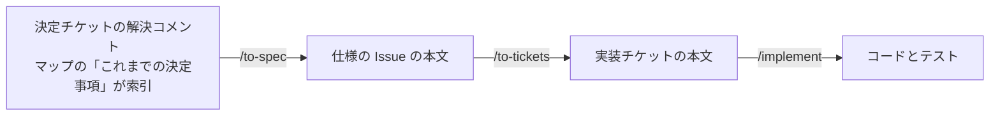

# 決定の置き場

決定は、mattpocock/skills の流れに沿って置き場を移る。移った先が正本になり、元のものは経緯として残る。

- 1つの決定は1か所にだけ書き、ほかからは指す
- 決定チケットの解決コメント（解決のあとの追記を含む）は、仕様にするまでの決定の正本。あとのチケットで変わった決定は、新しいチケットの解決コメントに書き、元のチケットに置き換えたチケットを指すコメントを1行足し、マップの索引の行を新しいほうへ向ける
- `/to-spec` で仕様の Issue を作ったら、マップの「仕様」の節の、その仕様の行に `#<番号>` を足す。マップを閉じる時機は、マップの目的地にある
- 仕様の Issue と実装チケットの本文は、決定が変わったら本文を直す
- 実装した PR で、あとのチケットに頼むこと（申し送り）ができたら、そのチケットの本文の「前の PR からの申し送り」の節に、PR を指して足す。PR は書き換えない記録で、あとのチケットを実装するエージェントは、チケットの本文から読み始めるため
- コードとテストは、実装した決定の正本。実装した PR で、実装とテストで読める決定を文書から消す（`AGENTS.md` と `docs/agents/` の働き方、コードから読めない理由、見た目のトークン、コードの外で確かめることは残す）
- `docs/ui-design/`（凍結済みの設計記録）は、画面の決定の、仕様にするまでの正本。`/to-spec` は、マップの目的地が指す設計記録の `index.md` の「実装はここから読む」も読む
- ADR（`docs/adr/`）には、覆しにくく、理由がないと驚かれる決定だけを書く。使う技術では、ロックインのあるものだけ。題は決定を言い切る形にし、ファイルの一覧を索引にする。書き方の好みは `docs/agents/domain.md` の「ADR に書くこと」。ほかのライブラリと道具は、実装したあとは依存の宣言（`package.json`、`Package.swift`、`wrangler.jsonc` など）が正本で、実装するまでは解決コメントに置く
- `AGENTS.md`（ルート、`ios/`、`server/`）には、そこでどう働くか（層と置き場、確かめる手順、機能をまたいでかかる守りごと）だけを書く。仕様の中身（振る舞い、計算の決まり、係数）と、技術を選んだ理由と比べた案は置かない。使う技術は、そこでの働き方に要る分だけ書く
- 一部の作業でだけ要る働き方は `docs/agents/` の文書に書き、`AGENTS.md` には「〜するときは `<文書>` を読む」の1行を残す
- `DESIGN.md` には、見た目（色・形・大きさ・文字・余白）と、見た目に効く禁止事項だけを書く。状態・文言・条件・操作の結果は、仕様の Issue とコード（とテスト）に置き、`DESIGN.md` に写さない
- 用語は `GLOSSARY.md`、見た目のトークンとガードレールは `DESIGN.md`、好みは `CODING_STANDARDS.md` から指す `docs/agents/` の文書、`AGENTS.md` から指す働き方は `docs/agents/`
- あとから書き換えない記録: 解決コメント、ADR、PR、コミットメッセージ、`docs/research/`（日付つきの調査）、`docs/ui-design/`。これらどうしが食い違うときは、新しいほうに従う（ADR と、あとの決定チケットの追記が食い違うときも）
- 書き換えない記録や、Issue・PR のコメントが指す `AGENTS.md` の節や、その中の記述が見つからないときは、移し先の表を見る。2026-09-26 に仕様の中身と技術の選択を決定チケットへ移したときの表は「[決定の置き場を Matt の流れに合わせる](https://github.com/gn-t-k/nu-tori/issues/51)」の解決コメント、2026-09-29 に一部の作業でだけ要る働き方を `docs/agents/` へ移したときの表は「[AGENTS.md を整理する](https://github.com/gn-t-k/nu-tori/issues/92)」の解決コメントにある。2026-10-28 に `server/AGENTS.md` の一部の作業でだけ要る節を `docs/agents/server-*.md` と `docs/agents/table-design.md` へ移したときの表は、「[server/AGENTS.md が約60KBあり、server を触るたびに読む出力が大きすぎて退避される](https://github.com/gn-t-k/nu-tori/issues/795#issuecomment-6459443001)」のコメントにある。2026-11-11 に `docs/agents/git.md` の「PR の前のレビュー」と「動かして確かめる」を `docs/agents/review.md` へ移したときの表は、「[レビューと検査の一覧を1つの文書に置き、何にかかるかの正本にする](https://github.com/gn-t-k/nu-tori/issues/988)」の解決コメントにある
- 用語集は、2026-09-30 に mattpocock/skills に合わせて `CONTEXT.md` から `GLOSSARY.md` に改名した。それより前の記録が指す `CONTEXT.md` は `GLOSSARY.md` と読む

## 置き場の観点

文書の照合（`docs/agents/review.md`）と、工程のゲートでの新しい文脈のレビュー（`docs/agents/gate-review.md`）が、文書をこの観点で照らす。

- 1つの決定を、ほかから指さずに2か所に書いている（上の「1つの決定は1か所にだけ書き」）
- 置き換わった決定を、今の決定として指している

## 試作の置き場

- `/prototype` の試作は、試作だけのブランチのリポジトリ直下の `prototype/<Issue の番号>-<題>/` に置く。`<題>` は英小文字をハイフンでつなぐ。ブランチは PR にせず、main に入れない。main には確かめた決定だけを残し、試作は一次資料としてブランチに残すため
- ブランチは、Mac では `prototype/<Issue の番号>-<題>`、クラウドでは試作のセッションに割り当てられた `claude/...` にする。クラウドでは、同じセッションで実装の PR を出さない。PR を merge するとそのセッションのブランチが消え、試作も消えるため
- `docs/ui-design/`（凍結済み）、`site/`・`ios/`・`server/` の下、Claude Docs には置かない。アプリやページの部品を使う試作も、`prototype/<Issue の番号>-<題>/` から相対パスで読む。`/prototype` スキルの置き場（`.agents/skills/prototype/SKILL.md` の "close to where it will actually be used"、`UI.md` の sub-shape A・B）より、この置き場を優先する
- 作った HTML は Artifact（claude.ai の非公開のページ）にも載せ、そのリンクと、ブランチとパスを Issue のコメントに書く。開発者が iPad の Claude アプリで開いて見比べるため。正本はブランチのファイルで、直したら同じページに載せ直す
- ブランチに置いた試作を探すときは、Issue のコメントにあるブランチとパスから読む。実機で比べる試作の探し方は、下の「アプリの見た目と動きを実機で比べる試作」
- この決まりより前の `prototype/0001-*` のブランチの `0001` は、Issue の番号ではなく `docs/ui-design/0001-first-release` の番号で、試作は `docs/ui-design/0001-first-release/` や `prototype/` の下にある

**Why:** 置き場が `docs/ui-design/`・`site/` の下・ブランチ・Claude Docs にばらけ、試作を探して grep とブランチの探索を約8回した。凍結済みの `docs/ui-design/` に試作を置いたこともあった（#744、#796）

### アプリの見た目と動きを実機で比べる試作

アプリの見た目と動きのうち、実機で触らないと決められないもの（打ちながら見る動き、指で動かすもの）の試作は、上の置き場の例外にして、main の `ios/` に入れ、TestFlight の版で比べる。`/prototype` スキルの、試作を main の外のブランチに残す決まり（`SKILL.md` の「Rules that apply to both」の 6、`UI.md` の「6. Capture the answer and clean up」）より、この節を優先する。

- 案は本番の画面の中に入れ、切り替えで選べるようにする。試作ごとに、案と切り替えを `ios/NuTori/Trial/` の1つのファイルに置き、画面のコードからはそこを読むだけにする
- 切り替えは TestFlight の版でだけ出す。出すかは `ios/NuTori/Trial/TrialBuild.swift` で決め、このファイルは試作が無いあいだも残す。App Store の版とデバッグビルドでは出さず、今の見た目のまま動く
- 試作を入れる PR は、比べる問いの Issue に結びつけ、Issue を閉じない。Issue のコメントには、試作を入れた PR と、案と、TestFlight のどこで切り替えるかを書く
- 今ある試作は、`ios/NuTori/Trial/` の `TrialBuild.swift` のほかのファイルから探す
- 決めたら、決めた案だけを本番のコードに残し、切り替えと没の案を消す PR を出す。Issue の解決コメントに、判定と何を決めたかを書く。一次資料は、試作を入れた PR とその Issue にする
- `ios/NuTori/Trial/` に `TrialBuild.swift` のほかのファイルが残っているあいだは、App Store に出さない（`docs/agents/ios-release.md` の「出すビルドを確かめる」）

**Why:** デバッグビルドは Mac につないだ iPhone にしか入らず、開発者が出先で試作を触れなかった。TestFlight に届くのは main のコードだけなので、試作を main に入れる。TestFlight の版と App Store の版は同じビルドで、試作が残ったまま出すと、隠れた切り替えが審査に出る（App Store Review Guidelines 2.3.1）ため、出す前に片づける（#1133）
