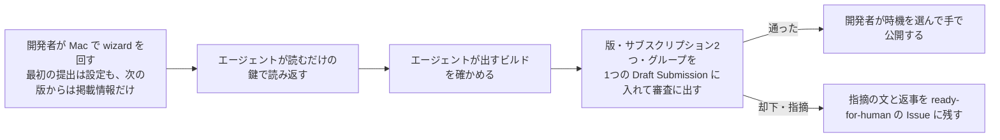

# iOS のアプリの配布と実機の確認

## 配布

- Xcode Cloud のワークフローは「main から内部テスト」の1つ。枠（月 25 時間）に収めるため、main の `ios/` が変わったとき（と手で始めたとき）だけ動かし、アクションは Archive（Distribution Preparation は App Store Connect。外部テストと App Store に出せるのはこれだけ）だけにする。配る先は内部テストのグループ「初回リリーステストユーザーグループ」。設定は Xcode の Report navigator の Cloud のタブで直す
- Xcode Cloud の秘密の値は、ワークフローの Environment に Secret で置く。アーカイブのあとに `ios/ci_scripts/ci_post_xcodebuild.sh` が dSYM を Sentry に上げ、`SENTRY_AUTH_TOKEN`（Sentry の組織のトークン）が無ければ飛ばす

## スクリーンショット

掲載情報と LP の手順の絵に使う生の画面（見本の場面を撮った、枠も見出しも無い画面）は、撮る入口 `scripts/check ios-screenshots` で撮る。見本の場面の決まりは `ios/AGENTS.md` の「見本の場面」。

- 撮る入口は、アプリをビルドし、6.9 インチ（1320×2868）の決めた1つの機種（`scripts/check` の `screenshot_device_type`。合成の枠と同じ機種にし、無ければ止まる）のシミュレーターを作って、状態の表示を 9:41・電波と Wi-Fi と電池が満ちた形に、明るい表示と既定の文字の大きさに固めてから、UI テストの `ListingScreenshots` だけを回す。撮った画面は `ios/.build/listing-screens/<場面>.png` に書き出す（大きさが 1320×2868 でなければ落ちる）。ふつうの UI テストの回（`scripts/check ios-ui-test`）は `ListingScreenshots` を除く
- 画面を変えたら撮り直す。Mac のセッションは手元で `scripts/check ios-screenshots` を回してよい。クラウドのセッションは、撮るワークフローを回して成果物を落とす

  ```bash
  gh workflow run ios-ui-test.yml --ref <ブランチ> -f target=ios-screenshots
  gh run list --workflow ios-ui-test.yml --branch <ブランチ> --limit 1
  gh run download <回の ID> --name listing-raw-screens --dir <置き場>
  ```

  撮るワークフローは `ios-ui-test.yml` の `target` の入力で、ブランチの上で回せる（既定のブランチに無いワークフローは手で始められないため、ファイルを分けない）。成果物 `listing-raw-screens` は7日で消える
- 生の画面はリポジトリに置かない。合成の結果だけを置く

### medium の大きさで上げる

App Store Connect の版のページの iPhone の欄は「iPhone with Dynamic Island (medium display)」の1つだけで、1179×2556 と 1206×2622（と横向き）しか受け付けない（2026-11-04 に画面で確かめた。6.9 インチの欄は無かった）。上げるのは、合成のコマンドが掲載用の画像を 1206×2622 に縮めて書き出す `site/src/app-store-screenshot-images/medium/01〜05.png` で、この順に上げる。撮り直しと合成の作り直しはしない（縦横の比が 6.9 インチとほぼ同じで、縮めた高さの差は2ピクセルに満たない。`site/AGENTS.md` の「合成する」）。確かめる前の経緯は #867 の解決コメントの3

## App Store に出す

App Store Connect の画面の名前は英語のまま書く（`docs/agents/tooling.md` の「App Store Connect を読む」）。

審査に出すのは、アプリの版と、最初のサブスクリプション2つ（月額・年額）とそのサブスクリプショングループを一緒に。最初のサブスクリプションとそのグループは、アプリの版と一緒にしか出せない。決めた経緯は「[仕様: App Store の掲載と提出](https://github.com/gn-t-k/nu-tori/issues/853)」の「審査に出す」。



### 掲載情報と設定を入れる

エージェントの App Store Connect の鍵は読むだけ（`docs/agents/tooling.md` の「App Store Connect を読む」）なので、入れるのは開発者。

- 最初の提出（#863）は、掲載情報と、一度入れれば変わらない設定（App Information の Category・Content Rights・Age Rating、App Privacy、Pricing and Availability、Copyright、App Review Information、App Store Version Release）を、1回だけ回す wizard で入れる。main には置かず、PR #893 のコミット `d5c0222` に残してある。main の最新の作業ツリーで `git show d5c0222:scripts/app-store-connect-first-submission-wizard > /tmp/first-submission-wizard && bash /tmp/first-submission-wizard` と回す。入れる前に、本番の値（最低バージョン、LLM の費用の上限、App Store のサーバー通知の URL）が決めたとおりかを確かめ、外れていれば止まる
- 1回だけの wizard に写した答えの出どころは、App Privacy が「[App Privacy の回答の表を作る](https://github.com/gn-t-k/nu-tori/issues/861#issuecomment-6548836403)」の解決コメントの表、Age Rating が「[App Store の掲載情報を決める](https://github.com/gn-t-k/nu-tori/issues/597#issuecomment-6406051504)」の解決コメントの 12（Health or Wellness Topics だけが当たり、9+ になる）。あとで答えを変えるときは、wizard でなく出どころを読んで App Store Connect を直す
- 掲載情報を変えた版では、Mac で `scripts/app-store-connect-listing-wizard` を回す（`docs/agents/marketing.md` の「掲載情報の置き場と変える手順」）。掲載情報のモジュール（`site/src/app-store-connect-listing.ts`）の値を1欄ずつ入れる。入れる欄と順は wizard の段に従う。設定には触らない
- 「App Review Information」の「Sign-in required」を外すのは、この欄がデモアカウントを渡すためのものだから。nu-tori は Sign in with Apple だけで、デモアカウントを渡さない（#597 の解決コメントの 13）。審査の人は自分の Apple アカウントでサインインし、その道は App Review Information の「Notes」（掲載情報のモジュールの `reviewNotes`。wizard が入れる）に書く
- Content Rights で、第三者のコンテンツを含み、使う権利があると答えるのは、日本食品標準成分表の値を見せるから。その利用に許諾は要らない（`docs/research/launch-legal-checks.md` の問い3）。画面の選択肢の英語の文言は記録していないので、次に開いたときにここへ書き足す
- 著作権の欄の氏名と、App Review の連絡先は、リポジトリにも Issue・PR にも書かない

### 読み返す

開発者が入れたら、エージェントが `scripts/app-store-connect get '<パス>'` で読み、`site/` で `node src/app-store-connect-listing-command.ts json` が出す値と突き合わせる（`<app>` は `6816842705`）。

- App 情報: `/v1/apps/<app>/appInfos` のうち状態が `PREPARE_FOR_SUBMISSION` のものの ID で、`/v1/appInfos/<id>/appInfoLocalizations`（`ja` の名前・サブタイトル・プライバシーポリシーの URL）、`/v1/appInfos/<id>/primaryCategory`（`HEALTH_AND_FITNESS`）、`/v1/appInfos/<id>/ageRatingDeclaration`（`healthOrWellnessTopics` だけが当たり、ほかは無し）と、`appInfos` の `appStoreAgeRating`
- 版: `/v1/apps/<app>/appStoreVersions` のうち状態が `PREPARE_FOR_SUBMISSION` のものの ID で、その版の `copyright`（「2026 」で始まるかだけを見る）と `releaseType`（`MANUAL`）、`/v1/appStoreVersions/<id>/appStoreVersionLocalizations`（`ja` のプロモーション用テキスト・説明文・キーワード・サポートとマーケティングの URL）、`/v1/appStoreVersions/<id>/appStoreReviewDetail`（`demoAccountRequired` が `false`、メモ）。スクリーンショットは、その版の `ja` の地域化の `appScreenshotSets` から、枚数と並びを見る
- 鍵で読めないもの: 価格と配信状況（`appAvailabilityV2` と `appPriceSchedule` は、役割 Developer の鍵では 403。2026-11-03 に確かめた）と、App のプライバシー（読む API が無い）。開発者が wizard の段で見たものを聞く
- 公開の Issue に書くのは、欄ごとの一致・不一致まで。著作権の氏名と連絡先は書かない。App のプライバシーの回答の表は、入れたチケットの解決コメントに残す（`docs/agents/privacy.md`）

### 出すビルドを確かめる

審査に出すたびに、主な流れを実機で通し直さない（アカウントを作り直すことを含む）。主な流れは機能ごとに UI テストとサーバーのテストで確かめ、Apple の部品（ヘルスケア、カメラ、通知、StoreKit、Sign in with Apple）とのつなぎ目は、下の「実機の確認」の時機の実機のチケットで確かめてある。審査に出す前に、エージェントが次を確かめ、出すビルドの番号と結果を出す作業の Issue に書く。

- 出すビルドが TestFlight の内部テストに配られている（`docs/agents/tooling.md` の「App Store Connect を読む」の、TestFlight に配られたか）
- main の `deploy.yml` の最後の回が success で、出すビルドの番号が main の `server/wrangler.jsonc` の本番の `MINIMUM_APP_BUILD` 以上
- `/v1/apps/<app>` の `subscriptionStatusUrl` と `subscriptionStatusUrlForSandbox` が、本番の routes（`server/wrangler.jsonc`）と通知の経路（`server/src/http/app-store-server-notification-routes/`）から組んだ URL を指し、`subscriptionStatusUrlVersion` と `subscriptionStatusUrlVersionForSandbox` が `V2`
- ページの一覧（`site/src/site-pages.ts`）の `kind` が `public` のページと `/` が、本番で 200 を返す
- 出すビルドで、Sentry の新しい課題と、TestFlight のクラッシュのフィードバックが無い
- LLM の費用の上限はエージェントから読めないので、Anthropic のワークスペース `nu-tori-production` の月の上限、知らせの額、前払いの自動の補充と支払い方法が、`docs/agents/production-incidents.md` の「費用の知らせ」のとおりかを開発者に聞く

**Why:** 審査に出すビルドで主な流れを全部、実機で通し直すチケット（#864）を切ったが、項目はどれも自動テストか機能ごとの実機のチケットで確かめてあり、出すたびにアカウントを作り直す手間に見合わなかった（#864 の解決コメントに、項目と確かめた場所の対応がある）

### 審査に出す

審査に出すものは、1つの Draft Submission（下書きの提出。画面の右下の「Draft Submissions」から開く）に集めてから、まとめて出す。版のページに、サブスクリプションを選ぶ欄は無い（2026-11-04 に画面で確かめた）。

1. 月額（`app.nu_tori.subscription.monthly`）と年額（`app.nu_tori.subscription.yearly`）の商品のページ（Monetization → Subscriptions → グループ「nu-tori」→ 商品）の「Review Information」の「Screenshot」に、課金画面の画像を上げて「Save」を押し、「Add for Review」で Draft Submission に入れる。画像は、版のスクリーンショットと同じく medium の大きさ（1206×2622 など）でないと受け付けない。テストユーザーのアカウントは課金画面を開けないので、開発用のサーバーにつないだデバッグビルドで撮る（#718）
2. Subscriptions のページで「Edit」を押し、グループ「nu-tori」を選んで「Add for Review」で同じ Draft Submission に入れる（Apple の「[Submit an In-App Purchase](https://developer.apple.com/help/app-store-connect/manage-submissions-to-app-review/submit-an-in-app-purchase/)」）。グループが入っていないと、Draft Submission に「Your auto-renewable subscription must be submitted with its subscription group」と出て出せない
3. 版のページで「Build」に上の「出すビルドを確かめる」で確かめたビルドを付け、「Add for Review」で同じ Draft Submission に入れる
4. Draft Submission で、版・サブスクリプション・グループがそろっていることを見て「Submit for Review」を押す

- 4 の前後で、そろったかをエージェントが読む: `/v1/reviewSubmissions?filter[app]=<app>` で提出の ID と状態を取り、`/v1/reviewSubmissions/<id>/items` で中身の数と状態を読む。そろうと、中身が4つ（版1・サブスクリプション2・グループ1）で、どれも `READY_FOR_REVIEW` になる（2026-11-04 に確かめた）。中身のどれが何かは、この鍵では読めない
- リリースは「Manually release this version」。審査が通ったら、開発者が LP を出す PR と時機をそろえて、手で公開する
- 版が審査に通ったら、そのあと初めて `ios/` を変える PR で版の番号（`ios/NuTori.xcodeproj/project.pbxproj` の `MARKETING_VERSION`。3つのターゲットのすべての構成）を上げる。通った版の番号のままのビルドは、App Store Connect が ITMS-90186（その版の列は閉じた）と ITMS-90062（`CFBundleShortVersionString` が通った版より大きくない）で断り、TestFlight にも届かない（ビルド 138。1.0 が通ったあと）。番号は、直しだけなら3つ目、機能を足したら2つ目を上げる。上げ忘れは、PR の CI の `ios-version`（`scripts/check-app-version`）が落ちて知らせる
- 審査で却下・指摘されたら、指摘の文と返事を `ready-for-human` の Issue に残す。掲載情報かアプリを直すなら、その Issue からチケットを切る

### 審査の人への返事の下書き

審査で「サブスクリプション切れの状態を見せて」と指摘されたら、アカウントを削除して同じ Apple ID でサインインし直すよう返事で案内する。作り直したアカウントは無料体験が無く、最初からサブスクリプション切れになる（「[仕様: 課金](https://github.com/gn-t-k/nu-tori/issues/647)」の作り直したアカウント）。コードと管理の口は足さず、テストユーザー（`test_users`）は使わない（いつもサブスクリプション中と同じに扱う旗で、切れの状態を作れない）。この道は、サーバーのテスト（作り直したアカウントに無料体験の無い状態が届くこと）と UI テスト（`SubscribeFromComposerChipAfterFreeTrialUITests`）と、課金の実機のチケット（#686）で確かめてある。

審査の人とのやりとりは英語なので、英語で書く。アプリの文言は日本語のまま引き、英語の訳を添える。審査へのメモ（掲載情報のモジュールの `reviewNotes`）と道の書き方をそろえ、どちらかを直したらもう一方も直す。

```text
Thank you for reviewing nu-tori.

nu-tori uses Sign in with Apple only, and a new account starts a 30-day free trial. You can see the app with an expired subscription by deleting your account and signing in again with the same Apple Account:

1. Tap the person icon at the top right of the timeline to open the Account screen (アカウント).
2. Tap "アカウントを削除" (Delete Account) at the bottom of the screen, and confirm.
3. Sign in again with the same Apple Account.

The free trial is available only once per Apple Account, so the new account starts without a free trial, with an expired subscription. The timeline shows the notice "無料体験はありません" (No free trial), and the message field cannot be used.

4. To reach the purchase screen, tap "撮って記録するには、サブスクリプションが必要です" (A subscription is required to record with photos) above the message field, or tap "サブスクリプション" at the top of the Account screen. Our production server accepts Sandbox purchases.
```

## 実機の確認

エージェントには実機を操作する道が無いので、人が確かめる。

- 確かめるのは、ヘルスケア、カメラ、通知、写真の読み込みに触れた PR をマージしたあとと、外部テストに出す前。確かめる項目は、実機のチケット（`docs/agents/issue-tracker.md` の「iOS のチケットの分け方」）に、どこを押して何が見えれば合格かの形で並べる。チケットの無い PR では、PR の本文に「実機の確認が要る」と書いて並べる
- ヘルスケアは、「[ヘルスケアの読み書きの対応表](https://github.com/gn-t-k/nu-tori/issues/27)」の追記の「実機で確かめるまで見込みのもの」に加えて、他のアプリの当日の体重で通知が取り消されることを確かめる。nu-tori を閉じてヘルスケアアプリで体重を手入力すると、その日の体重の通知が取り消され、開くと体重のボタンが目立たない。MacroFactor で入れても同じになる
- 栄養は、ヘルスケアアプリに nu-tori の食品の組として入っていれば合格にする。MacroFactor・FoodNoms が取り込むかは確かめない。どちらも取り込み方がアプリ側の決まりに左右される（MacroFactor は日の合計を Nutrition のページにだけ出し、その日に MacroFactor で記録があると取り込まない。`docs/research/healthkit-foodnoms-macrofactor.md`）

## クラッシュを調べる

クラッシュの知らせ（TestFlight の「クラッシュしました」、Sentry の新しいエラー、問い合わせ）を受けたら、次の順にクラッシュログを探す。

1. Sentry: `scripts/sentry` で課題を探し、スタック・版・OS・件数を読む（使い方は `docs/agents/tooling.md` の「Sentry を読む」）。クラッシュは、落ちた次にアプリを開いたときに送られる
2. 開発者の iPhone が Mac につながっているとき: 端末のクラッシュログを直接取る。Sentry に届く前でも読める

   ```bash
   xcrun devicectl list devices
   xcrun devicectl device info files -d <UDID> --domain-type systemCrashLogs | grep -i nutori
   xcrun devicectl device copy from -d <UDID> --domain-type systemCrashLogs --source <パス> --destination <置き場>
   ```

   `.ips` は1行目が要約の JSON、2行目からが本体の JSON。本体の `faultingThread` の `frames` と、スレッドの `queue` を読む
3. 一般の利用者で Sentry に無いとき: 利用者に、設定 → プライバシーとセキュリティ → 解析と改善 → 解析データ から `NuTori-*.ips` を共有してもらう。App Store Connect のクラッシュ（「App デベロッパと共有」をオンにした人の分）も見る。TestFlight のテスターがクラッシュのときに送ったフィードバックとログは、`scripts/app-store-connect` で読める

原因が分かったら直す PR を出す。シミュレーターで確かめられないもの（バックグラウンドの起動など）は、このファイルの「実機の確認」に従い、確かめる手順と合格の条件を `ready-for-human` の Issue に書けば、PR は実機の確認を待たずにマージしてよい。手順は、TestFlight の版をふつうに使ったあとに、エージェントが 2 のクラッシュログを見れば済む形を先に考える。

## 古いビルドの締め出し

サーバーは、最低バージョン（受け付けるいちばん古いアプリのビルド番号。本番の `server/wrangler.jsonc` の `vars` の `MINIMUM_APP_BUILD`）より古いビルドの要求を 426 で断り、アプリは締め出しの画面を出す。開発用の環境は最低バージョンを持たず、締め出さない。仕組みの正本は「[強制アップデートの仕様（#223）](https://github.com/gn-t-k/nu-tori/issues/223)」。

### 締め出すかの線引き

古い版で困ったことが起きたら、次の順で決める。

1. サーバーの値で止められるなら、サーバーの応答で止める
2. 止められず、データか安全を損なうなら、締め出す。損なうものは、記録を壊す書き込み、脆弱性、API を古い形のまま残せない変更
3. それ以外は、直した版を出して自動アップデートを待つ

### 最低バージョンを上げる手順

- 上げるのは、上げた先の版を配り終えてから。App Store なら公開したあと、TestFlight なら使えるようになったあと。配り終えたかは `scripts/app-store-connect` で TestFlight のビルドの状態を読んで確かめる（`docs/agents/tooling.md` の「App Store Connect を読む」）。App Store に公開したかは App Store Connect を手で見て確かめる
- 上げる値は、締め出したい版の次の、配り終えた版のビルド番号
- `MINIMUM_APP_BUILD` を直す PR を出し、マージしてデプロイすると効く。PR の本文に、なぜ上げるか（線引きのどれに当たるか）を書く
- 下げれば締め出しは解ける。締め出された端末は、次に開いたときか前に出たときの同期の要求で解ける
