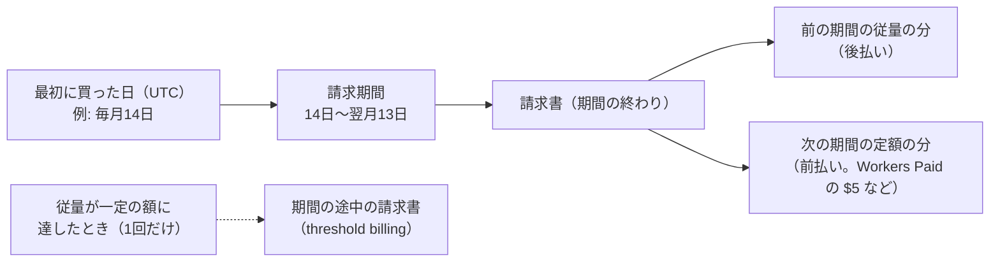
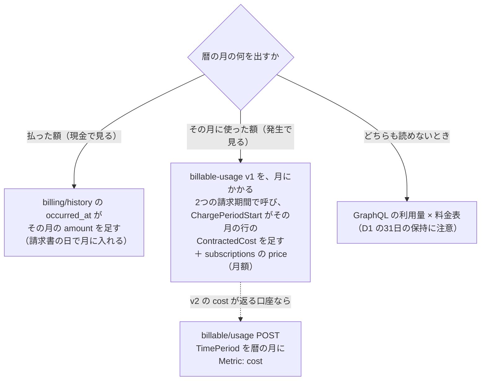

# 月1回の定期のタスクが、Anthropic と Cloudflare の利用額を API で読む

調査日: 2026-10-27
対象: Issue #758「調査: Anthropic と Cloudflare の利用額を読む API」。親は #591「お金の数字を追えるようにする」で、決定は[解決コメント](https://github.com/gn-t-k/nu-tori/issues/591#issuecomment-6405078077)。毎月3日に動く定期のタスク（Claude Code on the web のクラウドのセッション）が、前の暦の月の Anthropic（本番のワークスペース `nu-tori-production`）と Cloudflare（アカウント）の利用額を読む道を、一次情報で集める。決定はしない。App Store Connect の販売レポートとダッシュボードの作り方は扱わない。

> **確認の方法と限界**
> - Anthropic は platform.claude.com の Markdown 版（`<ページ>.md`。docs.claude.com と docs.anthropic.com の URL はここへ転送される）を読んだ: Usage and Cost API のガイド、Admin API、Admin API キー、認証（鍵の種類）、Workload Identity Federation とその参照、API リファレンスの Get Cost Report・Get Messages Usage Report。役割は support.claude.com の記事を読んだ（いずれも 2026-10-27）。
> - Cloudflare は developers.cloudflare.com の Markdown 版（`<ページ>/index.md`）と API リファレンス（`/api/resources/...`）を読み、各エンドポイントの受け付けるトークンの権限・廃止の印・プランは、Cloudflare の公式の OpenAPI（cloudflare/api-schemas、`e2b8c60`、2026-10-27 に取得）の `x-api-token-group`・`x-cfPermissionsRequired`・`x-fern-availability`・`deprecated` で確かめた。
> - Claude Code on the web は code.claude.com/docs の Markdown 版（cloud-environments、routines）を読んだ。
> - 本文で確かめた主張は「本文で確認」と書き、短い英語の原文を添える。OpenAPI で確かめたものは「ソースで確認」と書く（次の版で変わりうるので、文書の約束より弱い）。本文やソースから推し量ったものは「本文からの読み取り」、探しても記述が無かったものは「本文を探したが記述なし」と書く。
> - **どちらのアカウントでも何も動かしていない**（鍵もトークンも作っていない）。この調査のセッションから、鍵なしで `GET https://api.anthropic.com/v1/organizations/cost_report` が 401（`x-api-key header is required`）を、`GET https://api.cloudflare.com/client/v4/accounts/0/billing/history` が 404（ID が不正）を返すことだけ確かめた（「観察」と書く）。届くことの確かめで、応答の中身は見ていない。二次情報（ブログ、記事）は使っていない。

## 結論の要約

- **1. Anthropic: 読める。** `GET /v1/organizations/cost_report` が、日ごとの利用額（ドル。値はセント単位の10進の文字列）を返す。`group_by[]=workspace_id` でワークスペースごとに分かれる。**絞り込みの `workspace_ids` は cost_report に無い**ので、返ったものから `nu-tori-production` の ID の行を取る（`usage_report/messages` には `workspace_ids` がある）。日の区切りは UTC、1回に31日まで（暦の月は1ページに収まる）。データは「typically within 5 minutes」で出る。**何か月さかのぼれるか、いつ確定するかは書かれていない**。鍵は **Admin API キー**（`sk-ant-admin01-...`、役割 admin の人だけが作れる）か、ワークスペースに絞らない個人・サービスアカウントのキー（リンク先の人の権限で動く）（本文で確認）。
- **2. Cloudflare: 読める。ただし Cloudflare の請求は暦の月でなく、最初に買った日を起点にした 30 日の請求期間で回る**（本文で確認）。口は3つ:
  - `GET /accounts/{id}/billing/history`: 請求の出来事（金額・通貨・`occurred_at`・種類）。**`Billing Read`** で読める。廃止の印は無い。**`/user/billing/history` は廃止**（`deprecated: true`）（ソースで確認）
  - `GET /accounts/{id}/billable-usage`（Version 1, Alpha）: 従量の分の、FOCUS に沿った行（`ContractedCost`・`ChargePeriodStart`・`ServiceName` など）。**問い合わせの範囲に請求期間の起点の日が入っていないと何も返らない**。固定の月額（Workers Paid の $5）は入らない。ほかに `POST /accounts/{id}/billable/usage`（Version 2, Alpha, Restricted）は、使った日で31日まで自由に区切れ、`Metric: "cost"` で金額を返すが、「Restricted」の意味と、金額が空で返る条件がある（ソースで確認）
  - 料金表と GraphQL の利用量から計算する道もあるが、**D1 は31日しか残らない**ので、3日に前の月の初めの数日を読めないことがある。含まれる量の区切りも請求期間なので、暦の月で計算すると合わない（本文で確認、計算が合わないのは本文からの読み取り）
- **3. 読むだけの鍵**: **Cloudflare はできる**（アカウントのトークンに `Billing Read` を足す。読むだけの権限で、アカウントのトークンでも使える。本文で確認）。ただし `Billing Read` は請求先の住所・支払い方法の情報（billing profile）も読めるので、スクリプトが呼ぶ口を絞る。**Anthropic はできない**: Console で作る Admin API キーは「do not have selectable scopes; every key carries full access」で、メンバーの削除・招待、ワークスペースの作成と保管、**API キーの無効化**までできる（本文で確認）。GET だけを送るスクリプト（`scripts/app-store-connect` と同じ形）で呼ぶ側を絞り、**鍵をこのタスク専用の環境にだけ置き、期限を付ける**のが、とれる中でいちばん狭い（本文からの読み取り）。
- **4. クラウドのセッションから届くか**: **`api.anthropic.com` は Trusted の既定の一覧にある**。**`api.cloudflare.com` は無い**ので、Custom にして足すか、ネットの秘密（network secret）の宛先にする（本文で確認）。**`api.anthropic.com` にはネットの秘密が付かない**（"The agent proxy never attaches a secret you add to these requests: ... `api.anthropic.com`"）ので、Admin API キーは環境変数に置くしかなく、その環境を使う人は誰でも読める（本文で確認）。この調査のセッションからは両方に届いた（観察）。

## 問い1: Anthropic の、暦の月ごとの利用額

### 口と引数

| 問い | 答え | 確かさ | 出典 |
|---|---|---|---|
| 使う口 | `GET https://api.anthropic.com/v1/organizations/cost_report`（"Retrieve service-level cost breakdowns in USD"）。Console の Cost のページと同じ種類のデータ（"similar to the information available on the Usage ... and the Cost page"） | 本文で確認 | A1、A5 |
| 引数 | `starting_at`（必須、RFC 3339）、`ending_at`、`bucket_width`（`1d` だけ）、`group_by[]`（`workspace_id`・`description`）、`limit`（既定 7、最大 31）、`page`（前の応答の `next_page`） | 本文で確認 | A5 |
| ワークスペースで絞れるか | cost_report の引数に `workspace_ids` は無く、`group_by[]=workspace_id` で分けるだけ。返る行の `workspace_id` は、既定のワークスペースなら `null`（"Usage and costs attributed to the default workspace have a `null` value for `workspace_id`."） | 本文で確認 | A1、A5 |
| ワークスペースの ID | `GET /v1/organizations/workspaces`（List Workspaces）か Console で調べる | 本文で確認 | A1 |
| 返る値 | `data[]`（日ごとの箱、古い順。使わなかった日も空の `results` で入る）の `results[].amount` は "Cost amount in lowest currency units (e.g. cents) as a decimal string. For example, `"123.45"` in `"USD"` represents `$1.23`."。`currency` は今は常に `USD`。`group_by[]=description` で `model`・`token_type`・`cost_type`（`tokens`・`web_search`・`code_execution`・`session_usage`）が付く | 本文で確認 | A5 |
| 入らないもの | Priority Tier の費用（"Priority Tier costs use a different billing model and are not included in the cost endpoint."） | 本文で確認 | A1 |
| 日の区切り | 箱は UTC の日の始まりに揃う（"Each time bucket will be snapped to the start of the minute/hour/day in UTC."）。JST の暦の月ぴったりには切れない | 前半は本文で確認、後半は本文からの読み取り | A5 |
| 1か月を1回で | `bucket_width=1d` で `limit` は最大 31 なので、暦の月は1ページに入る。`group_by` で行が増えても、`limit` は箱の数（"Maximum number of time buckets"）。`has_more` が `true` なら `page` でたどる | 本文で確認 | A1、A5 |
| `ending_at` の端 | "Time buckets that end before this RFC 3339 timestamp will be returned." とある。ガイドの例は `starting_at=2025-01-08`・`ending_at=2025-01-15` を「the last 7 days」と呼ぶので、翌月1日の 0 時を渡せば月末の日まで入るとみられる | 原文は本文で確認、端の扱いは本文からの読み取り | A1、A5 |
| 使用量の口（参考） | `GET /v1/organizations/usage_report/messages` はトークン数を返し、`workspace_ids[]` で絞れる。`bucket_width` は `1m`・`1h`・`1d`（`1d` は最大 31）。金額は無い | 本文で確認 | A1、A6 |
| リファレンスの置き場 | 2つのリファレンスは `api/beta/organization/...` の下にあり、索引では「(Beta)」と付く。ガイドの例は `anthropic-beta` ヘッダーを付けずに `anthropic-version: 2023-06-01` で呼ぶ | 本文で確認 | A1、A5、A0 |

### 遅れ、さかのぼれる長さ

| 問い | 答え | 確かさ | 出典 |
|---|---|---|---|
| 出るまでの遅れ | "Usage and cost data typically appears within 5 minutes of API request completion, though delays might occasionally be longer." | 本文で確認 | A1 |
| 確定するまで（あとから直るか） | 書かれていない。毎月3日に前の月を読むので、2日以上の間がある | 本文を探したが記述なし（A1、A5）。間は本文からの読み取り | — |
| 何か月さかのぼれるか | 書かれていない。"historical API usage and cost data" とだけある。Console の Cost のページは月を選べる | 本文を探したが記述なし（A1、A5、A7） | A1、A7 |
| 呼ぶ頻度 | "The API supports polling once per minute for sustained use." | 本文で確認 | A1 |
| 支払いとの関係 | Console の組織は、多くが前払いのクレジット（"Most organizations pay with prepaid usage credits."）。cost_report は使った額で、クレジットを買った額ではない。税がどちらに入るかは書かれていない | 前半は本文で確認、後半は本文を探したが記述なし | A8、A1 |

### 鍵の種類と権限

| 問い | 答え | 確かさ | 出典 |
|---|---|---|---|
| 受け付ける鍵 | "You can access them using an Admin API key, an OAuth token with the `org:admin` scope, or a personal or service account key that isn't scoped to a workspace; workspace API keys don't work." | 本文で確認 | A1 |
| Admin API キー | Console の Admin keys のページで作る、`sk-ant-admin01-...`。作れるのは役割 admin のメンバーだけ。"Claude Console keys do not have selectable scopes; every key carries full access to all endpoints that accept Admin API keys" | 本文で確認 | A3 |
| Admin API キーで何ができるか | メンバーの役割の変更と削除、招待、ワークスペースの作成と保管、ワークスペースのメンバー、API キーの読み取り・名前の変更・状態の変更（無効にする）。API キーを新しく作ることはできない（"The Admin API can only read, rename, and change the status of existing keys."） | 本文で確認 | A2 |
| 個人のアカウントの組織 | "The Admin API is unavailable for individual accounts." | 本文で確認 | A1、A2 |
| 個人・サービスアカウントのキー | ワークスペースに絞らずに作れば Admin API に使え、"The key has the same permissions as the linked account."。サービスアカウントの `organization_role` は `developer` か `admin` | 本文で確認 | A2、A4、A10 |
| 役割ごとに利用額を見られるか（Console） | Usage と Cost は Developer・Billing・Admin が見られる。Billing は「Can view usage and cost data」、Developer は「Can manage API keys」もある | 本文で確認 | A7、A9 |
| `org:admin` の OAuth | `ant auth login --scope "org:admin"` の対話のトークンは短命（"Interactive tokens are short-lived."）。自動の仕事は Workload Identity Federation で、IdP が出す JWT を交換する。スコープは `workspace:developer`・`workspace:inference`・`workspace:manage_tunnels`・`org:admin` の4つで、"Finer-grained scopes (by resource, or read versus write) are not available." | 本文で確認 | A2、A10 |
| 期限 | Admin API キーも、作るときに期限を選べる（3時間・1日・7日・30日、任意の長さ、Never）。あとから変えられない。期限が近づくと作った人にメールが来る（14日以上のキーは7日前） | 本文で確認 | A3、A4 |

### 当てはめ（本文からの読み取り）

- 前の月の利用額 = `cost_report?starting_at=<前の月1日>T00:00:00Z&ending_at=<今月1日>T00:00:00Z&group_by[]=workspace_id&limit=31` の、`workspace_id` が `nu-tori-production` の ID の行の `amount` の合計 ÷ 100（ドル）。箱の数が前の月の日数と同じかを確かめる。
- 月の区切りは UTC にするのがよい。JST で切るなら `1d` の箱では切れない（`usage_report` の `1h` ならトークン数は切れるが、金額は出ない）。
- 本番の LLM 代の全部（#591 の「1人あたりの粗利」）には、`nu-tori-production` の行だけを使う。開発用のワークスペースの分は、固定費に入れるかを #591 の側で決める。

## 問い2: Cloudflare の、暦の月ごとの請求額

### 請求の回り方（暦の月とずれる）



| 問い | 答え | 確かさ | 出典 |
|---|---|---|---|
| 請求期間 | "Your billing period is 30 days for monthly plans"。起点は最初に買った日（"Your first paid purchase on a Cloudflare account sets the billing date for all future monthly subscriptions."、"All billing dates use UTC."） | 本文で確認 | C1、C2 |
| 請求書の中身 | "an invoice that includes both flat-rate charges for the upcoming period and usage-based charges for the period that just ended" | 本文で確認 | C1 |
| 期間の途中の請求 | 従量の合計が一定の額に達すると、期間の途中で1回だけ請求書が出る。期間の終わりの請求書は残りだけ。2つを足すと期間の従量の全部 | 本文で確認 | C3 |
| 含まれる量の区切り | "All included usage is on a monthly basis."。D1 は "Monthly included limits reset based on your monthly subscription renewal date" | 本文で確認 | C4 |
| 税 | 日本では Pay-as-you-go の顧客から 2024-04-01 以降に消費税を集める | 本文で確認 | C5 |

### 請求の口

| 口 | 返すもの | 権限 | 状態 | 出典 |
|---|---|---|---|---|
| `GET /accounts/{account_id}/billing/history` | 請求の出来事の一覧。`amount`・`amount_to_pay`・`currency`・`description`・`occurred_at`・`type`・`action`・`status`・`invoice_id`・`receipt_id`・`hosted_invoice_url`。引数は `page`・`per_page`・`status` だけで、期間で絞る引数は無い | `Billing Read`（か `Billing Write`）。`#billing:read` | 廃止の印なし。全プラン | ソースで確認（C10）、API リファレンス（C11） |
| `GET /user/billing/history` | 同じ種類（ユーザーの単位）。`occurred_at`・`type`・`action` で絞れる | 同上 | **`deprecated: true`**。リファレンスにも「Deprecated」 | ソースで確認（C10）、C12 |
| `GET /accounts/{account_id}/billable-usage`（Version 1, Alpha） | 従量の分の FOCUS の行。`ContractedCost`（PayGo では `BilledCost`・`EffectiveCost`・`ListCost` と同じ）、`CumulatedContractedCost`（請求期間の累計）、`ChargePeriodStart`・`ChargePeriodEnd`、`ConsumedQuantity`・`ConsumedUnit`、`ServiceFamilyName`・`ServiceName`、`BillingPeriodStart`（終わりの欄は無い）。引数は `from`・`to`（日付）で、"The provided time range must include the subscription billing cycle anchor day, otherwise no usage data is returned." 引数なしなら今の請求期間 | OpenAPI に権限の記載なし | `generally-available`、Enterprise では使えない（`x-cfPlanAvailability`） | ソースで確認（C10）、C13 |
| `GET /accounts/{account_id}/billable-usage/info`（Version 1, Alpha） | `covered`（使えるか）、`subscriptions[]` の `billing_cycle_anchor_timestamp`・`start_timestamp` | 同上 | 同上 | ソースで確認（C10） |
| `POST /accounts/{account_id}/billable/usage`（Version 2, Alpha, Restricted） | 使った日（charge period）で区切る。`TimePeriod.From`（含む）〜`To`（含まない）は31日まで。`Metric: "cost"` で金額の欄が入る。ただし "it is available only on `POST` account usage and only when the underlying usage data source is ClickHouse (other sources return an empty result set)"。書くのではなく "It is a read-only operation and requires only the `#billing:read` permission" | `#billing:read`（説明文） | `generally-available`。「Restricted」の意味は書かれていない | ソースで確認（C10）、C14 |
| `GET /accounts/{account_id}/billing/usage` | Stream・Images・Workers の要求・KV の読み取りなどの利用量の時系列。保持は約18か月。D1・R2・Durable Objects の指標は無い | `Billing Read` | `x-fern-availability: deprecated` | ソースで確認（C10） |
| `GET /accounts/{account_id}/subscriptions` | 定額の契約。`price`（ドル）・`frequency`・`current_period_start`・`current_period_end`・`state`・`rate_plan` | `Billing Read` | 廃止の印なし | ソースで確認（C10） |

- 名前に「Deprecated」と付くリファレンスのページ（`.../usage/methods/paygo`・`paygo_info`・`get`）は、SDK の古いメソッドの名前のこと（"Deprecated: Use `get_account_usage_v2` instead."）で、エンドポイントの廃止ではない（本文で確認、C15）。
- ダッシュボードの Billable Usage は「usage-based overage charges only. Fixed-fee plan subscriptions (for example, a Pro plan) are not included.」、「Usage data is aligned to your billing cycle, not the calendar month.」、「The total usage cost shown at the end of a completed billing period matches the usage overage charges on the corresponding invoice.」。Pay-as-you-go の口座だけで、Billing read の権限が要る（本文で確認、C6）。`billable-usage` の口は、このダッシュボードと同じ元とみられる（本文からの読み取り。名前と欄が同じ。同じだとは書かれていない）。

### 何か月さかのぼれるか

| 口 | 答え | 確かさ | 出典 |
|---|---|---|---|
| `billing/history` | 書かれていない。ダッシュボードの請求書は「For any historical invoices not included in the **Billing** section, contact Cloudflare support」 | 本文を探したが記述なし（C10、C11）、引用は本文で確認 | C7 |
| `billable-usage` v1 | 書かれていない。ダッシュボードは「Use the date picker to view a previous billing period.」 | 本文を探したが記述なし（C10、C13）、引用は本文で確認 | C6 |
| `billable/usage` v2 | 1回に31日まで。どこまで古い日を受けるかは書かれていない | 本文で確認、後半は本文を探したが記述なし | C10 |
| `billing/usage`（廃止の印つき） | "Data retention is approximately 18 months." | ソースで確認 | C10 |

### 請求額を読めないときの、利用量と料金表から計算する道

| 製品 | Workers Paid の料金（従量の分） | GraphQL のデータセット | 残る長さ | 出典 |
|---|---|---|---|---|
| 基本料 | 「a minimum charge of $5 USD per month for an account」 | — | — | C4 |
| Workers | 要求 1,000 万/月込み、+$0.30/100 万。CPU 3,000 万ミリ秒/月込み、+$0.02/100 万ミリ秒 | `workersInvocationsAdaptive`（`requests`・`cpuTime*`） | "up to one month of data for dates up to three months ago" | C4、C16 |
| D1 | 読んだ行 250 億/月込み +$0.001/100 万、書いた行 5,000 万/月込み +$1.00/100 万、保存 5 GB 込み +$0.75/GB-月 | `d1AnalyticsAdaptiveGroups`（`rowsRead`・`rowsWritten`）、`d1StorageAdaptiveGroups`（`databaseSizeBytes`） | **"Metrics can be queried (and are retained) for the past 31 days."** | C4、C17 |
| Durable Objects | 要求 100 万/月込み +$0.15/100 万、時間 40 万 GB 秒/月込み +$12.50/100 万 GB 秒。SQLite の行と保存は D1 と同じ量の込みで、保存は +$0.20/GB-月 | `durableObjectsInvocationsAdaptiveGroups`・`durableObjectsPeriodicGroups`・`durableObjectsStorageGroups`・`durableObjectsSubrequestsAdaptiveGroups`。欄は introspection で調べる（GB 秒と SQLite の行の欄の名前は書かれていない） | 書かれていない | C4、C18 |
| R2 | 保存 10 GB-月込み +$0.015/GB-月、Class A 100 万/月込み +$4.50/100 万、Class B 1,000 万/月込み +$0.36/100 万。転送は無料 | `r2OperationsAdaptiveGroups`・`r2StorageAdaptiveGroups` | 1回に31日まで。残る長さは書かれていない | C4、C19 |
| Workers Logs | 2026-12-01 から Cloudflare Observability の料金（量で数える） | — | — | C4 |

- GraphQL の権限は `Account Analytics Read`（"select *Account* ... *Account Analytics* ... *Read*"）で、今の読むだけのトークンにある（本文で確認、C20。トークンの今の権限は `docs/agents/tooling.md` の「Cloudflare を読む」）。
- 各データセットの正確な残る長さは、GraphQL の `settings` の `notOlderThan`（秒）で引ける。Adaptive のデータセットは「retain at least 31 days of data on every plan」（本文で確認、C21、C22）。
- **この道の弱いところ**（本文からの読み取り）:
  - 毎月3日に前の月を読むと、31日の月の1日はもう32日前で、D1 の31日の保持を越える。日ごとに取り溜めるか、読む日を早めないと、月の頭の数日が欠ける
  - 含まれる量は請求期間ごとにリセットされるので、暦の月で込みの量を引くと、実際の請求と合わない
  - Durable Objects の GB 秒、SQLite の行、R2 の Class A・B の分け方を、欄から組み立てる必要がある（欄の名前が文書に無い）
  - nu-tori の規模で込みの量に収まっていれば、従量の分は 0 で、月の額は基本料の $5 になる。収まっているかは確かめていない

### 暦の月に直す形（本文からの読み取り）



- `billing/history` は1か月に1件か2件（期間の終わりの請求書と、あれば期間の途中の請求書）になる見込みで、金額は税も含む請求書の額とみられる（税を含むかは書かれていない）。月によって、前の期間の従量と次の期間の定額が混ざる。
- `billable-usage` v1 の行が日ごとかは、v1 の説明に書かれていない（v2 は "Each record represents one billable metric for one account on one day."）。`ChargePeriodStart`・`ChargePeriodEnd` と `CumulatedContractedCost` の欄があるので、期間より細かい行とみられる。

## 問い3: 読むだけに絞った鍵

### Cloudflare

| 問い | 答え | 確かさ | 出典 |
|---|---|---|---|
| 読むだけの権限 | `Billing Read`: "Grants read access to billing profile, subscriptions, and access to fetch invoices and entitlements."。書くのは `Billing Write`（ユーザーのトークンでは `Billing Edit`） | 本文で確認 | C8 |
| アカウントのトークンで | 互換の表で Billing は ✅ | 本文で確認 | C9 |
| 文書の手順 | "API tokens used for billing endpoints require the `Billing Read` or `Billing Edit` permission." 手順は My Profile のユーザーのトークンで書かれているが、上の互換の表のとおりアカウントのトークンでもよい | 本文で確認、後半は本文からの読み取り | C23、C9 |
| `Billing Read` で読めてしまうもの | billing profile（請求先の住所・メール・支払い方法）。`billing/history` の `hosted_invoice_url` は請求書そのもの（宛名・住所が載る）を開く URL とみられる | 前半は本文で確認（C8）、URL の中身は本文からの読み取り | C8、C10 |
| 今のトークンに足すか、分けるか | Claude Code on the web のネットの秘密は「Two secrets whose hosts overlap without matching exactly get no marker, and the agent proxy sends only one of them.」。今の `scripts/cloudflare` は環境変数 `NU_TORI_CLOUDFLARE_READ_TOKEN` を読む | 本文で確認、後半はソースで確認（`scripts/cloudflare`） | CC1 |

- 読むだけの権限で足りるので、スクリプトの側の絞りは、**呼ぶ口を `billing/history`・`billable-usage`（と `info`）・`subscriptions` に限り、出力から `hosted_invoice_url` と請求先の情報を落とす**ことが主になる（本文からの読み取り）。v2 の `POST /billable/usage` を使うなら、`scripts/cloudflare` の GraphQL と同じく POST を1つ許すことになる（v2 の説明は読むだけの操作と書く）。
- 足し方の候補（決めるのは開発者）:
  - A. 今の読むだけのトークンに `Billing Read` を足す: 置き場は増えないが、ログや指標を読むほかのセッションも請求先の情報を読める
  - B. `Billing Read` だけのトークンを別に作り、別の環境変数（例 `NU_TORI_CLOUDFLARE_BILLING_READ_TOKEN`）にして、定期のタスクの環境にだけ置く

### Anthropic

| 問い | 答え | 確かさ | 出典 |
|---|---|---|---|
| Admin API キーを読むだけにできるか | できない。"Claude Console keys do not have selectable scopes"。読むだけのスコープ（`read:analytics` など）は Claude Enterprise（claude.ai）で作るキーだけにある | 本文で確認 | A3 |
| OAuth で絞れるか | できない。"Finer-grained scopes (by resource, or read versus write) are not available."。`org:admin` は組織の全体に効く | 本文で確認 | A10、A2 |
| 役割の狭い人のキー | 個人・サービスアカウントのキーは、リンク先の権限で Admin API を呼べる。Console の Billing の役割は利用額を見られて、メンバーを管理できない。ただし Billing の役割の人の個人のキーで cost_report が通るとは書かれていない。サービスアカウントの役割は `developer` か `admin` だけで、Billing は無い | 前半は本文で確認、通るかは本文を探したが記述なし | A2、A4、A9、A10 |
| 漏れたときにできること | Admin API キーなら、メンバーの削除・役割の変更・招待、ワークスペースの保管、**本番のサーバーが使う API キーの無効化**（障害になる）。API キーの新しい作成はできない | 本文で確認（できること）、障害は本文からの読み取り | A2 |

- **呼ぶ側で絞る形**（`scripts/app-store-connect` と同じ）: GET だけを送り、送る先を `api.anthropic.com` に限り、パスを `/v1/organizations/cost_report`・`/v1/organizations/usage_report/messages`・`/v1/organizations/workspaces` に限る（本文からの読み取り）。
- **それで足りるか**: スクリプトが守るのは、エージェントがスクリプトを通したときだけ。鍵は環境変数にあるので（問い4）、同じセッションのエージェントは鍵を読めて、直接 `curl` もできる。App Store Connect の Developer の鍵（フィードバックを消せる）と同じ決まり（「スクリプトを通さずに API を呼ばない」）で運べるが、漏れたときの被害は App Store Connect の Developer より大きい（本文からの読み取り）。被害を小さくする手:
  - **鍵を、このタスク専用のクラウドの環境にだけ置く**。開発用のふだんの環境（ほかのセッションが使う）には置かない。routines の文書は、環境変数は「visible to anyone who uses the environment」と書く（本文で確認、CC2）
  - **期限を付ける**（例 1 年。期限の前にメールが来る）（本文で確認、A4）
  - 個人のキーを Billing の役割の別のメンバーで作る道は、通るかを確かめてからにする（下の「確かめていないこと」）

## 問い4: クラウドのセッションから届くか

| 問い | 答え | 確かさ | 出典 |
|---|---|---|---|
| 定期のタスクのネット | タスクは環境のネットの設定を引き継ぐ（"The task inherits the environment's network policy on every run."）。Default の環境は Trusted で、一覧の外は `403` と `x-deny-reason: host_not_allowed` | 本文で確認 | CC2 |
| `api.anthropic.com` | Trusted の既定の一覧（Anthropic services）にある。Claude Code 自身の要求は None でも届くが、それは Claude Code の要求のことで、スクリプトの `curl` は一覧に従う | 前半は本文で確認、後半は本文からの読み取り（"The Anthropic API, for Claude Code's own requests, even at **None**"） | CC1 |
| `api.cloudflare.com` | Trusted の既定の一覧に無い（Cloudflare は `production.cloudflare.docker.com` と `*.r2.cloudflarestorage.com` だけ）。Custom にして足すか（"Check **Also include default list of common package managers** to keep the default allowlist"）、ネットの秘密の宛先にすると、ネットの設定に関係なく届く | 本文で確認 | CC1、CC2 |
| GraphQL | `https://api.cloudflare.com/client/v4/graphql` で、同じホスト | ソースで確認（`scripts/cloudflare`） | — |
| ネットの秘密を Anthropic に使えるか | 使えない。"The agent proxy never attaches a secret you add to these requests: ... **The Anthropic API and public package registries**: `api.anthropic.com`, ..." | 本文で確認 | CC1 |
| ネットの秘密を Cloudflare に使えるか | 使える（Bearer で `Authorization`）。ただし同じホストに2つ置くと片方しか送られない。今の `scripts/cloudflare` は環境変数を必須にしているので、ネットの秘密にするなら、スクリプトが環境変数の無いときに `Authorization` を付けずに送る形に変える必要がある | 前半は本文で確認、後半はソースで確認と本文からの読み取り | CC1、`scripts/cloudflare` |
| 届くか（観察） | この調査のセッション（ネットの設定は確かめていない）から、鍵なしで `api.anthropic.com` は 401、`api.cloudflare.com` は 404 の JSON を返した。届いてはいる。プロキシの `noProxy` に `api.anthropic.com` があり、エージェントのプロキシを通らない | 観察（`$HTTPS_PROXY/__agentproxy/status`） | — |

- 足すホスト: Custom にするなら **`api.cloudflare.com`** を足し、既定の一覧を残す（`api.anthropic.com` は既定の一覧にある）。既定の一覧を外すなら `api.anthropic.com` も書く（本文からの読み取り）。
- `docs/agents/tooling.md` の Sentry の節は、クラウドのネットを Custom にして `sentry.io` を足す形なので、定期のタスクの環境も同じ Custom の一覧に `api.cloudflare.com` を足す形になる（本文からの読み取り）。

## nu-tori への当てはめ

ここは、上の表からの読み取り。決めるのは開発者で、決めたことは #591・#759・#760 と `docs/agents/tooling.md` に書く。

```
毎月3日の定期のタスク（専用のクラウドの環境: ネットは Custom ＋ 既定の一覧 ＋ api.cloudflare.com）
  │
  ├─ Anthropic: GET /v1/organizations/cost_report
  │     前の月の UTC の1日〜翌月1日、group_by[]=workspace_id、limit=31
  │     → nu-tori-production の ID の行の amount の合計 ÷ 100
  │     鍵: Admin API キー（期限つき）を、この環境の環境変数にだけ置く
  │
  └─ Cloudflare（Billing Read のトークン）
        ├─ 発生で見る: billable-usage/info → 起点の日 → billable-usage を2つの請求期間で
        │              → ChargePeriodStart が前の月の行の ContractedCost の合計 ＋ subscriptions の月額
        └─ 払った額で見る: billing/history の occurred_at が前の月の amount の合計
     （どちらも、hosted_invoice_url と請求先の情報は出さない）
```

- #759（人: 鍵を作って置く）で作るもの: Anthropic の Admin API キー（期限つき）と、Cloudflare の `Billing Read` の付いたトークン（今のトークンに足すか、分けるか）。置き場は、定期のタスクだけが使うクラウドの環境。
- #760 で決めること: Cloudflare を「払った額」と「その月に使った額」のどちらで見るか（ダッシュボードの「月の固定費」の意味）。月を UTC で切るか。

## 確かめていないこと

- Anthropic の cost_report が**何か月さかのぼれるか**、あとから額が直ることがあるか（いつ確定するか）。文書に無い。鍵を作ったら、ダッシュボードを始める前の月を1回呼んで、返るかを見る
- `ending_at` に翌月1日の 0 時を渡したとき、月末の日の箱が入るか（箱の数で確かめる）
- 役割 Billing のメンバーの個人のキー、または役割 developer のサービスアカウントのキー（ワークスペースに絞らない）で、cost_report が通るか。通るなら、Admin API キーより狭い鍵にできる。ただし developer は API キーを管理できる
- Anthropic の cost_report の額に税が入るか（前払いのクレジットの購入に税がかかる形か）
- Cloudflare の `billable-usage` v1 と `billing/history` を、`Billing Read` だけのアカウントのトークンで呼べるか（v1 は OpenAPI に権限の記載が無い。ダッシュボードとほかの請求の口から `Billing Read` と見ている）
- nu-tori のアカウントで `billable-usage/info` の `covered` が真か（Workers Paid だけの口座で使えるか）
- `billable-usage` v1 の行が日ごとか、Workers Paid の基本料が入らないか（ダッシュボードの説明からの推し量り）
- v2 の `POST /billable/usage` の「Restricted」の意味と、`Metric: "cost"` が nu-tori の口座で空にならないか
- `billing/history` が何年分返るか、`amount` に消費税が入るか、期間の途中の請求書がどう並ぶか
- GraphQL の各データセットの `notOlderThan`（`settings` で引ける）と、Durable Objects の GB 秒・SQLite の行、R2 の Class A・B の欄の名前
- 定期のタスクの環境で、両方のホストに届くか（この調査のセッションでは届いた）

## 出典一覧

Anthropic（Markdown 版。2026-10-27）
- A0 索引: https://platform.claude.com/llms.txt
- A1 Usage and Cost API: https://platform.claude.com/docs/en/manage-claude/usage-cost-api
- A2 Admin API: https://platform.claude.com/docs/en/manage-claude/admin-api
- A3 Create an Admin API key: https://platform.claude.com/docs/en/manage-claude/admin-api-keys
- A4 Authentication（Key types、Key expiration）: https://platform.claude.com/docs/en/manage-claude/authentication
- A5 Get Cost Report: https://platform.claude.com/docs/en/api/beta/organization/cost_report/retrieve
- A6 Get Messages Usage Report: https://platform.claude.com/docs/en/api/beta/organization/usage_report/retrieve_messages
- A7 Cost and usage reporting in the Claude Console: https://support.claude.com/en/articles/9534590-cost-and-usage-reporting-in-the-claude-console
- A8 How do I pay for my Claude API usage?: https://support.claude.com/en/articles/8977456-how-do-i-pay-for-my-claude-api-usage
- A9 Claude Console roles and permissions: https://support.claude.com/en/articles/10186004-api-console-roles-and-permissions
- A10 Workload Identity Federation: https://platform.claude.com/docs/en/manage-claude/workload-identity-federation 、WIF reference（OAuth scopes）: https://platform.claude.com/docs/en/manage-claude/wif-reference 、Manage WIF with the Admin API: https://platform.claude.com/docs/en/manage-claude/wif-admin-api

Cloudflare（Markdown 版。2026-10-27）
- C1 How Cloudflare billing works: https://developers.cloudflare.com/billing/understand/how-billing-works/
- C2 Billing FAQ: https://developers.cloudflare.com/billing/understand/faq/
- C3 Threshold billing: https://developers.cloudflare.com/billing/threshold-billing/
- C4 Workers pricing: https://developers.cloudflare.com/workers/platform/pricing/
- C5 Sales tax: https://developers.cloudflare.com/billing/understand/sales-tax/
- C6 Monitor billable usage: https://developers.cloudflare.com/billing/manage/billable-usage/
- C7 Invoices: https://developers.cloudflare.com/billing/manage/invoices/
- C8 API token permissions: https://developers.cloudflare.com/fundamentals/api/reference/permissions/
- C9 Account API tokens（Compatibility matrix）: https://developers.cloudflare.com/fundamentals/api/get-started/account-owned-tokens/
- C10 cloudflare/api-schemas の openapi.json（`e2b8c60`）: https://github.com/cloudflare/api-schemas — 上の各パスの `x-api-token-group`・`x-cfPermissionsRequired`・`x-cfPlanAvailability`・`x-fern-availability`・`deprecated`、`billable-usage-api_usage_record` の説明
- C11 Get Account Billing History: https://developers.cloudflare.com/api/resources/billing/subresources/history/methods/list/
- C12 Billing History Details（user）: https://developers.cloudflare.com/api/resources/user/subresources/billing/subresources/history/methods/list/
- C13 Get Account Billable Usage (Version 1, Alpha): https://developers.cloudflare.com/api/resources/billing/subresources/usage/methods/get_account_usage_v1/
- C14 Get Account Usage (Version 2, Alpha, Restricted): https://developers.cloudflare.com/api/resources/billing/subresources/usage/methods/get_account_usage_v2/
- C15 Billing の Usage（SDK のメソッドの一覧）: https://developers.cloudflare.com/api/resources/billing/subresources/usage/ 、古い名前: https://developers.cloudflare.com/api/resources/billing/subresources/usage/methods/get/
- C16 Querying Workers Metrics with GraphQL: https://developers.cloudflare.com/analytics/graphql-api/tutorials/querying-workers-metrics/
- C17 D1 metrics and analytics: https://developers.cloudflare.com/d1/observability/metrics-analytics/
- C18 Durable Objects metrics and analytics: https://developers.cloudflare.com/durable-objects/observability/metrics-and-analytics/
- C19 R2 metrics and analytics: https://developers.cloudflare.com/r2/platform/metrics-analytics/
- C20 Configure an Analytics API token: https://developers.cloudflare.com/analytics/graphql-api/getting-started/authentication/api-token-auth/
- C21 GraphQL Limits: https://developers.cloudflare.com/analytics/graphql-api/limits/
- C22 Settings node: https://developers.cloudflare.com/analytics/graphql-api/features/discovery/settings/
- C23 Billing permissions: https://developers.cloudflare.com/billing/understand/billing-permissions/

Claude Code（Markdown 版。2026-10-27）
- CC1 Configure cloud environments（Network secrets、Access levels、Default allowed domains）: https://code.claude.com/docs/en/cloud-environments
- CC2 Cloud scheduled tasks（Environments and network access）: https://code.claude.com/docs/en/routines

nu-tori の中（2026-10-27 の作業ツリー）
- `AGENTS.md`、`docs/agents/tooling.md`（Cloudflare を読む、App Store Connect を読む）、`scripts/app-store-connect`、`scripts/cloudflare`、`server/wrangler.jsonc`（D1・R2・Durable Objects を使い、Workers AI のつなぎは無い）、`docs/research/cloudflare-agent-access.md`
