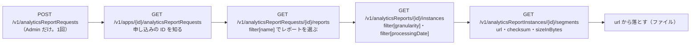
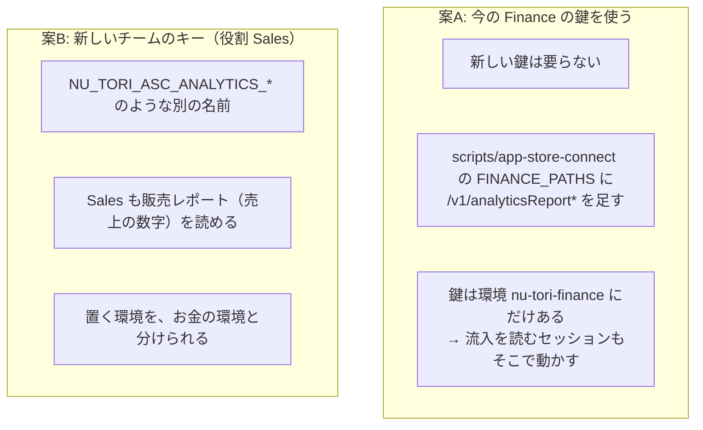

# エージェントが App Store Connect の App Analytics（表示回数・プロダクトページの閲覧・流入元）を読めるか

調査日: 2026-11-06
対象: #910「流入の数字を、クラウドのエージェントが読めるようにする」の調べの1つ。App Store Connect の App Analytics にある、表示回数（Impressions）、プロダクトページの閲覧数（Product Page Views）、どこから来たか（Source Type・Referrer）を、今の鍵（`scripts/app-store-connect`、環境変数 `NU_TORI_ASC_*`、チームのキーで役割 Developer）で API から読めるか。足りないなら、何の役割の鍵が要り、誰が何をすればよいか。前の調査は `docs/research/app-store-connect-agent-access.md`（鍵の種類と役割、JWT の作り方、`scripts/app-store-connect` を置いた理由）。重なる所は繰り返さず、そちらを指す

> **確認の方法と限界**
> - Apple の App Store Connect API の OpenAPI の仕様（`https://developer.apple.com/sample-code/app-store-connect/app-store-connect-openapi-specification.zip`、`info.version` 4.6、ファイルの日付 2026-11-04）を落とし、パス・パラメータ・スキーマ・列挙の値を `jq` で読んだ。これを「仕様で確認」と書く。
> - Apple の文書は developer.apple.com の DocC の JSON（`https://developer.apple.com/tutorials/data/documentation/<パス>.json`）で本文を読んだ。役割の表は `https://developer.apple.com/help/account/manage-your-team/roles/`（前の調査の `/support/roles/` は、ここへ 301 で移っていた）の HTML を読んだ（いずれも 2026-11-06）。
> - 本文で確かめた主張は「本文で確認」と書き、短い英語の原文を添える。本文から推し量ったものは「本文からの読み取り」、探しても記述が無かったものは「本文を探したが記述なし」と書く。
> - 実際の App Store Connect に向けて送ったのは、**今の Developer の鍵での GET 2回だけ**（下の「試した結果」）。POST・PATCH・DELETE は送っていない。役割 Finance の鍵（`NU_TORI_ASC_FINANCE_*`）はこのセッションの環境に無く、試していない。レポートの申し込みが無いので、レポートの中身は1行も読んでいない。二次情報（ブログ、記事、SNS）は使っていない。

## 結論の要約

- **今の Developer の鍵では読めない**。`GET /v1/apps/6816842705/analyticsReportRequests` が **403 `FORBIDDEN_ERROR`「The API key in use does not allow this request」** を返した（観察）。Apple の文書でも、Analytics Reports の API を使える役割は Admin・Sales and Reports・Finance だけで、Developer は無い（本文で確認）
- **数字は Analytics Reports API の「App Store Discovery and Engagement」レポートで取れる**（本文で確認）。1行は「日・イベント・ページの種類・流入元・…」ごとの件数で、`Event` が `Impression`（表示回数）・`Page view`（ページの閲覧）・`Tap`、`Page Type` が `Product page` などで、`Source Type` が `App Store search`・`App Store browse`・`App referrer`・`Web referrer` など。**どのアプリ・どのサイトから来たか（`Source Info`）は Detailed のレポートにだけある**
- **読む前に、レポートの申し込み（`POST /v1/analyticsReportRequests`）が1回要る**。申し込めるのは **Admin だけ**で、Finance と Sales and Reports は、できたレポートを一覧して落とすだけ（本文で確認）。最初のレポートは申し込みから **1〜2日**ででき、`ONGOING` ならあとは毎日増える（本文で確認）
- **人がやること**: Admin の役割のチームのキーを一時的に作り、`ONGOING` の申し込みを1回 POST して、キーをすぐ取り消す（下の「人がやる手順」）。そのあと読むだけの鍵を決める
- **読むだけの鍵は、今ある Finance の鍵で足りる見込み**（本文で確認: Finance は「List and download reports」ができる）。ただし `scripts/app-store-connect --finance` は販売レポートと財務レポートの口しか通さないので、使うならスクリプトの絞りを広げる。Finance の鍵は環境 `nu-tori-finance` にしか無い。分けるなら、新しいチームのキーを役割 Sales（API の文書の名前は Sales and Reports）で作る。どちらにするかは下の「鍵の分け方の材料」
- **小さいアプリでは数字が欠ける**。Detailed のレポートは、5人（または5台）より少ない値を省き、値に小さな乱数を足す（本文で確認）。流入元のアプリ・サイト（`Source Info`）は Detailed にしか無いので、使い始めのうちは多くの行が出ない見込み（本文からの読み取り）

## 問い1: どのレポートの、どの列か

Analytics Reports API のレポートは5つの分類（`category`）に分かれる。表示回数・閲覧・流入元は `APP_STORE_ENGAGEMENT`（"Engagement information shows how people find, discover, and share your app on the App Store."）（本文で確認、https://developer.apple.com/documentation/appstoreconnectapi/downloading-analytics-reports 。列挙の値は仕様で確認: `APP_USAGE`・`APP_STORE_ENGAGEMENT`・`COMMERCE`・`FRAMEWORK_USAGE`・`PERFORMANCE`）。

その中の **App Store Discovery and Engagement** レポート（"provides details about how users engage with your apps on the App Store itself. This includes data about user engagement with your app's icons, product pages, in-app event pages"）（本文で確認、https://developer.apple.com/documentation/analytics-reports/app-store-discovery-and-engagement ）。レポートの名前は Standard と Detailed の2つで、名前の後ろに付く（例 `"name": "App Store Discovery and Engagement Detailed"`、`"category": "APP_STORE_ENGAGEMENT"`）（本文で確認、downloading-analytics-reports）。

| 列 | 中身 | Standard | Detailed |
| --- | --- | --- | --- |
| `Date` | 起きた日。週・月の instance では週・月の初日 | ✔ | ✔ |
| `App Name`・`App Apple Identifier` | アプリ | ✔ | ✔ |
| `Event` | `Impression`・`Page view`・`Tap` | ✔ | ✔ |
| `Page Type` | `No page`（一覧の中）・`Product page`・`In-app event`・`Store sheet`・`Developer page` など | ✔ | ✔ |
| `Page Title` | プロダクトページ（カスタムを含む）やイベントのページの名前 | | ✔ |
| `Source Type` | `App Store search`・`App Store browse`・`App referrer`・`Web referrer`・`App Clip`・`Notification`・`Unavailable` | ✔ | ✔ |
| `Source Info` | "The app referrer or web referrer that led the user to discover the app." | | ✔ |
| `Campaign` | App Analytics で作ったキャンペーンのトークン（2024-11-19 から） | | ✔ |
| `Engagement Type` | `Get`・`Redownload`・`Open`・`Share` など | ✔ | ✔ |
| `Device`・`Platform Version`・`Territory` | 機種・OS の版・国と地域 | ✔ | ✔ |
| `Counts`・`Unique Counts` | 件数と、した人の数 | ✔ | ✔ |

（本文で確認、app-store-discovery-and-engagement）

- **表示回数**: `Event = Impression` の `Counts`。"A user viewed your app icon in a list alongside other apps, including in search results, charts, and the Today, Apps, and Games tabs. Page views are not included in these counts."（本文で確認）
- **プロダクトページの閲覧数**: `Event = Page view` かつ `Page Type = Product page` の `Counts`（本文からの読み取り。`Page view` は "The user was presented with a dedicated page for your app or in-app event."、`Product page` は "A product page."）
- **流入元**: 大分けは `Source Type`（Standard にもある）。`Web referrer` は "Users who discovered your app after browsing a website in Safari."、`App referrer` は Safari 以外のアプリ（メッセージなど）から（本文で確認）。**どのサイト・アプリか（`Source Info`）は Detailed だけ**
- 出る時期: 日次は毎日、週次は毎週金曜に前の週、月次は翌月5日。"Completeness: Within three days."。申し込めば 2024-01-01 からのデータがある（本文で確認）
- ほかの App Store のレポート（ダウンロード数など）も同じ `APP_STORE_ENGAGEMENT`・`COMMERCE` の分類にあるが、今回の3つの数字はこのレポートで足りる（本文からの読み取り）

## 問い2: 申し込みと役割

### 流れ



（パスとパラメータは仕様で確認。順は本文で確認、downloading-analytics-reports）

| 項目 | 内容 | 確かさ | 出典 |
| --- | --- | --- | --- |
| 申し込みが要るか | 要る。"Start by using the [POST analyticsReportRequests] API to request generation of reports for one of your apps." | 本文で確認 | downloading-analytics-reports |
| 申し込みの種類 | `ONGOING`: "Provides current data and is the most typical. It generates reports daily, weekly and monthly." `ONE_TIME_SNAPSHOT`: "Provides up-to-the-moment data and goes back as far as is available. It doesn't generate any new data after the day you request it." | 本文で確認 | 同上 |
| 出るまでの時間 | "Your first report request generates in 1–2 days. Subsequent ONGOING reports are available daily." | 本文で確認 | 同上 |
| 止まること | 長く読まないと、申し込みが `stoppedDueToInactivity` になり、新しい申し込みが要る（"If you don't retrieve data for a long time, a report request changes to stoppedDueToInactivity. You need to make a new request to resume getting reports."）。「長く」が何日かは書いていない | 本文で確認、日数は本文を探したが記述なし | 同上、`AnalyticsReportRequest.attributes.stoppedDueToInactivity`（仕様で確認） |
| 申し込める役割 | Admin だけ（表の「Manage requests」は Admin の行にだけ POST と DELETE がある） | 本文で確認 | https://developer.apple.com/documentation/appstoreconnectapi/analytics |
| 読める役割 | "To download analytics reports, be sure you have one of the following user roles: ADMIN, SALES AND REPORTS, FINANCE"。表の「List and download reports」は3つとも `GET /v1/analyticsReportRequests/{id}/reports` | 本文で確認 | 同上 |
| 第三者に渡すとき | "If you share an API key … with a third party for analyzing or processing your reports, select the Sales and Reports role when generating a new key." | 本文で確認 | downloading-analytics-reports |
| Sales and Reports のほかの権限 | "The Sales and Reports role can also read [GET salesReports] in addition to Analytics Reports." | 本文で確認 | analytics |
| ウェブの画面での役割 | 役割の表の「View app analytics」は Account Holder・Admin・Finance・Sales。App Manager・Developer・Marketing・Customer Support は無い | 本文で確認 | https://developer.apple.com/help/account/manage-your-team/roles/ |

- API の文書の「SALES AND REPORTS」と、役割の表の「Sales」は、同じ役割を指す見込み（本文からの読み取り。役割の表に Sales and Reports という列は無い）
- Finance と Sales and Reports の行に、`GET /v1/apps/{id}/analyticsReportRequests`（申し込みの ID を知る口）が書かれていない。表は代表の口だけを挙げていると読めるが、Finance の鍵でこの口が通るかは確かめていない（本文からの読み取り）。通らないなら、Admin で申し込んだときに返る ID を控えておけば、その先の口だけで読める
- Admin の鍵での申し込みをウェブの画面でする方法は、本文を探したが記述なし（API の文書は POST だけを案内する）

## 問い3: 今の Developer の鍵で試した結果

2026-11-06、このセッション（クラウドの環境、`NU_TORI_ASC_KEY_ID`・`NU_TORI_ASC_ISSUER_ID`・`NU_TORI_ASC_PRIVATE_KEY` あり）で（観察）:

| 送ったもの | 返ったもの |
| --- | --- |
| `scripts/app-store-connect get '/v1/apps/6816842705?fields[apps]=bundleId'`（鍵が生きているかの対照） | 200。`bundleId` が返った |
| `scripts/app-store-connect get '/v1/apps/6816842705/analyticsReportRequests'` | **403** `"code": "FORBIDDEN_ERROR"`、`"title": "This request is forbidden for security reasons"`、`"detail": "The API key in use does not allow this request"` |

- 鍵そのものは通り、Analytics Reports の口だけを役割で断られた。上の文書の役割の表と合う（本文からの読み取り）
- 403 なので、申し込みがあるか無いかも、この鍵からは見えない

## 問い4: 足りないもの

### 人がやる手順

1. **申し込む（Admin が1回）**: App Store Connect の Users and Access → Integrations → App Store Connect API → Team Keys で、Access を **Admin** にしたキーを一時的に作る。そのキーで次を1回送る（エージェントの `scripts/app-store-connect` は GET だけなので、送れない）

   ```json
   POST https://api.appstoreconnect.apple.com/v1/analyticsReportRequests
   {
     "data": {
       "type": "analyticsReportRequests",
       "attributes": { "accessType": "ONGOING" },
       "relationships": { "app": { "data": { "type": "apps", "id": "6816842705" } } }
     }
   }
   ```

   返った `data.id`（申し込みの ID）を控える（秘密ではない）。リリース前からの数字が要るなら、同じく `ONE_TIME_SNAPSHOT` も1回送る（本文で確認: 過去にさかのぼるのはこちら）。送ったら **Admin のキーをすぐ取り消す**（Revoke。取り消したキーは戻せない。前の調査の問い0）
2. **1〜2日待つ**（本文で確認）
3. **読む鍵を決める**（下の材料）。エージェントは、`/v1/analyticsReportRequests/<ID>/reports?filter[name]=App Store Discovery and Engagement Detailed` から instance・segment をたどり、落としたファイルの中で数える

- 申し込みの body の形: `AnalyticsReportRequestCreateRequest` の `data` は `type`・`attributes`・`relationships` が必須で、`attributes.accessType` と `relationships.app` が必須（仕様で確認）
- `ONGOING` は長く読まないと止まるので、定期のタスクで読み続けるか、止まったら Admin がもう一度申し込む

### 鍵の分け方の材料



- **案A（Finance の鍵）**: Finance は Analytics Reports を一覧して落とせる（本文で確認）。新しい鍵は要らない。ただし Finance の鍵は、`docs/agents/tooling.md` の「お金の数字を読む」で、お金のレポートを読むためだけに作ったもので、`scripts/app-store-connect` も「ほかの口へは送らない」と絞っている。使うなら、この絞りに Analytics Reports の口（`/v1/apps/{id}/analyticsReportRequests`、`/v1/analyticsReportRequests/{id}/reports`、`/v1/analyticsReports/{id}/instances`、`/v1/analyticsReportInstances/{id}/segments`）を足し、落とすファイルの URL の扱いを決める。流入を読むセッションは `nu-tori-finance` の環境で動かすことになる
- **案B（新しい Sales のキー）**: Apple が第三者に渡す鍵として勧める役割（本文で確認）。ただし **Sales も販売レポートを読める**（本文で確認）ので、お金の数字から完全には離れない。違いは、財務レポート（Payments and Financial Reports）を読めないことと、鍵を置く環境を `nu-tori-finance` と分けられること（本文からの読み取り）
- どちらでも、読むだけの鍵は申し込めない。申し込み（と、止まったときの申し込み直し）は Admin が要る（本文で確認）
- 落としたレポートの数字は、記録の中身ではないが、公開の Issue・PR に貼るかどうかは `docs/agents/tooling.md` と #910 の決定に従う（この調べでは数字を書いていない）

## 確かめていないこと

- Finance の鍵で、`GET /v1/apps/{id}/analyticsReportRequests` と、その先の口が通るか（このセッションに Finance の鍵が無い）
- 実際のレポートの行数、Standard と Detailed のどちらに何行出るか、`Source Info` がどれだけ省かれるか（申し込みが無い）
- `stoppedDueToInactivity` になるまでの日数
- segment の `url` の期限と、落とすファイルの形式（本文では "Segments are the actual report files" とだけ読んだ）

## 出典一覧

Apple（2026-11-06）
- App Store Connect API の OpenAPI の仕様（4.6）: https://developer.apple.com/sample-code/app-store-connect/app-store-connect-openapi-specification.zip
- Analytics: https://developer.apple.com/documentation/appstoreconnectapi/analytics
- Downloading Analytics Reports: https://developer.apple.com/documentation/appstoreconnectapi/downloading-analytics-reports
- Request analytics reports for your apps（POST）: https://developer.apple.com/documentation/appstoreconnectapi/post-v1-analyticsreportrequests
- Read analytics report requests for a specific app: https://developer.apple.com/documentation/appstoreconnectapi/get-v1-apps-_id_-analyticsreportrequests
- App Store Discovery and Engagement: https://developer.apple.com/documentation/analytics-reports/app-store-discovery-and-engagement
- Privacy（Analytics Reports）: https://developer.apple.com/documentation/analytics-reports/privacy
- Roles: https://developer.apple.com/help/account/manage-your-team/roles/

観察（2026-11-06）
- このセッションの Developer の鍵で `scripts/app-store-connect get` を2回（上の「試した結果」）
