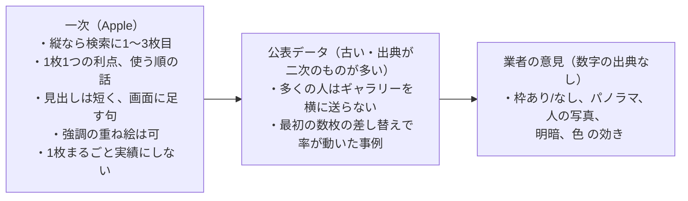
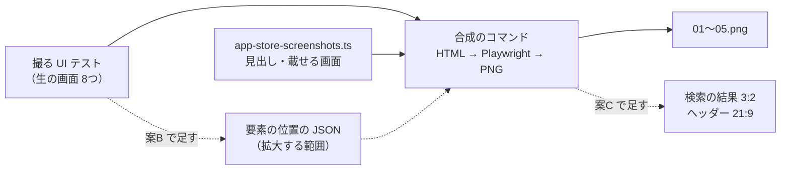
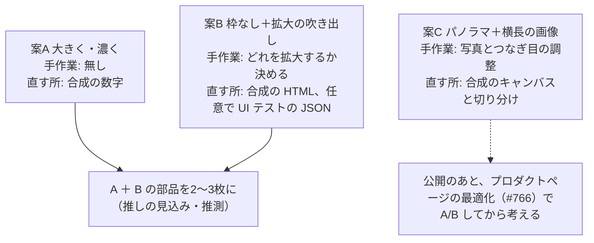

# App Store のスクリーンショット（と見出し）の作り方の調査（#867）

調べた日: 2026-11-01。根拠の強さを3つに分けて書く。**[一次]** = Apple の文書・WWDC、**[観察]** = このノートで実際に App Store の画像を落として見たもの、**[業者]** = ASO 業者・ツール業者のブログ（業者の意見として扱う）。推測は「推測」と書く。

## 結論

1. 今の案の見劣りの主な原因は、型（地の色＋上に見出し＋枠に入れた生の画面）ではなく、**画面が小さく、余白が多く、地がアプリの地と同じ灰色で、1枚の中で目を引く所が無い**こと。1枚目は端末3台で画面1つが幅の約2割になり、キャンバスの約半分が空いている。Apple 自身の Fitness も同じ型で、端末をキャンバスの高さの約3/4まで大きくしている **[観察]**。
2. Apple が求めることは少ない。「使っているところを見せる（2.3.3）」「価格を載せない（2.3.7）」「透過なし・最大10枚」「縦なら検索の結果に最初の3枚」の4つ **[一次]**。Apple の配る端末の枠を使うなら、傾けない・切らない・文字を画面の上に重ねない（Marketing Guidelines）**[一次]**。ただし、日本の上位の食事記録アプリの多くは、枠を傾けたり下で切ったりしたまま通っている **[観察]**。
3. 日本の上位11本は全部が「上に大きな見出し」で、ほとんどが濃いブランドの色の地、端末を下の端で切る、画面の一部を拡大して画面の外へ出す（吹き出し）を使う。1枚目に「No.1」「○万人」「平均−○kg」を置くものが多いが、Apple はこれを勧めていない **[観察]／[一次]**。
4. 2026年秋から、iOS 27 では検索の結果とプロダクトページの上に、スクリーンショットとは別の「クリエイティブアセット」（横長の画像か動画。使っているところを見せなくてよい）を出せる **[一次]**。HTML から作れる。
5. 案は3つ（下の4）。A「今の型のまま、大きく・濃く・強調する」は合成の HTML の数字を直すだけで、手で作るものは無い。B「枠なしで画面を拡大して切り出す」は、撮る UI テストに要素の位置を書き出す小さな足しが要る。C「5枚をつないだ1枚の絵＋検索の結果の横長の画像」は、つなぎ目の絵柄を手で決める部分が残る。まず A を作り、B の要素（拡大の吹き出し）を2〜3枚に混ぜるのが、手間に対して効きが大きい見込み（推測）。

---

## 1. Apple 自身が求めること・勧めること

### App Store Connect の仕様 [一次]

- 端末の大きさごとに **1〜10枚**、`.jpeg`／`.jpg`／`.png`。**アルファのチャンネル・透過は不可**。<https://developer.apple.com/help/app-store-connect/reference/app-information/screenshot-specifications>
- iPhone の「Dynamic Island（large）」は **1320×2868** ほか（横は縦横を入れ替え）。大きいサイズを上げれば、小さい端末には自動で縮めて使われる。同ページ
  - 注: 2026-11-01 の同ページでは、必須の記述が「iPhone with Dynamic Island (medium display) を最低1枚」になっている。今の案の 1320×2868（large）は、medium が無いときの縮小の連鎖でまかなわれるかを、上げる前に App Store Connect で確かめたほうがよい（同ページの連鎖の注は「medium が無ければ Face ID（large）を縮めて使う」で、large → medium の向きの記述は読み取れなかった）。また「iPhone Duo」の大きさが「iOS 27.1 SDK 以降のアプリは 2027年4月から必須」と書かれている
- 縦でも横でもよい（サイズの表が両方ある）。同ページ

### Product Page のガイダンス [一次]

<https://developer.apple.com/app-store/product-page/>

- 「Depending on the orientation of your screenshots, the first one to three images will appear in search results when no app preview is available」— **縦なら検索の結果に1〜3枚目**が並ぶ。ここでアプリの本質を見せる
- 「Focus each subsequent screenshot on a main benefit or feature」— 2枚目以降は1枚に1つの利点
- 「Use images captured from your app's UI」— アプリの画面から撮る
- ダークモードに対応するなら、少なくとも1枚で見せることを考える

### App Store asset best practices（2026年に新しく出た） [一次]

<https://developer.apple.com/app-store/asset-best-practices/>

- 「Stay focused on the core user experience — **avoid using the entire asset to highlight general accolades or call-to-action statements**」— 1枚まるごと実績や「今すぐ」に使わない
- 「Lead with your best features … sequence them so they tell a cohesive story」— 強い機能から、使う順の話になるよう並べる
- 「If using text, use a **short phrase that enhances your visual rather than describes it**」— 見出しは画面を説明するのでなく、画面に足す短い句
- 「Keep it legible」「focal point artwork is within the center」— どこに出ても読めるように。焦点は中央
- 「you can use image overlays to demonstrate input mechanisms or highlight specific functionality」— 機能を強調する重ね絵は可
- 「Don't include specific pricing, discounts, website URLs, copyright symbols」
- App Store に出る素材は、アプリの年齢区分にかかわらず **4+** に合うこと

### 審査ガイドライン [一次]

<https://developer.apple.com/app-store/review/guidelines/>

- **2.3.3**: 「Screenshots should show the app in use, and not merely the title art, login page, or splash screen. They may also include **text and image overlays** (for example, to demonstrate input mechanisms…)」— 使っているところを見せる。文字と絵の重ねは可
- **2.3.4**: プレビュー（動画）はアプリの画面の録画だけ。ナレーションと文字の重ねは可
- **2.3.7**: 名前・サブタイトル・スクリーンショット・プレビューに**価格**を入れない。サブタイトルで確かめられない主張をしない
- **2.3.10**: ほかのモバイルの基盤の名前・絵を入れない

### Marketing Guidelines の端末の枠の決まり [一次]

<https://developer.apple.com/app-store/marketing/guidelines/>

- 「Use Apple-provided product bezels … Always use the latest-generation devices」
- 「Use Apple product images "as is" and without modification. Modifications include adding reflections, shadows, …; **cropping, tilting, or obstructing** any part of the images; …」
- 「You can place promotional copy or violators **beside the product images, not on top of them**」
- 画面は動いているとおりに。状態の表示は電波・Wi‑Fi・電池が満ち。実在の人のデータでなく作り物のアカウント情報を見せる
- 写真・動画で人が端末を持つのは可（「Show people interacting with the Apple product in an authentic way」、正面から、極端な角度にしない）
- 注（推測）: この文書は「marketing materials／communications」全般の決まりで、App Store のスクリーンショットに審査で当てはめている様子は見えない。下の3のとおり、枠を傾けたり切ったりした上位アプリが日本で出ている。nu-tori が Apple の枠を使い続けるなら、決まりどおり「正面・切らない・上に重ねない」に寄せるのが安全。**枠を使わない**（画面だけを角丸で置く）なら、この決まりは関わらない

### 動画（App Preview）との関係 [一次]

- 最大3本、15〜30秒、端末の大きさと言語ごと。iPhone 6.9 インチは 886×1920（縦）。<https://developer.apple.com/help/app-store-connect/reference/app-information/app-preview-specifications>
- 「Previews always appear before screenshots」（縦横がスクリーンショットと違えば「A Closer Look」に回る）。同ページ
- 検索の結果とプロダクトページで**音なしで自動再生**。自動再生を切った人にはポスターフレーム（既定は5秒目）が出る。<https://developer.apple.com/app-store/app-previews/>
- プレビューがあると検索の結果の1枠目がプレビューになる（「first one to three images will appear in search results **when no app preview is available**」の裏返し。何枚目までスクリーンショットが並ぶかは Apple の文書で読み取れなかった）

### 新しく出た「クリエイティブアセット」（iOS 27 から） [一次]

- WWDC26「Enhance your presence on the App Store」: 「your Product Page can now have a **Header** … images and videos, outside of your app screenshots and previews」「Instead of showing the default app screenshots, you can use an impactful image or video … in the **Search Results**」<https://developer.apple.com/videos/play/wwdc2026/205/>
- 使っているところを見せる決まり（2.3.3）とは別で、ブランドや季節の絵でよい。iOS 27／iPadOS 27 以降でだけ出る。資産ライブラリから単独で審査に出せる。<https://developer.apple.com/help/app-store-connect/manage-app-information/manage-your-app-store-assets>
- 大きさ: 検索の結果 **3:2（1920×1280〜3840×2560）**、ヘッダー **21:9（3840×1646）**、どちらも 16:9（5244×2950）も可。透過なし。<https://developer.apple.com/help/app-store-connect/reference/app-information/creative-assets-specifications>
- 置かなければ、検索の結果には今までどおりアプリ内イベント・プレビュー・スクリーンショットが出る（asset best practices）
- 使い始めの日は Apple の文書で確かめられなかった。業者は 2026-10-05 に App Store Connect で使えるようになったと書く [業者] <https://adapty.io/blog/app-store-creative-assets/>

---

## 2. よく見る作り方の型と、何に効くと言われているか

根拠の強さの要約:



### 公表されているデータ [業者が公表した計測。強さは中〜弱]

- AppAgent（2017頃、訪問者 25,000 人超）: 縦のスクリーンショットを横に送った人は約 9%（横向きは約 5%）。Phiture の紹介 <https://phiture.com/asostack/why-7-seconds-could-make-or-break-your-mobile-app-f41000fb2a17/>。古く、母集団もゲーム寄りの可能性（推測）
- StoreMaven: ギャラリーを見ずに最初の見た目で数秒で決める層がいて、最初に見える枠のあとで閲覧の率が大きく落ちる、という主張（Chartboost の解説経由で、StoreMaven の一次の報告は見つけられなかった）。<https://www.chartboost.com/?p=3080>、<https://www.chartboost.com/?p=3084>
- AppTweak（2026、米国の上位1000本）: 2025年に上位の 54% が App Store のスクリーンショットを2回以上更新。上位アプリの 35% が2回以上スクリーンショットの試験を回した。<https://www.apptweak.com/en/aso-blog/aso-app-store-trends-benchmarks-report>
- 見出しの文字が検索の順位に効くか（OCR）: 2025年6月の変更後に業者のあいだで説が出たが、Apple は否定したと Phiture は書く。ConsultMyApp の試験でも強い証拠なし [業者] <https://phiture.com/asostack/aso-trends-in-2026/>
- 「枠あり 対 枠なし」「パノラマ 対 1枚ずつ」を切り分けて率を出した公表の A/B は見つからなかった

→ データで言えるのは「**最初に見える数枚（＝検索の結果の3枚）でほぼ決まる**」ことまで。型ごとの効きは業者の意見の域。

### 型ごとの、言われている効き

| 型 | 言われている効き | 根拠の強さ |
| --- | --- | --- |
| 上に見出し（大きく短く） | 画面だけでは伝わらない「何がうれしいか」を一目で。検索の結果の小さな絵で読めるのは見出しくらい | 一次（短い句を勧める）＋業者 |
| 端末の枠あり | 実機の大きさ感・iPhone のアプリらしさ。業者は「信頼が要るカテゴリで枠が多い」と言う | 業者（データなし） |
| 枠なし（画面だけを角丸で、大きく） | 同じ面積で画面の中身を大きく見せられる。Apple の Pages も枠なし | 観察（Apple の Pages）＋業者 |
| 画面の拡大・切り出し・吹き出し（UI の一部を画面の外へ大きく出す） | 小さい絵でも要点（数字・カード）が読める | 一次（強調の重ね絵は可）＋業者 |
| パノラマ（つながった1枚の絵） | 横に送らせる動機。統一感 | 業者のみ。検索の結果では1枚ずつ切れて見えるので、1枚で立つことが前提（推測） |
| 人・手の写真 | 感情・使う場面が伝わる（AppTweak は「人を中心にした絵」を勧める） | 業者（AppTweak <https://www.apptweak.com/en/aso-blog/how-to-optimize-your-app-screenshots>） |
| 1枚目に実績（No.1、○万人、平均−○kg） | 社会的証明 | 業者。Apple は1枚まるごと実績を勧めない（一次） |
| 濃い地の色・高いコントラスト | 一覧で目立つ。AppTweak は明るい色・高いコントラストが率が高いと書く（数字なし） | 業者 |
| 暗い画面 | 多くが明るいので目立つ（AppTweak）。Apple はダークモード対応なら1枚を勧める | 一次（ダーク1枚を考える）＋業者 |
| 動画（App Preview） | 自動再生で目を引く。最初の数秒が大事 | 一次（仕組み）。効きの数字は無し |

---

## 3. 日本の App Store の食事記録・カロリー・ダイエットアプリの型 [観察]

### 数え方

- iTunes Search API（`country=jp`）で「食事記録」「カロリー計算」「ダイエット」を検索し、評価の数が多いもの・写真で記録する AI 系・nu-tori に近い（体重から目安を直す）ものから11本を選んだ。各アプリの `screenshotUrls`（JP のストアの iPhone 用）を全部落とし、幅300px で並べて目で見た。2026-11-01 時点
- 選んだもの: あすけん、カロミル、MyFitnessPal、FiNC、カルシー、マクロファクター（MacroFactor の日本語版。体重から目安を毎週直す点で nu-tori に最も近い）、WiseMeal、メシトラ、SmartDiet、Cal AI、Yazio
- 限界: 幅300px の目視なので細部は誤りうる。プロダクトページの最適化やカスタムプロダクトページで人によって違う画像が出ている可能性がある。プレビュー動画の有無は API で分からないので数えていない

### 数（11本中）

| 型 | 本数 | アプリ |
| --- | --- | --- |
| 上に見出し（全枚かほぼ全枚） | 11 | 全部。見出しはキャンバスの上 1/4〜1/3 を占め、2〜3行の大きな太字 |
| 見出しの中で語を色分け・大きさ分け | 6 | あすけん、カロミル、FiNC、カルシー、メシトラ、WiseMeal |
| 濃い・はっきりしたブランドの色の地 | 7 | あすけん（緑）、カロミル（緑・黄）、MyFitnessPal（青）、FiNC（ピンク）、マクロファクター（色ごと）、WiseMeal（水色）、Cal AI（黒） |
| 淡い色の地（クリーム・薄灰） | 4 | カルシー、メシトラ、SmartDiet、Yazio |
| 端末の枠あり | 11 | 全部（どれかの枚で） |
| 端末を下の端で切る（端末を大きくしてはみ出させる） | 9前後 | あすけん、カロミル、MyFitnessPal、FiNC、カルシー、WiseMeal、メシトラ、SmartDiet、Yazio ほか |
| 端末を傾ける・重ねる | 5 | カロミル、MyFitnessPal、カルシー、マクロファクター、SmartDiet（多くは1枚目） |
| UI の一部を拡大して画面の外へ出す（吹き出し・カード） | 8 | あすけん、カロミル、MyFitnessPal、カルシー、WiseMeal、Cal AI、Yazio、メシトラ |
| 手・人の写真 | 5 | カロミル（手）、カルシー（手・体の前後）、SmartDiet（手）、メシトラ（体の前後）、Yazio（体の前後） |
| キャラクター・人のイラスト | 5 | あすけん、FiNC、WiseMeal、メシトラ、Yazio |
| 1枚目に実績・数字（No.1、○万人、−○kg） | 6 | あすけん、カロミル、MyFitnessPal、SmartDiet、WiseMeal、メシトラ |
| 1〜3枚目のどこかに実績・評価・減量の数字 | 9 | 上の6本＋カルシー（★4.6）、FiNC（1,300万DL）、Yazio（★4.6） |
| 1枚目が「何をするアプリか」の画面そのもの | 3 | Cal AI（ホーム）、カルシー（傾けた画面）、マクロファクター |
| パノラマ（2枚をまたぐ絵） | 1 | Yazio（1→2枚目で端末と皿がつながる） |
| 暗い画面・暗い地の枚がある | 3 | Cal AI、マクロファクター、Yazio |
| 最後の枚が機能の一覧（端末なし） | 4 | あすけん、MyFitnessPal、WiseMeal、カルシー |
| 日本語にしていない（英語の画像のまま） | 2 | MyFitnessPal、Cal AI |
| 枚数 | 4〜10（多くは 7〜10） | nu-tori の案は5 |

### 型の要点（観察からの読み。推測を含む）

- 日本の上位は「**濃い地＋大きな2〜3行の見出し＋大きく下で切った端末＋拡大の吹き出し**」がほぼ標準。nu-tori の今の案との差は、型より「端末の大きさ」「地の色」「吹き出しの有無」
- Apple 自身の Fitness（日本語のページ）は、薄い地＋小さめの見出し＋**正面で切らない枠をキャンバスの約3/4の高さ**。Pages は**枠なし**の画面と、1枚目に手で持った写真。Apple の決まりどおりでも大きく見せられる例
- 1枚目の実績・減量の数字は nu-tori には今は無い（公開前）。減量の数字は `docs/agents/marketing.md` の「病気に効くとは書かない」と、確かめられない主張（2.3.7）に近づくので、使わないのが筋（推測）
- Cal AI・カルシー・メシトラ・WiseMeal など写真で記録する AI 系は、**料理の写真を大きく**見せる枚を1〜3枚目に置く。nu-tori の今の案では料理の写真が端末の中で小さい

---

## 4. nu-tori が選べる作り方の案

### 今の案の見え方（観察と推測）

- 01: 端末3台が横に並び、1台がキャンバスの幅の約22%、高さの約25%。見出しの下に約3割、端末の下に約2割の空き。3つの画面がどれも同じタイムライン（同じ返事の文）に見え、「量る／撮る／目安」の違いが絵で分からない
- 02: 2台で同じく上下が空く。03〜05 は1台で大きさは十分だが、何を見ればよいかの強調が無い（04 は「栄養の出典」が下の端で切れている）
- 地 `#F2F2F7` がアプリの地と同じで、端末の画面の地と溶け、一覧で目立たない
- 検索の結果の大きさ（推測）: 6.9 インチの iPhone で縦3枚が並ぶと1枚は幅おおよそ 120pt。1320px のキャンバスが約 0.09pt/px になり、見出し 88px は約 8pt で読めるが、01 の画面の中の文字（アプリの 13pt）は 1pt 未満で読めない。読めるのは見出しと、大きな形（写真・数字・リング）だけ

今の合成のコマンド（`site/screenshots/compose-screenshots.ts`）は、見出しの高さ 640px・字 88px・地 `var(--background)` に固定され、端末の大きさは「幅で割る」か「残りの高さ」の小さいほうで決まる。そのため台数が増えるほど小さくなる。



### 案A: 今の型のまま、大きく・濃く・強調する（Apple Fitness 寄り）

```text
┌───────────────┐
│ 体重を量って、     │ ← 見出し 110〜130px、2行。地は primary #6155F5、字は白
│ 食べる前に撮るだけ │
│ ┌─────────┐   │
│ │ 枠に入れた  │   │ ← 端末1台を高さの約75%（Fitness と同じ割合）
│ │ 生の画面    │   │    正面・切らない・上に字を重ねない（Marketing Guidelines どおり）
│ │           │   │
│ └─────────┘   │
└───────────────┘
```

- 1枚目は3台を並べるのをやめ、1台にするか、3つの手順を**枠なしの画面の切り出し3つ**（それぞれ「体重 77.8 kg」「撮った写真」「1日の目安が変わりました」のカード）を縦に並べる（後者は案Bの部品）
- 地をブランドの色（`primary`）か、その淡い色（DESIGN.md にある `color-mix(#6155F5 22%, #FFF)`）にし、画面の地 `#F2F2F7` と分ける。1枚だけ暗い画面（`background-dark`）を混ぜる案も（Apple の勧め＋業者）
- 今の仕組みで作れるか: **作れる**。`compose-screenshots.ts` の数字（見出しの高さ・字の大きさ・地の色・端末の割合）と、`app-store-screenshots.ts` の `screens`（1枚目を1つに）を直すだけ。暗い画面を混ぜるなら、撮る UI テストにダークの外観で撮る場面を1つ足す
- 手で作る部分: 無い。見た目の判断（色と字の大きさ）を Artifact で見比べるだけ
- 弱み: 日本の上位と並ぶと、吹き出しが無いぶん「中身が読めない」ことは残る（推測）

### 案B: 枠なしで、画面を拡大して切り出す（強調の吹き出し）

```text
┌───────────────┐
│ 食べる量の目安は、 │
│ 毎週の体重で決め直す│
│ ┌───────────┐ │ ← 生の画面を枠なし・角丸で大きく（下の端で切ってよい。枠でないので Marketing の決まりの外）
│ │  ╔═══════════╗ │ ← 要のカード（「1日の目安が変わりました 1,750 kcal −150」）を
│ │  ║ 1,750 kcal  ║ │    1.5〜2倍に拡大して、画面からはみ出させて重ねる
│ │  ╚═══════════╝ │
│ │             │ │
└─┴───────────┴─┘
```

- 2.3.3 は「text and image overlays」を認め、asset best practices は「highlight specific functionality」を認める **[一次]**。日本の上位11本中8本がこの吹き出しを使う **[観察]**
- 枠を使わなければ、傾け・切り・重ねの決まり（Marketing Guidelines）に触れずに大きく見せられる。枠を使うなら、吹き出しは枠の**横**に置き、枠の上に重ねない
- 今の仕組みで作れるか: **ほぼ作れる**。合成の HTML で、生の画面の一部を `background-position`／`object-position` で切り出して拡大するだけ。切り出す範囲の決め方が2通り:
  1. `app-store-screenshots.ts` に、生の画面の座標で切り出しの四角を書く（足すのは型と HTML だけ。画面の並びが変わると座標がずれる。撮り直した画像を Artifact で見るときに気づける）
  2. 撮る UI テストで、要の要素の `XCUIElement.frame` を生の画面と一緒に JSON で書き出し、合成のコマンドがそれを読む（ずれない。UI テストに数行と、名前の約束が1つ増える）
- 手で作る部分: どの枚でどのカードを拡大するかを決めること（5枚で1回）。絵は描かない
- 弱み: 拡大した UI は画素が粗くなるので、生の画面を 3x のまま使い、拡大は2倍までにする（推測）

### 案C: 5枚をつないだ1枚の絵（パノラマ）＋料理の写真＋検索の結果の横長の画像

```text
 01        02        03        04        05
┌────┬────┬────┬────┬────┐
│見出し │見出し │見出し │見出し │見出し │
│  📱   🍛━━━━━━📱    📱   📱      │ ← 1枚の横長の HTML（6600×2868）に置き、5つに切る
│      （料理の写真が 01→02 をまたぐ）   │    1枚ずつでも立つように、またぐ物は飾りに限る
└────┴────┴────┴────┴────┘
＋ iOS 27 の検索の結果 3:2・ヘッダー 21:9 を同じ部品で作る
```

- 効き: パノラマは業者の意見だけで、データは無い。日本の11本では Yazio の1本だけ。検索の結果では1枚ずつ切れて並ぶので、またぐ絵が切れて見える
- 横長のクリエイティブアセット（検索の結果 3:2、ヘッダー 21:9）は、**使っているところを見せなくてよい**ので、料理の写真と見出しを大きく置ける **[一次]**。ただし出るのは iOS 27 以降だけ
- 今の仕組みで作れるか: **作れる**。キャンバスを横長にして5つに切る処理と、3:2・21:9 の書き出しを足す。透過なしのルールはそのまま
- 手で作る部分: 料理の写真の選び（リポジトリに置いてよい作り物に限る。ADR-0010 と #853 の決まり）、またぐ物の置き場所の調整。切れ目で文字や要の UI が割れないかを毎回目で見る必要があり、画面を撮り直すたびに崩れやすい（推測）
- 弱み: 手間が一番大きく、効きの根拠が一番弱い

### 比べ



- どの案も、検索の結果の3枚が勝負という点（一次＋データ）は同じ。1〜3枚目に「料理の写真が大きく見える枚」と「1日の目安の数字が大きく見える枚」を入れると、写真で記録する AI 系と、体重から目安を直すマクロファクターの両方と並べて見分けがつく（推測）
- 型の効きはどれも推測なので、公開のあとに App Store Connect のプロダクトページの最適化（3つまでの別案を本物の流入で比べられる。<https://developer.apple.com/app-store/product-page/>）で、1枚目の別案を試すのが確かめる段取り（#766）

---

## 出典

一次（Apple）
- Screenshot specifications: <https://developer.apple.com/help/app-store-connect/reference/app-information/screenshot-specifications>
- Product page: <https://developer.apple.com/app-store/product-page/>
- App Store asset best practices: <https://developer.apple.com/app-store/asset-best-practices/>
- App Review Guidelines（2.3.3／2.3.4／2.3.7／2.3.10）: <https://developer.apple.com/app-store/review/guidelines/>
- Marketing Resources and Identity Guidelines: <https://developer.apple.com/app-store/marketing/guidelines/>
- App previews: <https://developer.apple.com/app-store/app-previews/>
- App preview specifications: <https://developer.apple.com/help/app-store-connect/reference/app-information/app-preview-specifications>
- Creative assets specifications: <https://developer.apple.com/help/app-store-connect/reference/app-information/creative-assets-specifications>
- Manage your App Store assets: <https://developer.apple.com/help/app-store-connect/manage-app-information/manage-your-app-store-assets>
- Get ready for new creative assets on the App Store（2026-08-05）: <https://developer.apple.com/news?id=kug6m2ea>
- WWDC26 Enhance your presence on the App Store: <https://developer.apple.com/videos/play/wwdc2026/205/>

観察
- iTunes Search／Lookup API（`https://itunes.apple.com/search?country=jp&entity=software&term=…`、`https://itunes.apple.com/lookup?id=…&country=jp`）の `screenshotUrls`。見たアプリの ID: あすけん 687287242、カロミル 963055562、MyFitnessPal 341232718、FiNC 965626396、カルシー 6743029309、マクロファクター 1553503471、WiseMeal 6739987348、メシトラ 6745637277、SmartDiet 1320729984、Cal AI 6480417616、Yazio 946099227、Apple の Pages 361309726、Fitness 1208224953

業者（意見・二次の数字）
- Phiture（AppAgent の数字の紹介）: <https://phiture.com/asostack/why-7-seconds-could-make-or-break-your-mobile-app-f41000fb2a17/>
- Phiture ASO Trends 2026: <https://phiture.com/asostack/aso-trends-in-2026/>
- Chartboost（StoreMaven の数字の紹介）: <https://www.chartboost.com/?p=3080>、<https://www.chartboost.com/?p=3084>
- AppTweak 2026 benchmarks: <https://www.apptweak.com/en/aso-blog/aso-app-store-trends-benchmarks-report>
- AppTweak screenshot best practices: <https://www.apptweak.com/en/aso-blog/how-to-optimize-your-app-screenshots>
- Adapty（クリエイティブアセットの開始日）: <https://adapty.io/blog/app-store-creative-assets/>
