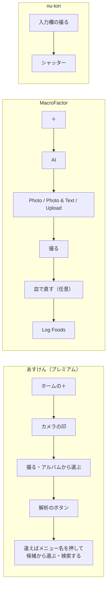
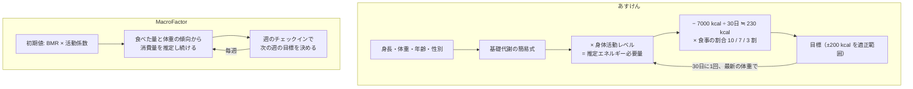
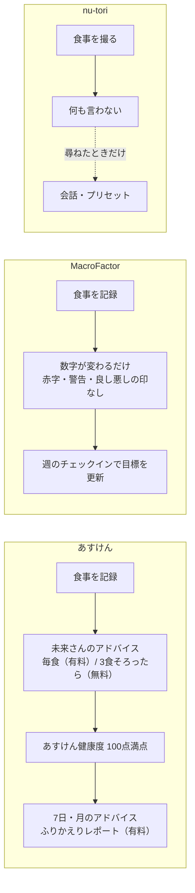
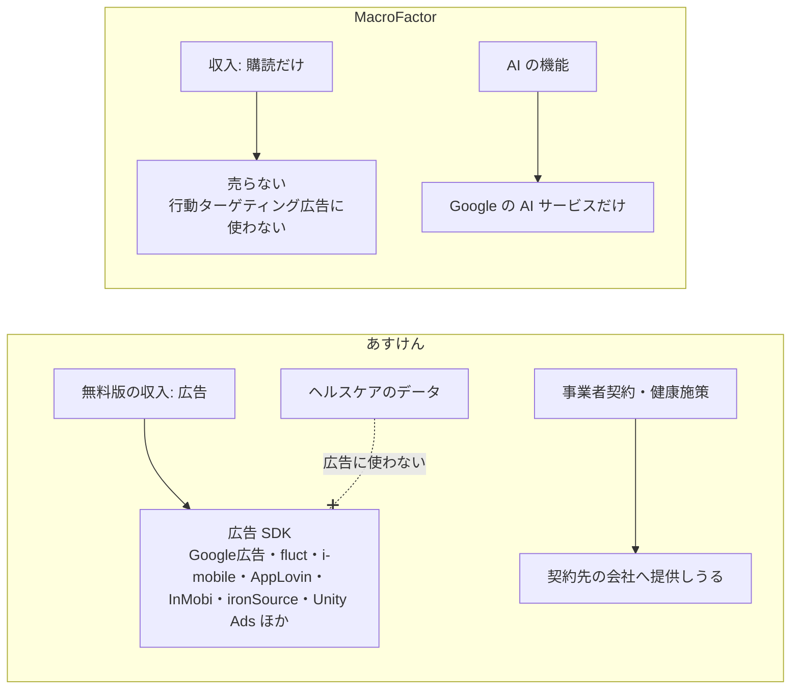

# あすけんと MacroFactor の比較材料

調査日: 2026-10-10
対象: 食事管理アプリ「あすけん」（株式会社asken）と「MacroFactor」（Stronger By Science Technologies LLC、日本の App Store での名前は「マクロファクター」）。nu-tori と比べる材料として、機能、記録の手数、1日の目安の決め方、アドバイスの出し方、栄養データの出どころ、料金、プライバシー、ヘルスケアとの連携、評判と弱点を一次情報で集める。

> **確認の方法と限界**
> - あすけんは、公式サイト（asken.jp）、公式ヘルプ（asken.tayori.com）、会社サイト（asken.inc）のニュースとプライバシーポリシーと外部送信のページ、PR TIMES に会社が出したプレスリリース、App Store の日本のページの**本文を直接取得して読んだ**。
> - MacroFactor は、公式ヘルプ（help.macrofactorapp.com）、公式サイトと記事（macrofactor.com）、プライバシー通知と利用規約、App Store の日本と米国のページの**本文を直接取得して読んだ**。
> - 本文で確かめた主張は「本文で確認」、本文の記述から推し量ったものは「本文からの読み取り」（何から読み取ったかを添える）、探しても記述が無かったものは「本文を探したが記述なし」と書く。
> - 実機での確認はしていない。操作の数は、公式ヘルプの手順から数えたもので、実機で数えたものではない。
> - App Store の評価の数字・料金・プライバシーラベルは**取得日（2026-10-10）時点**の表示。プライバシーラベルは開発者の申告で、Apple は検証していない（両ページにそう書いてある）。
> - あすけんの料金改定（2026-08-18）のプラン別の新料金の表は画像で載っていて、読めていない。料金は App Store の表示を使った。
> - プレスリリースと MacroFactor の自社記事（速さの比較など）は、会社自身の主張として扱う。
> - 二次情報（レビュー記事、まとめ、Reddit）は使っていない。App Store のユーザーレビューの本文も根拠にしていない。
> - 次の内容は既存のメモにあるので、ここでは繰り返さない。
>   - MacroFactor の消費量の推定、体重の傾向、記録が少ない週の扱い、週のチェックイン: `docs/research/expenditure-estimation.md`
>   - MacroFactor とあすけんの目標の速さ・下限・期限の扱い: `docs/research/goal-rates.md`
>   - MacroFactor とヘルスケアのやりとり（書き込む項目、他アプリの栄養の取り込み）: `docs/research/healthkit-foodnoms-macrofactor.md`

## 結論の要約

- **2つは記録の考え方が逆。** あすけんは「メニュー（料理名）」を選ぶ記録で、栄養はあすけんの栄養士が作った標準のレシピから出す。MacroFactor は「食品」を皿（Plate）に積む記録で、写真や文章の AI も、最後はデータベースの食品に当てる（どちらも本文で確認）。
- **写真の記録は、どちらも有料で、どちらも確かめてから記録する。** あすけんの画像解析はプレミアムの機能で、2025-05 に生成 AI の解析に切り替えた（精度は従来比 25% 向上と発表）。MacroFactor は無料の版が無く、AI の写真記録は皿の画面で直してから「Log Foods」を押す（本文で確認）。
- **1日の目安の決め方が違う。** あすけんは「推定エネルギー必要量（基礎代謝の簡易式 × 身体活動レベル）− 230 kcal × 食事の割合」の固定の式で、30日に1回、最新の体重で計算し直す。目標は自分で入力できない。MacroFactor は体重の傾向と食べた量から消費量を推定し、毎週見直す（本文で確認）。
- **アドバイスの出し方が逆。** あすけんは栄養士キャラクター「未来さん」が記録のたびにアドバイスを出し、100点満点の「あすけん健康度」で採点する（毎食のアドバイスはプレミアム）。MacroFactor は「adherence neutral」を掲げ、超えても赤い数字・警告・食品の良し悪しの印を出さない（本文で確認）。
- **栄養データ**: あすけんは自社のメニュー 15万件超。一般のメニューは日本食品標準成分表（八訂）で計算し、市販品はメーカーの公表値と自社の推計。MacroFactor は研究用のデータベース（NCCDB など）と、人が確かめた投稿の約 136万件。日本版では Life Log Technology（カロミルの会社）のデータベースを使えると利用規約に書く（本文で確認）。
- **料金（日本の App Store）**: あすけんは無料で始められ、プレミアムは月 580円・年 4,400円、プレミアムPlus は月 980円・年 7,500円。MacroFactor は無料の版が無く、月 1,540円・年 9,200円（ほかに年 6,600円の表示もある）。7日の無料体験はどちらもある（本文で確認）。
- **プライバシーが大きく違う。** あすけんの無料版は広告で成り立ち、App Store のラベルに「トラッキングに使用されるデータ」（位置情報・ID・使用状況など）があり、外部送信のページに広告の SDK が10社以上並ぶ。ヘルスケアのデータは広告に使わないと明記する。MacroFactor は「個人データを売らない、クロスコンテキストの行動ターゲティング広告に使わない」と書き、ラベルにトラッキングの項目が無い。AI は Google のサービスだけを使うと書く（本文で確認）。
- **評価**: あすけんは 4.4（約15万件、日本）、MacroFactor は 4.7（1,119件、日本）・4.8（約2.3万件、米国）（App Store の表示）。
- **nu-tori が学べる点**: 写真の推定をデータベースに当てて根拠を残す（ADR-0015 と同じ方向）、責めない表示（adherence neutral）、成分表を使う日本の基準。**気をつける点**: あすけんの「毎食のアドバイスと採点」は ADR-0001 の5番と逆の設計であり、真似しない。あすけんの目安は固定の式と 30日ごとの見直しで、nu-tori の売りの「体重の傾向で毎週見直す」とは違う。

## 問い1: 機能の全体像

### あすけん

| 項目 | 所見 | 確度 | 出典 |
|---|---|---|---|
| 記録できるもの | 食事、体重、体脂肪率、お通じ、生理日、運動（ウォーキング・ランニング・筋トレなど、消費カロリーを自動で計算）、睡眠（β版、ヘルスケアから）。栄養はカロリーと 14 種類の栄養素をグラフで出す | 本文で確認 | https://apps.apple.com/jp/app/id687287242 |
| 食事の記録の方法 | 検索（市販品・外食を含む）、バーコード、画像解析（プレミアム）、Myセット・Myレシピ（プレミアム）、AIおまかせ記録（文章・音声、プレミアム、β版）、QR コードで他の人の食事を写す共有（2025-05） | 本文で確認 | https://asken.tayori.com/q/s-faq/detail/899466/ 、https://www.asken.inc/news/20250529-asken-update |
| 予定の入力 | 食べる前に予定として入れられる（無料・有料とも） | 本文で確認 | https://asken.tayori.com/q/s-faq/detail/899466/ |
| アドバイスのコース | 無料は3コース。プレミアムで「ゆる糖質制限ダイエット」「あす筋ボディメイク」「あすママ（妊娠・授乳期）」が加わる | 本文で確認 | 同上 |
| AI の機能 | AIおまかせ記録（文章・音声で記録、β版）、AIこんだて提案（次の一食を提案するチャット、β版、プレミアムは月10回・プレミアムPlus は月90回）、ふりかえりレポート（前の週の食事の傾向を毎週月曜に届ける、β版、プレミアム） | 本文で確認 | https://asken.tayori.com/q/s-faq/detail/1027223/ 、https://www.asken.inc/news/20260729 、https://prtimes.jp/main/html/rd/p/000000238.000058653.html |
| 使える人 | 日本国内だけ。原則 15 歳以上。AI の機能は「連携先システムの規約に基づき」18 歳以上 | 本文で確認 | https://apps.apple.com/jp/app/id687287242 |
| 会員数 | 累計 1,300万人（2025-10）。App Store の説明文では「1400万会員突破」 | 本文で確認（会社の発表） | https://prtimes.jp/main/html/rd/p/000000212.000058653.html 、https://apps.apple.com/jp/app/id687287242 |
| 水分の記録 | — | 本文を探したが記述なし | — |

### MacroFactor

| 項目 | 所見 | 確度 | 出典 |
|---|---|---|---|
| 記録できるもの | 食事（カロリー・マクロ・微量栄養素）、体重、体の周囲の長さ、進捗の写真、歩数、生理、習慣（続けた日数） | 本文で確認 | https://macrofactor.com/macrofactor/ |
| 分析 | 推定消費量、体重の傾向、週・月・全期間の平均、栄養を食べた時刻、栄養ごとの上位の食品 | 本文で確認 | 同上 |
| 目標の作り方 | Coached・Collaborative・Manual の3つ。日ごとに違う目標、断食の日にも対応 | 本文で確認 | 同上 |
| 食事の記録の方法 | 検索、マルチ追加、バーコード、栄養成分表示の読み取り（Label Scanner）、Quick Add（kcal とマクロを直接）、AI（写真・写真と文章・写真を選ぶ）、Describe（文章・キーボードの音声入力）、レシピ（URL・料理本の写真からも）、コピー、履歴とその時刻のいつもの食品 | 本文で確認 | https://help.macrofactorapp.com/en/articles/215-how-to-log-food-in-macrofactor 、https://macrofactor.com/macrofactor/ |
| 食事の並べ方 | 朝・昼・夕の区分ではなく、時刻（1時間ごと）のタイムライン | 本文で確認 | https://macrofactor.com/new-food-logger/ |
| 水分 | 食品に含まれる水分を数え、栄養の概要に出す。ブランド品の多くは水分の値を持たない | 本文で確認 | https://help.macrofactorapp.com/en/articles/195-water |
| 運動の記録 | 食事のアプリには無い。別アプリ「MacroFactor Workouts」（年額のセットあり） | 本文で確認 | https://macrofactor.com/macrofactor/ 、https://help.macrofactorapp.com/en/articles/393-how-macrofactor-subscriptions-and-bundles-work |
| 日本語 | 日本語版は 2024-05 に公開。東京のチームが訳し、日本の食品の専用データベースを持つ | 本文で確認 | https://macrofactor.com/annual-report-2024/ |
| 利用者数 | 18.5万人超（2024 年の年次報告） | 本文で確認（会社の発表） | 同上 |

## 問い2: 記録の手数

### 写真で記録する流れ（公式ヘルプの手順）



- あすけん: 本文の手順は「＋ → カメラ → 撮影かアルバム → 解析のボタン → 違えばメニュー名から直す」。解析のあとに記録を確定する操作があるかは、本文に書いていない（本文を探したが記述なし）。手順から数えて、直さなければ 4〜5 操作（本文からの読み取り）。出典: https://asken.tayori.com/q/s-faq/detail/904657/
- MacroFactor: 本文の手順は「＋ → AI → 方法を選ぶ → 解析されて皿へ → 直す → Log Foods」。シャッターを含めて、直さなければ 5 操作（本文からの読み取り）。AI のボタンが出ないときは、ツールバーの設定で出す。出典: https://help.macrofactorapp.com/en/articles/258-ai-food-logging
- nu-tori: 入力欄の「撮る」とシャッターの 2 タップ（`docs/ui-design/0001-first-release/06-layout.md` の「撮るまでの手数」）。確かめて記録する操作を求めない。

### 写真以外の記録

| 項目 | 所見 | 確度 | 出典 |
|---|---|---|---|
| MacroFactor の操作の数（自社の測定） | 自社の「Food Logging Speed Index」で数えた操作の数は、検索で2品 10、マルチ追加で2品 6、バーコードで1品 5、Quick Add 3（合計 24）。比べた中でいちばん近い競合でも 25% 多く、平均は約 70% 多いとする。**写真の AI は測っていない。あすけんは比べた中に無い** | 本文で確認（自社の測定） | https://macrofactor.com/fastest-food-logger-2025/ |
| MacroFactor の Describe | 文章を書くか、キーボードのマイクで話し、「Find Foods」→ 皿で確かめて「Log Items」。当てる先は一般の食品のデータベースだけで、ブランド品は当てない。材料を並べると別々の食品になることがある | 本文で確認 | https://help.macrofactorapp.com/en/articles/216-log-foods-with-describe |
| MacroFactor のくり返しの記録 | 検索の前に、その時刻によく食べる食品と最近の食品を出す。検索結果の小さな＋で、詳細を開かずに皿に足せる。食事・1日分のコピーができる | 本文で確認 | https://help.macrofactorapp.com/en/articles/215-how-to-log-food-in-macrofactor 、https://macrofactor.com/macrofactor/ |
| あすけんの AIおまかせ記録 | 「サバの味噌煮とご飯とお味噌汁」のような文章か音声を送ると、AI がメニューを当て、未来さんとのチャットで確かめる。g で量も言える。日付と食事の区分（朝など）も文章で指定できる。1回に1つの区分。「記録」を押して確定。量を指定したときは特に正しくないことがあると書く | 本文で確認 | https://asken.tayori.com/q/s-faq/detail/1027223/ |
| あすけんのくり返しの記録 | 複数選択と「Myアイテム」は無料、「Myセット」（よく食べる組み合わせを一度に）はプレミアム | 本文で確認 | https://asken.tayori.com/q/s-faq/detail/899466/ 、https://www.asken.jp/premium |
| 1日の利用回数の上限 | あすけんの画像解析・AIおまかせ記録、MacroFactor の AI は、どちらも本文に上限の記述なし（あすけんのAIこんだて提案だけ月10回・90回） | 本文を探したが記述なし | 上の各ページ |

## 問い3: 1日の目安（目標カロリー・PFC）の決め方



### あすけん

| 項目 | 所見 | 確度 | 出典 |
|---|---|---|---|
| 基礎代謝の式 | 基礎代謝量（kcal/日）＝（0.1238 + 0.0481 × 体重 kg + 0.0234 × 身長 cm − 0.0138 × 年齢 − 0.5473 × 性別［男 1・女 2］）× 1000 ÷ 4.186。「国立健康・栄養研究所で推奨している簡易計算式を引用」 | 本文で確認 | https://www.asken.jp/info/3072 |
| エネルギーの基準 | 推定エネルギー必要量 ＝ 基礎代謝量 × 身体活動レベル。その ±200 kcal を基準範囲とする | 本文で確認 | 同上 |
| 減量の差し引き | 「約7000kcal消費すると脂肪1kgが燃焼するという考え方から7000kcal÷30（日）≒230kcal」。食事と運動の割合は「食事中心 10:0」「バランス 7:3」「運動中心 3:7」 | 本文で確認 | 同上 |
| 見直し | 「目標設定は30日に1回最新体重によって再計算されます」。記録した食べた量から消費量を推定する記述は無い | 本文で確認（推定の記述は本文を探したが記述なし） | 同上 |
| PFC | たんぱく質はエネルギーの 13〜20%（49歳まで）・14〜20%（50〜64歳）・15〜20%（65歳以上）、脂質 20〜30%、炭水化物 50〜65%。ビタミン・ミネラルは「日本人の食事摂取基準（2025年版）」。あす筋のコースでは PFC を変えられる | 本文で確認 | 同上、https://asken.tayori.com/q/s-faq/detail/899466/ |
| 運動の消費 | 「健康づくりのための身体活動基準2013」と METs 表で計算する | 本文で確認 | https://www.asken.jp/info/3072 |
| 自分で入力 | 目標カロリーは自分で入力できない | 本文で確認 | https://www.asken.jp/info/3053 |
| 速さの選択肢・下限 | `docs/research/goal-rates.md` の「そのほかのアプリと NIH の計算機」 | — | — |
| ページの日付 | 最終編集日 2026-04-01。監修は日本栄養大学教授 川端輝江 | 本文で確認 | https://www.asken.jp/info/3072 |

あすけんの減量の差し引きは「1 kg = 7,000 kcal」で、増量と減量で同じ換算を使う式かどうかは本文に無い。体重の傾向（ならした体重）を使う記述も無く、30日ごとの計算に使うのは「最新体重」と書く（本文で確認）。日々のブレの大きい日の体重で計算し直すことになる（本文からの読み取り）。

### MacroFactor

公式に書かれている式・しきい値・週のチェックインは、`docs/research/expenditure-estimation.md` の「問い1」と「記録が少ない週の扱い」にまとめてある。ここで足すのは次の考え方だけ。

| 項目 | 所見 | 確度 | 出典 |
|---|---|---|---|
| 週ごとに区切る | 各週を独立に扱い、前の週の食べすぎを次の週で「取り返させ」ない | 本文で確認 | https://macrofactor.com/macrofactors-algorithms-and-core-philosophy/ |
| 守ったかで変えない | 次の週の目標は、目標をどれだけ守ったかではなく、実際に食べた量と体重の変化で決める | 本文で確認 | 同上、https://macrofactor.com/adherence-neutral/ |
| 向きを押しつけない | 増量・減量・維持を同じ扱いの選択肢として出し、減量に誘導しない | 本文で確認 | https://macrofactor.com/macrofactors-algorithms-and-core-philosophy/ |

## 問い4: アドバイスの出し方



### あすけん

| 項目 | 所見 | 確度 | 出典 |
|---|---|---|---|
| アドバイスの種類 | 無料は「3食のアドバイス」（朝・昼・夕を入れたら見られる）と「7日・月のアドバイス」。プレミアムは「1食ごとのアドバイス」が加わる | 本文で確認 | https://asken.tayori.com/q/s-faq/detail/899466/ |
| 誰が言うか | 栄養士キャラクターの未来さん。「話して記録」では未来さんが食事の中身を確かめて記録する | 本文で確認 | https://prtimes.jp/main/html/rd/p/000000212.000058653.html 、https://www.asken.inc/news/20250930-ai-log |
| 文面の数 | AI のアドバイスのパターンは 20万超（会社の発表） | 本文で確認（会社の発表） | https://prtimes.jp/main/html/rd/p/000000212.000058653.html |
| 採点 | 「あすけん健康度」は 100点満点。食事の kcal、運動の kcal、食事バランス（主食・副菜・主菜・牛乳乳製品・果物・お菓子・お酒、「食事バランスガイド」が基準）、PFC バランスで判定。配点は非公開。コースで項目が変わる | 本文で確認 | https://www.asken.jp/info/3072 、https://www.asken.jp/info/3074 |
| 採点の見せ方 | 高得点で点数の横にキラキラが出る、クラッカーが弾ける。公式の読みもの（利用者の取材）で「100点ではなく60点を目指す」コツを紹介 | 本文で確認（公式の読みもの） | https://more.asken.jp/article/25703/ |
| 広告との混在 | プレミアムでもアドバイスの中のタイアップ広告は消えない | 本文で確認 | https://asken.tayori.com/q/s-faq/detail/899466/ |
| 尋ねたときの提案 | AIこんだて提案は、気分・外食の予定・冷蔵庫の食材を伝えると次の一食を提案する（月10回・90回、18歳以上） | 本文で確認 | https://www.asken.inc/news/20260729 |

### MacroFactor

| 項目 | 所見 | 確度 | 出典 |
|---|---|---|---|
| adherence neutral | 「a lack of functional and visual elements within MacroFactor that would attempt to cajole people into adhering to their diet」。目標を超えても数字を赤くしない。超える食品や「悪い」食品（砂糖・飽和脂肪・ナトリウムが多い）を記録する前に警告しない。食品に笑顔・しかめ面を付けない | 本文で確認 | https://macrofactor.com/adherence-neutral/ （2025-09-12 更新） |
| 理由 | 責めても続かず、責めないほうが食べたものをすべて記録するようになり、推定が正確になる | 本文で確認（会社の主張） | https://macrofactor.com/macrofactors-algorithms-and-core-philosophy/ （2024-10-10 更新） |
| 毎食の採点・コメント | 採点や毎食のコメントについての記述は無い。機能の一覧にも無い | 本文を探したが記述なし | https://macrofactor.com/macrofactor/ |
| 尋ねたときの答え | ナレッジベースを GPT-4 のモデルに尋ねられる（Gleap の機能、任意） | 本文で確認 | https://macrofactor.com/privacy/ |

## 問い5: 栄養データの出どころ

| 項目 | あすけん | MacroFactor | 確度 | 出典 |
|---|---|---|---|---|
| 単位 | メニュー（料理名）。15万件超 | 食品。検索で約 136万件、バーコードでさらに約 400万件（後者は会社の比較記事の数字） | 本文で確認 | https://prtimes.jp/main/html/rd/p/000000212.000058653.html 、https://help.macrofactorapp.com/en/articles/25-how-robust-is-the-database-coverage-in-my-region 、https://macrofactor.com/macrofactor-vs-cronometer/ |
| 一般の料理・食品 | 「あすけん栄養士が作成した標準的なレシピ」から、日本食品標準成分表 2020年版（八訂）で計算。一般のメニューは材料とおおよその分量を見られる | 研究用のデータベース（NCCDB を一般の食品の検索に使う） | 本文で確認 | https://www.asken.jp/info/3072 、https://asken.tayori.com/q/s-faq/detail/1093361/ 、https://macrofactor.com/understanding-nutrition-data/ |
| 市販品・外食 | メーカーの公表値。公表されていない栄養は「原材料を推定したうえで」自社で推計 | ブランド品は利用者の投稿を人が確かめてから公開。外食はチェーンでも入っていないことがある | 本文で確認 | https://www.asken.jp/info/3072 、https://help.macrofactorapp.com/en/articles/25-how-robust-is-the-database-coverage-in-my-region |
| 利用者の投稿 | 自分用の Myレシピ はある。ほかの人に公開する投稿の記述は無い。間違いは問い合わせで受ける | あり。人が確かめてから公開し、Open Food Facts にも渡す（渡した食品は投稿者の ID を残す） | あすけん: 本文を探したが記述なし（公開投稿について）／MacroFactor: 本文で確認 | https://www.asken.jp/info/3072 、https://help.macrofactorapp.com/en/articles/25-how-robust-is-the-database-coverage-in-my-region 、https://macrofactor.com/privacy/ |
| 日本の食品 | — | 日本版は Life Log Technology（カロミルの運営会社）のデータベースを使えると利用規約 7.5 に書く。日本のバーコードの網羅は「excellent」 | 本文で確認 | https://macrofactor.com/terms/ 、https://help.macrofactorapp.com/en/articles/25-how-robust-is-the-database-coverage-in-my-region |
| 写真の AI の当て先 | 写真から「メニュー」を当てる。正しいメニューを登録すると学習して精度が上がると書く。2025-05 から生成 AI を使う解析エンジン。包装の文字やロゴから店名・商品名を読む | 複数の LLM プロンプトで料理を材料とレシピに分け、データベースの「実在の食品」を引く。LLM で項目を作るのは必要なときだけ | 本文で確認 | https://asken.tayori.com/q/s-faq/detail/904657/ 、https://www.asken.inc/news/20250529-asken-update 、https://macrofactor.com/ai-food-logging/ |
| 誤差の書き方 | 「数値はあくまでも参考値」。標準のレシピとの材料・調理法の違いで誤差が出る | 「AI is not perfect and can make mistakes」。すべての項目を記録の前に確かめるよう勧める。表示の誤差は日本でおおむね ±10% と紹介 | 本文で確認 | https://www.asken.jp/info/3072 、https://macrofactor.com/ai-food-logging/ 、https://macrofactor.com/understanding-nutrition-data/ |

成分表の扱い全般は `docs/research/food-composition-db.md` にある。

## 問い6: 料金

```
あすけん（日本の App Store、2026-10-10）
  無料 ─────────── 検索・バーコード・3食のアドバイス・健康度・バナー広告あり
  プレミアム ───── 月 ¥580 / 半年 ¥2,300 / 年 ¥4,400（「月額会員 ¥480」の表示もある）
                  画像解析・毎食のアドバイス・PFC・Myセット・AIおまかせ記録・バナー広告なし
  プレミアムPlus ─ 月 ¥980 / 半年 ¥3,900 / 年 ¥7,500
                  プレミアムの全部 + AIこんだて提案 月90回（プレミアムは月10回）

MacroFactor（日本の App Store、2026-10-10）
  無料の版なし ─── 7日の無料体験（コードで14日）
  有料 ─────────── 月 ¥1,540 / 半年 ¥6,100 / 年 ¥9,200（年 ¥6,600 の表示もある）
  Workouts と組 ── 年 ¥11,500
  （米国: 月 $11.99 / 半年 $47.99 / 年 $71.99 / 組 $89.99）
```

| 項目 | 所見 | 確度 | 出典 |
|---|---|---|---|
| あすけんの境目 | 上の図のとおり。無料体験は 7日で、終わっても自動で課金されない | 本文で確認 | https://asken.tayori.com/q/s-faq/detail/899466/ 、https://asken.tayori.com/q/s-faq/detail/906039/ 、https://apps.apple.com/jp/app/id687287242 |
| あすけんの値上げ | 2026-08-18 から改定。ウェブのクレジットカードの月額は 475円 → 580円（2026-09-01 以降の更新から）。プレミアムPlus は対象外。プラン別の新料金の表は画像で、読めていない | 本文で確認（表は取得できず） | https://asken.tayori.com/q/s-faq/detail/1299017/ |
| あすけんのプレミアムPlus | 2026-07-29 に開始 | 本文で確認 | https://www.asken.inc/news/20260729 |
| MacroFactor の料金 | 上の図のとおり。地域で為替と税により変わる。無料体験はコードで 14日に延ばせ、購読に割引やセールはしないと書く | 本文で確認 | https://help.macrofactorapp.com/en/articles/393-how-macrofactor-subscriptions-and-bundles-work 、https://macrofactor.com/macrofactor/ 、https://macrofactor.com/affiliate-codes/ 、https://apps.apple.com/jp/app/id1553503471 |
| 年 ¥6,600 と ¥9,200 の違い | 同じ名前の項目が2つ並ぶ。どちらが新規の人向けかは書いていない。2026-01-01 より前からの契約者は料金が違うと書くので、旧料金の可能性がある | 本文からの読み取り | 同上 |

## 問い7: プライバシー



| 項目 | あすけん | MacroFactor | 確度 | 出典 |
|---|---|---|---|---|
| App Store の「トラッキングに使用されるデータ」 | 位置情報、ID、使用状況データ、その他のデータ | 項目なし | 本文で確認（開発者の申告） | https://apps.apple.com/jp/app/id687287242 、https://apps.apple.com/jp/app/id1553503471 |
| 「ユーザに関連付けられたデータ」 | 健康とフィットネス（広告・マーケティング、分析、パーソナライズ、その他の目的にも）、連絡先、ユーザコンテンツ（写真・メッセージ）、ID | 健康とフィットネス（分析とアプリの機能）、購入、連絡先、写真、ID、使用状況、診断 | 本文で確認（開発者の申告） | 同上 |
| 「ユーザに関連付けられないデータ」 | 位置情報（おおよそ）、検索履歴、デバイス ID、使用状況（サードパーティ広告にも）、診断 | 項目なし | 本文で確認（開発者の申告） | 同上 |
| 広告 | 利用目的に「当社又は当社と契約する事業者の広告配信又は表示のため」。外部送信のページに広告の SDK が並ぶ。無料版にバナー広告 | 「We do not sell your Personal Data」「we do not share your data for cross-behavioral advertising purposes」。アプリに広告なし。自社の広告は Meta と App Store で出す | 本文で確認 | https://www.asken.inc/asken-privacy-policy/ 、https://www.asken.inc/external-transmission 、https://macrofactor.com/privacy/ |
| ヘルスケアのデータ | HealthKit のデータは「広告や類似の用途に利用・開示することはありません」。明示の同意なく第三者に開示しない | 「Apple Health の権限の方針に従う」と書く | 本文で確認 | https://www.asken.inc/asken-privacy-policy/ 、https://macrofactor.com/privacy/ |
| 第三者提供 | 同意なく提供しない。例外に、事業者契約に基づく提供、学術研究機関への提供、連携する他事業者を通じたマーケティング・広告宣伝など。他事業者から広告識別子・Cookie などを得て、保有する個人情報と組み合わせることがある | 研究のため、名前とメールを除いた生データを Steele Research Limited などに渡すことがある | 本文で確認 | 同上 |
| AI の提供元 | 名前を書いていない。AI の機能は「連携先システムの規約に基づき」18歳以上 | 「Certain features of the MacroFactor app use or rely on artificial intelligence (AI) services provided by Google. We do not currently use AI services from any other provider.」 | あすけん: 本文を探したが記述なし（提供元）／MacroFactor: 本文で確認 | https://apps.apple.com/jp/app/id687287242 、https://macrofactor.com/privacy/ |
| 食事の写真の保存 | — | 進捗の写真はアカウントがあるあいだ保存すると書くが、AI に送る食事の写真の扱いは書いていない | 本文を探したが記述なし（食事の写真） | https://macrofactor.com/privacy/ |
| 削除 | 開示・削除の請求は郵送（手数料 500円分の切手） | アプリの「Account & Data Deletion」か、メール | 本文で確認 | https://www.asken.inc/asken-privacy-policy/ 、https://macrofactor.com/privacy/ |
| 改定日 | 2026-09-01 | 2025-12-01 | 本文で確認 | 同上 |

## 問い8: ヘルスケアとの連携

MacroFactor は `docs/research/healthkit-foodnoms-macrofactor.md` にある（体重とカロリー・マクロ・微量栄養素を書き込み、他アプリの栄養を日ごとに取り込んで推定に使う）。

| 項目 | あすけん | 確度 | 出典 |
|---|---|---|---|
| 読む | 体重、体脂肪率、睡眠、血圧、歩数。歩数から消費カロリーを計算する。アクティブカロリーやワークアウトは読まない | 本文で確認 | https://asken.tayori.com/q/s-faq/detail/905709/ 、https://asken.tayori.com/q/s-faq/detail/1002885/ |
| 書く | 摂取カロリー、たんぱく質、脂質、炭水化物、体重、体脂肪率（iOS 版 8.82.0 以降）。カルシウム・鉄・ビタミン・食物繊維・食塩相当量などは書かなくなった。コースで変わることがある | 本文で確認 | https://asken.tayori.com/q/s-faq/detail/905709/ |
| 書くとき | 1日3食を入れたあと、アドバイスの画面を開いたとき | 本文で確認 | 同上 |

あすけんは1日分を、3食がそろってアドバイスを開いたときにまとめて書く（本文で確認）。nu-tori がヘルスケアからあすけんの栄養を読むと、3食そろわない日や、アドバイスを開かない日の分が無い（本文からの読み取り）。

## 問い9: 評判と弱点

| 項目 | あすけん | MacroFactor | 確度 | 出典 |
|---|---|---|---|---|
| App Store の評価（日本） | 4.4（約15万件）。ヘルスケア／フィットネスで 2位 | 4.7（1,119件） | 本文で確認（2026-10-10 の表示） | https://apps.apple.com/jp/app/id687287242 、https://apps.apple.com/jp/app/id1553503471 |
| App Store の評価（米国） | — | 4.8（約2.3万件） | 本文で確認（同上） | https://apps.apple.com/us/app/macrofactor-macro-tracker/id1553503471 |
| 会社の発表する順位 | 健康・フィットネスで国内のダウンロードと売上 1位を 4年連続（2021〜2024、data.ai） | 自社の測定で「最速の記録」 | 本文で確認（会社の発表） | https://prtimes.jp/main/html/rd/p/000000212.000058653.html 、https://macrofactor.com/fastest-food-logger-2025/ |
| Apple の編集部の評 | 「正確さにこだわりすぎると入力が手間に感じられるかもしれない」「ある程度のゆるさを持って続けていくのが目標達成のコツ」 | — | 本文で確認 | https://apps.apple.com/jp/app/id687287242 |
| 公式が認める制約 | 目標カロリーを自分で入力できない。栄養は参考値。画像解析の精度は写真で違う。AIおまかせ記録は量を指定すると特に不正確なことがある。日本国内だけ | 無料の版が無い。外食とまれな食品は弱い。Describe はブランド品を当てない。AI の量は外れることがある（ご飯を少なく見積もった例）。スマートウォッチと活動量計の連携は無い | 本文で確認 | https://www.asken.jp/info/3053 、https://www.asken.jp/info/3072 、https://asken.tayori.com/q/s-faq/detail/1027223/ 、https://help.macrofactorapp.com/en/articles/25-how-robust-is-the-database-coverage-in-my-region 、https://help.macrofactorapp.com/en/articles/216-log-foods-with-describe 、https://help.macrofactorapp.com/en/articles/258-ai-food-logging 、https://macrofactor.com/macrofactor/ |

ユーザーレビューの本文は、件数が多く偏りを確かめられないので、根拠にしていない。

## nu-tori と比べて

用語は `GLOSSARY.md` に合わせる（1日の目安、推定消費量、見直し、体重の傾向、会話、知らせ）。

### 位置づけ

```
            記録の手数が少ない
                    ▲
                    │   nu-tori（撮る2タップ、確かめる操作を求めない）
                    │
  固定の式 ─────────┼───────── 体重の傾向で毎週見直す
    あすけん        │        MacroFactor
   （30日ごと、     │       （毎週、記録を確かめてから）
     選ぶ記録）     │
                    ▼
            記録の手数が多い
```

### 違い

1. **記録の単位**: あすけんは「メニュー」、MacroFactor は「食品」、nu-tori は「料理 → 材料」（ADR-0005）。nu-tori は MacroFactor の AI と同じく材料に分けるが、あすけんのように料理の名前も残す。
2. **確かめる操作**: あすけんも MacroFactor も、AI の結果を確かめてから記録を確定する。nu-tori は撮って送れば記録になり、直すのは「いつでもできるが、しなくてよい」（ADR-0001 の1番）。
3. **1日の目安**: あすけんは固定の式と 30日ごとの見直しで、ならしていない最新の体重を使う。nu-tori は MacroFactor と同じく体重の傾向と食べた量で毎週見直す（ADR-0007）。
4. **アドバイス**: あすけんは毎食のアドバイスと採点で動機づける。MacroFactor は何も言わず、責めない。nu-tori は尋ねられたときだけ（ADR-0001 の5番）で、MacroFactor に近い。あすけんの AIこんだて提案（次の一食を尋ねる）は、nu-tori のプリセット「次の食事のアドバイス」に近い。
5. **お金の出どころ**: あすけんは広告と購読、MacroFactor は購読だけ。

### nu-tori が学べる点

- **写真の推定をデータベースに当てる。** MacroFactor は LLM に栄養を作らせず「実在の食品」を引き、作るのは必要なときだけ。ADR-0015（LLM は材料と量、栄養は成分表）と同じ方向で、公式の言葉でも裏づけられる。
- **責めない表示の具体。** MacroFactor の「超えても赤くしない」「記録の前に警告しない」「食品に良し悪しの印を付けない」は、1日の丸（P・F・C の輪）の見た目を決めるときの基準にそのまま使える。理由も「責めないほうが全部記録され、推定が正確になる」で、nu-tori の推定にも当てはまる。
- **週を区切って取り返させない。** MacroFactor は前の週の食べすぎを次の週で取り返させない。1日の目安の見直しを決めるときの考え方として使える。
- **日本の基準の出どころ。** あすけんは成分表（八訂）、日本人の食事摂取基準（2025年版）、国立健康・栄養研究所の基礎代謝の簡易式、METs 表を明記している。nu-tori の目標を初めて立てるときの計算（身体データ）で、日本の利用者に説明しやすい式の候補になる。
- **1日分の栄養を書くときの欠け。** あすけんは3食そろってアドバイスを開いた日しかヘルスケアに書かない。nu-tori がヘルスケアから他アプリの栄養を読むとき、日が抜けるのを前提にする。

### 気をつける点

- **毎食のアドバイスと採点を真似しない。** あすけんの売りだが、ADR-0001 の5番「求められていないことは言わない」と逆。知らせは記録忘れ・目標・1日の目安の変更だけにとどめる。
- **「目標を自分で入力できない」はあすけんの制約。** nu-tori の目標は向き・期限・目標体重の組みで、1日の目安も計算で出す。手で上書きさせるかは別に決める必要があり、あすけんの「入力できない」を根拠にはしない。
- **AI の精度の言い方。** MacroFactor は「AI is not perfect」、あすけんは「参考値」と書く。nu-tori は「間違うかもしれない」という言い訳を画面に出さない（ADR-0001 の4番）。ただし利用規約・AI の開示では書く必要がある（ADR-0018、`docs/research/ai-disclosure.md`）。画面と規約で言い方を分ける。
- **プライバシーで差をつけられる。** あすけんは広告の SDK とトラッキングのラベルを持ち、MacroFactor は持たない。nu-tori の観測の決まり（記録の中身を送らない、ADR-0017）は MacroFactor 側に立つ。App Store のラベルで「トラッキングなし」を保てるかは、課金を足すときにも守る前提になる。
- **AI の提供元の明記。** MacroFactor は「Google だけ」と書き、あすけんは書かない。nu-tori は写真を LLM の提供元に送るので、MacroFactor のように提供元を明記するほうが説明しやすい（`docs/research/food-photo-llm.md`、`docs/research/privacy-policy.md`）。
- **価格の目安。** 日本の App Store で、あすけんのプレミアムは年 4,400円、MacroFactor は年 9,200円（または 6,600円）。nu-tori の課金を決めるときの比較の端になる。

## 確かめられなかったこと

- あすけんの画像解析で、解析のあとに記録を確定する操作があるか（ヘルプの手順に無い）。実機での操作の数
- あすけんの 2026-08-18 改定後のプラン別の料金の表（画像）。App Store の「月額会員 ¥480」と「1ヶ月 ¥580」の違い
- MacroFactor の日本の App Store の年額 ¥6,600 と ¥9,200 のどちらが新規向けか
- あすけんの身体活動レベルの選択肢の値（「あまり動かない」「活発に動く」などに当てる数値）
- あすけん・MacroFactor の AI の1日の利用回数の上限（AIこんだて提案を除く）
- あすけんの AI の提供元、食事の写真の保存期間。MacroFactor の AI に送る食事の写真の保存期間
- MacroFactor の Describe と AI が日本語の文章・日本の料理にどこまで対応するか
- MacroFactor の日本版で Life Log Technology のデータベースが検索のどこに出るか
