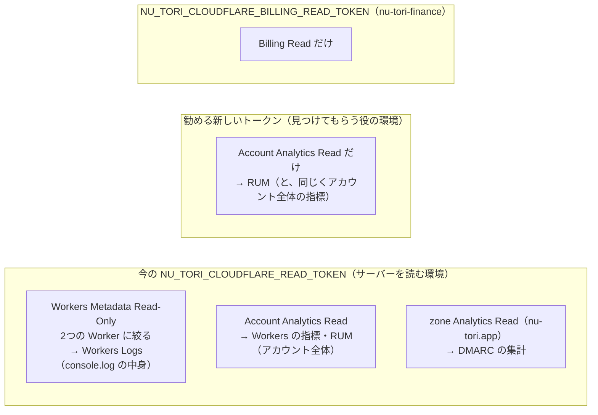

# Cloudflare Web Analytics で、LP の参照元とページごとの訪問をエージェントが読む

調査日: 2026-11-06
対象: 見つけてもらう役（#738）が、`nu-tori.app` の LP の参照元（referer）とページごとの訪問を、Cloudflare の GraphQL Analytics API で読めるか（#910 の「2. Cloudflare Web Analytics」）。あわせて、要るトークンの権限と、今の `NU_TORI_CLOUDFLARE_READ_TOKEN`（`scripts/cloudflare` 用）を流用できるか。Workers の指標・ログの読み方は `docs/research/cloudflare-agent-access.md` にあり、重なる事実（GraphQL の権限の名前など）は繰り返さない。

> **確認の方法と限界**
> - Cloudflare の文書は developers.cloudflare.com の Markdown 版（`<ページ>/index.md`）と `/web-analytics/llms.txt`・`/analytics/llms.txt` を読んだ（2026-11-06）。REST の口と受け付ける権限は、Cloudflare の公式の OpenAPI（cloudflare/api-schemas の `main` の `openapi.json`、2026-11-06 に取得）の `x-api-token-group` で確かめた。
> - GraphQL のデータセット・次元・指標・絞り込みは、文書に載っていないので、**この環境の `NU_TORI_CLOUDFLARE_READ_TOKEN` で introspection を呼んで確かめた**（「introspection で確認」）。データセットごとの上限は `settings` ノードで読んだ。
> - **同じトークンで `rumPageloadEventsAdaptiveGroups` を実際に呼んだ**（読むだけ。「実行で確認」）。読めた数字そのものはここに書かず、行があったか・次元が埋まっていたかまでを書く。
> - 本文で確かめた主張は「本文で確認」と書き、短い英語の原文を添える。OpenAPI で確かめたものは「ソースで確認」、本文や実行から推し量ったものは「読み取り」と書く。

## 結論の要約

- **読める。今の `NU_TORI_CLOUDFLARE_READ_TOKEN` で、クラウドのセッションから1回読めた**（実行で確認、2026-11-06）。`nu-tori.app` では Web Analytics がもう有効で、ビーコンは `site/src/web-analytics.ts` で外枠に手で置いてある（#652）。開発者が有効にする手順は要らない
- **データセットは account の `rumPageloadEventsAdaptiveGroups`**（"Beta. Aggregated RUM pageload event metrics with adaptive sampling"）。指標は `count`（ページビュー）と `sum { visits }`（ほかのサイトか直接来た訪問）。次元に `refererHost`・`refererPath`・`requestHost`・`requestPath`・`siteTag`・`date`・`bot`・`countryName`・`deviceType` などがある（introspection で確認）
- **絞り方は `requestHost: "nu-tori.app"` がよい**。`nu-tori.app` の行には site tag が2つあった（1つは 10-19 の1日だけ、もう1つは 10-22 から今まで）。ビーコンに書いてある値（`token`）は site tag と別物で、site tag の一覧を引く REST の口は `Account Settings Read` が要る（ソースで確認）。ホストで絞れば、site tag を知らなくても、増えても、取りこぼさない（読み取り）
- **クエリ文字列（UTM など）は取れない**。`requestPath` は "Path of the web page URL" で、クエリの次元は無く、実際の値にも `?` は無かった（introspection と実行で確認）。どこから来たかは参照元のホストとパスだけで見る
- **権限は `Account Analytics Read` で足りる**。今のトークンがこれを持ち、RUM が読めた。ただしこの権限はアカウント全体に効き、同じアカウントのほかのサイトの RUM と、Workers の指標も読める（実行で確認、`cloudflare-agent-access.md` の「問い4」）
- **新しいトークンを作るのを勧める**（`Account Analytics Read` だけ）。今のトークンは、加えて Workers の `Metadata Read-Only`（Workers Logs、つまり `console.log` の中身を読める）と、zone の `Analytics Read`（DMARC の集計）を持つ。見つけてもらう役にログは要らず、置く環境もサーバーを読む環境と分かれるので、要らない範囲を持たせない（読み取り）。お金の `NU_TORI_CLOUDFLARE_BILLING_READ_TOKEN`（`Billing Read` だけ、環境 `nu-tori-finance`）とは、どちらにしても別の鍵になる

## 問い1: データセットと、次元・指標・絞り方

| 主張 | 内容 | 確かめ方 | 出典 |
| --- | --- | --- | --- |
| RUM のデータセット | account に `rumPageloadEventsAdaptiveGroups`、`rumPerformanceEventsAdaptiveGroups`、`rumWebVitalsEventsAdaptive`、`rumWebVitalsEventsAdaptiveGroups` がある。どれも説明が "Beta." で始まる。参照元とページを読むのは pageload | introspection で確認 | `__type(name: "account")` |
| 指標 | `count`（"The number of pages viewed by end-users"）、`sum { visits }`（"... initiated from a different website (i.e. where the Document.referrer does not match the hostname)"）、`avg { sampleInterval }`、`confidence` | introspection で確認 | `AccountRumPageloadEventsAdaptiveGroups`・`...Sum` |
| 訪問の定義 | "Visits - A page view that originated from a different website or direct link. Cloudflare checks where the HTTP referer does not match the hostname." | 本文で確認 | https://developers.cloudflare.com/web-analytics/data-metrics/high-level-metrics/index.md |
| 次元 | `refererHost`・`refererPath`・`refererScheme`、`requestHost`・`requestPath`・`requestScheme`、`siteTag`、`date`・`datetimeHour` など時刻の刻み、`bot`（"Returns 1 if from a bot"）、`countryName`、`deviceType`、`navigationType`、`deliveryType`、`userAgentBrowser`・`userAgentOS` など | introspection で確認 | `AccountRumPageloadEventsAdaptiveGroupsDimensions` |
| 参照元のパス | "You can access `referer host` data on the dashboard. Additionally, you can access data for the `referer path` from the GraphQL API." | 本文で確認 | https://developers.cloudflare.com/web-analytics/data-metrics/dimensions/index.md |
| 絞り込み | `filter` に `siteTag`（`_in`・`_like` など）、`requestHost`（同）、`bot`、`date_geq`・`datetime_geq`/`_leq` などがあり、`AND`・`OR` も使える | introspection で確認 | `AccountRumPageloadEventsAdaptiveGroupsFilter_InputObject` |
| クエリ文字列 | 次元にクエリ（UTM）を表すものは無い。`requestPath` の値に `?` は無かった | introspection と実行で確認 | 同上 |
| 1回で読める幅と古さ | `settings` で `maxDuration` 8035200 秒（93 日）、`notOlderThan` 15897600 秒（184 日）、`maxPageSize` 10000 | 実行で確認 | `settings { rumPageloadEventsAdaptiveGroups { ... } }` |
| 保持と抜き取り | "Currently, you can access data for the previous six months."、"We retain unsampled beacon data for the past 7 days, after this point data is aggregated down to around 10%."。抜き取りの度合いは `sampleInterval` で分かる | 本文で確認 | https://developers.cloudflare.com/web-analytics/faq/index.md |
| site tag と token | ビーコンの `data-cf-beacon` の `token` と、GraphQL の `siteTag` は値が違った | 実行で確認 | `site/src/web-analytics.ts` |

問い合わせの形（実行で確認。`$a` はアカウントの ID）:

```graphql
query ($a: string!, $s: Time!, $e: Time!) {
  viewer { accounts(filter: { accountTag: $a }) {
    rumPageloadEventsAdaptiveGroups(
      limit: 1000
      orderBy: [sum_visits_DESC]
      filter: { requestHost: "nu-tori.app", bot: 0, datetime_geq: $s, datetime_leq: $e }
    ) {
      count
      sum { visits }
      avg { sampleInterval }
      dimensions { date refererHost refererPath requestPath }
    }
  } }
}
```

GraphQL は権限の不足や問い合わせの誤りを HTTP 200 と `errors` で返す（`scripts/cloudflare` の `fail_on_graphql_errors` と同じ扱いが要る）。

## 問い2: 要るトークンの権限

| 主張 | 内容 | 確かめ方 | 出典 |
| --- | --- | --- | --- |
| GraphQL の権限 | "select *Account* in the first drop-down list, *Account Analytics* from the second drop-down list, and *Read* from the third." | 本文で確認 | https://developers.cloudflare.com/analytics/graphql-api/getting-started/authentication/api-token-auth/index.md |
| RUM もそれで読める | `Account Analytics Read` を持つ今のトークンで、`rumPageloadEventsAdaptiveGroups` が `errors` なしに返った。RUM 専用の権限は要らなかった | 実行で確認 | — |
| site の一覧の口 | `GET /accounts/{account_id}/rum/site_info/list`（"List Web Analytics sites"）と `.../site_tag/list` は `Account Settings Read`。今のトークンでは 403（`Authentication error`） | ソースで確認、実行で確認 | openapi.json |
| 範囲 | `Account Analytics Read` はアカウント全体に効き、サイトごとに絞れない。実際、同じアカウントの `nu-tori.app` でないサイトの行も返った | 実行で確認 | `cloudflare-agent-access.md` の「問い4」 |

site の一覧は、問い合わせを `requestHost` で絞れば要らない。`Account Settings Read` はアカウントの設定を広く読む権限なので、足さない（読み取り）。

## 問い3: `nu-tori.app` で有効か、1回読めたか

- 有効。`site/src/web-analytics.ts` と `site/src/site-layout.tsx` が全ページの `<head>` にビーコンを置き（`site/src/worker.test.ts` が確かめている）、2026-11-06 に直近 30 日を問い合わせると、`requestHost` が `nu-tori.app` の行があった（実行で確認）
- `requestHost: "nu-tori.app"`・`bot: 0` で `siteTag`・`refererHost`・`requestPath`・`date` ごとに分けると、site tag は2つ、ページのパスは複数、外の参照元を持つ行もあった（実行で確認。数は書かない）
- 開発者が手でやることは、Web Analytics を有効にすることではなく、下の「勧める形」のトークンを作って環境に置くことだけ

## 問い4: 今のトークンを流用するか、新しく作るか



- 流用すると読めはする（実行で確認）。ただ、見つけてもらう役の環境に、Workers Logs を読める鍵を置くことになる。ログには `console.log` に書いたものがそのまま載る（`cloudflare-agent-access.md` の「返る中身のうち、公開の Issue・PR に貼ってはいけないもの」）。流入を読む役には要らない（読み取り）
- `Account Analytics Read` だけのトークンでも、Workers の呼び出しの数などの指標は読める（権限がアカウント全体に効くため。`cloudflare-agent-access.md` の「問い4」）。指標は数だけで記録の中身を含まないので、ここは割り切れる（読み取り）
- 名前は `NU_TORI_CLOUDFLARE_ANALYTICS_READ_TOKEN` のように今のものと分けると、どちらの鍵がどの環境にあるかが名前で分かり、スクリプトが要る鍵を名前で求められる（読み取り。`scripts/finance` が `NU_TORI_CLOUDFLARE_BILLING_READ_TOKEN` を使うのと同じ形）。アカウントの ID は `NU_TORI_CLOUDFLARE_ACCOUNT_ID` をそのまま使えるが、`scripts/finance` のようにトークンから引けば、置く値が1つ減る

## nu-tori への当てはめ

### 開発者が手でやること

1. Cloudflare のダッシュボードの Account API tokens で、アカウントの持つトークンを作る。権限は Account > Account Analytics > Read だけ
2. 見つけてもらう役を動かすクラウドの環境にだけ、そのトークンを置く（名前の案 `NU_TORI_CLOUDFLARE_ANALYTICS_READ_TOKEN`）。`nu-tori-finance` と、サーバーを読む環境には置かない

### 確かめていないこと

- 新しいトークン（`Account Analytics Read` だけ）で同じ問い合わせが通るか。今のトークンの3つの権限のうち効いているのは `Account Analytics Read` と見ているが、それだけのトークンでは呼んでいない
- site tag が2つある理由。10-19 の1日だけのものは、#652 でビーコンを置く前後の試しの名残とみているが、ダッシュボードで確かめていない。`requestHost` で絞る限り読み方は変わらない
- RUM のデータセットは "Beta." なので、名前や次元が変わりうる

## 出典一覧

- Web Analytics の索引: https://developers.cloudflare.com/web-analytics/llms.txt
- About: https://developers.cloudflare.com/web-analytics/about/index.md
- Dimensions: https://developers.cloudflare.com/web-analytics/data-metrics/dimensions/index.md
- High-level metrics: https://developers.cloudflare.com/web-analytics/data-metrics/high-level-metrics/index.md
- Limits: https://developers.cloudflare.com/web-analytics/limits/index.md
- FAQs: https://developers.cloudflare.com/web-analytics/faq/index.md
- GraphQL の索引: https://developers.cloudflare.com/analytics/llms.txt 、Datasets: https://developers.cloudflare.com/analytics/graphql-api/features/data-sets/index.md 、Configure an Analytics API token: https://developers.cloudflare.com/analytics/graphql-api/getting-started/authentication/api-token-auth/index.md
- OpenAPI: https://github.com/cloudflare/api-schemas の `openapi.json`（`/accounts/{account_id}/rum/site_info/*` の `x-api-token-group`）
- GraphQL の introspection と `settings` ノード: `POST https://api.cloudflare.com/client/v4/graphql`（2026-11-06、`NU_TORI_CLOUDFLARE_READ_TOKEN`）
