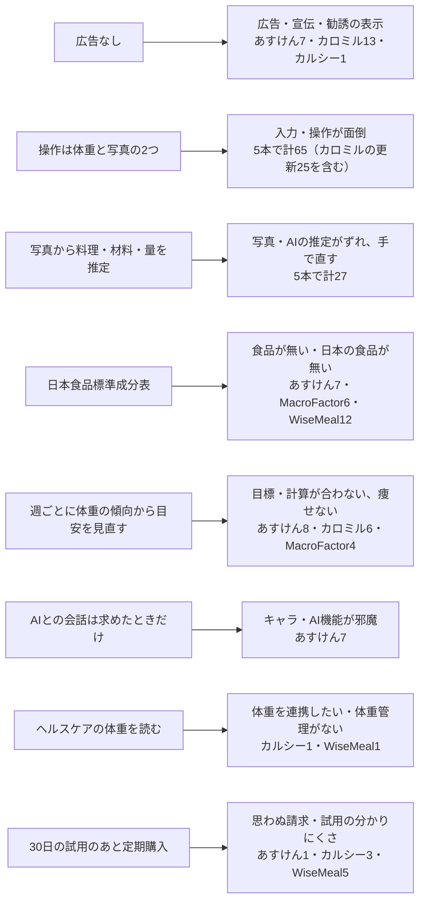

# 日本の App Store での競合の載せ方と、レビューに出る不満（検索語、商品ページ、最近のレビュー）

調査日: 2026-10-17
対象: nu-tori の売り方（App Store の名前・サブタイトル・説明文の言葉選び、何を売りにするか）を、思い込みでなく事実から決めるために、日本の App Store（`country=jp`）で次を集める。(1) 食事管理に関わる検索語で出てくるアプリ、(2) あすけん・カロミル・FiNC・MacroFactor・Foodnoms・SnapCalorie と、検索で上に出た写真で記録するアプリ（名前などに「AI」を含むもの）の商品ページ、(3) あすけん・カロミル・MacroFactor と写真で記録するアプリ 2 本の、最近のレビューで星 1〜3 に出る不満と、星 5 で褒められていること。nu-tori は、食事の写真から料理・材料・量と栄養（日本食品標準成分表）を推定し、ヘルスケアの体重の傾向から 1 日の目安の kcal を週ごとに見直す（MacroFactor に近い）iPhone のアプリで、ユーザーの操作は朝の体重と食事の写真の 2 つ、忘れた食事は文章で入れ、AI との会話は求めたときだけ、広告なし、30 日の試用のあと定期購入、という形を前提にする。

> **確認の方法と限界**
> - iTunes Search API（`https://itunes.apple.com/search?country=jp&entity=software&limit=10&term=…`）と Lookup API（`https://itunes.apple.com/lookup?country=jp&id=…`）の JSON を、このセッションから `curl` で**直接取得して読んだ**（2026-10-17）。API の文書（IT1）は「approximately 20 calls per minute」を上限とし、実際に何度か 403 が返ったので、間をあけて取り直した。
> - **iTunes Search API は検索の回数（検索ボリューム）を返さない。** 返すのは並んだアプリと、その評価の数（`userRatingCount`）などだけで、API の文書にも人気や回数の項目は無い【本文を探したが記述なし IT1】。評価の数は「その検索語がどれだけ検索されるか」ではなく「そのアプリがどれだけ評価されたか」を表す。
> - **API の並び順が、iPhone の App Store アプリで同じ語を検索したときの並び順と同じかは確かめていない。** API の文書に並び順の決め方の記述は無い【本文を探したが記述なし IT1】。`limit=10` を指定しても 9 件しか返らない語があった（理由は書かれていない）。
> - apps.apple.com/jp の各アプリのページ（HTML と、その中の `serialized-server-data` の JSON）を `curl` で取得し、名前（`h1`）、サブタイトル（`p.subtitle`）、「アプリ内購入」の一覧を読んだ。**ページの「アプリ内購入」は 1 アプリにつき最大 10 件ほどしか並ばず**、同じ名前で値段の違う項目（地域や時期で違う値段、紹介用の値段と思われるもの）が混ざる。どの値段が今の新規の人に出るのかは、ページからは分からない。
> - 公開のレビューの RSS（`https://itunes.apple.com/jp/rss/customerreviews/page=N/id=…/sortby=mostrecent/json`）を、各アプリ 2 ページ（1 ページ最大 50 件）取得し、星・日付・版・題・本文を読んだ。**書いた人の名前やニックネームはこの文書に載せない**。引用は短い抜粋だけにした。
> - 不満の分類は、この調査で星 1〜3 のレビューを 1 件ずつ読んで手で付けた。1 件に複数の不満があれば複数の分類に数えた。**分類の線引きは調査者の判断で、別の人が付ければ数は少し変わる。** 星 5 の「褒められていること」は、本文に含まれる語（「簡単」「楽」「写真」「痩せ」「続」など）を機械的に数えた目安で、褒めていない文脈の一致も混ざりうる。
> - レビューの RSS に出るのは**本文を書いたレビューだけ**で、星だけの評価は含まれない。RSS の星の分布は、ページに出る平均の評価（例: あすけん 4.43）よりずっと低い側に寄っていた。レビューで不満を書く人は、評価をつける人全体を代表しない。
> - Google Trends は、`trends.google.com/trends/explore` と内部の `trends/api/explore` の両方とも **429（Too Many Requests）が返り、取得できなかった**（GT2）。取得できたとしても、Trends は検索の回数ではなく 0〜100 の相対の値を返す【本文で確認 GT1】。Apple Ads の「検索人気度」（1〜5）は Apple Ads の画面の中で出す値で、このセッションには Apple Ads のアカウントが無いので取得していない（AA1,AA2）。Google 広告のキーワードプランナーは確かめていない。
> - 本文で確かめた事実は「本文で確認」、そこから推し量ったものは「本文からの読み取り」、探して無かったものは「本文を探したが記述なし」と書く。nu-tori に当てはめた部分は、ほとんどが読み取りに当たる。
> - 英語の本文（Foodnoms、SnapCalorie、Cal AI の説明文と英語のレビュー）は原文のまま引用した。
> - 二次情報（ランキングのまとめ、ASO の解説記事、ブログ）は使っていない。

## 結論の要約

- **日本語の検索語で、どの語でも上に出るのはあすけんとカロミル。** 「食事管理」「カロリー計算」「写真 カロリー」「AI 食事管理」「PFC」の 5 語で、2 本ともに上位 4 位以内に入る（「AI カロリー」ではカロミルが 1 位）【本文で確認 IT2】。評価の数はあすけん 147,325、FiNC 102,558、カロミル 45,726 で、2025 年以降に出た写真で記録するアプリ（カルシー 1,236、WiseMeal 1,105、カロサポ 740、カロミー 658）とは 1〜2 桁の差がある【本文で確認 IT3】。
- **検索の回数（ボリューム）は、一次の情報からは取れなかった。** iTunes Search API には回数の項目が無く【本文を探したが記述なし IT1】、Google Trends は 429 で取れず、取れても相対の 0〜100【本文で確認 GT1】、Apple Ads の検索人気度（1〜5 の相対）はアカウントの中でしか見られない【本文で確認 AA1,AA2】。**どの語が多く検索されるかは、この調査では言えない。**
- **「マクロ」は食事管理の語として働いていない。** 上位 9 件のうち 6 件が自動クリックの道具で、マクロファクターは 5 位【本文で確認 IT2】。「ダイエット 記録」「体重管理」の上位は、体重を記録するアプリ（SmartDiet 130,508 件など）が占め、食事を記録するアプリはあすけんだけ【本文で確認 IT2】。
- **名前に「AI」を入れているのは、2025 年以降に出た写真のアプリと海外のアプリ。** WiseMeal（名前「AIカロリー計算」）、Yazio、Cal AI、Lifesum、Nutrilio などで、あすけん・カロミル・FiNC・MacroFactor の名前とサブタイトルには「AI」が無い【本文で確認 IT2,AS1〜AS4】。カルシー・カロサポ・カロミーは名前に AI を入れず、「写真」「撮る」を名前かサブタイトルに入れている【本文で確認 AS7,AS9,AS11】。
- **最近のレビューの不満は、アプリによって中心が違う**【本文で確認 RV1〜RV5、分類は調査者】。あすけん（星 1〜3 が 46 件）は「入力・操作が面倒」10、「目標・採点・計算が合わない」8、「食品の不足」7、「広告・宣伝」7。カロミル（70 件）は「入力・操作」33 件で、うち 25 件が 2026 年 8〜9 月の更新で入力画面が変わったこと、次が「不具合」17、「広告」13。MacroFactor（16 件、2021〜2026 年）は「日本の食品が無い」6、「操作」6、「目標が低すぎる」4。写真のアプリのカルシー（28 件）は「不具合」13、「価格・課金」6（うち思わぬ請求・試用の分かりにくさ 3）、「写真・AI の推定のずれ」5、WiseMeal（49 件）は「価格・課金」15、「食品の不足」12、「入力」11、「不具合」11、「写真・AI のずれ」9。
- **写真で記録するアプリでは、推定がずれて手で直すのが手間、という不満が繰り返し出る**（「修正、修正で手打ちする羽目に」RV5、「玄米150gを250キロカロリーと出してきたと思ったら夕食時には130kcal」RV4）。和食・中華・手の込んだ料理の取り違えの例が多い（もずく→海苔、サバの味噌煮→別の料理、麦茶→天丼のタレ）【本文で確認 RV1,RV2,RV5】。
- **星 5 で多く褒められるのは、あすけんでは「痩せた」（29 件中 16 件に減量の語）と「続く・習慣」（12 件）、写真のアプリでは「写真を撮るだけ」（カルシー 8 件中 7 件）**【本文で確認 RV1,RV4、語の数え上げ】。
- **nu-tori の形と、観察した不満の対応（本文からの読み取り）。** 次の図の左が nu-tori の形、右がレビューで見た不満（数は 5 本の星 1〜3 の合計の目安）。

  - 対応は強さが違う。「広告」は、あすけん・カロミルで実際に多い不満で、nu-tori はそれを出さない形なので、売りとして当てはまりやすい（読み取り）。
  - 「入力が面倒」は、写真で記録するアプリ自身にも多い（WiseMeal 11、カルシー 5）。**写真で撮るだけ、は不満を消すとは限らず、推定がずれると「直す手間」の不満に変わる**（RV4,RV5 からの読み取り）。推定の当たりと、直しやすさの両方が要る。
  - 「目標が合わない」は、体重の傾向から目安を見直す MacroFactor にも 4 件あり、どれも「目安が低すぎる」（1,100〜1,500 kcal）という不満【本文で確認 RV3】。**週ごとに見直す形でも、この不満は消えない。** 最初の目安の出し方と、その説明が問われる（読み取り）。
  - 「思わぬ請求」は、試用から自動で有料に移ったこと、年額に入ったと気づかなかったことへの不満で、新しい写真のアプリに多い【本文で確認 RV1,RV4,RV5】。30 日の試用は、終わる日と値段を見せないと同じ不満を招く（読み取り）。
  - カロミルの例から、毎日触る入力の画面の配置を変えると、それだけで星 1 が続く（RV2、2026-08〜09 月に 25 件）。操作が 2 つしかない nu-tori では、その 2 つの画面を変えるときの影響が大きい（読み取り）。
  - 価格の目安（ページの「アプリ内購入」から）: あすけんは月 480〜980 円・年 4,400〜7,500 円、カロミルはプレミアム 480 円、MacroFactor は月 1,540 円・年 9,200 円、カルシーは月 700〜1,600 円・年 3,900〜5,800 円、WiseMeal は月 1,500〜3,000 円・年 3,000〜10,000 円【本文で確認 AS1〜AS8】。WiseMeal の「月3000円とあり得ない値段」（RV5）のように、月 3,000 円の水準には値段そのものへの不満が出ている。

## 問い1: 検索語で出るアプリ（iTunes Search API、country=jp）

**注意: ここに並ぶ数（評価の数）は検索の回数ではない。** 並び順も App Store アプリの検索の結果と同じとは限らない（「確認の方法と限界」）。書式は「順位. 名前 ／ 販売元 ／ ジャンル ／ 評価の数（平均）」。ジャンルは書いていなければ「ヘルスケア／フィットネス（Health & Fitness）」。すべて 2026-10-17 取得【本文で確認 IT2】。

### 「AI 食事管理」（9 件）
1. あすけん ダイエット・ヘルスケアのカロリー計算や体重管理に ／ asken inc. (Tokyo) ／ 147,325（4.43）
2. WiseMeal：AIカロリー計算・食事管理 ／ ENJOYMENT INTERNATIONAL LIMITED ／ 1,105（4.11）
3. ダイエットAI 食事管理 カロリー計算アプリ 体重 記録 ／ NEONSOAK ／ 37（4.08）
4. カロミル - ダイエット、カロリー＆PFC管理の健康アプリ ／ Life Log Technology, Inc. ／ 45,726（4.49）
5. カロミー：ダイエット・カロリー計算が楽しく続く！ ／ LABI INC ／ 658（4.32）
6. AIカロリー計算: Nutrilio ／ Habitics s.r.o. ／ 173（4.54）
7. ウェリー - パーソナルヘルスケアAI スマートバスマット ／ issin Inc. ／ 10,052（4.32）
8. MyFitnessPal: 健康管理 ／ MyFitnessPal, Inc. ／ 30,396（4.48）
9. ダイエットお助けAIアバター - 食事管理・体重記録・習慣化 ／ AI AVATAR, CO., LTD. ／ 93（4.57）

### 「AI カロリー」（9 件）
1. カロミル ／ 45,726（4.49）
2. カルシー Calsee 写真で簡単カロリー計算・ダイエット ／ Pixel Tokyo Inc. ／ 1,236（4.46）
3. WiseMeal：AIカロリー計算・食事管理 ／ 1,105（4.11）
4. ダイエットAI 食事管理 カロリー計算アプリ 体重 記録 ／ NEONSOAK ／ 37（4.08）
5. カロサポ - 写真で栄養・食事管理、PFC・カロリー計算も ／ Welsup Inc. ／ 740（4.47）
6. Puzz AI - カロリー記録 ／ Dat Pham ／ 56（4.38）
7. Yazio: AIカロリー計算 ダイエット記録 ／ YAZIO GmbH ／ 5,968（4.33）
8. Cal AI - Calorie Tracker ／ Viral Development LLC ／ 1,028（4.66）
9. Lifesum: AI Calorie Counter ／ Lifesum AB ／ 320（4.41）

### 「食事管理」（9 件）
1. あすけん ／ 147,325（4.43）
2. カロミル ／ 45,726（4.49）
3. FiNC ダイエット・健康管理のカロリー計算や体重記録アプリ ／ FINC TECHNOLOGIES INC. ／ 102,558（4.21）
4. MyFitnessPal: 健康管理 ／ 30,396（4.48）
5. ダイエット記録カレンダー ハミング ／ Shigeru Nakaya ／ 54,750（4.60）
6. PFCボディメイク ／ Yamada Taku ／ 4,842（4.70）
7. WiseMeal ／ 1,105（4.11）
8. カルシー ／ 1,236（4.46）
9. マクロファクターPFC・ダイエット・食事管理・カロリー計算 ／ Stronger By Science Technologies LLC ／ 1,131（4.70）

### 「カロリー計算」（9 件）
1. あすけん ／ 147,325（4.43）
2. カロミル ／ 45,726（4.49）
3. カルシー ／ 1,236（4.46）
4. FiNC ／ 102,558（4.21）
5. かんたんカロリー管理 - 食事記録やダイエット、健康のために ／ Daiki Tsukuda ／ 610（4.47）
6. カロリー記録 - 摂取カロリーを記録・管理・分析 ／ NAOYA ONO ／ 19（4.58）
7. MyFitnessPal ／ 30,396（4.48）
8. WiseMeal ／ 1,105（4.11）
9. メシトラ - カロリー記録, PFC バランス 計算 ／ Jun Hirobayashi ／ 2,324（4.36）

### 「ダイエット 記録」（9 件）
1. SmartDiet ダイエットの体重記録で痩せるダイエット ／ Komorebi Inc. ／ 130,508（4.60）
2. ダイエット記録カレンダー ハミング ／ 54,750（4.60）
3. シンプルダイエット 体重記録をグラフ、カレンダーで管理できる ／ i-mobile Co.,Ltd ／ 23,871（4.54）
4. my nicca - 目標達成のためのシンプル習慣化アプリ ／ FURYU Corporation ／ 6,181（4.71）
5. ゆるっとダイエット カナヘイの体重管理アプリ ／ UNITED, Inc. ／ 11,729（4.26）
6. 継続する技術｜ダイエットも筋トレも記録・習慣化で目標達成 ／ bondavi Inc. ／ 53,376（4.78）
7. Cahoのかわいいダイエットアプリ ／ Masaya Kato ／ 18,438（4.62）
8. あすけん ／ 147,325（4.43）
9. 簡単ダイエット記録！おでかけマイメロデ ／ SANRIO WAVE CO.,LTD. ／ 21,588（4.46）

### 「写真 カロリー」（10 件）
1. あすけん ／ 147,325（4.43）
2. カロミル ／ 45,726（4.49）
3. Senumi: AIカロリー計算 ／ Debby Nirwan ／ 0（2026-09-28 公開）
4. カルシー ／ 1,236（4.46）
5. FoodLog : 写真でカロリー管理 ／ foo.log Inc. ／ 54（2.76）
6. カロママプラス カロリー計算 食事のパーソナルアドバイス ／ Wellmira Inc. ／ 2,677（3.91）
7. カロミー ／ 658（4.32）
8. Avocado | 写真で簡単カロリー計算 ／ APOC, K.K. ／ 2（5.0）
9. カロリー計算・食事記録 - 写真でAI分析 ／ Evgenii Evsiukov ／ 3（3.0）
10. ワンショット栄養管理｜写真でカロリー記録 ／ Masato Kurita ／ 1（1.0）

### 「食事 写真」（10 件）
1. フォトミール 写真で食事管理 ／ Kenta Iso ／ 33（4.70）
2. カロミル ／ 45,726（4.49）
3. Foodie(フーディー)-料理がおいしく撮れるカメラ ／ SNOW Corporation ／ 写真／ビデオ ／ 80,160（4.53）
4. 食事記録 mogmog ／ Yuma Ikeda ／ 56（4.54）
5. あすけん ／ 147,325（4.43）
6. ミイルｰ料理写真カメラできれい！日記とグルメ店検索 ／ miil inc. ／ フード／ドリンク ／ 407（3.91）
7. English Reels ／ SHINING APPS LLC ／ 教育 ／ 2（5.0）
8. ダイエット記録カレンダー ハミング ／ 54,750（4.60）
9. シンプル日記 - 写真を貼れる日記帳ダイアリー ／ Komorebi Inc. ／ ライフスタイル ／ 143,405（4.59）
10. ごはんlog ／ Sugahara Yuta ／ フード／ドリンク ／ 3（4.0）

### 「体重管理」（9 件）
1. SmartDiet ／ 130,508（4.60）
2. ダイエット記録カレンダー ハミング ／ 54,750（4.60）
3. シンプルダイエット ／ 23,871（4.54）
4. あすけん ／ 147,325（4.43）
5. 体重管理アプリSmartRecord ：ダイエット・筋トレ ／ Komorebi Inc. ／ 23,480（4.50）
6. 簡単ダイエット！おさんぽハローキティ ／ SANRIO WAVE CO.,LTD. ／ 39,091（4.29）
7. Cahoのかわいいダイエットアプリ ／ 18,438（4.62）
8. ゆるっとダイエット カナヘイの体重管理アプリ ／ 11,729（4.26）
9. シンプル体重管理 - Yasegramで簡単ダイエット ／ FURYU Corporation ／ 9,966（4.39）

### 「PFC」（10 件）
1. カロミル ／ 45,726（4.49）
2. PFCボディメイク ／ 4,842（4.70）
3. PFCバランス タンパク質を計算・記録できる食事日記 ／ Ryohei Kawamon ／ 109（4.44）
4. あすけん ／ 147,325（4.43）
5. MyFitnessPal ／ 30,396（4.48）
6. 「PFC食事記録」バランスを考えた食事の記録 ／ Masaya Kato ／ スポーツ ／ 765（4.55）
7. PFCログ - ボディメイク、PFC&カロリー管理のアプリ ／ HOTATE JUNSHI ／ 35（4.49）
8. PFC記録 - タンパク質（P）、脂質（F）、炭水化物（C） ／ NAOYA ONO ／ 1（5.0）
9. マクロファクター ／ 1,131（4.70）
10. カルシー ／ 1,236（4.46）

### 「マクロ」（9 件）
1. Auto Clicker - Click Assistant ／ 仕事効率化 ／ 700
2. ポイ活アンケート マクロミル ポイント貯まる副業 節約アプリ ／ MACROMILL,INC. ／ ライフスタイル ／ 5,038
3. オートクリッカー - 連打ツール - 自動クリッカー ／ ユーティリティ ／ 563
4. Auto Click - Auto Clicker app ／ ユーティリティ ／ 187
5. マクロファクター ／ 1,131（4.70）
6. 自動クリッカー・自動タップ ／ 仕事効率化 ／ 7
7. ショートカット ／ iTunes K.K. ／ 仕事効率化 ／ 28,994
8. オートクリッカー - Auto Tap ／ ユーティリティ ／ 16
9. オートクリッカー - 自動クリック, 連打ツール ／ 仕事効率化 ／ 503

### 検索語から読み取れること

- あすけん・カロミルは、名前に「カロリー計算」「体重管理」「PFC管理」を、サブタイトルに「食事記録」「カロリー計算」を並べている【本文で確認 AS1,AS2】。名前とサブタイトルに入れた語でヒットしている、と見るのが自然（本文からの読み取り。Apple の検索の決め方は確かめていない）。
- 「AI カロリー」の上位 9 件のうち 6 件は名前に「AI」を含む。一方「食事管理」「カロリー計算」では、名前に AI を含むのは WiseMeal 1 本だけ【本文で確認 IT2】。
- マクロファクターは日本の名前に「PFC」「食事管理」「カロリー計算」を入れ、「食事管理」で 9 位、「PFC」で 9 位に出る【本文で確認 IT2,AS4】。日本の利用者に「マクロ」でなく「PFC」と書いて届けている（本文からの読み取り）。
- 「ダイエット 記録」「体重管理」は、体重を付けるだけのアプリが占める。nu-tori の「朝の体重」だけを売り文句にすると、これらと並ぶことになる（本文からの読み取り）。

## 問い2: 競合の商品ページ（apps.apple.com/jp、Lookup API）

書式: 名前／サブタイトル／説明文の最初の数行（抜粋）／ジャンル／評価／値段と「アプリ内購入」／「AI」の有無（名前・サブタイトル・説明文）。評価・ジャンル・説明文は Lookup API、サブタイトルとアプリ内購入はページから【本文で確認 IT3,AS1〜AS11】。

### あすけん（id687287242、2013-09 公開、版 10.3.0）
- 名前: あすけん ダイエット・ヘルスケアのカロリー計算や体重管理に
- サブタイトル: カロリー計算や体重管理に！ダイエット/だいえっとに最適
- 説明文の最初: 「■ダイエットアプリNO.1 あすけんで食事・体重管理 ■カロリー計算や栄養・運動記録もこれ一つ！ ■誰でも無料ではじめられます！」「バーコードや写真を撮るだけで簡単に食事記録ができ、…管理栄養士監修のアドバイスをあなただけに毎日お届けします！」
- ジャンル: ヘルスケア／フィットネス（ほかにライフスタイル）
- 評価: 4.43（147,325 件）
- 値段: 無料、アプリ内購入あり。プレミアムサービス 月 480 円（月額会員）・1 か月 580 円・6 か月 2,300 円・1 年 4,400 円、プレミアム Plus 1 か月 980 円・6 か月 3,900 円・1 年 7,500 円
- AI: 名前・サブタイトルに無し。説明文に「AIおまかせ記録」（2 回）。説明文には、プレミアムでもタイアップ広告は出ることがある、と書いてある
- ヘルスケア: 歩数・体重などを連携すると説明文に書く

### カロミル（id963055562、2015-02 公開、版 4.1.7）
- 名前: カロミル - ダイエット、カロリー＆PFC管理の健康アプリ
- サブタイトル: 食事記録とカロリー計算で健康的なダイエットと栄養バランス管理
- 説明文の最初: 「カロリーのみでなく、糖質やたんぱく質の管理ができるようになっていますので、ロカボ・ダイエットや糖質制限にもご活用いただけます。」
- ジャンル: ヘルスケア／フィットネス（ほかにフード／ドリンク）
- 評価: 4.49（45,726 件）
- 値段: 無料、アプリ内購入あり。プレミアムプラン 480 円、応援プラン 300 円、ほか機能ごとの課金（食事提案 360 円、除脂肪コース 540 円、曜日ごとカロリー設定 300 円など）
- AI: 名前・サブタイトル・説明文のどれにも「AI」の字は無い（説明文は「画像解析」と書く）。説明文に「オンライン広告の掲載を開始しました」「カロミル応援プラン」で広告を消せる、とある

### FiNC（id965626396、2015-02 公開、版 11.3.3）
- 名前: FiNC ダイエット・健康管理のカロリー計算や体重記録アプリ
- サブタイトル: 歩数・食事・睡眠・生理・運動記録とBMIをまとめてサポート
- 説明文の最初: 「ダイエットに必要な体重管理やカロリー計算はもちろん、食事管理や運動記録（万歩計・歩数計）、生理管理や睡眠記録もこのアプリひとつでOK！」
- ジャンル: ヘルスケア／フィットネス（ほかにライフスタイル）
- 評価: 4.21（102,558 件）
- 値段: 無料、アプリ内購入あり。FiNC プラス 480 円〜3,800 円、FiNC プレミアム 960 円〜8,700 円、FiNC PLAY 980 円・9,800 円（期間の表示はページに無い）
- AI: 名前・サブタイトルに無し。説明文に「AI献立相談」（AI パートナーとチャットで相談）

### MacroFactor（id1553503471、2021-09 公開、版 5.8.9）
- 名前: マクロファクターPFC・ダイエット・食事管理・カロリー計算
- サブタイトル: カロリー計算と体重管理を習慣化する食事記録・栄養管理アプリ
- 説明文の最初: 「高品質の食品データベースと充実したデータ入力ツールを搭載し、正確な食事記録が手早く直感的に取れる。」「ユーザー様の食事データから独自のアルゴリズムがカロリー消費量を推定。個人に合わせたカロリーと三大栄養素の摂取量をプログラム化し目標を狙い撃ち。」「広告一切なしの有料プランをぜひ7日間の無料トライアルをお試しください！」
- ジャンル: ヘルスケア／フィットネス
- 評価: 4.70（1,131 件）
- 値段: 無料、アプリ内購入あり。月 1,540 円、6 か月 6,100 円、年 9,200 円（ほかに年 6,600 円、年のまとめ買い 11,500 円の項目）
- AI: 名前・サブタイトル・説明文のどれにも無し

### Foodnoms（id1479461686、2019-11 公開、版 2026.17）
- 名前: Nutrition Tracker: Foodnoms
- サブタイトル: 日本のページでは、サブタイトルの位置にジャンル名「ヘルスケア／フィットネス」が出る（サブタイトルは出ていない）
- 説明文の最初（英語）: "Foodnoms is the nutrition tracker that respects your time and your privacy. Log meals in seconds, set goals that fit the way you eat, and watch your progress add up. No ads, no spam."
- ジャンル: ヘルスケア／フィットネス（ほかにフード／ドリンク）
- 評価: 4.39（23 件）
- 値段: 無料、アプリ内購入あり。Foodnoms+ 月 900 円・1,500 円、年 6,000 円・8,000 円、家族向けもあり
- AI: 名前・サブタイトルに無し。説明文に 3 回（写真や言葉で記録する機能の説明）。言語は英語のみ（`languageCodesISO2A` が EN だけ）

### SnapCalorie（id1574239307、2021-11 公開、版 141.0.4）
- 名前: SnapCalorie AI Calorie Counter
- サブタイトル: Foodnoms と同じく、ジャンル名が出る
- 説明文の最初（英語）: "The fastest and most accurate way to track your food. SnapCalorie isn't another complicated calorie counter - just snap a photo or voice note, and get instant nutrition data in seconds."
- ジャンル: ヘルスケア／フィットネス（ほかにフード／ドリンク）
- 評価: 4.41（37 件）
- 値段: 無料、アプリ内購入あり。SnapCalorie Premium 1,500 円〜22,000 円（月・年の別がある項目とない項目が混ざる）
- AI: 名前に有り、説明文に 7 回。言語は英語のみ

### カルシー Calsee（id6743029309、2025-03 公開、版 1.28）
- 名前: カルシー Calsee 写真で簡単カロリー計算・ダイエット
- サブタイトル: ダイエットや体重管理に！写真を撮るだけでカロリー＆PFC計算
- 説明文の最初: 「Calsee（カルシー）は、食事の写真を撮るだけで、AIがカロリーやPFCバランス（タンパク質・脂質・炭水化物）を自動計算してくれる、次世代の食事管理・体重管理ダイエットアプリです。」「面倒な入力は不要で、…」
- ジャンル: ヘルスケア／フィットネス（ほかにライフスタイル）
- 評価: 4.46（1,236 件）
- 値段: 無料、アプリ内購入あり。Premium 週 290 円、月 700〜1,600 円、3 か月 1,790 円、年 3,900〜5,800 円
- AI: 名前・サブタイトルに無し、説明文に 8 回

### WiseMeal（id6739987348、2025-03 公開、版 1.7.7）
- 名前: WiseMeal：AIカロリー計算・食事管理
- サブタイトル: カロリー・体重管理、食事記録に！ダイエットと筋トレに最適
- 説明文の最初: 「WiseMeal：AIカロリー計算・かんたん食事管理・栄養トラッカー」「毎日の食事管理にお悩みですか？WiseMealは、手軽なダイエットと健康管理のために設計された、オールインワンのAIカロリートラッカー・スキャナー・栄養管理アプリです。」
- ジャンル: ヘルスケア／フィットネス
- 評価: 4.11（1,105 件）
- 値段: 無料、アプリ内購入あり。週 1,500 円、月 1,500 円・3,000 円、年 3,000 円〜10,000 円、Premium 3,500〜8,000 円
- AI: 名前に有り、説明文に 9 回

### カロサポ（id6753960287、2025-10 公開、版 4.20）
- 名前: カロサポ - 写真で栄養・食事管理、PFC・カロリー計算も
- サブタイトル: ダイエット・筋トレ・体重記録用、レコーディングでボディメイク
- 説明文の最初: 「「記録が面倒」で、食事管理を諦めていませんか？ カロサポは、起動から完了まで最短2タップ。…」「「ご飯の写真を撮るだけ」「チャットで送るだけ」。」
- ジャンル: ヘルスケア／フィットネス（ほかにライフスタイル）
- 評価: 4.47（740 件）
- 値段: 無料、アプリ内購入あり。月 600〜1,280 円、年 4,800〜6,000 円、年の特別オファー 3,600 円
- AI: 名前・サブタイトルに無し、説明文に 4 回。チャットで文章を送って記録する機能、ヘルスケアの歩数・ワークアウトの連携を説明文に書く

### Cal AI（id6480417616、2024-04 公開、版 26.41.0）
- 名前: Cal AI - Calorie Tracker
- サブタイトル: ジャンル名が出る
- 説明文の最初（英語）: "HOW TO USE CAL AI: 1) Answer lifestyle questions to build your plan 2) Snap a photo of your meal*"
- ジャンル: ヘルスケア／フィットネス（ほかにフード／ドリンク）
- 評価: 4.66（1,028 件）
- 値段: 無料、アプリ内購入あり。Unlimited 780 円〜6,000 円、Streak Restore 150 円
- AI: 名前に有り、説明文に 2 回。対応言語に日本語（JA）を含むが、日本のページの説明文は英語

### カロミー（id6751512744、2025-11 公開、版 2.5.1）
- 名前: カロミー：ダイエット・カロリー計算が楽しく続く！
- サブタイトル: 写真から簡単カロリー計算/ダイエットや筋トレに最適！
- 説明文の最初: 「撮るだけでAIがカロリーを自動計算。もう面倒な入力は不要です。」「「ダイエットが続かない」「カロリー計算が面倒」を、カロミーが解決。」
- ジャンル: ヘルスケア／フィットネス（ほかにライフスタイル）
- 評価: 4.32（658 件）
- 値段: 無料、アプリ内購入あり。SUPER プラン 月 680 円・年 5,800 円、初回特別オファー 3,000 円
- AI: 名前・サブタイトルに無し、説明文に 8 回

### 商品ページから読み取れること

- **写真のアプリは、説明文の最初の 1〜2 文で「面倒な入力は不要」と言い切る**（カルシー、カロミー、カロサポ）【本文で確認 AS7,AS9,AS11】。売り文句の中心が「入力が面倒」の解消である点は、どれも同じ（本文からの読み取り）。
- **「広告なし」を説明文に書いているのは MacroFactor（「広告一切なしの有料プラン」）と Foodnoms（"No ads, no spam."）**【本文で確認 AS4,AS5】。日本のアプリでは、カロミル・FiNC・あすけんが「広告非表示」を有料の特典として書く【本文で確認 IT3】。
- **日本食品標準成分表を説明文に書いているアプリは、調べた 11 本の中に無かった**（「成分表」の語は、カロミルの「栄養成分表示を画像解析」だけ）【本文を探したが記述なし IT3】。
- 体重の傾向から目安を見直すことを説明文に書くのは MacroFactor だけ（「独自のアルゴリズムがカロリー消費量を推定」）【本文で確認 AS4】。

## 問い3: 最近のレビューの不満と、褒められていること

取得したレビュー（RSS、新しい順、各 2 ページまで）【本文で確認 RV1〜RV5】:

- あすけん: 100 件（2026-09-09〜10-15）。星 1: 28、2: 12、3: 6、4: 25、5: 29
- カロミル: 100 件（2026-06-04〜10-14）。星 1: 28、2: 20、3: 22、4: 14、5: 16
- MacroFactor: 45 件（2 ページ目は空。2021-10-21〜2026-09-21 と期間が長い）。星 1: 10、2: 4、3: 2、4: 5、5: 24
- カルシー: 43 件（2 ページ目は空。2025-03-11〜2026-09-27）。星 1: 18、2: 4、3: 6、4: 7、5: 8
- WiseMeal: 77 件（2025-09-29〜2026-10-13）。星 1: 27、2: 10、3: 12、4: 9、5: 19

写真で記録するアプリ 2 本には、「AI カロリー」「写真 カロリー」で上に出て評価の数が多いカルシーと WiseMeal を選んだ。

### 分類（星 1〜3 に付けた不満の種類）

- **入力・操作**: 入力が面倒、遅い、画面が使いにくい、更新で操作が変わった、推定を手で直す手間
- **写真・AI のずれ**: 写真や文章からの推定が違う料理・量になる、写真の機能が使えない
- **食品の不足**: 食品・料理・商品が見つからない、検索で出ない、日本の食品が無い
- **広告・勧誘**: 広告、物販の宣伝、有料プランを勧める表示
- **価格・課金**: 値段が高い、無料で使える範囲が狭い、思わぬ請求、試用の分かりにくさ
- **目標・計算**: 目安の kcal や PFC が合わない・自分で決められない、採点が合わない、痩せない・太った
- **キャラ・アドバイス**: 栄養士のキャラやコメントが不快、消せない
- **AI 機能が邪魔**: AI の機能が邪魔、消せない
- **不具合**: 落ちる、開かない、表示されない、ログインできない、データが消える
- **サポート・解約**: 問い合わせ先・解約の方法が分からない
- **その他**: 年齢の設定、権限、機能の要望、中身の無い罵倒など

### あすけん（星 1〜3、46 件）
- 入力・操作 10 — 「使うこと自体が面倒になった」
- 目標・計算 8 — 「カロリー摂取量が自分で設定できない」、「目標以下のカロリーを維持し…体重が「増えた」」
- 食品の不足 7 — 「食材単体でのデータの登録が非常に少ない」
- 広告・勧誘 7 — 「課金してるのに体重計の宣伝ばかり」
- 写真・AI のずれ 5 — 「写真でのカロリー判断は実用に全く耐えない」
- 価格・課金 5 — 「無料期間過ぎたら課金しないと写真判断不可になります」、「登録終わったらプレミアムでした」
- 不具合 5 — 「機種変してログインしても過去のデータが全く継承されず」
- キャラ・アドバイス 4 — 「栄養士キャラのコメントがイラッっとします」
- AI 機能が邪魔 3 — 「AI機能が邪魔すぎる」
- サポート・解約 2、その他 5（年齢の設定、食品ごとの栄養が見られない、中身の無いもの）

### カロミル（星 1〜3、70 件）
- 入力・操作 33（うち 25 件が 2026-08〜09 月の更新で入力画面、特に検索欄が下に移ったこと） — 「検索欄を今まで上にあったのに下に移動した」
- 不具合 17 — 「最近使い物にならないくらいアプリが落ちます」、記録が二重になる、体重のグラフに値が出ない
- 広告・勧誘 13 — 「急に広告の音が鳴る」、「広告を誤タップしやすくなった」
- 写真・AI のずれ 6 — 「コップに入った麦茶を天丼のタレ」
- 目標・計算 6 — 「pfcの合計カロリーと総カロリーが一致しない」
- 価格・課金 3 — 「1週間トータルが有料化」
- サポート・解約 2、その他 6（写真の権限を何度も聞かれる 2、Google Health の連携、自由入力・共有の要望）
- 食品の不足 0（むしろ星 3 に「検索精度が高く」という声がある）

### MacroFactor（星 1〜3、16 件。2021〜2026 年にわたる）
- 食品の不足 6 — 「ほっともっとなどとお弁当屋さんのメニューが反映されてなくて」、"I literally can’t log anything using barcode"
- 入力・操作 6 — 「情報が散漫していて見づらい」
- 目標・計算 4 — 「1ヶ月で2キロ落とそうとすると摂取カロリーが1100になるのはおかしくないか？」（4 件とも目安が低すぎるという不満）
- 価格・課金 3 — "the subscription price is quite steep"、二重請求
- 不具合 3 — 「料理を検索しても検索結果がありません」
- 写真・AI のずれ 2 — "The AI feature fails constantly"
- サポート・解約 1、その他 2（18 歳未満が登録できない、Apple Watch に対応しない）

### カルシー（星 1〜3、28 件）
- 不具合 13 — 「画面が真っ白だったり、ログインできなかったり」
- 価格・課金 6 — 「勝手に年間プランにされていた」、「基本的な自分で入力する方すら、課金しないと出来ない」
- 写真・AI のずれ 5 — 「玄米150gを250キロカロリーと出してきたと思ったら夕食時には130kcal」
- 入力・操作 5 — 「1個づつ選択して、また戻って登録、になるのが、面倒」
- 広告・勧誘 1（有料にしたあとも購入の画面が出る）、その他 2（「体重も反映されるようにして欲しい」など）

### WiseMeal（星 1〜3、49 件）
- 価格・課金 15 — 「いきなり¥10000の決済」、「写真からカロリー計算してもらうのは有料なんですね」
- 食品の不足 12 — 「検索しても出てくるのは中国語」
- 入力・操作 11 — 「修正、修正で手打ちする羽目に」
- 不具合 11 — 「運動を保存を押すとアプリが強制終了する」
- 写真・AI のずれ 9 — 「鳥の胸肉をチーズと判断したりします」、「中華料理や手の込んだ素材が複数混ざっていると、全く認識できていない」
- サポート・解約 2 — 「サブスク解約の場所がどかにもなく」
- 目標・計算 1、その他 3（筋トレの運動が無い、「体重管理はできないのかね？」）

### 星 5 で褒められていること（語の数え上げ、目安）
- **あすけん（29 件）**: 減量の語（痩せ・キロ・kg）16、「続」「習慣」12、「簡単」「楽」7、「写真」3。体重が何 kg 減った、という報告が中心【本文で確認 RV1】
- **カロミル（16 件）**: 「使いやすい」5、「続」「習慣」5、減量 3。あすけんの点数・キャラを避けて移ってきた、という声が 2 件（「あすけんの点数に一喜一憂してしまい、記録がストレスになっていた」）【本文で確認 RV2】
- **MacroFactor（24 件）**: 「見やすい」「グラフ」5、減量 5、「使いやすい」4、値段に見合う 3、食品の多さ 3。体重の傾向や推定の消費 kcal を出す分析を褒める声がある（「入力したデータから体重のトレンドや推定消費カロリー等を算出する機能」）【本文で確認 RV3】
- **カルシー（8 件）**: 「写真」「撮る」7、「簡単」3、「精度」3（あすけんより画像解析の精度が高い、とする声を含む）【本文で確認 RV4】
- **WiseMeal（19 件）**: 「写真」4、「続」4、「簡単」3、「使いやすい」3。短い本文が多い【本文で確認 RV5】

### レビューから読み取れること
- 大手 2 本（あすけん・カロミル）は、褒められているのが「痩せた」「続いた」という結果で、不満は広告・操作の変更・点数やキャラへの苛立ちに寄る。写真の新しいアプリは、褒められているのが「撮るだけ」の手軽さで、不満は不具合・課金・推定のずれに寄る（本文からの読み取り）。
- 新しい写真のアプリの「価格・課金」の不満の多くは、値段そのものより「無料だと思った」「試用から気づかずに有料になった」「年額に入っていた」という、課金の分かりにくさについて（カルシー 6 件中 3 件、WiseMeal 15 件中少なくとも 5 件。読み取り）。
- 写真の推定の取り違えは、和食・中華・混ぜた料理で多い（読み取り）。日本の食品の不足は、海外のアプリ（MacroFactor、WiseMeal）で多い。

## 関連して見つけたこと
- あすけんの説明文には、AI で記録する機能（「AIおまかせ記録」）が「連携先システムの規約に基づき、現状18歳以…」と年齢の条件付きで書かれている【本文で確認 IT3】。MacroFactor にも、App Store の年齢の表示と、アプリ内の 18 歳未満の制限が食い違うというレビューがある【本文で確認 RV3】。
- カロミルは、入力画面の変更への不満を受けて、v4.1.5 で設定から元の配置に戻せるようにした、とレビューに書かれている（「メニュー>各種設定 から直せるようになった」）【本文で確認 RV2】。
- 「写真 カロリー」の結果には、2026 年 7〜9 月に出たばかりの写真のアプリが 3 本（Senumi、Avocado、ワンショット栄養管理）入っており、評価の数は 0〜2 件【本文で確認 IT2】。新しく出るアプリが少ない評価の数でも上に出ることがある（読み取り）。

## 出典一覧

### Apple の API と文書
- IT1: iTunes Search API（Apple Services Performance Partners） — https://performance-partners.apple.com/search-api
- IT2: iTunes Search API の検索の結果（2026-10-17 取得）。`https://itunes.apple.com/search?country=jp&entity=software&limit=10&term=<語>` の `<語>` を次にしたもの: `AI 食事管理`、`AI カロリー`、`食事管理`、`カロリー計算`、`ダイエット 記録`、`写真 カロリー`、`食事 写真`、`体重管理`、`PFC`、`マクロ`。Foodnoms と SnapCalorie の id は `term=Foodnoms`、`term=SnapCalorie` で引いた
- IT3: Lookup API（2026-10-17 取得） — https://itunes.apple.com/lookup?country=jp&id=687287242,963055562,965626396,1553503471,1479461686,1574239307,6743029309,6739987348,6753960287,6480417616,6751512744
- AA1: Apple Ads Glossary（Search popularity） — https://ads.apple.com/app-store/help-glossary
- AA2: Apple Ads Recommendations — https://ads.apple.com/app-store/best-practices/recommendations

### App Store のページ（apps.apple.com/jp、2026-10-17 取得）
- AS1: あすけん — https://apps.apple.com/jp/app/id687287242
- AS2: カロミル — https://apps.apple.com/jp/app/id963055562
- AS3: FiNC — https://apps.apple.com/jp/app/id965626396
- AS4: マクロファクター — https://apps.apple.com/jp/app/id1553503471
- AS5: Foodnoms — https://apps.apple.com/jp/app/id1479461686
- AS6: SnapCalorie — https://apps.apple.com/jp/app/id1574239307
- AS7: カルシー Calsee — https://apps.apple.com/jp/app/id6743029309
- AS8: WiseMeal — https://apps.apple.com/jp/app/id6739987348
- AS9: カロサポ — https://apps.apple.com/jp/app/id6753960287
- AS10: Cal AI — https://apps.apple.com/jp/app/id6480417616
- AS11: カロミー — https://apps.apple.com/jp/app/id6751512744

### レビューの RSS（2026-10-17 取得、各 page=1 と page=2）
- RV1: あすけん — https://itunes.apple.com/jp/rss/customerreviews/page=1/id=687287242/sortby=mostrecent/json
- RV2: カロミル — https://itunes.apple.com/jp/rss/customerreviews/page=1/id=963055562/sortby=mostrecent/json
- RV3: MacroFactor — https://itunes.apple.com/jp/rss/customerreviews/page=1/id=1553503471/sortby=mostrecent/json
- RV4: カルシー — https://itunes.apple.com/jp/rss/customerreviews/page=1/id=6743029309/sortby=mostrecent/json
- RV5: WiseMeal — https://itunes.apple.com/jp/rss/customerreviews/page=1/id=6739987348/sortby=mostrecent/json

### Google Trends
- GT1: How Trends data is adjusted（Trends Help） — https://support.google.com/trends/answer/4365533?hl=en
- GT2: 取得を試みて 429 が返ったもの — https://trends.google.com/trends/explore?geo=JP&q=%E9%A3%9F%E4%BA%8B%E7%AE%A1%E7%90%86 、`https://trends.google.com/trends/api/explore?hl=ja&tz=-540&req=…`（「食事管理」、geo=JP、過去 12 か月）
