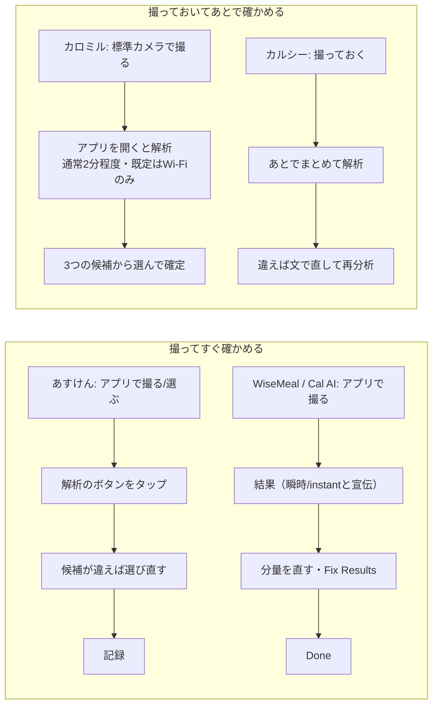

# 競合の、食事の写真を撮ってから記録になるまでの流れ（待ち時間と確定の操作）

調査日: 2026-10-17
対象: 写真で食事を記録する競合（あすけん、カロミル、カルシー、WiseMeal、Cal AI）で、写真を撮ったあと、(1) アップロードや解析を待つ必要があるか、(2) 解析の結果を見て確定・登録する操作をしないと記録にならないか、(3) 待ち時間は何秒・何分と書かれているか、またはレビューでどう言われているかを、一次の情報から確かめる。「撮ったらスマホを置いて食べられる」（Issue #596、「一般公開の準備の範囲と方針を決める」の 17）を仮説として確かめる材料にする。アプリの ID・検索順位・価格・レビューの不満の全体は `docs/research/competitor-app-store-listings.md`（ブランチ `claude/release-prep`）にあり、ここでは繰り返さない。

> **確認の方法と限界**
> - **アプリを実際に入れて操作はしていない。** 流れは、公式のヘルプ・使い方、App Store の説明文、スクリーンショットの画像、公開のレビューから組み立てた。画面の遷移の細部（解析中に別の画面へ移れるか、確定の前に記録が仮に作られるか）は、書かれていなければ分からない。
> - Lookup API（`https://itunes.apple.com/lookup?country=jp&id=…`）の JSON を、このセッションから `curl` で取得し、説明文（`description`）と `screenshotUrls` を読んだ（LK1）。**スクリーンショットは画像を取得して目で見た**（幅 300px に縮めたもの）。画像の中に書かれた見出しと、写っている画面の文字（ボタンの名前など）を読んだ。画像は小さく、写っている画面の細かい文字は読めないものがある。スクリーンショットは宣伝用に作られた画面で、今の版の画面と同じとは限らない。
> - 公式のヘルプは、あすけんのよくある質問（Tayori）、カロミルの公式サイトの FAQ と iOS のご利用ガイド（PDF）、Cal AI の FAQ を読めた。**カロミルのご利用ガイドの PDF は作成日が 2021-07-01** で、今の画面と違う可能性がある。カルシーの公式サイト（calsee.app）は取得できたのが利用規約の画面だけで、使い方の記述は見つからなかった。WiseMeal の公式サイトは一文の紹介と規約へのリンクだけだった。あすけんの `www.asken.jp/faq` は 403 が返った。
> - 公開のレビューの RSS（`https://itunes.apple.com/jp/rss/customerreviews/page=N/id=…/sortby=mostrecent/json`）は、**この調査の時点（2026-10-17 の午後）にはどのアプリも空の feed しか返らなかった**（entry が無い。10 ページ・3 通りの URL の形で試した）。そのため、同じ日の午前（02:26 ごろ）に `competitor-app-store-listings.md` の調査で取得した RSS の写し（各アプリ最大 2 ページ）を読んだ。範囲は、あすけん 100 件（2026-09-09〜10-15）、カロミル 100 件（2026-06-04〜10-14）、カルシー 43 件（2025-03-11〜2026-09-27）、WiseMeal 77 件（2025-09-29〜2026-10-13）。**Cal AI の日本のレビューは取得できていない。**
> - レビューは「待/時間がかか/解析中/遅い/重い/秒/分かかる/登録ボタン/確定」と「写真/画像/撮/カメラ」を含むものを抜き出して 1 件ずつ読んだ。**書いた人の名前やニックネームは載せない**。引用は短い抜粋だけにした。RSS に出るのは本文を書いたレビューだけで、使う人全体を代表しない。
> - 本文で確かめた事実は「本文で確認」、そこから推し量ったものは「本文からの読み取り」、探して無かったものは「本文を探したが記述なし」と書く。
> - 二次情報（比較記事、まとめ、ブログ）は使っていない。

## 結論の要約

- **待ち時間を数で書いているのはカロミルだけで、「通常2分程度」。** 写真の解析は「アプリを起動しておくと定期的に新しい写真を解析」し、既定では Wi-Fi のときだけ、「通常2分程度で解析が終わるように努めています」「食後などアクセスが集中する時間帯にはもう少し時間がかかる」と書く【本文で確認 LK1】。ほかの 4 本は、秒や分の数を書いていない【本文を探したが記述なし LK1,AK1,CS1,WM1,CA1】。WiseMeal は「瞬時に表示」、Cal AI は「instant」と言葉で言うだけ【本文で確認 LK1,CA2】。
- **5 本とも、解析の結果をアプリの中で見て、選ぶ・直す・確定する操作がある（と読める）。** はっきり書いてあるのはカロミル（「3 つの候補から食べたメニューを選択して確定してください」CL2、「ボタンを押すだけで記録が完了します」LK1）とあすけん（アップロード → 解析のボタンをタップ → 違えばメニュー名をタップして候補から選ぶ AK1）。Cal AI はスクリーンショットの結果の画面に「Fix Results」と「Done」のボタンが写る【本文で確認 SS5】。カルシーはスクリーンショットに「再分析」のボタン（写真だけで伝わらないことを文で直す）が写り【本文で確認 SS3】、WiseMeal はスクリーンショットに「AI判定後に、分量をサクッと調整」とある【本文で確認 SS4】。**確定の操作をしないと記録が残らないのかは、あすけん・カルシー・WiseMeal・Cal AI については書かれていない**【本文を探したが記述なし】。
- **「撮っておいて、あとでまとめて解析する」流れは、すでに 2 本が売りにしている。** カロミルは「写真を撮っておけばOK! 解析結果を選択するだけ」「スマホのカメラで写真を撮って、時間のある時にアプリを立ち上げるだけ」（標準のカメラで撮った写真を、アプリを開いたときにカメラロールから解析）【本文で確認 CL1,CL2】。カルシーは「食べる前に撮っておけば、あとからまとめて解析OK！」【本文で確認 LK1】。ただしどちらも、結果を見て選ぶ・確かめるためにあとでアプリを開く操作は残る（読み取り）。
- **待ちへの不満はレビューに少ない。** 読んだ 320 件のうち、写真の解析の遅さを言うものはカルシーの 2 件（2025-07-08、テレビで紹介された直後の版 1.9。「分析するのにも結構時間がかかる」「遅すぎる」）と、エラーが出て「時間を待てば改善」の 1 件（2025-06-03）だけ【本文で確認 RV3】。逆に「すぐ分析してカロリーを出してくれる」（カルシー、2025-07-13）もある。あすけんの「遅い」（2026-09-25「一品登録するのに3秒ぐらいで終わって欲しい」）と「重い」（2026-09-09、起動）は、写真ではなく検索・登録と起動の速さの不満【本文で確認 RV1】。カロミル 100 件と WiseMeal 77 件には、解析を待つことへの不満は見つからなかった【本文を探したが記述なし RV2,RV4】。
- **レビューで繰り返し出るのは、待ちより「結果が違って直す手間」。** あすけん「他の食べ物の名前がでてきたり…いちいち入力しなきゃ」（2026-09-12）、WiseMeal「修正、修正で手打ちする羽目に」（2026-03-20）、カロミル「ダイレクトに登録になるケースは少ない」（2026-10-12）【本文で確認 RV1,RV2,RV4】。Cal AI の FAQ も自社の推定を「about 80% accurate」と書く【本文で確認 CA1】。
- **仮説への示唆（本文からの読み取り）。** 次の図は、読めた範囲での各アプリの流れ。

  - 「撮ったらスマホを置いて食べられる」のうち、**「待たなくてよい」はカロミルとカルシーがすでに言っている**。違いを出せるとすれば「あとで確定・選択の操作をしなくても記録になる」ほうで、これは 5 本のどれも書いていない（読み取り）。
  - ただしレビューの中心は「推定が違って直す手間」で、確定を省くと、違った推定がそのまま記録に残ることになる。確定を省くなら、あとで直すときの手間の少なさが問われる（読み取り）。
  - 待ちそのものへの不満が少ないことは、「待たない」を売りの中心にする根拠としては弱い（読み取り）。レビューは書く人に偏り、待つのが嫌で離れた人はレビューを書かないこともあるので、「待ちが問題でない」とも言えない。

## あすけん（id687287242）

- **流れ（ヘルプ）**: 「画像解析はプレミアムサービス機能です」。①ホーム画面の「＋」ボタンのカメラマークから写真を撮影するかアルバムから選んでアップロード、②アップロードした画面で「赤丸の部分をタップして解析を行います」、③解析結果で修正があればメニュー名をタップ、④詳細メニューの候補か他の候補から選ぶ。どれも当てはまらなければ検索して登録【本文で確認 AK1、最終更新日 2026/09/28】。**撮る → 解析のボタン → 確かめる、の 3 段で、解析は自動では始まらず、ボタンで始める**。
- **待ち時間**: ヘルプにも説明文にも、解析にかかる時間の記述は無い【本文を探したが記述なし AK1,LK1】。説明文は「料理写真から自動的にメニューを判別する『画像解析機能』」（プレミアム）と「バーコードや写真を撮るだけで簡単に食事記録」と書く【本文で確認 LK1】。
- **確定の操作**: 候補が違うときに選び直すことは書かれている。合っていたときに確定のボタンを押す必要があるか、解析した時点で記録になるかは書かれていない【本文を探したが記述なし AK1】。スクリーンショット 3 枚目（見出し「撮るだけでカロリー計算」「AIで精度が向上!」）の「画像解析」の画面では、写真の中の料理に番号の枠が付き、下の一覧の行の左にチェックの印が写る【本文で確認 SS1】。チェックで記録するものを選ぶ画面に見えるが、文字が小さく確かめられない（読み取り）。
- **レビュー（2026-09-09〜10-15 の 100 件）**: 写真の解析を待つことへの不満は無い。速さの不満は「食品検索と登録が遅い…一品登録するのに3秒ぐらいで終わって欲しい」（星 2、2026-09-25）と「起動が重くなっちゃった…立ち上がるのに時間がかかる」（星 4、2026-09-09）で、写真の解析ではない。写真では「サバの味噌煮の写真をのせると何故か他の食べ物の名前が…いちいち入力しなきゃ」（星 2、2026-09-12）、「幕の内弁当で一括りにするのはやめて欲しい」（星 3、2026-10-13）、「写真でのカロリー判断は実用に全く耐えない」（星 1、2026-09-29）。一方で「写真で3食ほぼ完結する」（星 5、2026-09-20）【本文で確認 RV1】。

## カロミル（id963055562）

- **流れ（説明文・公式サイト）**: 説明文の「画像解析」は「撮影した食事の画像を解析して該当する食事メニューをリスト表示。ボタンを押すだけで記録が完了します」【本文で確認 LK1】。公式サイトは「写真を撮っておけばOK! 解析結果を選択するだけ」「AIがカメラロールから『食事』と『バイタル』の画像だけを自動解析」「スマホのカメラで写真を撮って、時間のある時にアプリを立ち上げるだけ」と書く【本文で確認 CL1】。
- **流れ（iOS のご利用ガイド、2021 年の PDF）**: ①標準のカメラアプリで食事を撮る、②「カロミルアプリを起動すると自動的に撮影した写真を解析します」（初期設定は Wi-Fi のときだけ）、③「カメラロール解析」の右上に赤丸と数字が出たらボタンをタップ、④「3 つの候補から食べたメニューを選択して確定してください」、候補に無ければ「メニューを探す」から検索、⑤「メニューを確定するとトップ画面に栄養情報が表示されます」【本文で確認 CL2】。**確定してはじめて記録になる、と読める**（「確定するとトップ画面に表示」からの読み取り）。
- **待ち時間**: 説明文の「食事写真の解析(無料)について」に、「アプリを起動しておくと定期的に新しい写真を解析します」「写真の解析はwifi環境下のみです。(設定すればモバイル通信下で行うこともできます)」「解析対象は直近72時間以内に撮影された写真」「解析には時間がかかる場合があります。アプリを起動してすぐに結果が表示されない時はしばらく時間を開けてください。**通常2分程度で解析が終わるように努めていますが、食後などアクセスが集中する時間帯にはもう少し時間がかかる場合があります**」「プッシュ通知の受信設定をONにしていただくことで、新しい結果が出た時に通知が届きます」【本文で確認 LK1】。**5 本の中で、待ち時間を数で書いているのはここだけ。**
- **スクリーンショット**: 6 枚目（「食事記録は自分に合う方法で簡単・シンプル」）に、記録の入口として「食事写真」「検索&履歴」「Myメニュー」「バーコード」の丸いボタンと、栄養成分表示を「撮るだけ!自動で記録」が写る。トップ画面の写る 4・5 枚目の下には「カメラロール解析」のタブがある【本文で確認 SS2】。解析の結果の画面や確定のボタンは、スクリーンショットには写っていない。
- **レビュー（2026-06-04〜10-14 の 100 件）**: 解析を待つことへの不満は見つからなかった【本文を探したが記述なし RV2】。写真の流れについては「その場でとったばっかりの写真しか反映されない、後日写真ホルダーから写真を持ってこれない」（星 1、2026-06-23）、「カメラロール解析の新しいUIが使いにくすぎる」（星 1、2026-07-27）、「写真から選ぶとなぜか二重に登録される」（星 3、2026-08-22）、「カメラロールの画像根こそぎ漁ろうとするの謎」（星 2、2026-09-22）、「アプリを開くたびに…カメラロールへのアクセスについて聞いてくる表示がウザい」（星 2、2026-08-24）。推定については「ダイレクトに登録になるケースは少ない」（星 3、2026-10-12）、「ご飯の写真を撮ると精度高く候補を出してくれてちゃんと記録ができます」（星 5、2026-06-08）【本文で確認 RV2】。**カメラロールを読む方式は、写真へのアクセスの許可を気にする人がいる**（読み取り）。

## カルシー Calsee（id6743029309）

- **流れ（説明文）**: 「アプリを開いて食事の写真をパシャッと撮るだけ。AIが画像を解析し、食材を判定して自動でカロリー・PFCを計算」「食べる前に撮っておけば、あとからまとめて解析OK！ 朝・昼・夜すべての食事をその都度入力しなくても、写真さえ撮っておけば後でまとめて解析が可能」「AI判定が違っていた場合は、料理名や食材名をテキストで修正可能。カロリーやPFCの数値も手動で編集でき」る【本文で確認 LK1】。「撮っておく」のがアプリの中か標準のカメラかは書かれていない【本文を探したが記述なし LK1】。
- **待ち時間**: 説明文に時間の記述は無い【本文を探したが記述なし LK1】。公式サイトに使い方の記述は見つからなかった（CS1）。
- **確定の操作**: 確定のボタンの記述は無い【本文を探したが記述なし LK1】。スクリーンショット 9 枚目（「より多くの機能 より便利に。」）に「クイック編集 写真だけでは伝えられないことは直感的に修正できます」として、「私たちは二人で分けました。コーヒーです、コーラではありません。」と入った欄と「再分析」のボタンが写る【本文で確認 SS3】。3 枚目（「写真を撮るだけでカロリー計算」）はカメラの画面、2 枚目は料理名・総カロリー・PFC が出た結果の画面【本文で確認 SS3】。
- **レビュー（2025-03-11〜2026-09-27 の 43 件）**: 待ちの不満は、テレビで紹介された直後の版 1.9 の 2 件。「アプリを開くのに時間がかかって、分析するのにも結構時間がかかる。分析が終わったと思ったら画面が真っ白になる」（星 2、2025-07-08）、「遅すぎるし、画面が真っ白だったり、ログインできなかったり」（星 1、2025-07-08）。エラーについて「写真を送っても分析エラー…時間を待てば改善されます」（星 2、2025-06-03）。逆に「すぐ分析してカロリーを出してくれる」（星 4、2025-07-13）、「画像をとればそのまま判断してくれるので楽ちん」（星 4、2025-10-08）、「写真の内容を後からコメントで修正できます。(写真の2倍食べた、など)」（星 5、2026-08-15）【本文で確認 RV3】。**待ちの不満は、利用者が急に増えた時期の、アプリ全体の重さと一緒に出ている**（読み取り）。

## WiseMeal（id6739987348）

- **流れ（説明文）**: 「撮るだけで、瞬時に記録＆追跡」「写真で識別：食事の写真を撮るだけで、カロリーや栄養素を瞬時に表示」【本文で確認 LK1】。「瞬時」が何秒かは書かれていない【本文を探したが記述なし LK1,WM1】。
- **確定の操作**: 説明文に記述は無い。スクリーンショット 4 枚目（「写真を撮る 瞬時にカロリー計算」）は、和食の写真の下に「和食セット」として kcal と PFC、品ごとの行（海苔、ご飯、サーモン刺身など）が並び、ご飯の行で「100 g」を入力している画面。10 枚目（「充実の機能」）に「AI判定後に、分量をサクッと調整」「食品データベースでAI結果を補完」とある【本文で確認 SS4】。
- **有料かどうか**: レビューに「課金しないと写真撮って記録もできない」（星 1、2025-10-07）、「写真からカロリー計算してもらうのは有料なんですね」（星 1、2025-11-26）【本文で確認 RV4】。
- **レビュー（2025-09-29〜2026-10-13 の 77 件）**: 解析を待つことへの不満は見つからなかった【本文を探したが記述なし RV4】。「写真からスタートできる間違いや量も訂正できる」（星 5、2025-12-24）、「修正、修正で手打ちする羽目に」（星 1、2026-03-20）、「記録をつける時に必ずカメラが起動するのも設定で選べると嬉しい」（星 3、2026-04-20）【本文で確認 RV4】。

## Cal AI（id6480417616）

- 日本の Lookup API で返り、日本の App Store で配信されている。説明文は英語のまま【本文で確認 LK1】。
- **流れ（説明文）**: 「1) Answer lifestyle questions to build your plan 2) Snap a photo of your meal* 3) Get your nutritional breakdown*」「*FOOD SCANNING ANALYSIS RESULTS REQUIRE A SUBSCRIPTION」【本文で確認 LK1】。公式サイトは「Snap a photo, scan a barcode, or describe your meal and get instant calorie and nutrient info」【本文で確認 CA2】。
- **確定の操作**: スクリーンショット 3 枚目（「Then let us do the rest」）の結果の画面に、料理名「Pancakes with blueberries & syrup」、数量の「− 1 ＋」、Calories・Carbs・Protein・Fats、「Health score」と、下に「Fix Results」と「Done」のボタンが写る。1 枚目のホームには「Recently uploaded」の一覧が写る【本文で確認 SS5】。「Done」を押さないと記録にならないのか、解析の時点で「Recently uploaded」に入るのかは書かれていない【本文を探したが記述なし LK1,CA1】。
- **待ち時間**: 時間の数の記述は無い【本文を探したが記述なし LK1,CA1,CA2】。FAQ は推定の当たりを「CalAI is about 80% accurate」と書き、明るさ・ピント・料理が画面いっぱいに写ることを勧める。「food items were not processed」のエラーへの対処もある【本文で確認 CA1】。
- **レビュー**: 日本のレビューは取得できなかった（「確認の方法と限界」）。

## 出典

- LK1: Lookup API（2026-10-17 取得。説明文・版・screenshotUrls） — https://itunes.apple.com/lookup?country=jp&id=687287242,963055562,6743029309,6739987348,6480417616
- SS1〜SS5: LK1 の `screenshotUrls` の画像（2026-10-17 取得、目視）。SS1 あすけん 10 枚、SS2 カロミル 9 枚、SS3 カルシー 9 枚、SS4 WiseMeal 9 枚、SS5 Cal AI 4 枚
- AK1: あすけん よくある質問「食事記録（画像解析機能)」（最終更新日 2026/09/28） — https://asken.tayori.com/q/s-faq/detail/904657/
- AK2: あすけん よくある質問「食事を記録する方法」（最終更新日 2026/09/29） — https://asken.tayori.com/q/s-faq/detail/899461/
- CL1: カロミル 公式サイト「カロミルとは？」と FAQ — https://www.calomeal.com/about-calomeal/
- CL2: カロミル iOS ご利用ガイド（PDF、作成日 2021-07-01） — https://www.calomeal.com/about-calomeal/pdf/guide_ios.pdf
- CS1: カルシー 公式サイト（取得できたのは利用規約の画面のみ） — https://calsee.app/
- WM1: WiseMeal 公式サイト — https://www.wisemeal.org/
- CA1: Cal AI FAQ（Last updated July 2026） — https://www.calai.app/faq
- CA2: Cal AI 公式サイト — https://calai.app/
- RV1: あすけん レビュー RSS — https://itunes.apple.com/jp/rss/customerreviews/page=1/id=687287242/sortby=mostrecent/json （と page=2）
- RV2: カロミル レビュー RSS — https://itunes.apple.com/jp/rss/customerreviews/page=1/id=963055562/sortby=mostrecent/json （と page=2）
- RV3: カルシー レビュー RSS — https://itunes.apple.com/jp/rss/customerreviews/page=1/id=6743029309/sortby=mostrecent/json
- RV4: WiseMeal レビュー RSS — https://itunes.apple.com/jp/rss/customerreviews/page=1/id=6739987348/sortby=mostrecent/json （と page=2）
- 関連: アプリの ID・検索順位・価格・レビューの不満の全体は `docs/research/competitor-app-store-listings.md`（ブランチ `claude/release-prep`）
