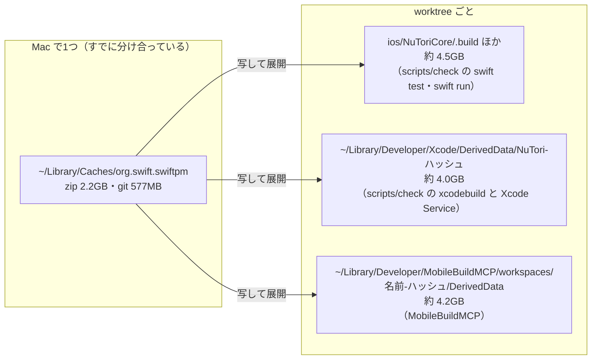
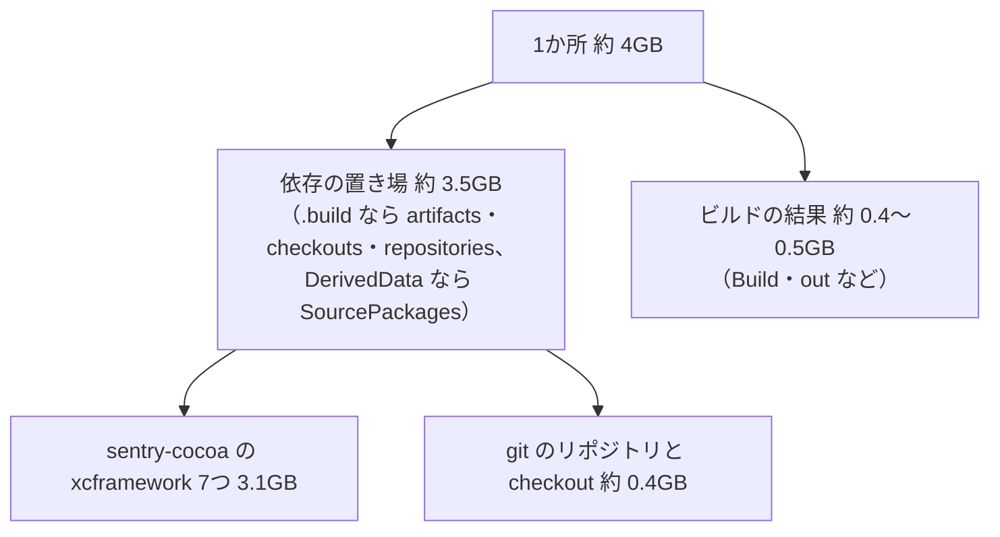
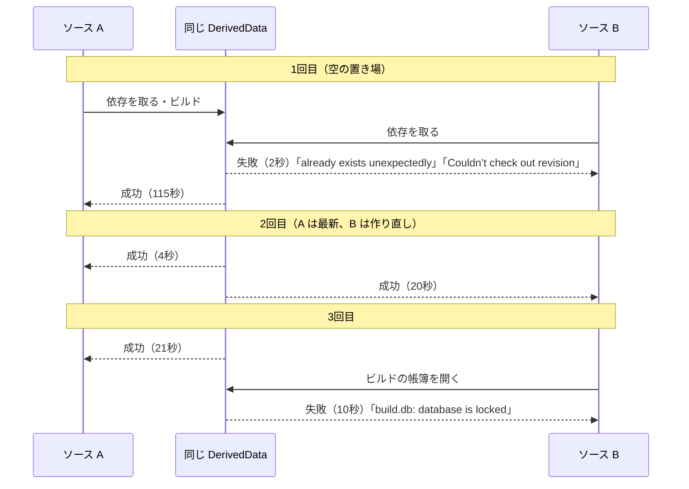
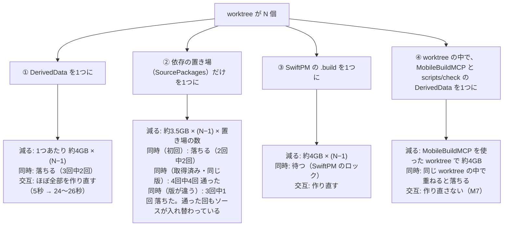

# iOS のビルド生成物を worktree のあいだで分け合えるか

調査日: 2026-10-17
対象: Issue #549「iOS のビルド生成物を、worktree のあいだで分け合えるか調べる」。溜まったものを消す掃除は #512（`scripts/clean-builds`）

> **確認の方法と限界**
> - 道具の振る舞いは、ソースを読んで確かめた。SwiftPM は swiftlang/swift-package-manager の main（7137197）、Xcode のビルドシステムの元の Swift Build は swiftlang/swift-build の main（5987c02）、ビルドの帳簿（`build.db`）を持つ llbuild は swiftlang/swift-llbuild の main（0a95849）、MobileBuildMCP は `scripts/mobilebuildmcp` が使う npm の `mobilebuildmcp@2.7.1` の配布物（`build/`）を読んだ。Xcode の中で Swift Build と同じコードが動いているかは確かめていない（Xcode 本体は公開されていない）
> - Mac（Xcode 27.1、Swift 6.4、12 コア、メモリ 64GB）で測った。ソースは、このブランチの HEAD（ccec7f36）の `ios/` と `shared/` を `git archive` で `/tmp` の2か所に書き出し、2つの worktree の代わりにした。ビルドは `xcodebuild … -scheme NuTori -destination <iPhone 17 のシミュレータ> build`。時間は1回ずつで、ほかのセッションも同じ Mac で動いていたので、目安にとどまる
> - Apple の文書には、DerivedData を複数のビルドで分け合ってよいかの記述が見つからなかった。xcodebuild の man ページとヘルプは、オプションの1行の説明だけ

## 結論の要約

- **worktree をまたいで分け合うのは、3つとも入れないことを提案する**。DerivedData を分け合うと、同時のビルドが帳簿の取り合いで落ち（3回中2回、M4）、交互に使うだけでもほぼ全部を作り直す（M3）。依存の置き場（`SourcePackages`）だけを分け合うと減る量は大きい（1か所あたり約 3.5GB）が、初回の取得が重なると落ち（2回中2回、M5）、ブランチで依存の版が違うと、片方のビルドがもう片方の版のソースで作られて落ちる（3回中1回、M6）。SwiftPM の `.build` は、分け合うと同時のビルドを待たせる作り（S2）
- **依存の取得は、すでに worktree をまたいで分け合っている**。SwiftPM も Xcode も、取ってきた zip と git のリポジトリを `~/Library/Caches/org.swift.swiftpm` に置き、そこから各置き場へ写す（S1・S3、M1）。重なっているのは、写したあとの展開済みのファイル
- **1つの worktree の中の重なりを1つにまとめるのは効く**。MobileBuildMCP は、`scripts/check` や Xcode とは別の DerivedData（約 4.2GB）を作る（B1）。`.mobilebuildmcp/config.yaml` の `sessionDefaults.derivedDataPath` と `scripts/check` の `-derivedDataPath` を、worktree の中の同じ置き場にそろえれば、MobileBuildMCP を使った worktree で約 4GB 減り、worktree を消すと一緒に消える。2つの呼び方を交互に回しても作り直さないことを確かめた（M7）
- **3か所すべての約 3.1GB は、sentry-cocoa の7つの xcframework を展開したもの**。アプリが使うのは `Sentry`（約 355MB）だけだが、SwiftPM は依存の全部の binary target を取ってくる（S4）。NuToriCore のどのターゲットも sentry-cocoa を使っていないのに、`swift test` の `.build` にも 3.1GB ができる（R1）。分け合うかとは別の問いだが、減る量はこちらのほうが大きい

## 今の形

1か所あたりの中身（M1。どれも同じ形）:

## 1. SwiftPM の依存の取得とビルドの分を、worktree のあいだで共有できるか

- 依存の取得は、既定で Mac で1つの置き場を分け合う。`swift build --help` は `--cache-path`（共有のキャッシュの置き場）と `--enable-dependency-cache`（既定で有効）を挙げる（ヘルプで確認、H1）。置き場の中は `repositories`（git）・`artifacts`（binary target の zip）・`manifests`・`prebuilts`（ソースで確認、S1 `Workspace+Configuration.swift` 140〜170 行）
- ただし各 `.build` には写して展開する。git は共有のキャッシュから `.build/repositories` へ写し（ソースで確認、S3 `RepositoryManager.swift` 297〜338 行）、zip も共有のキャッシュから写してから `.build/artifacts` に展開する（ソースで確認、S1 `Workspace+BinaryArtifacts.swift` 612〜672 行）。消すと空きが同じだけ増えたので、APFS の複製（clone）ではなく実際に場所をとっている（M8）
- 取ってくる binary target は、使うかどうかによらず、全部のマニフェストの全部の binary target（ソースで確認、S4 `parseArtifacts`、76 行〜）。sentry-cocoa 9.30.1 のマニフェストは、7つの xcframework を binary target に持つ（ソースで確認、R2 `Package@swift-6.2.swift` 88〜148 行）
- ビルドの分（`--scratch-path`、既定 `.build`）を worktree のあいだで1つにすると、SwiftPM は置き場に排他のロックをとり、2つめは「Another instance of SwiftPM … is already running using '…', waiting until that process has finished execution...」と出して待つ（ソースで確認、S2 `SwiftCommandState.swift` 1367〜1421 行）。壊れはしないが、並べて走るエージェントの `scripts/check` が順番待ちになる。ソースのパスが違うので、交互に使えば作り直しも起きる（DerivedData の M3 と同じ理由と見られるが、SwiftPM では測っていない）

**答え**: 依存の取得（ダウンロードと clone）はすでに分け合っている。展開済みのファイルとビルドの分は、`--scratch-path` で1つにはできるが、待ちと作り直しが増えるので勧めない。

## 2. DerivedData の置き場を worktree によらず1つにできるか。同時のビルドで壊れないか

### できるか

- xcodebuild の `-derivedDataPath` で置き場を指定できる（man ページで確認、H2）。依存の置き場だけを指定する `-clonedSourcePackagesDirPath`、キャッシュを指定する `-packageCachePath` もある（ヘルプで確認、H2）
- Xcode の既定の置き場の名前（`NuTori-<28 文字>`）は、プロジェクトのパスごとに変わる。どの worktree のものかは `info.plist` の `WorkspacePath` に入っている（実物で確認、M1）。名前の付け方の文書は見つからなかった
- コンパイルのキャッシュ（`COMPILATION_CACHE_ENABLE_CACHING`、Apple の Build settings reference の「Enable Compilation Caching」、A1）の置き場の既定は `$(DERIVED_DATA_DIR)/CompilationCache.noindex`（ソースで確認、S5 `Settings.swift` 2186〜2194 行）。このプロジェクトでは有効にしていない（`project.pbxproj` に設定が無い）

### 同時のビルド

- llbuild は、帳簿（`Build/Intermediates.noindex/XCBuildData/build.db`、SQLite）が使用中だと「Possibly there are two concurrent builds running in the same filesystem location.」と出して失敗する（ソースで確認、S6 `SQLiteBuildDB.cpp` 101〜110 行）。待たずに落ちる
- 実際に、2つのソースから同じ `-derivedDataPath` へ同時にビルドした（M4）

- 落ちたあとも、その置き場でのビルドは通った（A を続けて回して 4 秒で成功）。壊れた結果が残るのではなく、その回のビルドが落ちる

### 交互に使ったとき

- 1つの DerivedData を A → B → A の順に使うと、B と2回目の A は、それぞれ 1,067 のコンパイルをやり直した（26 秒・24 秒）。同じソースを続けて回すと 0 件・5 秒（M3）。Swift と C のコンパイルは、アプリ（NuTori 223）・NuToriCore（223）だけでなく、PostHog（178）や swift-crypto（111）のような依存にも及んだ
- 減る量は、2つで 8.4GB が 4.2GB になった（M3）

**答え**: 1つにはできる。しかし同時のビルドで落ち、交互に使うとほぼ全部を作り直す。並べて走るエージェントには合わない。

## 3. MobileBuildMCP のビルド置き場を共有できるか

- MobileBuildMCP は、xcodebuild に `-derivedDataPath <置き場>/DerivedData/<プロジェクト名>-<パスのハッシュ>` を渡す（ソースで確認、B1 `utils/derived-data-path.js`。実物のログでも確認、M2）。置き場は起動した場所ごと（`~/Library/Developer/MobileBuildMCP/workspaces/<名前>-<ハッシュ>`）
- 置き場は設定で変えられる。`sessionDefaults.derivedDataPath`（相対パスは起動した場所から解く）、環境変数 `MOBILEBUILDMCP_DERIVED_DATA_PATH`、道具ごとの `derivedDataPath`（ソースで確認、B2 `utils/session-defaults-schema.js`・`utils/project-config.js` 58〜68 行・`utils/config-store.js` 180 行）。xcodebuild への追加の引数も `sessionDefaults.extraArgs` で渡せる（同 B2）
- MobileBuildMCP が持つロックは、ログの片づけと置き場の手入れのためのもので、ビルドを順番にするものではない（ソースで確認、B3 `utils/log-paths.js` 29〜47 行）。なので、置き場を分け合ったときの同時のビルドは、2 の M4 と同じく落ちる
- テストの道具（`test_sim` など）は `-packageCachePath` を付ける（ソースで確認、B1 `utils/build-utils.js` 113〜122 行）。ビルド（`build_run_sim`）は付けない

**答え**: 設定で置き場を変えられるので、共有はできる。worktree をまたいで共有すると 2 と同じ理由で勧めない。同じ worktree の `scripts/check` と同じ置き場にそろえるのは、次の 4 のとおり効く。

## 4. 減る量と、速さ・同時の安全さとの引き換え。入れるか

### 比べた案

### ② を詳しく

- 2つのソースに `-clonedSourcePackagesDirPath` で同じ置き場を渡し、DerivedData は別にした（M5・M6）
  - 空の置き場から同時に始めると、2回とも片方が「Couldn’t check out revision」で落ちた
  - 一度取り終えた置き場で、同じ版どうしを同時に回すと、4回とも通った（どちらも 36〜37 秒）。DerivedData は1つあたり約 0.67GB で済んだ
  - 片方のソースの posthog-ios を 3.91.0 に下げ（依存を上げるブランチの代わり）、3.92.0 のソースと同時に回すと、3回中1回、3.91.0 のほうが `cannot find 'postHogLabel' in scope` などで落ちた。エラーのファイルは共有の `checkouts/posthog-ios` の中。checkout は1つのフォルダに1つの版しか持てないので、通った回も、どちらかがもう片方の版のソースでビルドした恐れがある（どちらが何でビルドしたかは確かめていない）。終わったあと、共有の checkout は 3.91.0 だった
- このリポジトリでは、依存の更新はブランチの PR で来る（`docs/agents/dependencies.md`）。版の違う worktree が並ぶのはふつうのことなので、② は「黙って違う版でビルドする」危うさを持つ

### 提案

- **①②③（worktree をまたいで分け合う）は入れない**。減る量はあるが、並べて走るエージェントのビルドが落ちるか、黙って違う版のソースで作られる。落ちたビルドを追うほうが、ディスクより高くつく。溜まる分は #512 の `scripts/clean-builds` で消す
- **④（worktree の中でそろえる）は入れる価値がある**。例えば `.mobilebuildmcp/config.yaml` の `sessionDefaults.derivedDataPath` と `scripts/check` の xcodebuild の `-derivedDataPath` を、どちらも `ios/.build/DerivedData` にする。`.gitignore` と `.ignore` の `.build/` に入るので、検索からも外れ、worktree と一緒に消える（#512 の掃除の対象も減る）
  - 引き換え: 同じ worktree で MobileBuildMCP と `scripts/check` を同時に回すと、M4 と同じく「database is locked」で落ちる。待たずにすぐ落ちて、やり直せば通る
  - Xcode Service（`RenderPreview` など）は Xcode の設定の置き場を使うので、これまで `scripts/check` と分け合っていた置き場とは別になる。Xcode の道具を使う worktree では、今の MobileBuildMCP の分が Xcode Service の分に移るだけで、減らない
  - 作るなら別のチケットにする（Issue の Acceptance criteria）。このメモの段階では立てていない
- **別の問い**: 3か所すべてにある sentry-cocoa の 3.1GB のうち、アプリが使うのは `Sentry`（約 355MB）だけ（M1）。特に `ios/NuToriCore/.build` は、どのターゲットも sentry-cocoa を使わないのに 3.1GB をとる（R1。版の正本を NuToriCore に置くため、`docs/agents/dependencies.md`）。分け合うよりも減る量が大きいので、別に扱う価値がある。直し方（版の正本の置き場を変える、など）はこのメモでは調べていない

## 分からなかったこと

- Xcode（Xcode Service と Xcode の画面）の DerivedData の置き場の名前の付け方と、Xcode の設定（Settings の Locations）の正確な振る舞いを書いた Apple の文書は見つからなかった
- ② の「通った回」に、それぞれがどの版のソースでビルドしたか
- ③ を実際に測ること（ソースを読んだだけ）
- 時間は1回ずつで、ほかのセッションの負荷が混ざっている

## 測ったこと

- M1: 実物の大きさ（2026-10-17）。worktree の `ios/NuToriCore/.build` 4.0GB（`artifacts` 3.1GB、`out` 514MB、`repositories` 315MB、`checkouts` 121MB）、`ios/OpenAPIGenerator/.build` 441MB、`ios/SharedRulesGenerator/.build` 51MB。`~/Library/Developer/Xcode/DerivedData/NuTori-*` は9つで、どれも 3.6〜4.4GB（うち `SourcePackages/artifacts` 3.1GB、`Build` 0.4〜0.5GB）。MobileBuildMCP の置き場で DerivedData を持つものは 4.2GB（`SourcePackages` 3.5GB、`Build` 437MB）。`~/Library/Caches/org.swift.swiftpm` は `artifacts` 2.2GB、`repositories` 577MB。`artifacts/sentry-cocoa` の中は `Sentry-Dynamic-WithARM64e` 670MB、`Sentry-Dynamic` 607MB、`Sentry-WithoutUIKitOrAppKit-WithARM64e` 541MB、`Sentry-WithoutUIKitOrAppKit` 490MB、`Sentry` 355MB、`SentryObjC-Dynamic` 325MB、`SentryObjC-Static` 159MB
- M2: MobileBuildMCP のビルドのログに残った xcodebuild の呼び方: `xcodebuild -project <worktree>/ios/NuTori.xcodeproj -scheme NuTori -skipMacroValidation -destination "platform=iOS Simulator,id=…" -collect-test-diagnostics never -derivedDataPath ~/Library/Developer/MobileBuildMCP/workspaces/<名前>-<ハッシュ>/DerivedData/NuTori-<ハッシュ> build`
- M3: 1つの DerivedData を交互に使った。A（空から）50 秒・1,216 件、A（続けて）5 秒・0 件、B 26 秒・1,067 件、A 24 秒・1,067 件。別の DerivedData での B（空から）37 秒。件数は、ログの `SwiftCompile` と `CompileC` の行の数
- M4: 2つのソースから同じ `-derivedDataPath` へ同時に `build` を3回。結果は上の図
- M5: `-clonedSourcePackagesDirPath` だけを共有し、DerivedData を別にして同時に `build`。空の置き場で2回（2回とも片方が失敗、終了コード 74）、取得済みの置き場で4回（4回とも成功、36〜37 秒）
- M6: M5 の取得済みの置き場で、posthog-ios 3.92.0 のソースと 3.91.0 に下げたソース（`project.pbxproj` の `version` と `Package.resolved` を書き換えた）を同時に3回。1回目と3回目は両方成功、2回目は 3.91.0 のほうが失敗（終了コード 65）
- M7: 1つの DerivedData へ、`scripts/check` と同じ引数（`-disableAutomaticPackageResolution … build-for-testing`）、MobileBuildMCP と同じ引数（`-skipMacroValidation -collect-test-diagnostics never … build`）、もう一度 `scripts/check` と同じ引数、の順に回した。13 秒・111 件（テストのターゲットの分）、5 秒・0 件、5 秒・0 件
- M8: 4.1GB の DerivedData を消すと、空きが約 3.8GiB 増えた（4,007,864 KB）

## 出典

- H1: `swift build --help`（Swift 6.4）の `--cache-path`、`--scratch-path`、`--enable-dependency-cache`
- H2: `man xcodebuild` の `-derivedDataPath`、`xcodebuild -help`（Xcode 27.1）の `-clonedSourcePackagesDirPath`・`-packageCachePath`・`-disablePackageRepositoryCache`
- A1: Build settings reference（Enable Compilation Caching）— https://developer.apple.com/documentation/xcode/build-settings-reference
- S1: SwiftPM `Sources/Workspace/Workspace+Configuration.swift`・`Sources/Workspace/Workspace+BinaryArtifacts.swift`・`Sources/Workspace/Workspace.swift`（585〜592 行）— https://github.com/swiftlang/swift-package-manager/tree/7137197d30da49413553f3dd5e03988b967be36a/Sources/Workspace
- S2: SwiftPM `Sources/CoreCommands/SwiftCommandState.swift` — https://github.com/swiftlang/swift-package-manager/blob/7137197d30da49413553f3dd5e03988b967be36a/Sources/CoreCommands/SwiftCommandState.swift
- S3: SwiftPM `Sources/SourceControl/RepositoryManager.swift` — https://github.com/swiftlang/swift-package-manager/blob/7137197d30da49413553f3dd5e03988b967be36a/Sources/SourceControl/RepositoryManager.swift
- S4: SwiftPM `BinaryArtifactsManager.parseArtifacts`（S1 と同じファイル）
- S5: Swift Build `Sources/SWBCore/Settings/Settings.swift`・`Sources/SWBCore/Settings/CASOptions.swift` — https://github.com/swiftlang/swift-build/tree/5987c0274baf641def06752bd4c1e9c2cce04cbd/Sources/SWBCore/Settings
- S6: llbuild `lib/Core/SQLiteBuildDB.cpp` — https://github.com/swiftlang/swift-llbuild/blob/0a9584962ff829b9e58e90d5f09c21da1e79cef7/lib/Core/SQLiteBuildDB.cpp
- B1: mobilebuildmcp 2.7.1 `build/utils/derived-data-path.js`・`build/utils/build-utils.js`（npm の配布物。リポジトリは https://github.com/getsentry/MobileBuildMCP ）
- B2: mobilebuildmcp 2.7.1 `build/utils/session-defaults-schema.js`・`build/utils/project-config.js`・`build/utils/config-store.js`
- B3: mobilebuildmcp 2.7.1 `build/utils/log-paths.js`・`build/utils/workspace-filesystem-lifecycle.js`
- R1: `ios/NuToriCore/Package.swift`（sentry-cocoa を依存に持ち、どのターゲットも使わない）、`ios/NuTori.xcodeproj/project.pbxproj`（アプリは `Sentry` の product を使う）、`scripts/check`（`check_ios_app`・`check_ios_package`）
- R2: sentry-cocoa 9.30.1（4f135c5）`Package@swift-6.2.swift` — https://github.com/getsentry/sentry-cocoa/blob/4f135c52afeeb1d6937eb93824c7ec1cddcaa372/Package%40swift-6.2.swift
