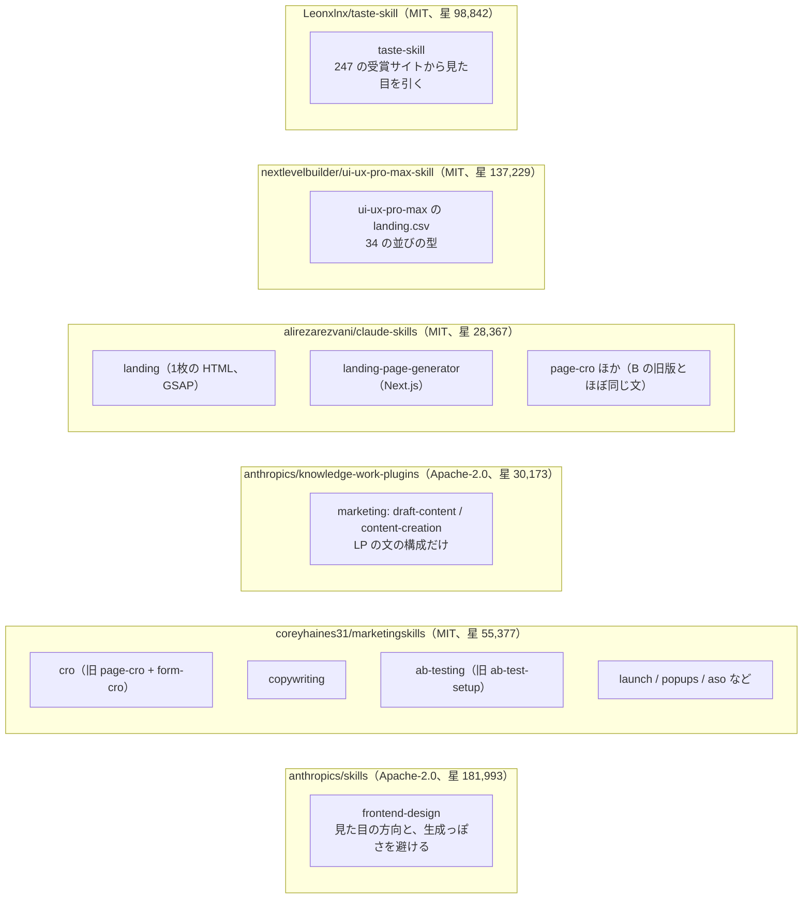
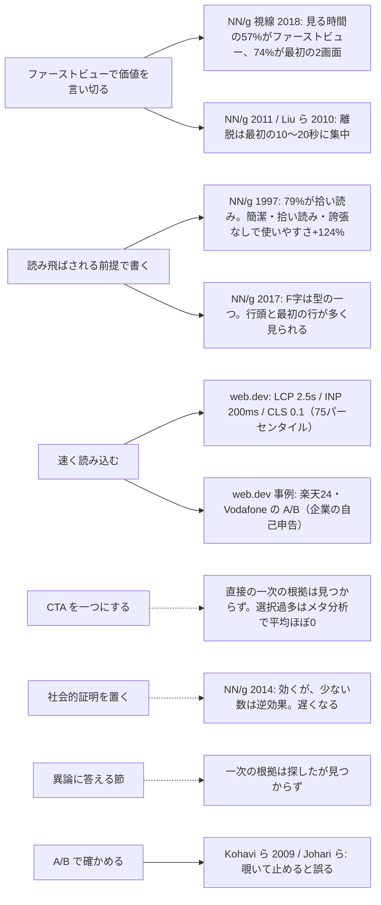
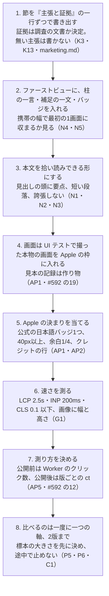
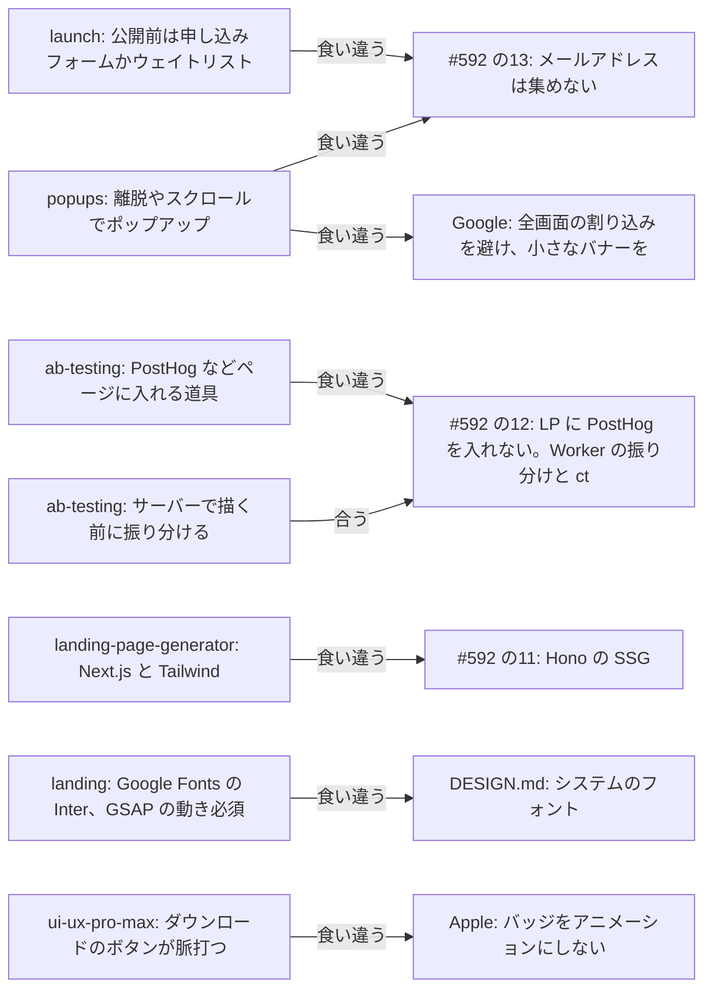

# LP を作るエージェントスキルと、その指示の一次の根拠（公開のスキル、NN/g・Google・Apple の文書、論文）

調査日: 2026-10-18
対象: nu-tori の LP（`nu-tori.app` のトップ。日本語、日本の App Store だけ）を作り直すための手順と原則を得るために、次を集める。(1) 公開されている「LP・コンバージョン・コピー・マーケティング」のエージェントスキル（Agent Skills の形式の SKILL.md など）の本文と、何を指示しているか、(2) その指示のうち主なものの一次の根拠（Nielsen Norman Group、Google の web.dev と Search Central、査読のある論文）、(3) iPhone アプリの LP に特有のこと（App Store のバッジ、Smart App Banner、予約注文、キャンペーンのリンク、スクリーンショット）を Apple の一次の文書で、(4) それらを nu-tori の LP と今の試作（`prototype/0001-lp/index.html`）に当てはめたもの。前提は「一般公開の準備の範囲と方針を決める」（#592）の解決コメントの 12〜17（LP に PostHog を入れない、A/B は Worker の振り分けと App Store のキャンペーンごとのダウンロード数で比べる、CTA は公開前は予約注文・公開後は App Store へのリンク、メールアドレスは集めない）。

> **確認の方法と限界**
> - スキルの本文は、GitHub のリポジトリを `git clone --depth 1` で取得し、SKILL.md と、そこから指す `references/` を**直接読んだ**（2026-10-18。各リポジトリのコミットは出典一覧に書く）。このセッションの `gh api` はリポジトリの外の API（`repos/…` と検索）が 403 で使えなかったので、星の数とライセンスの種類は GitHub の MCP の検索（`search_repositories`）と、取得したリポジトリの `LICENSE` で確かめた。星の数は取得した時点の値で、利用の多さそのものではない。
> - 候補を探すのは GitHub の検索（"landing page skills claude"、"marketing skills" など）だけで、星の多いものから順に見た。**すべての公開スキルを見たわけではない。** 集め物のリスト（`VoltAgent/awesome-agent-skills` など）は中身を開いていない。
> - スキルの本文は要約し、引用は短い抜粋だけにした。
> - NN/g、web.dev、Search Central、Apple の文書は `curl` で HTML（Apple の Smart App Banner は文書の JSON）を取得し、本文を読んだ。Apple の「App Store マーケティングガイドライン」は英語版と日本語版の両方を読み、日本語版の言い回しを引いた。
> - 論文は、Crossref の API で書誌（題・誌名・年・著者）が実在することを確かめた。**要旨まで読めたのは 2 本だけ**（Scheibehenne ら 2010 はジュネーブ大学の機関リポジトリ、Johari らは arXiv の版）。Lindgaard ら 2006 は出版社のページが 403 で要旨を読めず、本文では使っていない。Liu ら 2010 は NN/g の記事が紹介している内容を使い、論文の本文は読んでいない（NN/g を経た二次として扱う）。
> - Think with Google の「ページの読み込みの速さと直帰」の記事（よく引かれる「1 秒から 3 秒で直帰が 32% 増える」）は、旧 URL が `business.google.com` の別のページへ転送され、**本文を取得できなかった**（G9）。この数字は本文で使っていない。
> - web.dev の事例（楽天 24、Vodafone など）は、**Google が載せた企業の自己申告の事例**で、査読はない。A/B の結果は書かれているが、有意かどうかの数値は書かれていない。
> - 本文で確かめた事実は「本文で確認」、そこから推し量ったものは「本文からの読み取り」、探して無かったものは「本文を探したが記述なし」と書く。**「nu-tori への当てはめ」はすべて本文からの読み取りに当たる。**
> - 開発者の健康データは使っていない。試作の画面の数値も作り物（試作の冒頭のコメントにそう書かれている）。

## 結論の要約

- **LP の「作り方」を指示する公開スキルは、ほとんどが英語の SaaS（申し込み・試用・営業の問い合わせ）を前提にしている。** 星が最も多い Anthropic の `anthropics/skills` に LP 専用のスキルは無く、近いのは見た目の指示の `frontend-design` だけ【本文で確認 K1】。コンバージョンの指示が厚いのは `coreyhaines31/marketingskills`（MIT、星 55,377）で、言われていた `page-cro` と `ab-test-setup` は、今はそれぞれ `cro` と `ab-testing` に名前が変わっている【本文で確認 K7】。iPhone アプリの LP に触れるのは `ui-ux-pro-max-skill` の一行（「App Store Style Landing」）だけで、Apple のバッジの決まりには触れていない【本文で確認 K12】。
- **スキルどうしで指示が一致するのは、(1) ファーストビューで価値を一つ言い切る、(2) 主な行動（CTA）を一つにする、(3) 読み飛ばされる前提で節を分ける、(4) 社会的証明を置く、(5) 異論に答える節を置く、(6) 速く読み込む、の 6 つ**【本文で確認 K2,K3,K8,K10,K13】。**スキル自身はほとんど根拠を示さない。** 例えば `copywriting` の「明快さでコンバージョンが 81% 上がる」には出典が書かれていない【本文を探したが記述なし K3】。
- **一次の根拠が強いのは (1)(3)(6)。** NN/g の視線の調査で、見る時間の 57% がファーストビュー、74% が最初の 2 画面【本文で確認 N4】。79% の人が拾い読みし、簡潔・拾い読みしやすい・誇張しない書き方で使いやすさが 124% 上がった（1997 年の調査）【本文で確認 N1】。Google は Core Web Vitals の「良い」を LCP 2.5 秒・INP 200 ms・CLS 0.1 以下（75 パーセンタイル）とし【本文で確認 G1】、LCP を縮めた版の A/B で売上が増えた企業の事例を載せている【本文で確認 G6,G7】。
- **(2) CTA を一つにする、には直接の一次の根拠が見つからなかった。** よく背景に置かれる「選択肢が多いと選ばなくなる」は、50 の実験のメタ分析で**平均の効果がほぼ 0**【本文で確認 P2】。(4) 社会的証明は、NN/g が「少ない数を見せると逆効果」と書いている【本文で確認 N7】。
- **App Store に送る CTA は、Apple の決まりがスキルの指示より強い。** 公式のバッジだけを使い、日本語版（「App Store で予約注文」「App Store からダウンロード」）があり、高さ 40px 以上、周りに高さの 1/4 の余白、**1 つのレイアウトにバッジは 1 つ**、主な見出しや画像より目立たせない、アニメーションさせない、公開したら予約注文のバッジをダウンロードのバッジに替える【本文で確認 AP1,AP2】。iPhone の絵を自分で描くことは認められず、Apple の配る枠（ベゼル）を使う【本文で確認 AP1】。
- **#592 の測り方に、公開前は効かない部分がある。** キャンペーンのリンク（`ct`/`pt`）は「アプリに分析のデータが出るまで作れない」と Apple は書いている【本文で確認 AP5】。予約注文の期間に版ごとの `ct` で比べられない見込みが高い（読み取り）。Smart App Banner にも `ct`/`pt` を付けられる【本文で確認 AP5】ので、公開後は LP の版ごとにバナーの `ct` も分ける必要がある（読み取り）。
- **今の試作で直すところ**（読み取り）: CTA が自作のボタンで Apple のバッジでない／CTA が 3 か所／iPhone の絵を CSS で描いている／Apple の商標のクレジットの行が無い／各節が下から浮き上がるアニメーション（`frontend-design` が「生成されたページの典型」と書く）。見出し 3 × 並び 3 × 書き方 2 の 18 通りは、LP の訪問の数では A/B で見分けられない（下の計算）。
- **#592 と食い違うスキルの指示**: メールの登録・ウェイトリスト（`launch`、`popups`）、ポップアップ、PostHog など LP に入れる計測の道具（`ab-testing`）、Next.js の出力（`landing-page-generator`）、外部フォントと GSAP のアニメーション（`landing`）。どれも使わない。

## 問い1: 公開されているスキル

### 見つかったもの

次の図は、調べたリポジトリと、その中で LP に関わるスキル。星の数は 2026-10-18 の検索の値【本文で確認 GH1】。

- 言われていた `coreyhaines31/marketingskills` の `page-cro` と `ab-test-setup` は、v2 の名前の変更で `cro`（`page-cro` と `form-cro` を合わせた）と `ab-testing` になった【本文で確認 K7】。
- `alirezarezvani/claude-skills` の `page-cro` は、`marketingskills` の `cro` と 232 行中 113 行が同じ文で、冒頭の役の文（"You are a conversion rate optimization expert…"）も同じ【本文で確認 K11、行の一致は調査者が数えた】。どちらが元かはこの調査で確かめていない。以下では `marketingskills` の版を読む。
- Anthropic の公式のスキルで LP の作り方を扱うものは `anthropics/skills` に無い（`frontend-design` は見た目、`brand-guidelines` は Anthropic 自身のブランド）【本文で確認 K1】。`knowledge-work-plugins` の `marketing` は、LP の「文」の構成を数行で示すだけ【本文で確認 K8】。

### それぞれが指示していること

#### `anthropics/skills` の `frontend-design`（Apache-2.0）【本文で確認 K1】
- 手順は 2 回に分ける。先に色（4〜6 の hex）・文字・配置（ASCII の図）・原則の短い計画を作り、「どの似た依頼でも出てくる既定の形」になっていないかを見直してから書く。
- ファーストビューは「その題材の世界で一番らしいもの」で始める。大きな数字と小さなラベルとグラデーションの組は既定の形なので、本当に一番良いときだけ使う。
- 生成されたページの典型として避けるもの: 見出しの一語だけ色や太字を変える、全部大文字のラベル、**内容の上の要らないラベル**、内容が順番でないのに 01/02/03 の番号、**各節が下から浮き上がって現れる動き**、どのカードも同じ角丸と影（"the SaaS-card kit"）。
- 文: 作り手の言葉でなく使う人の言葉で書く。CTA は押すと何が起きるかを言う（"Save changes"、"Submit" でなく）。
- 品質の床: 携帯の幅まで崩れない、キーボードの焦点が見える、動きを減らす設定を守る。
- ページの構成（社会的証明、異論、A/B、速さ）には触れない【本文を探したが記述なし K1】。

#### `marketingskills` の `cro`（MIT、v2.0.3）【本文で確認 K2】
- 最初に、ページの種類・主なコンバージョン・流入元を確かめる。
- 影響の大きい順に 7 つを見る: (1) 価値の明快さ（5 秒で何か分かるか）、(2) 見出し、(3) CTA（主な行動が一つか、スクロールせずに見えるか、文が価値を言うか）、(4) 視覚の階層と拾い読み、(5) 信頼と社会的証明（ロゴ、名前つきの声、評価の数。CTA の近くに置く）、(6) 異論への答え（値段、自分に合うか、効かなかったら）、(7) 摩擦（入力の多さ、携帯、読み込みの遅さ）。
- LP では「流入元と文言を合わせる（message match）」「CTA は一つ、できればナビを外す」「一枚で論を完結させる」。
- 出力は「すぐ直す」「大きく直す」「A/B で試す」「見出しと CTA の別案 2〜3」。
- 根拠の出典は書かれていない【本文を探したが記述なし K2】。

#### `marketingskills` の `copywriting`（MIT、v2.3.1）【本文で確認 K3】
- 書く前に、ページの目的・一つの行動・読み手・異論・流入元を集める。渡された文が白紙か、書き手の声があるか、一部の直しかを先に見分け、声があればそれを残す。
- 一行ずつ 3 つの問いを通す: 思い浮かべられるか、真偽を確かめられるか、競合も同じ文を書けるか（書けるなら落とす）。
- 根拠の無い主張は書かず、何があれば書けるか（レビューの書き出し、保証の文書など）を添える。
- 構成の型: ファーストビュー（見出し・補足・CTA）→ 社会的証明 → 困りごと → 解決と利点（3〜5）→ 使い方（3〜4 段）→ 異論への答え → 最後の CTA。
- 生成っぽい書き方の禁止: 「X ではなく Y」、**「X なし、Y なし、Z なし」の否定の列挙**（本当に無いことは CTA の近くで一度だけ言う）、短い文の em ダッシュなど。英語の文を前提にした規則。
- 「明快な文で +81% のコンバージョン、-38% の商談期間」という数字を挙げるが、**出典は書かれていない**【本文を探したが記述なし K3（`references/copy-frameworks.md` も含めて）】。

#### `marketingskills` の `ab-testing`（MIT、v2.0.2）【本文で確認 K4】
- 仮説の形（「〜を観察したので、〜を変えると〜が起きると考える。〜で分かる」）、一度に一つだけ変える、標本の大きさを先に決める、途中で覗いて止めない。
- 標本の目安の表（基準 5% で 20% の改善を見るなら 1 版あたり約 7,000）。主な指標・補助の指標・悪くなってはいけない指標を分ける。
- 振り分けは、ページを読み込んでから JS で変える（ちらつく）か、描く前にサーバーで決める（ちらつかない）。道具の例に PostHog、Optimizely などを挙げる。
- p 値の読み方は American Statistical Association の声明を出典として挙げている（スキルの中で一次の出典を示しているのはこの箇所くらい）。

#### `marketingskills` の `launch`・`popups`【本文で確認 K5,K6】
- `launch` は公開前の段に「早期の申し込みフォームのある LP」「近日公開のページかウェイトリスト」を置く。
- `popups` は時間・スクロール・離脱の意図で出すポップアップの組み方。どちらも**メールアドレスを集める前提**。

#### `knowledge-work-plugins` の `marketing`（Apache-2.0）【本文で確認 K8】
- LP の構成: 10 語以内で主な利点を言う見出し → 補足 → ファーストビュー（CTA と画像）→ 利点 3〜4 → 社会的証明 → 異論への答え（FAQ）→ 最後の CTA。「機能より利点」「"you" で話す」「どの節も『だから何？』に答える」。

#### `alirezarezvani/claude-skills` の `landing` と `landing-page-generator`（MIT）【本文で確認 K9,K10】
- `landing` は 4 つの問い（製品、読み手、ブランドの色、口調）を聞いてから、1 枚の HTML を作る。既定は濃紺と青緑と Inter（Google Fonts）、GSAP の登場の動き・マウスの視差・スクロールでカードが浮く動きを**必須**にしている。
- `landing-page-generator` は Next.js と Tailwind の部品を出す。PAS・AIDA・BAB の型、SEO の確認表、速さの目標に「LCP < 1s、CLS < 0.1、FID < 100ms」を置く。**FID は 2024 年 3 月に INP に置き換わった指標**で【本文で確認 G2】、Google の「良い」の線は LCP 2.5 秒【本文で確認 G1】。スキルの目標は Google の線より厳しく、古い指標を含む。

#### `ui-ux-pro-max-skill` の `landing.csv`（MIT）【本文で確認 K12】
- ページの並びの型が 34 あり、その一つが「App Store Style Landing」: 端末の絵のあるファーストビュー → スクリーンショットの横送り → 機能 → 評価 → ダウンロードの CTA。CTA は「ずっと目立たせる」、効果に「ダウンロードのボタンが脈打つ」を挙げる。
- 同じ行に「本物のスクリーンショットと、今の確かな評価だけを見せる」「自動で送るなら止められるように」とある。データの出どころの記録（`data-provenance.json`）で、`landing.csv` に付いた外部の出典は W3C の WAI の 3 件（横送り、ドラッグ、コントラスト）だけ。
- 「バッジを脈打たせる」は、Apple の「バッジをアニメーションにしない」【本文で確認 AP2】と食い違う。

#### `taste-skill`（MIT）【本文で確認 K13】
- 「247 の受賞サイト（One Page Love、Awwwards）」から見た目の方向を引く。見出しはどの幅でも 2 行以内（調べたサイトの見出しの中央値は 5 語・32 文字）、見出しのすぐ下に一文、最初の画面に主な行動を一つ。
- 「各節を主張と証拠の一行で書き出し、主張の無い節は消す。これで『ファーストビュー、ロゴ、機能 3 つ、声、値段、CTA』の定番の並びを避ける」。
- 根拠は受賞サイトの見た目の調査で、コンバージョンの調査ではない（読み取り）。

### スキルが指示に添える根拠

スキルのうち、指示に一次の出典を添えていたのは `ab-testing` の p 値の箇所（ASA の声明）と、`ui-ux-pro-max` の WAI の 3 件だけだった。「5 秒で分かる」「CTA を一つに」「社会的証明を CTA の近くに」には出典が無い【本文を探したが記述なし K2,K3,K8,K10】。根拠は問い2で別に探した。

## 問い2: スキルが拠る原則の一次の根拠

次の図は、スキルが共通して言う原則と、見つけた一次の根拠の強さ。実線は根拠が支える、点線は根拠が弱い・限定つき・見つからない。

### ファーストビューで価値を言い切る
- NN/g の 2018 年の視線の調査で、ページを見る時間の約 57% がファーストビュー、74% が最初の 2 画面（2,160px まで）に入った。2010 年は 80% がファーストビューだった。ファーストビューの中でも上半分に 65% 以上が集まる【本文で確認 N4】。
- 「折り目」は画面の大きさで場所が変わっても、どの端末にもある。人は上にあるものが良さそうなときだけスクロールする【本文で確認 N6】。
- NN/g の 2011 年の記事は、Microsoft Research の Liu らの調査（205,873 ページの滞在時間）を紹介し、離脱は最初の 10 秒に最も多く、30 秒ほどで落ち着く、だから 10 秒以内に価値を伝える、と書く【本文で確認 N5】。元の論文（P1）は書誌だけ確かめた。
- スキルの「5 秒で分かるか」【K2】の「5 秒」の数字の根拠は見つからなかった【本文を探したが記述なし】。一次の根拠が言えるのは「最初の 10 秒前後と、最初の 1〜2 画面に注意が集まる」まで（読み取り）。

### 読み飛ばされる前提で書く
- 1997 年の NN/g の調査で、79% の人が新しいページを拾い読みし、言葉どおりに読んだのは 16%。同じ内容を 5 通りに書いて比べ、簡潔な版で使いやすさ +58%、拾い読みしやすい版で +47%、誇張しない（objective）版で +27%、3 つを合わせて +124%【本文で確認 N1,N2】。誇張した文は、読み手が誇張を差し引く手間を生むと推し量っている【本文で確認 N1】。
- F 字の読み方は型の一つで、いつも F になるわけではない。最初の行と、各行の左の数語が多く見られる【本文で確認 N3】。調査は英語の横書き。**日本語の横書きで同じかは書かれていない**【本文を探したが記述なし N3】。
- 1997 年の調査で古い。2017 年の F 字の再調査は携帯でも同じ型が出たとする【本文で確認 N3】。

### ページの速さ
- Core Web Vitals の「良い」は、LCP（いちばん大きな要素が描かれるまで）2.5 秒以内、INP（操作から次の描画まで）200 ms 以下、CLS（表示のずれ）0.1 以下。75 パーセンタイルで、携帯とパソコンを分けて測る【本文で確認 G1】。INP は 2024-03-12 に FID と入れ替わった【本文で確認 G2】。
- Google は、ページの体験の良さを順位の仕組みが評価すると書くが、一つ二つの指標だけを追うなとも書く【本文で確認 G4】。
- 速さと成果の結び付きは、Google が載せた企業の事例。Vodafone（イタリア）は見た目と機能が同じで LCP だけ 31% 速い版を A/B し、売上 +8%【本文で確認 G7】。楽天 24 は LP を 1 か月 50/50 で A/B し、最適化した版で訪問あたりの売上 +53.37%、コンバージョン率 +33.13%【本文で確認 G6】。BBC は 1 秒遅くなるごとに 10% の人を失った【本文で確認 G8】。どれも査読はなく、有意かどうかの数値は書かれていない。

### CTA を一つにする
- スキルは「主な行動を一つに」「ナビを外す」を言う【K2,K3,K13】。**これを直接確かめた一次の調査は見つからなかった**【本文を探したが記述なし】。
- 背景によく置かれる「選択肢が多すぎると選ばなくなる」は、Scheibehenne らのメタ分析（50 の実験、63 条件、N = 5,036）で**平均の効果がほぼ 0、ただし研究ごとのばらつきは大きい**【本文で確認 P2】。「CTA を一つに」を、選択過多の心理で正当化はできない（読み取り）。
- nu-tori の LP では行動が「予約注文（公開後はダウンロード）」の一つしか無いので、この問いはほとんど起きない（読み取り）。

### 社会的証明
- NN/g は、人は他の人の行動を手がかりにする、レビューや数を見せると不確かさが減る、と書く一方、**少ない数を見せると「人気が無い」と受け取られる**、外部のウィジェットはページを遅くする、という 2 つの危険を挙げる【本文で確認 N7】。根拠は Cialdini の本（査読なし）と NN/g の観察。
- 日本では、事業者が頼んだ感想を、広告と分からない形で載せると、2023-10-01 から景品表示法の違反（ステルスマーケティング）になる。インターネットの表示もレビューも対象で、規制されるのは事業者【本文で確認 J1】。

### 異論への答え
- スキルは FAQ や比較で値段・自分に合うか・効かなかったら、に答えよと言う【K2,K3,K8】。NN/g・Google・論文で、LP の異論への答えの効果を確かめた一次の調査は見つからなかった【本文を探したが記述なし】。nu-tori では、競合のレビューに出る不満（`docs/research/competitor-app-store-listings.md`）が、何に答えるかの根拠になる（読み取り）。

### A/B の確かめ方
- Kohavi らの、ウェブの対照実験の手引き（Data Mining and Knowledge Discovery、2009）【書誌を確認 P4】。Johari らは、結果を見続けて都合の良いところで止めると、通常の p 値と信頼区間は「まったく当てにならない」と書き、見続けても使える p 値（always valid）を示した【本文で確認 P5,P6】。`ab-testing` の「途中で覗いて止めない」【K4】はこれと合う。
- 標本の大きさ（両側 5%、検出力 80%、2 版の比率の差の式で調査者が計算）: クリック率が 5% のとき、20% の改善を見分けるには 1 版あたり約 8,200 の訪問、2 倍（100% の改善）なら約 430。10% のとき、それぞれ約 3,800 と約 200【計算 C1】。`ab-testing` の表の値（5% で 20% の改善に約 7,000）と桁は合う【K4】。

## 問い3: アプリの LP に特有のこと（Apple の文書）

### App Store のバッジ
【本文で確認 AP1,AP2（日本語版の言い回し）】
- マーケティングの資料には App Store のバッジを使い、ダウンロードを促す。バッジは 50 の言語にあり、**日本語版がある**。「からダウンロード」と「で予約注文」の部分が訳され、「App Store」はいつも英語。**自分で訳したバッジを作ってはいけない。** このガイドラインが配るバッジのアートワークだけを使う。
- 黒い推奨バッジを使う。白い代替バッジは、黒が重く見えるときに、バッジが 1 つだけで周りの色に合うときに使える。
- **1 つのレイアウトや 1 本のビデオにつき、バッジは 1 つ。** バッジは画像や重要なメッセージより目立たない位置に置き、最も目を引く要素にしない。変えない、傾けない、アニメーションにしない。
- 予約注文できる間は予約注文のバッジを使い、**リリースしたら、すべての資料で予約注文のバッジをダウンロードのバッジに替える。**
- 最小の余白はバッジの高さの 1/4。画面では高さ 40px 以上。はっきり読めて目立ちすぎない大きさにする。
- 商標のクレジットの行: バッジを使うときは、Apple と Apple のロゴの両方をクレジットに入れる。ウェブサイトの中で 1 回だけ、法的な表記のあるところに置く。米国の外では「… are trademarks of Apple Inc., registered in the U.S. and other countries.」などの国際の書式を使い、訳してよい（商標そのものは訳さない）。米国の外では ™ や ® を付けない。
- 日本語のダウンロードのバッジは、Apple のマーケティングの道具（toolbox）から SVG で取れる（幅 108.85、高さ 40 の viewBox）【本文で確認 AP9】。予約注文のバッジの同じ形の URL は推し量って試したが 404 で、取り方はこの調査で確かめていない【AP9】。
- 「1 つのレイアウト」が LP の 1 ページ全体を指すのか、画面に見える範囲を指すのかは書かれていない【本文を探したが記述なし AP1,AP2】。

### 端末の絵とスクリーンショット
【本文で確認 AP1】
- アプリを Apple の端末に入れて見せるときは、Apple の配る端末の枠（product bezels）を使い、最新の世代の端末を使う。変えない（影・反射・画面から飛び出す絵、切り取り、傾け、アニメーション）。画面の上でなく横に文を置く。画面では端末の高さ 200px 以上。
- **Apple の製品を描いたイラストや、Apple の製品を模した図は認められない。** 一般の端末の絵を使うなら、ホームボタン、センサーの出っ張り、音量ボタンなど Apple の製品に固有の細部を描かない。
- 画面の中身は、アプリが実際に動いているときの見た目にする。白い画面は出さない。**実在の人のデータではなく架空のアカウントの情報を出す。** ステータスバーは電波・Wi-Fi・電池をすべて満にする。
- 見出しと文は Apple の製品の機能でなくアプリに焦点を当て、いつもダウンロードへの呼びかけを入れる。製品名は「アプリ名 for iPhone」のように対応を示す形で書き、「iPhone アプリ名」としない。
- App Store の商品ページのスクリーンショットは、最初の 1〜3 枚が検索の結果に出るので本質を見せ、以降は 1 枚に 1 つの利点を見せる【本文で確認 AP8】。LP のスクリーンショットについての Apple の指示は、上の「画面の中身」以外に見つからなかった【本文を探したが記述なし】。

### Smart App Banner
【本文で確認 AP3】
- `<meta name="apple-itunes-app" content="app-id=…, app-argument=…">` を `head` に置くと、iOS の Safari でページの上にバナーが出る。`app-id` は必須、`app-argument` は任意（アプリが入っていれば、その URL の場所へ飛べる）。
- Apple は、全画面で邪魔をするより控えめなバナーのほうが良いとし、閉じれば同じページに戻っても再び出ない。アプリが入っていれば「開く」に変わる。端末が対応していないか、その地域で配信していなければ出ない。フレームの中とシミュレーターでは出ない。
- Google も、全画面の割り込みの代わりに小さなバナーを使えと書き、アプリのインストールの案内の例に Smart App Banner を挙げる【本文で確認 G3】。
- App Store Connect のヘルプは、Smart App Banner にキャンペーンのトークンと提供者のトークン（`ct`/`pt`）を足せると書く【本文で確認 AP5】。**書き方（meta の中のどのパラメータに入れるか）は、Smart App Banner の文書にもヘルプにも書かれていない**【本文を探したが記述なし AP3,AP5】。
- 予約注文の期間に Smart App Banner が出るかは書かれていない【本文を探したが記述なし AP3】。

### 予約注文
【本文で確認 AP4】
- 新しいアプリは、予約注文を公開してから 2〜180 日先を配信日にできる。審査を通ってから公開できる。予約注文した人の端末には、配信日に自動でダウンロードされる。
- 自分のウェブサイトなどで予約注文を宣伝するときは、「Pre-order on the App Store」のような明快な呼びかけと、商品ページへの直接のリンクを置く。
- **配信日が動く恐れがあるなら、日付を宣伝に入れないことを勧める。** 日付が変わったり予約注文を取り下げたりしても、**Apple は予約した人に知らせない**ので、開発者が自分で伝える必要がある。
- カスタムプロダクトページについて、予約注文のページは「既存のアプリ（existing apps）は、予約注文の商品ページにカスタムプロダクトページと最適化を使える」と書く【AP4】。一方、カスタムプロダクトページのページは「予約注文できるアプリもカスタムプロダクトページを使える」と書く【AP7】。**新しいアプリの予約注文の期間に使えるかは、2 つの文書で読み方が分かれる。**

### キャンペーンのリンク（`ct`/`pt`）
【本文で確認 AP5】
- App Store Connect の分析でキャンペーンのリンクを作る。例は `https://apps.apple.com/app/apple-store/id123456789?pt=123456&ct=test1234&mt=8`。`ct` はキャンペーンごと（30 文字まで）、`pt` は開発者のアカウントごとに一つで、最初にキャンペーンのリンクを作ったときに出る。自分で作れない。
- **キャンペーンの機能は、アプリに分析のデータが出てから使える。新しいアプリやダウンロードの無いアプリでは追加のボタンが出ないことがあり、データが出るまでキャンペーンのリンクは作れない。** 公開して 24 時間以上たってから見る。
- 数は 5 以上のときだけ出る（初めてのダウンロードが 5 人以上）。リンクを使ってから 24 時間以内の初めてのダウンロードを数え、複数のリンクを押したら最後のものに帰属する。
- 予約注文の数は、出どころの種類（source type）と地域などで分けて見られる。5 人以上で出る【本文で確認 AP6】。予約注文をキャンペーン（`ct`）ごとに分けて見られるかは書かれていない【本文を探したが記述なし AP6】。

## nu-tori への当てはめ

ここから下は、すべて本文からの読み取り。

### 作り方の手順

### 確かめる表（チェックリスト）

ファーストビュー
- [ ] 携帯の幅（例: 390px）で、見出し・補足の一文・バッジが最初の 1 画面に入る（N4・N6）
- [ ] 見出しは何のアプリか分かる言葉で、柱を一つ言い切る。見出しが比喩なら、すぐ下の一文が何かを言う（K13・N5）
- [ ] 見出しの一語だけ色や太さを変えない（K1）

本文
- [ ] 節ごとに主張が一つ。根拠の無い主張は書かず、`docs/agents/marketing.md` に従って根拠を添える（K3）
- [ ] 見出しと段落の頭に要点を置き、段落を短くする（N1・N3）
- [ ] 誇張しない（「最高の」「革新的な」を使わない）（N1・N2）
- [ ] 競合の不満に答える節は、`competitor-app-store-listings.md` の数に結び付ける（K2 の「異論」の読み替え）

App Store へのリンク
- [ ] 公開前は Apple の日本語の「App Store で予約注文」のバッジ、公開したら「App Store からダウンロード」に替える。自作のボタンや訳したバッジは使わない（AP1・AP2）
- [ ] バッジは 1 つ。高さ 40px 以上、周りに高さの 1/4 の余白。見出しや画面の画像より目立たせない。動かさない（AP2）
- [ ] フッターに Apple の商標のクレジットの行を 1 回（AP2）
- [ ] 配信日が動きうるうちは、日付を LP に書かない（AP4）
- [ ] 公開後、Smart App Banner の meta を置き、LP の版ごとに `ct` を分ける（AP3・AP5。書き方は要確認）

画面の見せ方
- [ ] 本物のアプリの画面を、Apple の配る端末の枠に入れる。CSS で iPhone を描かない（AP1）
- [ ] 画面の記録は作り物。開発者の記録を使わない（AP1・ADR-0010）
- [ ] ステータスバーは電波・Wi-Fi・電池を満に（AP1）

社会的証明
- [ ] 公開前は置かない。作らない（K3・J1）
- [ ] 公開後に App Store の評価を出すなら、少ない数を出さない（N7）
- [ ] テスターの声を載せるなら、本人の承諾をとり、事業者が頼んだものなら広告と分かるように書く（J1）

速さと見た目の品質
- [ ] Core Web Vitals の「良い」に入る（G1）。外部のフォントやアニメーションの道具を読み込まない（DESIGN.md のシステムのフォントとも合う）
- [ ] 画像に幅と高さを書き、表示のずれを出さない（G1 の CLS）
- [ ] 各節が浮き上がる動きを付けない。動きを減らす設定を守る（K1）
- [ ] キーボードの焦点が見える、暗い表示でも読める（K1）

測り方
- [ ] 公開前は、Worker で数えるバッジのクリック数と訪問数を比べる（AP5 で `ct` が作れないため。#592 の 12 の「中間の指標」）
- [ ] 公開後、版ごとの `ct` で App Store Connect のダウンロード数を比べる。5 未満は出ない（AP5）
- [ ] 比べる前に、どの軸を比べるか、何人で止めるかを決める（P5・P6・C1）

### 今の試作（`prototype/0001-lp/index.html`）と合っていない点

1. **CTA が Apple のバッジでない。** 角丸の紫のボタンに「App Store で予約注文」と書いている。Apple は公式のバッジだけを使い、日本語版を自作しないことを求める（AP2）。紫のボタンは「最も目を引く要素」でもあり、バッジを目立たせすぎない決まりとも合わない（AP2）。`cro` の「CTA を目立たせる」（K2）より Apple の決まりを優先する。
2. **CTA が 3 か所**（ヘッダー、ファーストビュー、最後の節）。Apple は「1 つのレイアウトにバッジは 1 つ」とする（AP2）。LP の 1 ページが「1 つのレイアウト」かは書かれていないので、バッジを 1 か所にし、他は App Store へのテキストのリンクにする案と、節ごとを別のレイアウトと見なす案がある。テキストのリンクについての決まりは見つからなかった。開発者の判断が要る。
3. **iPhone を CSS で描いている**（`.phone`、角丸 44px の黒い枠）。Apple の製品を描いた絵は認められない（AP1）。#592 の 19 のとおり UI テストで撮った画面を、Apple の配る枠に入れる。
4. **Apple の商標のクレジットの行が無い**（フッター）。バッジを使うなら Apple と Apple のロゴを含めて 1 回入れる（AP2）。
5. **各節に浮き上がる動き**（`.hero, .feature { animation: rise … }`）。`frontend-design` は、各節が下から浮き上がる動きを生成されたページの典型に挙げる（K1）。動きを減らす設定のときは止まるが、そもそも要るかを見直す。
6. **各工夫の上の小さなラベル**（「広告」「記録」「栄養の数え方」などの kicker）。`frontend-design` は内容の上の要らないラベルを典型に挙げる（K1）。一方、拾い読みでは行頭の語が多く見られる（N3）。ラベルが見出しと同じことを言っているなら削り、言っていないなら見出しに入れる。
7. **18 通りの組み合わせは A/B で見分けられない。** 公開前にキャンペーンのリンクが作れないうえ（AP5）、クリック率 10% で 20% の差を見るには 1 版に約 3,800 の訪問が要る（C1）。公開後に比べるのは、見出し（H1〜H3）のような一つの軸の 2 版までにし、並びと書き方は試作と外部テスターへの聞き取りで決める。
8. **料金の節の「— 円」と、体験の見本の値「—」。** 試作なので未定でよいが、公開の LP では料金が決まるまで料金の節を出さないか、#461 の決定を待つ。「配信予定」の文に日付を書くなら、動く恐れのあるうちは書かない（AP4）。
9. **社会的証明が無い**のは、今は正しい。公開前に作れる本物の証拠が無く、作れば景品表示法の恐れもある（J1）。

合っている点も挙げる。
- ファーストビューに見出し・補足・CTA・「30 日間、無料」の一文がそろっている（K2・K3・N4）。
- システムのフォントと、外部の読み込みの無い 1 枚の HTML で、速さの面で不利が無い（G1）。
- 「iPhone 用。日本の App Store で配信予定」は、Apple の「アプリ名 for iPhone」の書き方と合う（AP1）。
- 「医療の助言ではない」の一文をフッターに置いている（#592 の 3）。
- 根拠のメモ（「根拠」の切り替え）は、`copywriting` の「主張には証拠を」（K3）と `docs/agents/marketing.md` を形にしたもので、公開の LP には出さない前提で良い。

### 日本語の LP に当てはまらないもの

- `copywriting` の生成っぽさの禁止（em ダッシュ、「It's not X, it's Y」、三つの列挙）は英語の文の癖についての規則（K3）。日本語にそのまま移せない。近いのは「〜ではなく、〜」の言い換えの多用。
- 「否定の列挙を書くな」（K3）に対し、nu-tori の「広告は出ません」は競合の不満の多さという根拠がある（`competitor-app-store-listings.md`）。一度だけはっきり言う形なら、スキルの「本当に無いことは一度だけ言う」とも合う。
- 「見出しは 32 文字・5 語」（K13）は英語の受賞サイトの中央値で、日本語の文字数には当てはまらない。日本語では、携帯の幅で 2 行に収まるかで見る。
- F 字の読み方（N3）は英語の調査。日本語の横書きの LP で同じかは確かめられていない。

### #592 の決定と食い違うもの

- 予約注文と「メールを集めない」の間に、もう一つ食い違いがある。Apple は配信日が変わっても予約した人に知らせないので、開発者が自分で伝える必要がある（AP4）。メールを集めないなら、伝える道は LP、App Store の商品ページ、SNS などに限られる。配信日を固めてから予約注文を出す（#592 の「後続への影響」の最後の項と同じ向き）か、伝える道を決めておく必要がある。
- #592 の 12 の「版ごとの `ct` でダウンロード数を比べる」は、キャンペーンのリンクが作れるようになる公開の後からしか使えない見込み（AP5）。開発者のアカウントに、ほかのアプリで作った `pt` があっても、nu-tori の `ct` を作るボタンは nu-tori にデータが出るまで出ない（AP5 の「Campaigns の追加ボタン」の記述からの読み取り）。
- #592 の 17 の「App Store のカスタムプロダクトページで試す」は、予約注文の期間に新しいアプリで使えるかが、Apple の 2 つの文書で読み方が分かれる（AP4・AP7）。公開の後に試す前提にしておくのが安全。
- 公開後に Smart App Banner を置くと、バナーから入った人は LP のバッジを押さずに App Store へ行く。バナーに版ごとの `ct` を付けないと、その人のダウンロードは版に帰属しない（AP5 からの読み取り）。付け方は Apple の文書に書かれていないので、App Store Connect で確かめる。

## 関連して見つけたこと

- `alirezarezvani/claude-skills` の `landing` は、出典の仕様（`megaprompts/04-landing-megaprompt.md`）が「公開のリポジトリに無い」と自分で書いている【本文で確認 K9】。
- Google の Search Central は、割り込みが Google に内容を読みにくくさせ、検索の成績が落ちうると書く【本文で確認 G3】。LP に全画面の案内を出さない理由は、使う人の側と検索の側の両方にある。
- 楽天 24 の事例は、良い FID でコンバージョン率が「最大 55.88%」高い、と書くが、これは A/B でなく利用者のデータの比較【本文で確認 G6】。A/B の結果（訪問あたりの売上 +53.37%）と分けて読む必要がある。

## 出典一覧

### 公開のスキル（2026-10-18 取得）
- GH1: GitHub のリポジトリの検索（GitHub の MCP の `search_repositories`、2026-10-18）。星の数はこの時点の値
- K1: anthropics/skills `skills/frontend-design/SKILL.md`（コミット dbd4588、Apache-2.0） — https://github.com/anthropics/skills/blob/main/skills/frontend-design/SKILL.md
- K2: coreyhaines31/marketingskills `skills/cro/SKILL.md` v2.0.3 と `references/experiments.md`（コミット 365b412、MIT） — https://github.com/coreyhaines31/marketingskills/blob/main/skills/cro/SKILL.md
- K3: 同 `skills/copywriting/SKILL.md` v2.3.1 と `references/copy-frameworks.md` — https://github.com/coreyhaines31/marketingskills/blob/main/skills/copywriting/SKILL.md
- K4: 同 `skills/ab-testing/SKILL.md` v2.0.2 — https://github.com/coreyhaines31/marketingskills/blob/main/skills/ab-testing/SKILL.md
- K5: 同 `skills/launch/SKILL.md` — https://github.com/coreyhaines31/marketingskills/blob/main/skills/launch/SKILL.md
- K6: 同 `skills/popups/SKILL.md` — https://github.com/coreyhaines31/marketingskills/blob/main/skills/popups/SKILL.md
- K7: 同 `VERSIONS.md`（「Skill Renames」の `ab-test-setup → ab-testing`、`page-cro + form-cro → cro`） — https://github.com/coreyhaines31/marketingskills/blob/main/VERSIONS.md
- K8: anthropics/knowledge-work-plugins `marketing/skills/draft-content/SKILL.md` と `marketing/skills/content-creation/SKILL.md`（コミット 33eeda1、Apache-2.0） — https://github.com/anthropics/knowledge-work-plugins/tree/main/marketing/skills
- K9: alirezarezvani/claude-skills `marketing/landing/skills/landing/SKILL.md`（コミット 19392f7、MIT） — https://github.com/alirezarezvani/claude-skills/blob/main/marketing/landing/skills/landing/SKILL.md
- K10: 同 `product-team/skills/landing-page-generator/SKILL.md` — https://github.com/alirezarezvani/claude-skills/blob/main/product-team/skills/landing-page-generator/SKILL.md
- K11: 同 `marketing-skill/skills/page-cro/SKILL.md` — https://github.com/alirezarezvani/claude-skills/blob/main/marketing-skill/skills/page-cro/SKILL.md
- K12: nextlevelbuilder/ui-ux-pro-max-skill `.claude/skills/ui-ux-pro-max/SKILL.md`、`data/landing.csv`、`data/data-provenance.json`（コミット 56ea9cf、MIT） — https://github.com/nextlevelbuilder/ui-ux-pro-max-skill
- K13: Leonxlnx/taste-skill `skills/taste-skill/SKILL.md`（コミット a9c73c3、MIT） — https://github.com/Leonxlnx/taste-skill/blob/main/skills/taste-skill/SKILL.md

### Apple
- AP1: App Store Marketing Guidelines（英語） — https://developer.apple.com/app-store/marketing/guidelines/
- AP2: App Storeマーケティングガイドライン（日本語） — https://developer.apple.com/jp/app-store/marketing/guidelines/
- AP3: Promoting Apps with Smart App Banners — https://developer.apple.com/documentation/webkit/promoting-apps-with-smart-app-banners （本文は https://developer.apple.com/tutorials/data/documentation/webkit/promoting-apps-with-smart-app-banners.json で取得）
- AP4: Offering your apps for pre-order — https://developer.apple.com/app-store/pre-orders/
- AP5: Campaign links（App Store Connect Analytics Help） — https://developer.apple.com/help/app-store-connect-analytics/acquisition/campaign-links/
- AP6: Pre-orders（App Store Connect Analytics Help） — https://developer.apple.com/help/app-store-connect-analytics/acquisition/pre-orders/
- AP7: Custom product pages — https://developer.apple.com/app-store/custom-product-pages/
- AP8: Creating your product page — https://developer.apple.com/app-store/product-page/
- AP9: Apple のマーケティングの道具の日本語のバッジ — https://toolbox.marketingtools.apple.com/ja-jp/app-store 、SVG は https://toolbox.marketingtools.apple.com/api/v2/badges/download-on-the-app-store/black/ja-jp （予約注文の同じ形の URL `…/pre-order-on-the-app-store/black/ja-jp` は 404）

### Google
- G1: Web Vitals（web.dev） — https://web.dev/articles/vitals
- G2: Interaction to Next Paint becomes a Core Web Vital on March 12（web.dev） — https://web.dev/blog/inp-cwv-march-12
- G3: Avoid intrusive interstitials and dialogs（Search Central） — https://developers.google.com/search/docs/appearance/avoid-intrusive-interstitials
- G4: Understanding Google Page Experience（Search Central） — https://developers.google.com/search/docs/appearance/page-experience
- G5: The business impact of Core Web Vitals（web.dev） — https://web.dev/case-studies/vitals-business-impact
- G6: How Rakuten 24's investment in Core Web Vitals increased revenue per visitor by 53.37% and conversion rate by 33.13%（web.dev） — https://web.dev/case-studies/rakuten
- G7: Vodafone: A 31% improvement in LCP increased sales by 8%（web.dev） — https://web.dev/case-studies/vodafone
- G8: Why speed matters（web.dev Learn Performance） — https://web.dev/learn/performance/why-speed-matters
- G9: 取得できなかったもの（Think with Google、`business.google.com` の別のページへ転送） — https://www.thinkwithgoogle.com/marketing-strategies/app-and-mobile/page-load-time-statistics/ 、https://www.thinkwithgoogle.com/marketing-strategies/app-and-mobile/mobile-page-speed-new-industry-benchmarks/

### Nielsen Norman Group
- N1: How Users Read on the Web（1997-09-30） — https://www.nngroup.com/articles/how-users-read-on-the-web/
- N2: Concise, SCANNABLE, and Objective: How to Write for the Web（Morkes & Nielsen、1997） — https://www.nngroup.com/articles/concise-scannable-and-objective-how-to-write-for-the-web/
- N3: F-Shaped Pattern of Reading on the Web: Misunderstood, But Still Relevant (Even on Mobile)（2017-11-12） — https://www.nngroup.com/articles/f-shaped-pattern-reading-web-content/
- N4: Scrolling and Attention（2018-04-15） — https://www.nngroup.com/articles/scrolling-and-attention/
- N5: How Long Do Users Stay on Web Pages?（2011-09-11） — https://www.nngroup.com/articles/how-long-do-users-stay-on-web-pages/
- N6: The Fold Manifesto: Why the Page Fold Still Matters（2015-02-01） — https://www.nngroup.com/articles/page-fold-manifesto/
- N7: Social Proof in the User Experience（2014-10-19） — https://www.nngroup.com/articles/social-proof-ux/

### 論文
- P1: Liu, White, Dumais. Understanding web browsing behaviors through Weibull analysis of dwell time. SIGIR 2010. doi:10.1145/1835449.1835513（書誌だけ確認。内容は N5 による）
- P2: Scheibehenne, Greifeneder, Todd. Can There Ever Be Too Many Options? A Meta-Analytic Review of Choice Overload. Journal of Consumer Research, 2010. doi:10.1086/651235（要旨は https://archive-ouverte.unige.ch/unige:76440 で確認）
- P4: Kohavi, Longbotham, Sommerfield, Henne. Controlled experiments on the web: survey and practical guide. Data Mining and Knowledge Discovery, 2009. doi:10.1007/s10618-008-0114-1（書誌だけ確認）
- P5: Johari, Koomen, Pekelis, Walsh. Peeking at A/B Tests: Why it matters, and what to do about it. KDD 2017. doi:10.1145/3097983.3097992（書誌だけ確認）
- P6: Johari, Pekelis, Walsh. Always Valid Inference: Bringing Sequential Analysis to A/B Testing. arXiv:1512.04922（要旨を確認） — https://arxiv.org/abs/1512.04922
- 読めなかったもの: Lindgaard, Fernandes, Dudek, Brown. Attention web designers: You have 50 milliseconds to make a good first impression! Behaviour & Information Technology, 2006. doi:10.1080/01449290500330448（書誌は確認、出版社のページは 403）

### 日本の法令
- J1: 消費者庁「令和5年10月1日からステルスマーケティングは景品表示法違反となります。」 — https://www.caa.go.jp/policies/policy/representation/fair_labeling/stealth_marketing

### 計算
- C1: 2 版の比率の差の標本の大きさ（両側 α = 0.05、検出力 0.8、正規近似）。基準のクリック率 5%: 20% 改善 8,158、50% 改善 1,470、100% 改善 434（1 版あたり）。10%: 3,841、686、199。20%: 1,682、293、81。調査者が Python の `statistics.NormalDist` で計算
