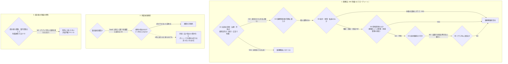

# 一般公開の前に確かめ残っている法と利用規約（薬機法のプログラム医療機器、アプリ本体の外部送信規律、成分表の有償頒布の例外）

調査日: 2026-10-19
対象: Issue #637「薬機法・アプリ本体の外部送信規律・成分表の有償頒布の例外が当たるかを確かめる」（#599 の子）。洗い出しの経緯は #614 の解決コメント。前の調査は、#598 の `docs/research/release-legal.md`（`research/release-legal` のブランチ。外部送信規律が LP に当たらないこと）、#24 の `docs/research/food-composition-db.md`（成分表の利用条件）。

> **確認の方法と限界**
> - 法令は e-Gov 法令 API（v2）で、調査日に施行されている版を取得した（薬機法は 2026-05-21 施行の版、同施行令は 2026-05-01 施行の版、電気通信事業法は 2026-05-27 施行の版、同施行規則は 2026-08-10 施行の版）。
> - 厚生労働省の「医療機器プログラムについて」のページ（HTML）、ガイドライン（令和5年3月31日一部改正）・判断事例（令和5年3月31日）・相談の事務連絡2本（PDF を `pdftotext` で文字にした）、医療機器プログラム事例データベース（令和8年9月8日更新、令和8年10月14日一部修正。Excel を python3 の openpyxl で読んだ）の**本文を直接取得して読んだ**。
> - 総務省の外部送信規律のページと FAQ（HTML）、「電気通信事業における個人情報等の保護に関するガイドライン」の解説（令和8年6月14日版、PDF の 7 章）、「電気通信事業参入マニュアル［追補版］」（令和5年1月30日改定、PDF）の**本文を直接取得して読んだ**。参入マニュアルの「ガイドブック」（令和4年4月14日）は画像の PDF で文字が取れず、読んでいない。
> - 文部科学省のウェブサイト利用規約（最終改正 令和8年8月17日）とその別紙、成分表（八訂）増補2023年のページ（HTML）、成分表の Q&A（令和8年3月、PDF）の**本文を直接取得して読んだ**。
> - nu-tori の機能と送り先は、リポジトリのコード・ADR・`GLOSSARY.md`・`site/public/privacy.html`（2026-10-14 改定の版）で確かめた。PostHog の iOS SDK の既定の振る舞いは、`ios/NuToriCore/Package.swift` が固定する版（3.92.0）のソースで確かめた。
> - 本文で確かめた主張は「本文で確認」、本文から推し量ったものは「本文からの読み取り」（何から読み取ったかを添える）、探したが記述が無かったものは「本文を探したが記述なし」と書く。**nu-tori への当てはめは、ほとんどが「本文からの読み取り」に当たる。**
> - **この文書は法律の専門家の見解ではなく、法律相談の代わりにならない。** 薬機法と電気通信事業法の当てはめは、どの文書も nu-tori と同じ形を名指ししておらず、最後は事業者の判断になる。
> - 二次情報（解説記事、ブログ、まとめ）は使っていない。

## 結論の要約

- **1. 薬機法: プログラム医療機器に当たらないと読める。** 決め手は機能より「使用目的」で、使用目的は表示・説明資料・広告（口頭を含む）で判断される【本文で確認 M2 3、別紙1 ①C】。プログラムで医療機器になるのは、施行令が定める「疾病診断用・疾病治療用・疾病予防用プログラム」だけで【本文で確認 Y2】、「健康な人の健康維持・増進のために、一般的な食事、運動、体重管理等の生活習慣に関するアドバイスを行うもの」は非該当の例に挙がる【本文で確認 M2 別紙1 ③C、M3 2 A 3)⑥】。nu-tori の体重の記録とグラフ、食事の記録と栄養の推定、目標と1日の目安、会話は、ガイドラインのフローチャートでどれも「医療機器非該当」に着く【本文からの読み取り】。ただしこれは、**画面・LP・App Store の説明で、病気（肥満症、糖尿病、メタボ、生活習慣病の予防、摂食障害など）の診断・治療・予防をうたわず、ほのめかさないこと**と、**会話の返事が病名の候補を示さないこと**が条件になる。「医療機器ではない」と書くのは「望ましい」とされるが、それだけでは根拠にならない【本文で確認 M2 8(1) と脚注12】。
- **相談は要らない（任意）。** 該当性の相談は、自治体でも PMDA でもなく、厚生労働省の監視指導・麻薬対策課のメール窓口（`samd-gaitousei@mhlw.go.jp`）に一元化されている【本文で確認 M1,M5】。ガイドラインは「判然としない場合」に使うよう案内しているだけで、出す前の相談を求めていない【本文で確認 M2 5(3)】。
- **2. 外部送信規律: アプリ本体には当たらないと読める（解釈の余地あり）。** nu-tori は、クラウドのソフトウェアを利用させる SaaS と同じく「登録及び届出が不要な電気通信事業（第３号事業）」に当たると読める【本文で確認 S4、当てはめは読み取り】。しかし規律がかかるのは、施行規則 22 条の 2 の 27 の 1〜4 号（メッセージの媒介、SNS・掲示板・ショッピングモール等、検索、ニュース・地図等の各種情報のオンライン提供）を提供する者だけで【本文で確認 T1 27条の12、T2、S2 問1-9】、nu-tori はどの号にも当たらないと読める。自分の記録を自分で見るだけで、ほかの利用者に見せる情報も、不特定の利用者の閲覧に供する情報も無いため【本文からの読み取り】。**4 号の「各種情報のオンライン提供」の幅は FAQ でも広くとられ（乗換案内、求人の情報、オンライン教育）、生成 AI の会話がこれに当たるかを書いた文書は無い**【本文を探したが記述なし S2,S3,S4】。
- **当たるとしても、今のプライバシーポリシーとサインインの同意で大部分は足りている。** 端末から外へ送るのは Sentry と PostHog の SDK と、nu-tori 自身のサーバー（「真に必要な情報」は通知が要らない）で、どちらも同意の前には動かない。足りないのは、**PostHog の SDK が既定で送るアプリのライフサイクルの出来事（入れた・更新した・開いた・バックグラウンドに移った）がポリシーに書かれていないこと**と、望ましいとされる事項（送り先ごとの概略をリンクと一緒に出す、モジュールごとの同意）の2つ（下の「問い2」）。
- **3. 成分表: 有料のアプリ（サブスクリプション）は「有償頒布」の例外に当たらないと読める。** 別紙の例外は、成分表を「書籍（電子書籍を含む。）として有償頒布する際」だけにかかる【本文で確認 F2 4)】。成分表の Q&A 1-11 は「書籍やアプリ等を作成する場合」に「許諾等の手続きは不要」と答え【本文で確認 F4】、利用規約は「数値データ、簡単な表・グラフ等は著作権の対象ではありません」「商用利用も可能です」とする【本文で確認 F1】。nu-tori は成分表そのものを配らず、材料ごとに引いた値を、その人の食事の栄養として見せるだけなので、「書籍として有償頒布」に当たらない【本文からの読み取り】。**照会は要らない（任意）。**
- **問い合わせが要るものは無い。** 確かさを上げたいときの任意の問い合わせ先と、聞くことは「問い合わせ先（任意）」の節にまとめた。

### 3つの問いの答えの道筋

## 問い1: プログラム医療機器（薬機法）に当たるか

### 法令とガイドラインの決まり

| 主張 | 根拠 | 確かさ | 出典 |
|---|---|---|---|
| 医療機器の定義 | 「人若しくは動物の疾病の診断、治療若しくは予防に使用されること、又は人若しくは動物の身体の構造若しくは機能に影響を及ぼすことが目的とされている機械器具等…であつて、政令で定めるもの」（2条4項） | 本文で確認 | Y1 |
| プログラムで医療機器になるもの | 施行令 別表第一の「プログラム」の項は「一 疾病診断用プログラム」「二 疾病治療用プログラム」「三 疾病予防用プログラム」の3つだけで、それぞれ「副作用又は機能の障害が生じた場合においても、人の生命及び健康に影響を与えるおそれがほとんどないものを除く」 | 本文で確認 | Y2 |
| 「身体の構造又は機能に影響」だけのプログラム | 別表第一のプログラムの項に、身体の構造・機能に影響を及ぼすことを目的とするプログラムの号は無い。体重を減らす・増やすことだけを目的にしたプログラムは、疾病の予防などをうたわない限り、政令で定める医療機器のどの号にも入らないと読める | 本文からの読み取り（Y2 の号の並び） | Y2 |
| 判断のしかた | 「製造販売業者等による当該製品の表示、説明資料、広告等に基づき、当該プログラムの使用目的及びリスクの程度が医療機器の定義に該当するかにより判断される。同じ機能を有するプログラムであっても、使用目的が異なれば、医療機器該当性の判断は異なる可能性がある」。別紙1 ①C は「口頭の演述を含む」とし、使用目的を「明示又は暗示するもの」を YES に進める | 本文で確認 | M2 3、別紙1 ①C |
| 複数の機能 | 「少なくとも１つの機能が医療機器プログラムの定義を満たす場合、全体として医療機器としての流通規制を受ける」。機能ごとに確かめ、どの機能も定義を満たさなければ規制対象外 | 本文で確認 | M2 3・4 |
| ①C で YES になる例 | 疾病の診断（スクリーニング、疾病の兆候や異常な体調の検出、早期発見、重症度判定、個人を特定しての疾病罹患の可能性の提示を含む）、疾病の治療（治療計画の提案、リハビリテーション、行動変容療法を含む）、疾病の予防（一次予防、二次予防、三次予防） | 本文で確認 | M2 別紙1 ①C |
| 典型的な非該当 | 「使用者（患者や健康な人）が自らの医療・健康情報を閲覧等することを目的とするプログラム」。体重等のデータを記録し、オンラインのデータベースに登録・記録できるもの（「経時的表示や統計処理をした数値の表示を含む」） | 本文で確認 | M2 4(3)① |
| ③A（表示・保管・転送のみ） | 自らの健康情報（例: 体重）の記録・閲覧のための表示・保管・転送だけなら非該当。「データを時系列に沿って並べ、グラフ化するなど、閲覧のために単純な加工・処理を行うものも含む」 | 本文で確認 | M2 別紙1 ③A |
| ③C（情報提供のみ） | YES の例に「健康な人の健康維持・増進のために、一般的な食事、運動、体重管理等の生活習慣に関するアドバイスを行うもの（情報提供にあたって、アドバイスの根拠が利用者に検証可能な形で示されることが望ましい）」。相談様式の注は「判断根拠を利用者に示していない場合…は NO」とする | 本文で確認 | M2 別紙1 ③C、M6 別紙1 ※3 |
| ③D（疾病候補） | ここまで進んで YES になるものは「罹患している又は罹患する可能性のある疾病候補の提示に相当し、疾病の診断に使用されることを目的にしているものの可能性が高い」 | 本文で確認 | M2 別紙1 ③D |
| 「公知」 | 「日本国内において、医学薬学栄養学上、科学的な根拠が十分あるものとして一般的に認知されている情報」。単に公表されているだけでは公知とされない | 本文で確認 | M2 5(1) 脚注8 |
| 「医療機器ではない」の表示 | 非該当のプログラムには「当該プログラムは、疾病の診断、治療又は予防に使用されることを目的としていない」又は「当該プログラムは医療機器ではない」旨の表示が「望ましい」。ただし脚注12「そのような記載があっても、疾病の疑いを判断できるなどと医療機器との認識を与える広告・標ぼうをする製品は医療機器に該当する」 | 本文で確認 | M2 8(1)、脚注12 |
| 承認前の広告 | 「何人も…承認…又は…認証を受けていないものについて、その名称、製造方法、効能、効果又は性能に関する広告をしてはならない」（68条） | 本文で確認 | Y1 |

### 判断事例とデータベースの近い事例

| 事例 | 判断 | 出典 |
|---|---|---|
| 健康な人の健康増進や体力向上のため、体重などから「医学栄養学上公知の範囲で」生活改善メニューの提示や実施状況に応じたアドバイスを行うプログラム | 非該当 | M3 2 A 3)③ |
| 健康な人の一般的な健康の維持・増進のため、健康的な食事、運動、体重管理などのアドバイスを行うプログラム | 非該当 | M3 2 A 3)⑥ |
| 体重計や歩数計等のデータを表示・保管・転送する個人の健康記録プログラム | 非該当 | M3 2 A 1)① |
| 疾病の治療又は予防を目的として、「医学栄養学上公知ではない独自のアルゴリズム」で個々人に適した食事や運動を提案するもの（例: 認知症予防） | 該当 | M3 1 5)④ |
| 糖尿病患者ごとに独自のアルゴリズムで食事療法の診療計画の立案を支援するもの | 該当 | M3 1 3)⑬ |
| No.139 食後グルコース値の変動から食事内容を 10 段階で評価するだけのもの | 非該当（疾病の診断・治療・予防を目的としない） | M4 |
| No.186 心電図から独自のスコア（心臓年齢など）を出すだけのもの / No.233 生成 AI との会話を独自のアルゴリズムで解析し、独自の指標「あたまの健康度」を出すもの（診断と誤認させる標ぼうをしない） | 非該当（疾病の診断や予防を意図しない独自のスコア・指標） | M4 |
| No.207 女性の体調を記録し、状態に応じたアドバイスや月経の予測日を出すもの | 非該当（疾病の診断や治療法の案内ではない範囲の分析とアドバイス） | M4 |
| No.187 循環器疾患患者の日常生活の疑問に AI チャットボットが答えるもの（診断と誤解される応答はせず、一般的な公知の情報のみ）/ No.185・No.242 AI との対話による心の悩みの相談 / No.234 がん患者向けの一般的な情報のチャットボット | 非該当 | M4 |
| No.34 AI チャットボットの ACT による社交不安障害の治療 / No.239 チャットの回答から独自のアルゴリズムで疾患名を示すもの / No.221 顔の画像や生活習慣から疾患の発症リスクを評価するもの | 該当 | M4 |
| No.166・No.176 利用者が送った情報を事業者が社内のプログラムで解析し、結果だけを返すサービス（プログラムを流通させない） | 「未判断」（薬機法の規制の対象とならないサービス） | M4 |

データベースを「食事」「カロリー」「体重」「栄養」「写真」などで探したが、**写真から食事の栄養を推定するプログラムや、体重の推移から1日のカロリーの目安を出すプログラムの事例は無かった**【本文を探したが記述なし M4】。

### nu-tori の機能に当てはめる

ガイドラインは機能ごとに確かめるよう求める【M2 3・4】。相談様式も「心電図測定機能、健康記録機能、食事記録機能」のように機能ごとに1枚ずつ書かせる【M6 2(1)】。nu-tori の機能を分けて、別紙1のフローチャートをたどる。すべて「本文からの読み取り」。

前提: nu-tori は医療関係者の指示や管理を受けず、本人が自分の意思で使う（②A で「個人使用のみ」）。サーバーで計算する（ADR-0009）が、アプリからサーバーの機能を使わせるので、M4 の No.166・No.176（プログラムを流通させないサービス）には当たらず、ガイドラインのいう「電気通信回線を通じて提供されるもの（…オンライン上での提供（使用者にアクセス権を付与し、オンライン上で運用するものも含む）等）」【M2 脚注2】に当たると読む。「サーバーで動かしているから対象外」とは言わないほうがよい。

| 機能 | たどり方 | 結論 |
|---|---|---|
| 体重・体脂肪率の記録、ヘルスケアとのやりとり、体重の傾向のグラフ | ①C NO → ②A 個人 → ③A YES（自分の健康情報の表示・保管・転送と、時系列のグラフ化）。M2 4(3)①、M3 2 A 1)① と同じ形 | 非該当 |
| 食事の記録、写真と文章からの料理・材料・量・栄養の推定、栄養の合計 | ①C NO（病気のための食事療法ではない）→ ③A NO（推定は加工）→ ③C: 食べたものの栄養の目安を示すのは情報提供に当たると読める。M4 No.139（食事内容の評価のみ、非該当）に近い。仮に ③C を NO としても ③D で病名を示さず、③E で医療上の判断に使わせないので非該当 | 非該当 |
| 目標（目標体重・期限・速さの案）、推定消費カロリー、1日の目安と週ごとの見直し | ①C NO → ③C:「健康な人の…体重管理等の生活習慣に関するアドバイス」【M2 ③C、M3 2 A 3)⑥】に当たると読める。推定は体重の傾向と食べた量からの独自の計算を含むが、独自のアルゴリズムが問題になる事例は、疾病の治療・予防を目的とするもの（M3 1 5)④、1 3)⑬）に限られ、疾病の目的を持たない独自のスコア・指標は非該当（M4 No.186・No.233・No.207）。1日の目安の下限（1,200 kcal）と速さの上限は、③E のリスクの見方を下げる方向に働く | 非該当 |
| 会話（送った文章への返事） | ①C NO → ③C: 一般的な食事・体重管理の助言。M4 No.187・No.185・No.242・No.234 と同じ形。返事の指示（`server/src/reply/durable-object/create-conversation-provider/reply-instructions.ts` の「医療にかかわる相談」）は、病気・薬・妊娠・体の不調の判断を医師や管理栄養士に任せ、摂食のつらさが見えたら相談窓口を勧めるとし、評価のケース（`server/evals/reply/cases.ts`）は「病名を挙げて診断したり…具体的な量の指示をしたりしていない」ことを確かめている。③D（疾病候補の提示）に入らない作りになっている | 非該当（返事が病名の候補を示さない限り） |
| 体重の記録忘れの通知、目標の知らせ | 医療・健康の判断を含まない知らせ | 非該当 |

どの機能も非該当に着くので、全体として医療機器に当たらないと読む。

### 当たらないと言えるための条件（崩れると判断が変わるところ）

- **表示・広告で病気をうたわない、ほのめかさない。** ①C は「製品の表示、説明において明示又は暗示するもの」を YES に進め、口頭の説明も含む【M2 別紙1 ①C】。アプリの画面、LP、App Store の説明文・キーワード・スクリーンショット（「[App Store の掲載情報を決める](https://github.com/gn-t-k/nu-tori/issues/612)」）、問い合わせへの返事で、肥満症・糖尿病・高血圧・メタボ・生活習慣病の予防や改善、摂食障害、「診断」「治療」「医師の代わり」と結びつけない。「健康診断の数値を良くする」のような言い方も、疾病の予防（一次予防）と読まれうる【本文からの読み取り M2 ①C の「疾病の一次予防、二次予防、三次予防」】。
- **病気の人を対象にしない。** 糖尿病・腎臓病・心不全など特定の疾病の患者に向けた食事・運動の個別の提案は、該当の事例が並ぶ（M3 1 3)⑬、M4 No.2・No.54・No.96・No.114）。利用規約の「持病のある方・妊娠中の方などは医師に相談」（#593 の解決コメント）は、この線に沿う。
- **返事で病名の候補や病気の可能性を示さない。** 今の返事の指示と評価のケースを保つ。返事は生成 AI の自由な文なので、評価のケースで確かめ続けることが根拠になる【本文からの読み取り】。
- **アドバイスの根拠を利用者が確かめられるようにする。** ③C の「望ましい」と相談様式の注【M2 ③C、M6 ※3】。目標の設定の画面から「推定消費量の出し方」へのリンクを置く実装チケット（#641）は、これに当たる。
- **「医療機器ではない」の一文は残すが、根拠にしない。** 利用規約の健康の但し書き（#593）は、ガイドラインの「望ましい」表示に当たる。根拠は上の当てはめと条件のほう【M2 8(1)、脚注12】。
- 機能を足すときは見直す。血糖・血圧などの値から状態を評価する、病名や疾病のリスクを示す、特定の疾病の食事療法をうたう、医療関係者と記録を共有して指示を受ける（②A で「医療関係者が業務に使用」に進む）、などは別の判断になる【M2 別紙1 ②A・③D、M4 No.114・No.221】。

### 相談の窓口と、相談するかどうか

| 主張 | 根拠 | 確かさ | 出典 |
|---|---|---|---|
| 窓口 | プログラムの医療機器該当性の相談は、令和3年4月1日から厚生労働省の監視指導・麻薬対策課に一元化し、メール（`samd-gaitousei@mhlw.go.jp`）で受ける。医療機器に該当しないプログラムの**広告**の相談は、引き続き都道府県 | 本文で確認 | M1、M5 |
| PMDA の窓口 | PMDA の「SaMD一元的相談窓口（医療機器プログラム総合相談）」は、医療機器プログラムの早期実用化を促すための相談の窓口で、該当性の相談の窓口ではない | 本文で確認 | M1 |
| 手続き | ガイドラインを確かめてから、機能ごとの相談様式（個人が使うものは様式1）と、機能の説明、結果を出すアルゴリズム、画面の画像、広告などの資料をメールで出す。照会に概ね1か月答えないと相談終了になりうる。判断事例は、申し入れが無ければ概要をデータベースで公表する | 本文で確認 | M6 1〜4 |
| 相談が要るか | ガイドラインは「個々の具体的な事例における医薬品医療機器等法の適用につき判然としない場合には、監視指導・麻薬対策課において相談・助言等を行っていることから、これを活用すること」と案内するだけで、出す前の相談を義務にしていない。フローチャートで「監視指導・麻薬対策課へ要相談」に着くのは、①E・③E・④G で「不明」になったときだけ | 本文で確認 | M2 5(3)、別紙1 |
| nu-tori は | 上の当てはめで、どの機能も「要相談」に着かない。相談は要らない。確かさを上げたいときの任意の相談として、下の「問い合わせ先（任意）」に書いた | 本文からの読み取り | — |

## 問い2: 電気通信事業法の外部送信規律は、アプリ本体に当たるか

### 規律がかかる者

| 主張 | 根拠 | 確かさ | 出典 |
|---|---|---|---|
| 条文 | 「電気通信事業者又は第三号事業を営む者（内容、利用者の範囲及び利用状況を勘案して利用者の利益に及ぼす影響が少なくないものとして総務省令で定める電気通信役務を提供する者に限る。）は、…情報送信指令通信…を行おうとするときは、…あらかじめ、…総務省令で定める事項を当該利用者に通知し、又は当該利用者が容易に知り得る状態に置かなければならない」（27条の12） | 本文で確認 | T1 |
| 電気通信事業でなければかからない | 「『電気通信事業』を営んでいない場合は、法の適用を受けないので、仮に情報の外部送信が行われていたとしても、外部送信規律の対象にはなりません」 | 本文で確認 | S2 問1-8 |
| 対象の役務（規則 22 条の 2 の 27） | ブラウザその他のソフトウェア（端末で OS を通じて実行されるもの）で提供される、次のいずれか。一「他人の通信を媒介する電気通信役務」、二 利用者から受けて記録・入力した情報を「不特定の利用者の求めに応じて送信する」役務、三 全てのウェブページを対象にした検索、四「前号に掲げるもののほか、不特定の利用者の求めに応じて情報を送信する機能を有する電気通信設備を他人の通信の用に供する電気通信役務であつて、不特定の利用者による情報の閲覧に供することを目的とするもの」 | 本文で確認 | T2 22条の2の27 |
| FAQ の言い換え | (1) 利用者間のメッセージ媒介等、(2) SNS、電子掲示板、動画共有サービス、オンラインショッピングモール等、(3) オンライン検索サービス、(4) ニュース配信、気象情報配信、動画配信、地図等の各種情報のオンライン提供 | 本文で確認 | S2 問1-9 |
| 1 号の中身 | メールサービス、ダイレクトメッセージ、宛先を指定した Web 会議など。「情報の加工・編集を行わず、かつ、送信時の通信の宛先として受信者を指定する場合に該当する」 | 本文で確認 | S2 問2-2、S3 7-1-2(1) |
| 2 号・4 号の「不特定の利用者」 | 「アカウント登録や利用料の支払をすれば誰でも受信（閲覧）できる場合も、『不特定の利用者』に含まれる」。2 号は「利用者…が情報を入力…し、当該情報を不特定の利用者が受信（閲覧）できるもの」 | 本文で確認 | S3 7-1-2(2)(4) |
| 4 号の幅 | 乗換案内（特定分野の検索）は 4 号に当たる。求人の情報提供サービスも 4 号。オンラインゲームやオンライン教育等のコンテンツサービスは「第2号に該当する」 | 本文で確認 | S2 問2-5・2-7・2-8 |
| 対象外の例 | サーバー間でのみデータを連携するシステム、閉域 LAN の業務システム、開発・検証の環境は対象外 | 本文で確認 | S2 問2-9〜2-11 |
| SaaS | 「クラウド上にアプリケーションソフトウェアを構築し…インターネット等を経由して当該ソフトウェアを企業や個人等に利用させるもの（SaaS、狭義のASPサービス）」は「自己と他人（利用者）との間の通信を行っており、他人の通信を媒介していない」ので、「登録及び届出が不要な電気通信事業（第３号事業）」。ただし利用者間のメール・チャット等の媒介を提供すれば登録又は届出が必要 | 本文で確認 | S4 4（事例の表） |
| 自己の需要 | 「自社商品やサービスのオンライン販売」は自己の需要で電気通信事業に当たらないが、「オンラインニュースや映像配信など、自社の商品やサービス自体がインターネットで提供される場合は、電気通信役務の提供（情報の送信）を前提としているため、電気通信事業に該当する」 | 本文で確認 | S4 フローチャート(2)Ⅰ |
| 同じ事業者の別の役務 | 対象役務を提供していても、対象役務に当たらない役務には外部送信規律はかからない | 本文で確認 | S2 問1-17 |

### nu-tori に当てはめる

すべて「本文からの読み取り」。

1. **電気通信事業か**: nu-tori のサブスクリプションで売るのは、サーバーに記録を置き、推定と返事を返すオンラインのサービスそのもので、ほかの本来業務の手段ではない。S4 の「自社の商品やサービス自体がインターネットで提供される場合」に当たり、SaaS と同じく第３号事業と読む。
2. **規則 22 条の 2 の 27 のどの号か**
   - 1 号: 利用者どうしでやりとりする機能が無い。会話の相手は nu-tori のサーバーで、返事はサーバーが作る（加工・編集した情報で、宛先を指定した他人への伝達ではない）。当たらない。
   - 2 号: 利用者が入れた記録・写真・文章は、その人のアカウント（アカウントごとの Durable Object、ADR-0012）の中だけに置き、ほかの利用者に見せない。当たらない。
   - 3 号: 検索の機能が無い。当たらない。
   - 4 号: 見せるのは、その人の記録と、その人の記録から作った推定・1日の目安・返事だけで、「不特定の利用者による情報の閲覧に供すること」を目的にした情報（記事、地図、時刻表、求人など）を配っていない。当たらないと読む。
3. **解釈の余地**: 4 号は FAQ で広くとられ（乗換案内・求人・オンライン教育）、「アカウント登録や利用料の支払をすれば誰でも受信できる場合も不特定」とされる。会話の返事は、ユーザーの問いに応じて一般的な食事の知識も返すので、「生成 AI が誰の問いにも情報を返すサービス」と見れば 4 号に近づく。生成 AI の会話や、本人の記録を管理するアプリ（家計簿・健康記録など）を名指しした記述は、FAQ・解説・参入マニュアルのどこにも無い【本文を探したが記述なし S2,S3,S4】。ここは言い切れない。

**結論: 当たらないと読む。ただし 4 号の解釈で当たると見られる余地を残すので、当たっても足りるようにしておくのが安い**（下の「当たるとした場合の差」）。

### 当たるとした場合に要ること

| 主張 | 根拠 | 確かさ | 出典 |
|---|---|---|---|
| 通知・公表する事項 | 「情報送信指令通信ごとに」、一 送信される利用者に関する情報の内容、二 送信先で当該情報を取り扱う者の氏名又は名称、三 その情報の利用目的 | 本文で確認 | T2 22条の2の29 |
| 「ごとに」の単位 | 「ウェブページやアプリケーションに埋め込まれたタグや情報収集モジュールごとに記載する必要がある」。表示はまとめてよい | 本文で確認 | S3 7-3-1 |
| 情報の粒度 | 「実際に送信されている情報がどのような情報か、利用者が適切に認識できるように記載する必要があります」 | 本文で確認 | S2 問4-7 |
| 名称 | 氏名又は名称を明記する。サービス名のほうが知られているならサービス名も併記が望ましいが、氏名又は名称との併記が求められる | 本文で確認 | S2 問4-2 |
| 利用目的 | 「原則として送信先と当該情報送信指令通信を行った電気通信事業者双方における利用目的を記載することが求められます」。送信先がさらに別の者に渡すことは規律の対象外 | 本文で確認 | S2 問4-3、S3 7-3-1(3) |
| 方法 | 日本語・専門用語を避け平易に・拡大などの操作なしに適切な大きさ。アプリでは「最初に表示される画面又は当該画面から容易に到達できる画面」に表示する | 本文で確認 | T2 22条の2の28、S2 問3-2 |
| ポリシーへのリンクで足りるか | 利用目的が書かれたプライバシーポリシーへのリンクで示すことは可能。「リンク先で表示される内容の概略を併せて示すことが望ましい」 | 本文で確認 | S2 問4-6、S3 7-3-1 |
| 通知が要らないもの | 一「利用者が電気通信役務を利用する際に送信をすることが必要なもの」（規則 22 条の 2 の 30: 真に必要な情報、入力した情報や認証の情報の再表示、不正の検知、設備の負荷の軽減）、二 自ら送った識別符号で自分に送り返されるもの、三「送信されることについて当該利用者が同意している情報」、四 オプトアウトの措置を講じ、所定の事項を知らせたうえで、利用者が停止を求めていない情報 | 本文で確認 | T1 27条の12 ただし書、T2 22条の2の30・31 |
| 自分のサーバーへの送信 | 「利用者以外の者」には運営者自身のサーバーも含まれるが、運営者に送られる情報は「原則として『真に必要な情報』に該当する」。ただし一般の利用者から見て通常想定できない情報や目的は除く。運営者以外へは原則として「真に必要」に当たらない | 本文で確認 | S2 問1-16・6-2、S3 7-4-1-1(1) |
| 委託先への送信 | 委託先の第三者に送る場合も規律に従う（個人情報保護法の委託の例外に当たるものは無い） | 本文で確認 | S3 7-1 ※3 |
| 同意の取り方 | 「利用者の具体的かつ能動的な同意を取得することが必要」。モジュールごとの同意が望ましく、あらかじめチェックを付ける方法は避ける。同意の前に、通知等の事項を知らせることが望ましい | 本文で確認 | S3 7-4-2-1・7-4-2-2 |
| 望ましい追加の事項 | オプトアウトの有無、送信先での保存期間、問い合わせ先など | 本文で確認 | S3 7-3-2 |
| 規律の対象は端末からの送信 | 情報送信機能は「利用者の電気通信設備に記録された当該利用者に関する情報を当該利用者以外の者の電気通信設備に送信する機能」。サーバーから Anthropic や Cloudflare の AI に送るのは端末からの送信ではなく、外部送信規律の外（個人情報保護法の外国の第三者への提供として、すでにポリシーに書いている） | 本文で確認（定義）、当てはめは読み取り | T1 27条の12 |

### nu-tori の端末から外へ送るもの

コードで確かめた（2026-10-19 の main）。

| 送り先（端末から） | 何が送るか | 送る中身 | 規律での扱い（読み取り） |
|---|---|---|---|
| nu-tori のサーバー（Cloudflare の上で動く運営者自身のサーバー） | アプリ本体（API の要求、写真の縮小版） | 記録、写真の縮小版、同期の記録、ビルド番号、要求のヘッダーなど | 運営者への送信で、役務の提供に要るもの。原則として「真に必要な情報」で通知は要らない（S2 問6-2） |
| Functional Software, Inc.（Sentry） | Sentry の SDK（sentry-cocoa。`ios/NuTori/Observability/SentryErrorReportingSession.swift`。`sendDefaultPii = false`、画面の写しと画面の構造は送らない） | エラーの種類、直前の操作と通信の記録、アプリを使った回、端末の情報、アカウント ID | 第三者への送信。通知・公表か同意が要る |
| PostHog, Inc.（PostHog） | PostHog の SDK（posthog-ios 3.92.0。`ios/NuTori/Observability/PostHogAnalyticsSession.swift`。画面の自動の記録・セッションリプレイ・エラーの自動の記録は切っている） | アプリが送る出来事（画面、操作、件数・時間・旗）、端末の情報、アカウント ID。**加えて、SDK の既定（`captureApplicationLifecycleEvents = true`）で「Application Installed」「Application Updated」「Application Opened」「Application Backgrounded」**（P1） | 第三者への送信。通知・公表か同意が要る。利用状況はアカウントの画面で止められる（オプトアウト） |
| Google LLC（Google フォーム） | アプリは問い合わせのフォームの URL を開くだけで、送るのはブラウザの中で利用者が送信したとき（アカウント ID を添えた URL を開く） | 書いた内容、メールアドレス、アカウント ID | 利用者が自分で開いて送るもの。ポリシーの表にすでに書いている |
| Apple（Sign in with Apple、ヘルスケア） | OS の仕組み | — | nu-tori が送らせるものではない。サインインは認証に要るもの |

両方の SDK は、サインインの画面の同意のあと（アカウント ID で `identify` するとき）に初めて始まる。同意の前には何も送らない。

### 今のプライバシーポリシーとの差

今のポリシー（`site/public/privacy.html`、2026-10-14 改定）の「1. 集める情報と集め方」の「不具合の報告」「利用状況」、「2. 使い道」、「3. 外部に送る情報」の表と「各社が講じる措置と、各社が自ら使う範囲」、「4. 同意と、その取り消し」を、上の要件と突き合わせた。すべて「本文からの読み取り」。

足りているもの:

- **送り先の名称**: Functional Software, Inc.（Sentry）、PostHog, Inc.（PostHog）と、会社の名称とサービス名を併記している（S2 問4-2）。
- **nu-tori の利用目的**: 「2. 使い道」の「不具合を見つけて直す」「利用状況を集計し、nu-tori を良くする」。
- **送信先の利用目的**: 「各社が自ら使う範囲」に、Sentry が識別できない形で分析と製品の開発に使うこと、PostHog が学習に使わないことを書いている（S2 問4-3 の「双方」）。
- **同意**: サインインの画面で、ボタンの真上の文で「不具合と利用状況も送って」と示し、続けた人だけが使い始める。あらかじめチェックを付ける形ではない。27 条の 12 第 3 号の同意の道で、通知・公表がなくても足りうる（S3 7-4-2）。
- **オプトアウト**: 利用状況はアカウントの画面で止められ、止めると送らないこと、前に送った分の扱いを書いている（規則 22 条の 2 の 31 の事項のうち、措置があること・送信を止めること・受け付ける方法）。
- **置き場**: 起動して最初に出るタイムラインからアカウントの画面を開くと、プライバシーポリシーへのリンクがある（`ios/NuTori/Account/AccountScreen.swift`）。サインインの画面の同意の文にもリンクがある（`ios/NuTori/SignIn/SignInConsentCard.swift`）。「最初に表示される画面…から容易に到達できる画面」と読める。
- **望ましい事項**: 保存期間（Sentry 30 日、PostHog 1 年）と問い合わせ先も書いている（S3 7-3-2）。

足りないもの（当たるとした場合に直すこと）:

1. **PostHog の SDK が既定で送るライフサイクルの出来事が、ポリシーの「利用状況」に無い。** アプリを入れた・更新した・開いた・バックグラウンドに移ったことが、アカウント ID と一緒に送られる（P1）。ポリシーの「利用状況」の列挙は「通知を押してアプリを開いたこと」しか挙げていない。「実際に送信されている情報がどのような情報か、利用者が適切に認識できるように」（S2 問4-7）に欠ける。直し方は2つで、どちらかを選ぶ: (a) ポリシーの「利用状況」に「アプリを入れた・更新した・開いた・閉じたこと」を足す、(b) `PostHogConfig` で `captureApplicationLifecycleEvents = false` にして、要る出来事はアプリから送る。これは外部送信規律が当たるかに関わらず、個人情報保護法の利用目的の公表と App Store Connect の App Privacy の回答の正確さにも関わる（`docs/agents/privacy.md` の「ポリシーを実装に合わせて保つ」）。
2. **リンクと一緒に出す概略と、モジュールごとの同意は「望ましい」の水準で満たしきっていない。** 同意の文は「不具合と利用状況も送って」と書くが、送り先（Sentry・PostHog）の名前と中身の概略はリンクの先にしかない。解説は、ポリシーへのリンクで示すときに概略を併せて示すこと、モジュールごとに同意を取ることを「望ましい」とする（S2 問4-6、S3 7-3-1・7-4-2-2）。義務ではないので、直さなくても規律に反するとは読まない。直すなら、アカウントの画面の「利用状況を送る」の下の文に「送り先: PostHog, Inc.。画面と操作の数、端末の情報」のような一行を足すのが軽い。

## 問い3: 成分表の利用規約の別紙の「有償頒布」の例外に、有料のアプリは当たるか

| 主張 | 根拠 | 確かさ | 出典 |
|---|---|---|---|
| 利用規約の原則 | 「どなたでも以下の1）～6）に従って、複製、公衆送信、翻訳・変形等の翻案等、自由に利用できます。商用利用も可能です。また、数値データ、簡単な表・グラフ等は著作権の対象ではありませんので、これらについては本利用ルールの適用はなく、自由に利用できます」。最終改正は令和8年8月17日 | 本文で確認 | F1 1 |
| 出典の記載と加工の記載 | 出典を記載し、編集・加工したときは加工したことを記載する。「あたかも国（又は府省等）が作成したかのような態様で公表・利用してはいけません」 | 本文で確認 | F1 1 1) |
| 別紙の例外の文言 | 「4）利用に当たって、届出や使用料の納付が必要となる場合があるコンテンツ」に「下記のコンテンツを書籍（電子書籍を含む。）として有償頒布する際には、届出や著作権使用料の納付が必要となる場合がありますので、担当課に御相談ください。 日本食品標準成分表」。翻訳・大量の印刷・出版物への掲載等の二次的な利用の定めは「一家に1枚」にだけかかる | 本文で確認 | F2 4) |
| 成分表の「電子書籍」 | 文部科学省は成分表を「電子書籍（PDF形式）とデータ（Excel形式）」で載せている。本表の「電子書籍（第2章を除く）」と「第2章（データ）」が別に置かれている | 本文で確認 | F3 |
| 出版社の成分表の本 | 「文部科学省が公表している食品のデータを用いて、一般の出版社から様々な形で、編集された食品成分表が書籍などの形で販売されています」 | 本文で確認 | F4 2-2 |
| アプリ | Q&A 1-11「日本食品標準成分表から、書籍やアプリ等を作成する場合、文部科学省の許可が必要でしょうか」→「成分表の一部又は全部利用に関する許諾等の手続きは不要としています。利用者においては、データの出典名として『八訂成分表』を読者・ユーザー等に分かるように明示する等、利用者間で混乱の無いよう適切な利用に配慮いただくようお願いします」 | 本文で確認 | F4 1-11 |
| 有料のアプリ・課金についての記述 | 利用規約・別紙・Q&A・成分表のページに、有料アプリやサブスクリプションを名指しした記述は無い | 本文を探したが記述なし | F1〜F4 |
| 担当課 | 成分表の担当は科学技術・学術政策局 政策課 資源室（`kagseis@mext.go.jp`） | 本文で確認 | F3、F4 |

### nu-tori に当てはめる

すべて「本文からの読み取り」。

- **別紙の例外は「書籍（電子書籍を含む。）として有償頒布」にだけかかる。** 文部科学省自身が成分表を「電子書籍（PDF形式）」と呼んで載せており（F3）、出版社が成分表を本にして売っていること（F4 2-2）と合わせると、例外が想定しているのは、成分表（食品の解説や表を含む本文）を本や電子書籍の形で売ることと読める。
- **nu-tori は成分表を本や電子書籍の形で配らない。** 成分表はサーバーに置き（ADR-0015）、写真から推定した材料ごとに食品を1つ選び、その値に量を掛けた栄養を、その人の食事の栄養として見せる。成分表の一覧・検索・食品の解説をユーザーに見せる画面は無い。サブスクリプションの代金は、推定・目標・返事などのサービスの対価で、成分表の写しの対価ではない。
- **Q&A 1-11 は「アプリ等」を名指しして許諾を不要とし、有償か無償かで分けていない。** 同じ答えが「書籍」も含むので、別紙の「書籍として有償頒布」は、それに上乗せされる狭い例外と読める。
- **使っているのは数値データ。** 利用規約は数値データを著作権の対象外とし、利用規約の適用の外に置く（F1）。nu-tori が使うのは食品ごとの成分値で、これに当たる。
- 結論: **有料のアプリ（サブスクリプション）は「有償頒布」の例外に当たらない。照会は要らない。** 要るのは、Q&A 1-11 と利用規約の出典の記載（「日本食品標準成分表（八訂）増補2023年」と、nu-tori が量に換算していること）で、これは #614 の解決コメントで「成分表の出典の表示」としてすでにどこかが持っている。
- 判断が変わる場合: 成分表の食品の一覧や解説をアプリで読める形にして売る、成分表の値をまとめて書き出せる機能を有料で出す、本や電子書籍の形で配る、など。

## 問い合わせ先（任意）

3つとも、出す前に要る問い合わせは無い。確かさを上げたいときに聞くなら、次のとおり。

| 問い | 窓口 | 聞くこと | 出典 |
|---|---|---|---|
| 1 薬機法 | 厚生労働省 医薬・生活衛生局 監視指導・麻薬対策課「プログラムの医療機器該当性の相談窓口」 `samd-gaitousei@mhlw.go.jp`（ページの表記どおり） | 様式1（個人が使用するプログラム）を機能ごとに（体重の記録とグラフ／写真と文章からの食事の栄養の推定／目標と1日の目安と推定消費カロリー／会話の返事）書き、機能の説明、計算のアルゴリズム（「推定消費量の出し方」）、画面の画像、LP と App Store の説明を添えて、「医療機器非該当」と考えるが、目標と1日の目安が独自の計算による個別の目安であることが ③C の「情報提供のみ」に当たるか、を聞く。判断の概要は原則公表される（非公表の申し入れはできる） | M1、M5、M6 |
| 2 外部送信規律 | 総務省 総合通信基盤局 電気通信事業部 利用環境課（TEL 03-5253-5847。外部送信規律のページの連絡先） | 「利用者が自分の体重と食事を記録し、サーバーがその人の記録から推定・目安と、生成 AI による返事を返す有料のアプリ（利用者どうしのやりとりも、ほかの利用者に見せる情報も無い）は、施行規則 22 条の 2 の 27 の各号に当たるか。特に 4 号の『不特定の利用者による情報の閲覧に供することを目的とするもの』に当たるか」 | S1 |
| 3 成分表 | 文部科学省 科学技術・学術政策局 政策課 資源室 `kagseis@mext.go.jp` | 「成分表の値をサーバーで引き、材料の量に換算した栄養をユーザーの食事の記録として見せる有料のアプリ（サブスクリプション）で、成分表の一覧や本文は見せない。利用規約の別紙 4) の『書籍（電子書籍を含む。）として有償頒布』に当たらず、届出や使用料は要らないと考えてよいか」 | F2、F4 |

おすすめは、2 は問い合わせより「足りないもの」の 1 を直すこと（当たるかに関わらず直すべきものなので）。1 と 3 は、問い合わせなくてよい。

## 関連して見つけたこと

- PostHog のライフサイクルの出来事（問い2 の「足りないもの」1）は、外部送信規律と関わりなく、プライバシーポリシーの「利用状況」と App Privacy の回答に響く。`docs/agents/privacy.md` に従い、直すなら同じ PR でポリシーを直す。
- ガイドラインは、医療機器ではないプログラムでも、利用者が想定外の目的で使わないよう、使用対象者や適切な使用目的を周知することを「重要」とする【本文で確認 M2 8(2)】。利用規約の「持病のある方・妊娠中の方などは医師に相談」と、目標の設定の医療の一文（#641）が、これに当たる。
- 医療機器に当たらないプログラムの**広告**の相談は都道府県が受ける【本文で確認 M1、M5】。LP と App Store の文言で迷ったときの窓口になる。健康増進法・景品表示法などの広告の規制は、今回は調べていない。

## 確かめられなかったこと

- 「判断フローチャートに係る Q&A」（相談手続きの事務連絡が参照を求める）は、厚生労働省のページにリンクが無く、読めなかった。
- 「電気通信事業参入マニュアル（追補版）ガイドブック」（令和4年4月14日）は画像の PDF で、本文を読めなかった。
- 総務省・厚生労働省の文書に、生成 AI の会話の機能、写真から食事の栄養を推定する機能、体重の推移から1日の目安を出す機能を名指しした事例は無かった。
- Sentry の SDK とサーバーが IP アドレスをどう扱うか（`sendDefaultPii = false` のときの既定）は、今回は確かめていない。外部送信規律の「利用者の端末に記録されている情報」に当たるかは本文から決まらない。
- 総務省の法令適用事前確認手続（ノーアクションレター）の手順は読んでいない。

## 出典一覧

すべて 2026-10-19 に本文を取得。

### 薬機法と厚生労働省

- Y1: 医薬品、医療機器等の品質、有効性及び安全性の確保等に関する法律（昭和35年法律第145号。2026-05-21 施行の版。2条4項、68条） — https://laws.e-gov.go.jp/law/335AC0000000145 （本文は e-Gov 法令 API v2）
- Y2: 同施行令（昭和36年政令第11号。2026-05-01 施行の版。別表第一の「プログラム」の項） — https://laws.e-gov.go.jp/law/336CO0000000011
- M1: 厚生労働省「医療機器プログラムについて」（該当性と相談窓口の節） — https://www.mhlw.go.jp/stf/seisakunitsuite/bunya/0000179749_00004.html
- M2: 「プログラムの医療機器該当性に関するガイドラインの一部改正について」（令和5年3月31日 薬生機審発0331第1号・薬生監麻発0331第4号。別添のガイドライン 3〜8 と別紙1のフローチャート①〜③） — https://www.mhlw.go.jp/content/11120000/001082227.pdf
- M3: 「プログラムの医療機器該当性判断事例について」（令和5年3月31日 事務連絡） — https://www.mhlw.go.jp/content/11120000/001082229.pdf
- M4: 医療機器プログラム事例データベース（令和8年9月8日更新、令和8年10月14日一部修正。No. は表の番号） — https://www.mhlw.go.jp/content/11120000/001759227.xlsx
- M5: 「プログラムの医療機器該当性の相談について」（令和3年3月31日 事務連絡） — https://www.mhlw.go.jp/content/11120000/000887987.pdf
- M6: 「『プログラムの医療機器該当性の相談窓口』における相談手続きについて」（令和4年1月26日 事務連絡。別紙1 様式1） — https://www.mhlw.go.jp/content/11120000/000887988.pdf

### 電気通信事業法と総務省

- T1: 電気通信事業法（昭和59年法律第86号。2026-05-27 施行の版。2条、27条の12、164条） — https://laws.e-gov.go.jp/law/359AC0000000086
- T2: 電気通信事業法施行規則（昭和60年郵政省令第25号。2026-08-10 施行の版〔令和8年総務省令第107号による改正〕。22条の2の27〜22条の2の31） — https://laws.e-gov.go.jp/law/360M50001000025
- S1: 総務省「外部送信規律」（3 対象者、4 やらなければならないこと、6 参考情報、連絡先） — https://www.soumu.go.jp/main_sosiki/joho_tsusin/d_syohi/gaibusoushin_kiritsu.html
- S2: 総務省「外部送信規律FAQ」（問1-8、1-9、1-16、1-17、2-2、2-3、2-5〜2-11、3-2、4-2、4-3、4-6、4-7、6-2〜6-4） — https://www.soumu.go.jp/main_sosiki/joho_tsusin/d_syohi/gaibusoushin_kiritsu_00002.html
- S3: 「電気通信事業における個人情報等の保護に関するガイドライン（令和4年個人情報保護委員会・総務省告示第4号）の解説」（令和8年6月14日版。7 外部送信に係る利用者に関する情報の取扱い、pp.251〜268） — https://www.soumu.go.jp/main_content/001073434.pdf （版の一覧: https://www.soumu.go.jp/main_sosiki/joho_tsusin/d_syohi/telecom_perinfo_guideline_intro.html ）
- S4: 総務省「電気通信事業参入マニュアル［追補版］」（令和5年1月30日改定。フローチャート(2)Ⅰ、4 主な事例と考え方の「ソフトウェアのオンライン提供（SaaS、ASP）」「各種情報のオンライン提供」「自社商品等のオンライン販売等」） — https://www.soumu.go.jp/main_content/000477428.pdf

### 文部科学省

- F1: 文部科学省ウェブサイト利用規約（平成26年7月31日大臣官房長決定、最終改正 令和8年8月17日） — https://www.mext.go.jp/b_menu/1351168.htm
- F2: 文部科学省ウェブサイト利用規約（別紙）（4) 利用に当たって、届出や使用料の納付が必要となる場合があるコンテンツ） — https://www.mext.go.jp/b_menu/1366610.htm
- F3: 日本食品標準成分表（八訂）増補2023年（掲載の形と担当課） — https://www.mext.go.jp/a_menu/syokuhinseibun/mext_00001.html
- F4: 日本食品標準成分表に関するQ&A（令和8年3月。1-11、2-2、3-1〜3-6） — https://www.mext.go.jp/content/20230428-mxt_kagsei-index_020.pdf

### nu-tori とライブラリ

- P1: posthog-ios 3.92.0 の `PostHog/PostHogConfig.swift`（`captureApplicationLifecycleEvents: Bool = true`）と `PostHog/AppLifeCycle/PostHogAppLifeCycleIntegration.swift`（「Application Installed」「Application Updated」「Application Opened」「Application Backgrounded」） — https://github.com/PostHog/posthog-ios/tree/3.92.0
- リポジトリ: `site/public/privacy.html`、`ios/NuTori/Observability/`、`ios/NuTori/SignIn/SignInConsentCard.swift`、`ios/NuTori/Account/AccountScreen.swift`、`ios/NuToriCore/Package.swift`、`server/src/reply/durable-object/create-conversation-provider/reply-instructions.ts`、`server/evals/reply/cases.ts`、ADR-0009・0012・0015・0024、`GLOSSARY.md`
