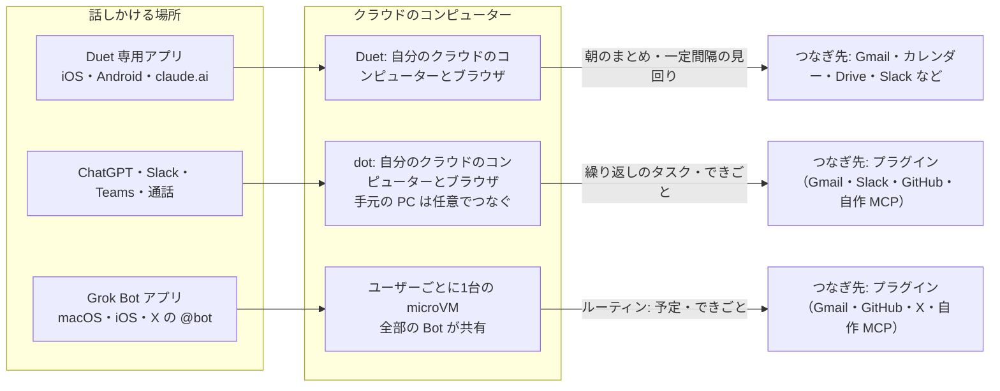
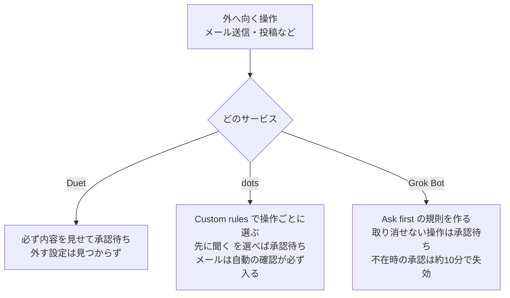
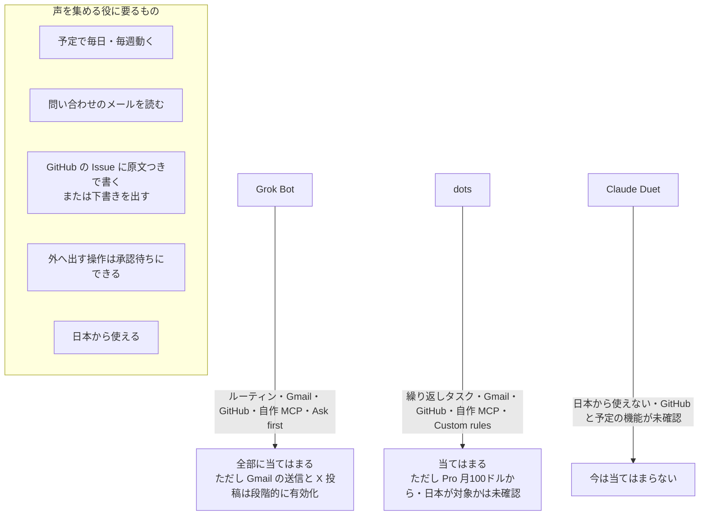
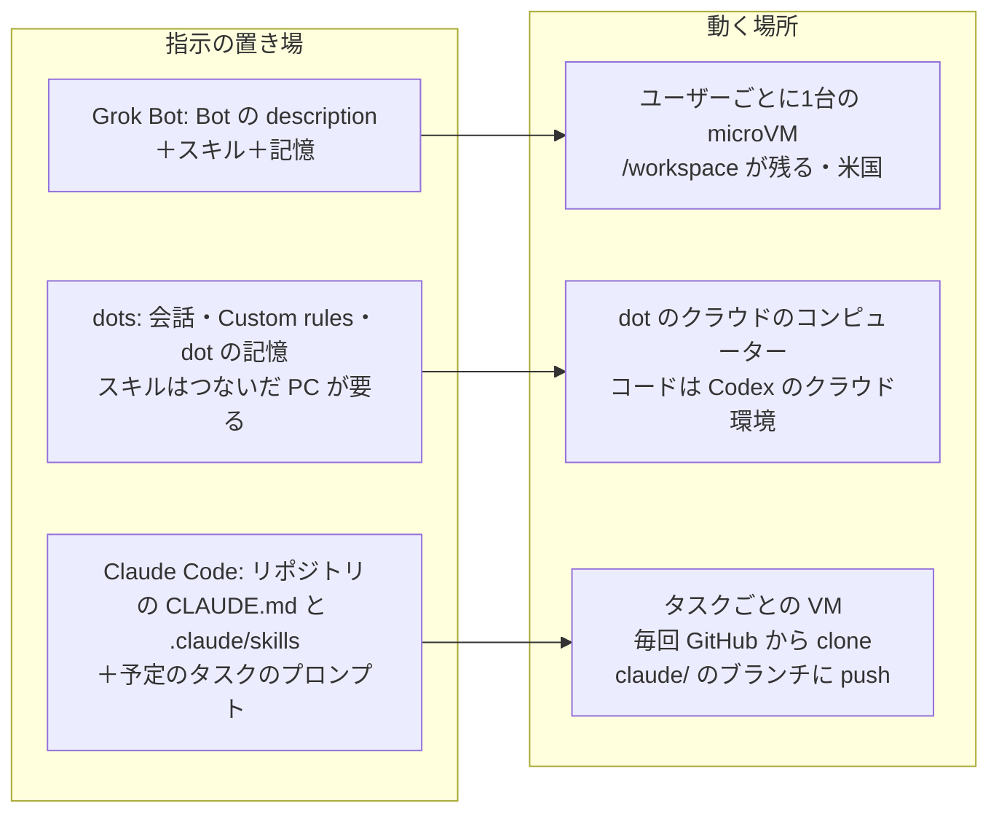
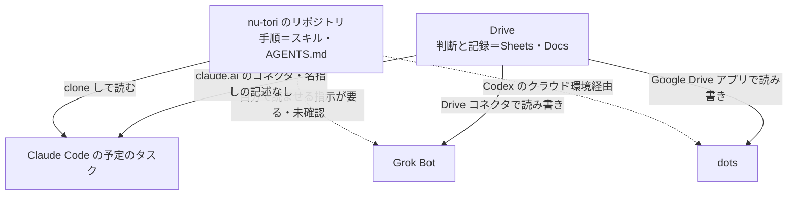

# 常駐型の AI エージェント3つ（Claude Duet・OpenAI dots・Grok Bot）を、事業の仕事に割り当てられるか

調査日: 2026-10-23
対象: 2026年の秋に出た「自分のクラウドのコンピューターで動き続ける」エージェント3つ。Anthropic の **Claude Duet**、OpenAI の **dots**（ChatGPT の中の機能）、xAI の **Grok Bot**。nu-tori（個人開発の公開 iOS アプリ）の事業の仕事（宣伝、問い合わせとユーザーの声の収集、予算と数字）を任せる前提で、できること、動く場所、常時動くか、つなげる先、承認の仕組み、料金、提供の状況を調べた。

> **確認の方法と限界**
> - **この調査では、公式ページの本文を直接開けなかった。** この環境の通信の出口が claude.com、support.claude.com、code.claude.com、anthropic.com、openai.com、help.openai.com、learn.chatgpt.com、x.ai、docs.x.ai、x.com への接続を拒んだ（プロキシの 403）。WebFetch も名前解決に失敗した。
> - そのため、**Web 検索の道具を公式のドメインだけに絞って（`allowed_domains`）検索し、検索結果に出る公式ページの抜粋と要約を読んだ**。抜粋は検索の道具が本文から抜き出したもので、英語の原文がそのまま出ているものと、言い換えられたものが混ざる。言い換えの誤りや、古い版の抜粋を読んでいる恐れがある。
> - そこで、`agent-ios-verification.md` の3つの区分を、この調査では次の意味で使う。
>   - 「**抜粋で確認**」: 公式ページの抜粋に、その主張がそのまま出ていた。原文に見える英語を短く添える（検索の道具が言い換えた可能性は残る）。
>   - 「**抜粋からの読み取り**」: 抜粋の記述から推し量った。何から読み取ったかを添える。
>   - 「**探したが記述なし**」: 公式ドメインに絞って検索したが、抜粋に出なかった。本文に書いてある可能性は残る。
>   - 頼まれた「本文で確認」は、本文を読んでいないので使わない。**確かさは全体として「中」**と見てほしい。実際に申し込む前に、出典の URL を自分のブラウザで開いて確かめる。
> - 公式の X アカウント（@claudeai、@OpenAI、@xai）の投稿は、x.com に届かず、検索にも出なかったので読んでいない。
> - 二次情報（ニュース、第三者のブログ）は検索結果に多く出たが、使っていない。食い違いの指摘として1か所だけ触れる（そう明記する）。
> - 3つとも出たばかりで、提供の範囲や料金が数週間ごとに変わっている。2026-10-23 時点の状態として読む。

## 結論の要約

- **名前の対応**: 3つとも、依頼にあった名前のとおりの公式製品が見つかった。Claude Duet は claude.com/product/claude-duet、dots は openai.com/index/introducing-dots/、Grok Bot は x.ai/bot。Grok Bot は「複数の Bot」を作って渡し合える製品で、依頼の「Grok Bots」はこれと判断した（抜粋で確認）。
- **3つとも「自分専用のクラウドのコンピューター＋ブラウザ」で動き、手元の端末を閉じても働き続ける**（抜粋で確認）。話しかける場所が違う。
  - Claude Duet: 専用アプリ（iOS・Android）と claude.ai の Web
  - dots: ChatGPT（デスクトップ・Web・モバイル）、Slack、Microsoft Teams、音声通話
  - Grok Bot: デスクトップ（macOS）と iOS のアプリ、X で `@bot` を付けて投稿
- **日本から今すぐ使えそうなのは Grok Bot と dots。Claude Duet は米国の Pro・Max だけで、順番待ち（waitlist）**（抜粋で確認）。dots は「対象の市場」の Pro と Business Premium に順に出している。除かれる地域に EEA・スイス・英国が書かれているが、日本が対象かは抜粋に無かった（探したが記述なし）。Grok Bot の X からの呼び出しは、オーストラリア・英国・EU などで使えないが、日本は除外の一覧に無い（抜粋からの読み取り）。
- **予定とできごとで動けるか**
  - Grok Bot: **できる**。「ルーティン」で時刻の予定と、対応するアプリのできごと（Slack のスレッド、GitHub の PR など）で動く（抜粋で確認）。
  - dots: **できる**。繰り返しのタスクと、対応するアプリのできごと（例: Slack のチャンネルに新しいバグ報告）で動く（抜粋で確認）。
  - Claude Duet: 朝のまとめ（morning brief）と、決まった間隔の見回りはある。自分で予定を組む機能と、できごとで動く機能は抜粋に無かった（探したが記述なし）。見回りの合間に来た急ぎのものは見逃しうる、と公式が書いている（抜粋で確認）。
- **外へ向く操作の承認**
  - Claude Duet: メッセージの送信、支払い、署名、削除の前に、何をするかを見せて承認を待つ作り（抜粋で確認）。承認を外す設定があるかは、抜粋に無かった（探したが記述なし）。
  - dots: 操作ごとに「聞かずにやる／頼まれたときだけ／先に聞く／人に渡す」を選べる（Custom rules）。下書きを頼んでも送信の許可にはならない。メール送信の前に自動の確認（Auto-review）が入り、これは外せない（抜粋で確認）。**「聞かずにやる」も選べるので、設定を誤らないことが要る。**
  - Grok Bot: 「Ask first（先に聞く）」の規則を作れ、規則がぶつかると Ask first が勝つ。送信・投稿・購入・削除のような取り消せない操作の前に承認を求める。ユーザー不在で始まった仕事（ルーティンなど）の承認は約10分で期限切れになり、実行されない（抜粋で確認）。**全部の Bot が1台のコンピューターと全部のログインを共有する**ので、Bot を分けても権限は分けられない（抜粋で確認）。
- **料金**（追加料金ではなく、プランに含まれる）
  - Claude Duet: プレビュー中は Pro（月20ドル）と Max（月100ドル・200ドル）に追加料金なしで含まれる。チャットと同じ利用の上限を使い、裏の見回りも上限を減らす（抜粋で確認）。
  - dots: Pro（月100ドル・200ドル・500ドル）の機能。dot との会話は上限に数えないが、dot が始めた Codex・ChatGPT Work のタスクは数える（抜粋で確認）。Plus には無い（抜粋で確認）。
  - Grok Bot: The X Subscription の Premium（月30ドル）・Super（月100ドル）・Ultra（月200ドル）に含まれ、Plus には含まれない。旧 SuperGrok と Cursor の各プランにも含まれる（抜粋で確認。価格のページどうしで食い違いがある）。
- **nu-tori の「ユーザーの声を集める」役には、今の時点では Grok Bot か dots が当てはまる。** どちらも予定とできごとで動き、Gmail・Slack・GitHub につなげ、自作の MCP サーバーもつなげる（抜粋で確認・抜粋からの読み取り）。Claude Duet は日本から使えないうえ、GitHub と自作のつなぎ先が確かめられなかった。詳細は末尾の「nu-tori の役割への当てはめ」。

## 3つの形の違い（図）

## 1. Claude Duet（Anthropic）

| 問い | 答え | 確かさ | 出典 |
|---|---|---|---|
| 名前の対応 | 依頼の名前のとおり「Claude Duet」という製品がある | 抜粋で確認 | https://claude.com/product/claude-duet |
| 何か | Claude が「先回りするエージェント」として働く新しいアプリ。メッセージで頼むと、クラウドで自分で働き、必要なときだけ声をかけ、仕上がったものを返す（"a proactive agent that understands what needs your attention. It takes on tasks of all sizes, keeps working while you're away, and waits for your ok when it matters."） | 抜粋で確認 | https://claude.com/product/claude-duet 、https://claude.com/resources/articles/claude-duet |
| 公開日 | 2026-10-21 にリサーチプレビューを開いた（"We just opened a research preview for users on Pro and Max plans: Claude Duet"） | 抜粋で確認 | https://claude.com/resources/articles/claude-duet 、https://support.claude.com/en/articles/12138966-release-notes |
| できること | 毎朝、つないだメールとカレンダーを見て、一番大事なものを選んだまとめ（morning brief）を送り、返信の下書きなど最初の一歩を始める。読む、下書きする、準備するは自分で行う | 抜粋で確認 | https://support.claude.com/en/articles/17631495-get-started-with-claude-duet |
| 動く場所 | クラウドの自分のコンピューターで動き、アプリを閉じても働き続ける。つなぎ先の無いサイトには、クラウドの自分のブラウザを使う。ブラウザで働く様子を見ることも、ブラウザを代わりに操作することもできない | 抜粋で確認 | 同上 |
| 使う端末 | iOS と Android の専用アプリ。PC では claude.ai の Web で開く（"Claude Duet is a standalone app for iOS and Android. On a computer, you can open it on the web at claude.ai."） | 抜粋で確認 | 同上 |
| モデル | Claude Opus 5.5 で動き、モデルは選べない（"You can't choose a model."） | 抜粋で確認 | 同上 |
| 常時動くか・予定 | 決まった間隔でアカウントを見回る（"It checks your accounts at set intervals, so something urgent can arrive between checks."）。朝のまとめがある | 抜粋で確認 | 同上 |
| 自分で予定を組む・できごとで動く | 「毎週月曜に〜」のような予定の作成や、メールの着信のようなできごとで動く機能の記述は出なかった（Anthropic の別製品の Cowork と Claude Code には予定の機能がある） | 探したが記述なし（claude.com・support.claude.com で "Claude Duet" と schedule・trigger・recurring を検索） | — |
| つなぎ先 | Claude にすでに設定したつなぎ先（コネクタ）を使う。挙がっているのは Gmail、Google Calendar、Google Drive、Slack、QuickBooks、HubSpot、Docusign、Calendly。製品ページは Notion、Stripe、Shopify も挙げ、「6,000 以上のコネクタとプラグイン」と書く。Slack などは Duet の中では機能が限られ、Microsoft 365 はまだ使えない | 抜粋で確認 | https://support.claude.com/en/articles/17631495-get-started-with-claude-duet 、https://claude.com/product/claude-duet |
| GitHub・X・App Store Connect・自作の MCP | Duet のつなぎ先の一覧に GitHub と X は無かった。自作の MCP サーバー（カスタムコネクタ）が Duet で使えるかの記述も出なかった。Claude 本体では Pro・Max でカスタムコネクタを足せるが、Duet に引き継がれるかは不明 | 探したが記述なし（同上の検索、"Claude Duet" と MCP・custom connector・GitHub） | Claude 本体のカスタムコネクタ: https://support.claude.com/en/articles/11175166-get-started-with-custom-connectors-using-remote-mcp |
| Claude の他の作業 | Claude の中の作業は読めるが変えられない。PC のファイルや全部のプロジェクトは見えない | 抜粋で確認 | https://support.claude.com/en/articles/17631495-get-started-with-claude-duet |
| サイトへのログイン | 保存したログインはまだ使えない。1Password でのログインは「近日」。Claude はパスワードやトークンを直接見ない | 抜粋で確認 | 同上（検索の抜粋） |
| 支払い | Link by Stripe と Shop Pay を Duet の中でつなげる。買う前に毎回聞き、1回だけ使えるカード番号で払う。米国の支払い手段が要る | 抜粋で確認 | https://support.claude.com/en/articles/17666484-how-to-use-link-by-stripe-with-claude-duet 、https://support.claude.com/en/articles/17666489-how-to-use-shop-pay-with-claude-duet |
| 承認 | メッセージの送信、支払い、署名、削除の前に、何をするかを正確に見せて承認を待つ作り。つないだアカウントからのメール送信も承認のうえで行う。承認があっても、有価証券の売買、口座間の送金、他人のアカウントへのアクセスはしない | 抜粋で確認 | https://claude.com/product/claude-duet 、https://support.claude.com/en/articles/17631495-get-started-with-claude-duet |
| 承認を外せるか | 「承認なしで送る」設定があるかの記述は出なかった（Claude 本体の Google Workspace コネクタは、既定で送信の前に承認を求め、Team・Enterprise では管理者が「毎回聞かない」を許せる） | 探したが記述なし（Duet について） | Claude 本体: https://support.claude.com/en/articles/10166901-use-google-workspace-connectors |
| 料金 | プレビュー中は Pro と Max に追加料金なしで含まれる。チャットと同じ利用の上限（5時間ごとと週ごと）を使い、朝のまとめや見回りなどの裏の仕事も数える。参加した人には上限の全リセットが1回ある（2026-11-30 まで） | 抜粋で確認 | https://support.claude.com/en/articles/17631495-get-started-with-claude-duet |
| プランの価格 | Pro は月20ドル（年払いで月17ドル相当）。Max は 5x が月100ドル、20x が月200ドル | 抜粋で確認 | https://claude.com/pricing 、https://support.claude.com/en/articles/11049741-what-is-the-max-plan |
| 提供の状況 | 米国の Pro・Max の利用者に、順番待ちで少しずつ（"We're adding people gradually, and you'll get an email when it's your turn."）。Team・Enterprise にはまだ無い（後で出す予定） | 抜粋で確認 | https://claude.com/product/claude-duet 、https://support.claude.com/en/articles/17631495-get-started-with-claude-duet |
| 公式が書いている弱み | スレッドを読み違えたり、急ぎの度合いを見誤ったりしうる。見回りの合間に来たものを見逃しうる | 抜粋で確認 | https://claude.com/product/claude-duet |

## 2. OpenAI dots

| 問い | 答え | 確かさ | 出典 |
|---|---|---|---|
| 名前の対応 | ChatGPT の機能「dots」（ひとつひとつを「dot」と呼ぶ）。依頼の名前と一致する | 抜粋で確認 | https://openai.com/index/introducing-dots/ 、https://chatgpt.com/features/dots/ |
| 公開日 | 2026-09-29 の DevDay で発表 | 抜粋で確認（発表の日付） | https://openai.com/index/introducing-dots/ 、https://openai.com/index/devday-2026-recap/ |
| 何か | GPT-6 Astra で動き、自分のクラウドのコンピューターを持ち、フィードバックから学び、24時間目標に向けて働く（"Dots are powered by GPT‑6 Astra, they have their own cloud computer, learn from feedback over time, and can work towards your goals 24/7."） | 抜粋で確認 | https://openai.com/index/introducing-dots/ |
| 動く場所 | クラウドの自分のコンピューターとブラウザ。手元の PC が切れていても働く。ブラウザのログインは自分のブラウザとは別。サイトがログインを求めると、会話の外で資格情報を渡す仕組みか、自分でブラウザを操作してログインする。クラウドのブラウザを拒むサイトでは、つないだ PC を使える | 抜粋で確認 | https://learn.chatgpt.com/docs/dots 、https://learn.chatgpt.com/docs/dots/computers-and-apps |
| 手元の PC | PC へのアクセスは任意で、既定では切れている。つなぐには、その PC で ChatGPT のデスクトップアプリを使う | 抜粋で確認 | https://learn.chatgpt.com/docs/dots/computers-and-apps |
| 話しかける場所 | ChatGPT（デスクトップ・Web・モバイル）、Slack と Microsoft Teams（DM、チャンネルでのメンション）、ChatGPT アプリからの音声通話。dot から電話はかけてこない。場所を替えても記憶は続く。SMS は「近日」 | 抜粋で確認 | https://learn.chatgpt.com/docs/dots/channels 、https://help.openai.com/en/articles/20001530-getting-started-with-your-dot |
| 仕事を渡す先 | 裏で別のエージェントを使い、クラウドの新しいスレッドを始め、つないだ PC で ChatGPT Work や Codex のタスクを作れる | 抜粋で確認 | https://learn.chatgpt.com/docs/dots |
| 予定 | 繰り返しのタスクを保存できる。何を確かめるか、いつ動くか（時間帯、終わりの日）、どんな変化で知らせるか、結果の送り先を決める。「Scheduled」の欄で管理する | 抜粋で確認 | https://learn.chatgpt.com/docs/dots/tasks-and-memory |
| できごとで動く | 元のアプリが対応していれば、「Slack のチャンネルに新しいバグ報告が来たら」のようなできごとで動ける | 抜粋で確認 | 同上 |
| 先回りの調べもの | 頼まれていないときも裏で役に立つことを探す（proactive research）。このときは**つないだアプリを読み取り専用でしか使えず**、送信、内容の変更、ブラウザや PC の操作はできない | 抜粋で確認 | 同上、https://help.openai.com/en/articles/20001529-dots-privacy-security-and-safety-faqs |
| つなぎ先 | 自分のアカウントで入れて有効にしたプラグイン（対応するもの）を、その接続と権限のまま使う。OpenAI のプラグインの一覧に Gmail、Slack、GitHub がある。Gmail のプラグインは検索、仕分け、返信の下書きができ、アーカイブ・ラベル・ゴミ箱は明示的に頼んだときだけ | 抜粋で確認 | https://learn.chatgpt.com/docs/dots 、https://developers.openai.com/codex/plugins |
| アプリの数 | 「4,000 以上のアプリ」とする検索の要約と、その数字は見当たらないとする要約があり、食い違った | 確かめられず | https://openai.com/index/introducing-dots/ |
| 自作の MCP | ChatGPT のプラグインの画面から自作の MCP サーバーを足せる（Developer Mode は不要）。リモートの MCP だけで、手元のサーバーはトンネルが要る。dot が「入れて有効にしたプラグイン」を使うことから、自作の MCP も dot で使えると読める | 抜粋で確認（ChatGPT 全体）／抜粋からの読み取り（dot で使えるか） | https://help.openai.com/en/articles/12584461-connecting-custom-mcp-servers-in-chatgpt |
| X・App Store Connect | X や App Store Connect の公式プラグインの記述は出なかった。ブラウザ経由か自作の MCP で届く可能性はあるが未確認 | 探したが記述なし（openai.com・help.openai.com・learn.chatgpt.com で X、App Store Connect を検索） | — |
| 承認（Custom rules） | 操作ごとに「聞かずにやる」「明示的に頼んだときだけ」「先に聞く」「その手順を人に渡す」を選べる。デスクトップと Web では Settings > Personalization > Custom rules | 抜粋で確認 | https://learn.chatgpt.com/docs/dots/controls |
| 承認（送信） | 下書きを頼んでも送信の許可にはならない。1回の承認は、その後も人に連絡してよい許可にはならない。メールを出す前に、宛先と本文を自動で確かめる（Auto-review）。Custom rules で必須の確認は外せない | 抜粋で確認 | https://help.openai.com/en/articles/20001530-getting-started-with-your-dot 、https://help.openai.com/en/articles/20001529-dots-privacy-security-and-safety-faqs |
| 承認（プラグインの権限） | プラグインごとに「毎回聞く／読み取りだけ／低リスクは許す／全部許す」を選べる。メールの送信は追加の確認が要りうる操作に挙がっている | 抜粋で確認 | https://help.openai.com/en/articles/20001495 |
| 料金 | Pro の機能（"Dot, your always-on agent"）。Pro は月100ドル・200ドル・500ドル。Plus には無い。dot との会話は利用の上限に数えないが、dot が Codex や ChatGPT Work で動かすタスクは数える。発表から1か月は、対象の Pro・Business・Enterprise で dots の利用をプランの枠に数えない | 抜粋で確認 | https://chatgpt.com/pricing/ 、https://help.openai.com/en/articles/9793128-about-chatgpt-pro-tiers 、https://help.openai.com/en/articles/6825453-chatgpt-release-notes |
| Business Premium の価格 | Business には Standard と Premium の席があり、Premium は ChatGPT Work と Codex の枠が多い。席の価格は抜粋に出なかった | 探したが記述なし | https://help.openai.com/en/articles/12003714-chatgpt-business-models-and-limits |
| 提供の状況 | 対象の市場の 18 歳以上の Pro と Business Premium に順に出している。Pro は EEA・スイス・英国を除く。Enterprise（Edu、Healthcare を含む）はベータで、管理者が有効にする（既定は切）。日本が対象の市場かは抜粋に出なかった | 抜粋で確認／日本は探したが記述なし | https://openai.com/index/introducing-dots/ 、https://help.openai.com/en/articles/6825453-chatgpt-release-notes 、https://help.openai.com/en/articles/20001554-manage-dots-in-chatgpt-workspaces |
| 複数の dot | 今は主に1つの dot。「チームの dots」は今後の構想として書かれている | 抜粋で確認（構想として） | https://openai.com/index/introducing-dots/ |

## 3. Grok Bot（xAI）

| 問い | 答え | 確かさ | 出典 |
|---|---|---|---|
| 名前の対応 | 製品名は単数の「Grok Bot」。ひとつのアカウントで複数の Bot を作り、渡し合わせる。依頼の「Grok Bots」はこれと判断した | 抜粋で確認 | https://x.ai/bot 、https://x.ai/news/introducing-grok-bot |
| 公開日 | 2026-08-11 にベータで公開。2026-08-26 に対象プランを広げ、2026-09-03 に Enterprise 向けを発表 | 抜粋で確認（後の発表とニュースの一覧の日付） | https://x.ai/news/grok-bot-more-plans 、https://x.ai/news/grok-bot-for-enterprise |
| 何か | 「仕事を終わらせる AI のチームメイト」。同僚のようにメッセージを送って仕事を渡す。チャットの下書きではなく、実際の道具の中で仕事を終える | 抜粋で確認 | https://x.ai/bot 、https://docs.x.ai/grok-bot/overview |
| 動く場所 | ブラウザ、ファイル、ターミナルのある、ずっと残るクラウドのコンピューターで動く。**ユーザーごとに1台の Firecracker microVM で、そのユーザーの全部の Bot が共有する**。ホストは Cursor のクラウド | 抜粋で確認 | https://docs.x.ai/grok-bot/overview 、https://docs.x.ai/grok-bot/teams-and-enterprises |
| 複数の Bot | ファイル、ブラウザのセッション、アプリのログインを共有するので、設定し直さずに仕事を渡せる。「chief of staff（まとめ役）」の Bot の下に、受信箱、経費、採用、バグ修正などの専門の Bot を置く形を勧めている。グループチャットに入れると、自分たちで仕事を渡し、担当を決め、判断が要るときだけ人を呼ぶ | 抜粋で確認 | https://x.ai/news/introducing-grok-bot 、https://x.ai/bot/guides/grok-bot-101 |
| Bot ごとの権限 | **Bot を分けても安全の境界にならない**（"The computer is assigned per user, not per Bot. Do not use separate Bots as a security boundary."） | 抜粋で確認 | https://docs.x.ai/grok-bot/teams-and-enterprises |
| 使う端末 | デスクトップ（macOS）と iOS | 抜粋で確認 | https://x.ai/news/introducing-grok-bot |
| 常時動くか | アプリ、ノート PC、スマホを閉じても、裏の仕事とルーティンは止まらない | 抜粋で確認 | https://docs.x.ai/grok-bot/skills-routines-and-automations |
| 予定・できごと | 「ルーティン」で、1つの Bot がいつ仕事をするかを決める。時刻の予定（時間帯つき、間隔は5分以上）と、対応していればできごと（Slack のスレッド、GitHub の PR を見張る、など）。1つの Bot に50本まで。チャットで頼むと Bot が作って次の実行時刻を見せる。一度手順を見せると「スキル」として保存し、予定で繰り返せる | 抜粋で確認 | 同上、https://x.ai/news/designing-grok-bot |
| X から呼ぶ | X の投稿か返信で `@bot` を付けると、その投稿をメインの Bot に仕事として渡す。`@bot` は X には短い確認だけを返す。Grok のアカウントに X のアカウントをつなぐ必要がある | 抜粋で確認 | https://docs.x.ai/grok-bot/tag-on-x 、https://x.ai/news/grok-bot-and-x |
| X を読む・書く | 公開の投稿、アカウント、トレンドは、ログインなしで読める（読み取り専用）。DM、ブックマーク、ホームのタイムラインなどは X のプラグインをつなぐ。プラグインで投稿までできるかは抜粋に出なかった | 抜粋で確認／投稿は探したが記述なし | https://docs.x.ai/grok-bot/computer-and-apps |
| つなぎ先 | Grok Bot に別のつなぎ先の一覧は無く、つなぎ先はアプリの中で「プラグイン」として出る。Grok のコネクタには Gmail と Google Calendar、Google Drive、OneDrive、Outlook、Teams、SharePoint、Salesforce、GitHub（リポジトリ、Issue、PR、コード）がある。Gmail は基本が読み取り専用で、書き込みと送信は段階的に有効にする | 抜粋で確認 | https://docs.x.ai/grok-bot/teams-and-enterprises 、https://docs.x.ai/grok/connectors 、https://docs.x.ai/grok/connectors/gmail-google-calendar |
| 自作の MCP | 一覧に無いサービスは、自分の MCP サーバーをつなげる（公開のインターネットから届く必要がある）。Team の管理者は Cursor の MCP の方針で制御する | 抜粋で確認（Grok のコネクタとして）／Grok Bot で同じに使えるかは抜粋からの読み取り | https://docs.x.ai/grok/connectors |
| Slack | Slack のスレッドを見張るルーティンの例と、Slack の議論を読む例はある。Slack の専用コネクタの記述は出なかった | 抜粋で確認（例として）／専用コネクタは探したが記述なし | https://docs.x.ai/grok-bot/skills-routines-and-automations |
| App Store Connect | 記述は出なかった | 探したが記述なし（x.ai・docs.x.ai で App Store Connect を検索） | — |
| 承認（Auto Review） | 有効にすると、シェルのコマンド、プラグインの呼び出し、コンピューターの操作、自動化の書き込み、別のエージェントへの委任を、独立した審査のモデルが見て「通す／承認を求める／止める」を決める。記憶への書き込みと多くの設定変更は対象外 | 抜粋で確認 | https://docs.x.ai/grok-bot/approvals-security-and-privacy |
| 承認（規則） | Settings → General → Auto-review に「Ask first（必ず先に聞く）」と「Allow automatically（審査が止めなければ通す）」の規則を作る。両方が当たると Ask first が勝つ。例に「外部へのメールは必ず承認」がある。承認のカードは Allow once・Always allow（規則を保存）・Deny | 抜粋で確認 | 同上 |
| 承認（取り消せない操作） | 送信、投稿、購入、削除のような取り消せない操作の前に、ユーザーのメッセージで承認を確かめる。送るメールは下書きのカードで承認を待つ | 抜粋で確認 | https://x.ai/changelog/bot |
| 承認（不在のとき） | ルーティンやできごとで始まった仕事の承認は、約10分で期限切れになり、その操作は実行されない | 抜粋で確認 | https://docs.x.ai/grok-bot/approvals-security-and-privacy |
| 承認の限界 | 承認と自動の審査は補助で、意図しない操作を全部は防げず、終わった操作は戻さない（利用規約）。読んだ Web ページやプラグインの結果が Bot を操ろうとしうる。パスワード、2段階認証、CAPTCHA、支払いの確認は人に渡す | 抜粋で確認 | https://x.ai/legal/grok-bot-terms 、https://docs.x.ai/grok-bot/computer-and-apps |
| 料金 | 最新の The X Subscription（2026年10月中旬の発表と読める）では Premium（月30ドル）・Super（月100ドル）・Ultra（月200ドル）に含まれ、Plus には含まれない。Bot の利用はその席の週ごとの共通の枠から使う。従量の追加もできる。旧来の SuperGrok と Cursor の Pro・Teams にも含まれる | 抜粋で確認 | https://x.ai/news/x-subscription 、https://docs.x.ai/x-subscription/grok-bot 、https://docs.x.ai/grok-bot/faq 、https://x.ai/news/grok-bot-more-plans |
| 料金の食い違い | x.ai/pricing の抜粋は SuperGrok 月30ドル・SuperGrok Plus 月100ドル、The X Subscription は Plus 月8ドル・Premium 月30ドル。SuperGrok Heavy の価格は出なかった。公開時の対象を「SuperGrok Heavy などに限る」とする抜粋と「全 SuperGrok」とする抜粋もあり、時期で変わったと読める | 抜粋どうしが食い違う | https://x.ai/pricing 、https://x.ai/news/x-subscription |
| 提供の状況 | ベータ。Enterprise は当初順番待ちで、その後提供を広げた。`@bot` の X からの呼び出しは、オーストラリア、英国、EU、アイスランド、リヒテンシュタイン、ノルウェーの X アカウントでは使えない（X に登録した国で判断）。日本は除外の一覧に無い | 抜粋で確認／日本は抜粋からの読み取り | https://docs.x.ai/grok-bot/tag-on-x 、https://x.ai/changelog/bot |

## nu-tori の役割への当てはめ

前提: 開発者は1人。アプリは公開の iOS アプリで、30日の無料体験つきのサブスク。使っている道具は GitHub、PostHog、App Store Connect、Sentry、Cloudflare。**外へ向く操作は全部、開発者の承認を通す**。最初のエージェントは「ユーザーの声を集める」役で、まとめには必ず原文を添える。人の声は TestFlight のフィードバックと問い合わせで受ける（`AGENTS.md`）。

以下は、上で確かめた範囲だけからの読み取り。

- **ユーザーの声を集める役（最初の役）**
  - **Grok Bot が一番当てはまる。** ルーティンで毎日動き、Gmail（基本は読み取り専用）と GitHub につなぎ、外部へのメールを「Ask first」にできる。X の公開の投稿をログインなしで読めるので、「nu-tori」への言及を拾うのにも使える（抜粋で確認）。月30ドルの Premium から使える。
  - 気をつけること: 全部の Bot が1台のコンピューターとログインを共有するので、後で宣伝の Bot を足すと、声を集める Bot にも X や Gmail の書き込みのログインが見える。**規則（Ask first）で縛るのが頼りで、Bot を分けても権限は分かれない**。不在時に始まった承認は約10分で失効するので、承認待ちの操作は「次の自分の時間に下書きを見る」流れにしたほうがよい（抜粋からの読み取り）。
  - **dots も当てはまる**が、Pro が月100ドルからで、日本が対象の市場か確かめられなかった。先回りの調べものが読み取り専用に固定されている点は、声を集める役と相性がよい（抜粋からの読み取り）。Custom rules の既定が何かは抜粋に出なかったので、使い始めに送信と投稿を「先に聞く」に揃える。
  - **Claude Duet は今は使えない**（米国の Pro・Max の順番待ちだけ）。承認を外す設定が見つからず「送信の前に必ず見せる」作りなので、承認の原則とは一番合う。日本に来たら見直す価値がある（抜粋からの読み取り）。
- **宣伝の役**: X の言及を読むところまでは Grok Bot が強い（X の公開の投稿をログインなしで読める、`@bot` で投稿から仕事を渡せる）。X への投稿が承認のうえでできるかは確かめられなかった。dots と Duet に X のつなぎ先の記述は無かった。
- **予算と数字の役**: 3つとも、PostHog、App Store Connect、Sentry、Cloudflare の公式のつなぎ先の記述は出なかった。dots と Grok Bot は自作の MCP をつなげるので、読み取りだけの MCP を自分で用意すれば届く（抜粋からの読み取り）。Duet は QuickBooks や Stripe の例があるが、これらは nu-tori では使っていない。
- **どれを使っても、まとめに原文を添える決まりは、指示（スキル・ルーティンの手順）で守らせる必要がある。** 3つとも「原文を添える」ような出力の形を保証する機能の記述は無かった（探したが記述なし）。

## 出典一覧

すべて 2026-10-23 に、公式ドメインに絞った Web 検索の抜粋で読んだ（本文は直接開けなかった）。

- Claude Duet
  - https://claude.com/product/claude-duet
  - https://claude.com/resources/articles/claude-duet
  - https://support.claude.com/en/articles/17631495-get-started-with-claude-duet
  - https://support.claude.com/en/articles/17666484-how-to-use-link-by-stripe-with-claude-duet
  - https://support.claude.com/en/articles/17666489-how-to-use-shop-pay-with-claude-duet
  - https://support.claude.com/en/articles/12138966-release-notes
  - https://claude.com/pricing 、https://support.claude.com/en/articles/11049741-what-is-the-max-plan
  - 参考（Claude 本体）: https://support.claude.com/en/articles/10166901-use-google-workspace-connectors 、https://support.claude.com/en/articles/11175166-get-started-with-custom-connectors-using-remote-mcp
- OpenAI dots
  - https://openai.com/index/introducing-dots/
  - https://chatgpt.com/features/dots/
  - https://learn.chatgpt.com/docs/dots
  - https://learn.chatgpt.com/docs/dots/computers-and-apps
  - https://learn.chatgpt.com/docs/dots/channels
  - https://learn.chatgpt.com/docs/dots/tasks-and-memory
  - https://learn.chatgpt.com/docs/dots/controls
  - https://help.openai.com/en/articles/20001530-getting-started-with-your-dot
  - https://help.openai.com/en/articles/20001529-dots-privacy-security-and-safety-faqs
  - https://help.openai.com/en/articles/20001554-manage-dots-in-chatgpt-workspaces
  - https://help.openai.com/en/articles/20001495
  - https://help.openai.com/en/articles/12584461-connecting-custom-mcp-servers-in-chatgpt
  - https://help.openai.com/en/articles/6825453-chatgpt-release-notes
  - https://chatgpt.com/pricing/ 、https://help.openai.com/en/articles/9793128-about-chatgpt-pro-tiers
  - https://developers.openai.com/codex/plugins
- Grok Bot
  - https://x.ai/bot
  - https://x.ai/news/introducing-grok-bot
  - https://x.ai/news/grok-bot-more-plans
  - https://x.ai/news/grok-bot-for-enterprise
  - https://x.ai/news/designing-grok-bot
  - https://x.ai/news/grok-bot-and-x
  - https://x.ai/news/x-subscription
  - https://x.ai/changelog/bot
  - https://x.ai/bot/guides/grok-bot-101
  - https://x.ai/legal/grok-bot-terms
  - https://docs.x.ai/grok-bot/overview
  - https://docs.x.ai/grok-bot/teams-and-enterprises
  - https://docs.x.ai/grok-bot/skills-routines-and-automations
  - https://docs.x.ai/grok-bot/approvals-security-and-privacy
  - https://docs.x.ai/grok-bot/computer-and-apps
  - https://docs.x.ai/grok-bot/tag-on-x
  - https://docs.x.ai/grok-bot/faq
  - https://docs.x.ai/x-subscription/grok-bot
  - https://docs.x.ai/grok/connectors 、https://docs.x.ai/grok/connectors/gmail-google-calendar
  - https://x.ai/pricing

## 追補: 指示の置き場・データの置き場・Google Workspace・データの扱い（Claude Code を加えて）

調査日: 2026-10-23（同じ日の追加の調べもの）
対象: Grok Bot、OpenAI dots、**Claude Code（claude.ai/code のクラウドのセッションと、予定で動く「scheduled tasks」（旧名 routines）、コネクタ）**。Claude Duet は短く。

> **確認の方法**: 上と同じ。claude.com・code.claude.com・openai.com・learn.chatgpt.com・x.ai・docs.x.ai への直接の取得をもう一度試したが、プロキシの 403（`connect_rejected`）と名前解決の失敗で開けなかった。そこで Web 検索を公式のドメイン（code.claude.com、support.claude.com、privacy.claude.com、anthropic.com、claude.com、help.openai.com、learn.chatgpt.com、openai.com、developers.openai.com、x.ai、docs.x.ai）に絞り、抜粋を読んだ。区分「抜粋で確認」「抜粋からの読み取り」「探したが記述なし」の意味も上と同じ。
>
> **前の節との食い違い**: Grok Bot の FAQ の抜粋は、デスクトップを macOS・Windows・Linux、手元のアプリを iOS・Android としている（上の表は macOS と iOS）。後から広がったと読める（抜粋からの読み取り）。

### 問いの対応（図）

### 1. 指示はどこに置き、どう渡すか

| 道具 | 答え | 確かさ | 出典 |
|---|---|---|---|
| Grok Bot | **Bot ごとの「description」が、ずっと守らせたい決まりの置き場**。その仕事だけの指示は会話で渡す（"Use the conversation for task-specific instructions. Use the description for rules that should remain true."） | 抜粋で確認 | https://docs.x.ai/grok-bot/bots |
| Grok Bot | 記憶（好み、役目、前の仕事のまとめ）とルーティンは **Bot に属し**、道具（プラグイン）とスキルは **アカウントに属する**。スキルは「仕事のやり方を書いた使い回せる指示」。一度見せた手順をスキルとして保存し、ルーティンで予定に載せる | 抜粋で確認 | https://docs.x.ai/grok-bot/skills-routines-and-automations 、https://docs.x.ai/grok-bot/overview |
| Grok Bot | テンプレートに Bot の指示の写し、記憶、スキル、プラグインが入り、共有できる | 抜粋で確認 | https://x.ai/bot/guides/templates-for-grok-bot |
| Grok Bot | **スキルを SKILL.md の文字として直接書く・直す手順は、Grok Bot については出なかった**。SKILL.md の形式と `AGENTS.md` を読む仕組みは、別製品の Grok Build（ターミナルのコーディングエージェント）の文書にある。Grok Bot のマーケットプレイスの1件は「手元のプラグインは読まず、Cursor のダッシュボードとマーケットプレイスからだけ読む」と書く | 探したが記述なし（Grok Bot で）／Grok Build は抜粋で確認 | https://docs.x.ai/build/features/project-rules 、https://docs.x.ai/build/features/skills-plugins-marketplaces |
| Grok Bot | GitHub のリポジトリを clone してその中の `AGENTS.md` やスキルに従う、という使い方の記述は出なかった。ターミナルとファイルがあり GitHub のコネクタもあるので、毎回「このファイルを読んでから始める」とルーティンに書けば読ませられると読めるが、確かめていない | 探したが記述なし／抜粋からの読み取り | https://docs.x.ai/grok-bot/computer-and-apps |
| Grok Bot | Google Drive のコネクタで Docs を探して読める（下の 3.）ので、毎回 Drive の文書を読ませる指示は書ける | 抜粋からの読み取り | https://docs.x.ai/grok/connectors/google-drive |
| dots | 決まりの置き場は **Custom rules**（許す・先に聞く・止める）。ただし「dot が守ろうとする指示で、間違えうる」と公式が書く（"They are instructions your dot tries to follow, and it can make mistakes."） | 抜粋で確認 | https://learn.chatgpt.com/docs/dots/controls |
| dots | dot は好み、決めたこと、続いている仕事について **自分のノート（記憶）** を持つ。ChatGPT の保存された記憶とは別。**個々の記憶は見られず、消せず、直せない** | 抜粋で確認 | https://learn.chatgpt.com/docs/dots/tasks-and-memory 、https://help.openai.com/en/articles/20001529-dots-privacy-security-and-safety-faqs |
| dots | 繰り返しの手順は「scheduled task」として保存する（何を確かめるか、いつ、何で知らせるか、結果の送り先）。Scheduled の欄で間隔・時刻・知らせを変えられ、dot に頼んで一覧・変更・取りやめもできる。タスクの中身を文字として直接編集できるかは抜粋に出なかった | 抜粋で確認／中身の編集は探したが記述なし | https://learn.chatgpt.com/docs/dots/tasks-and-memory |
| dots | **手元のスキル（Local skills）はつないだ PC が要る**（"Local skills require a connected computer."）。OpenAI のスキルは SKILL.md を中心にしたフォルダの形式 | 抜粋で確認 | https://learn.chatgpt.com/docs/dots 、https://developers.openai.com/api/docs/guides/tools-skills |
| dots | リポジトリの仕事は、**先に Codex でクラウド環境（リポジトリと準備の設定）を作り、dot がそれを使う** | 抜粋で確認 | https://learn.chatgpt.com/docs/dots |
| Claude Code | クラウドのセッションは **clone したリポジトリの `CLAUDE.md`（直下と `.claude/CLAUDE.md`、パス指定の無い `.claude/rules/`）を読み、`.claude/skills/`・`.claude/agents/`・`.claude/commands/` も clone と一緒に使える**。claude.ai で有効にしたスキルも読む。手元の `~/.claude/skills/` と、`.claude/settings.json` の `enabledPlugins` のプラグインは来ない | 抜粋で確認 | https://code.claude.com/docs/en/cloud-environments 、https://code.claude.com/docs/en/skills |
| Claude Code | 例外: **Projects の中のクラウドのスレッドは `CLAUDE.md` は読むが、リポジトリのスキル・`.mcp.json`・`.claude/settings.json` は読まない**（回避は claude.ai でスキルを有効にする） | 抜粋で確認 | https://code.claude.com/docs/en/claude-projects |
| Claude Code | 予定のタスク（scheduled tasks）は、名前・**プロンプト（文字）**・リポジトリ・環境・コネクタ・きっかけを持ち、claude.ai/code/routines の「Edit」で直せる。CLI の `/schedule` でも作れる。手順の本体はリポジトリのスキルに置き、プロンプトから呼ぶ形にできる | 抜粋で確認／スキルを呼ぶ形は抜粋からの読み取り | https://code.claude.com/docs/en/routines |
| Claude Code | Desktop アプリの「手元の予定のタスク」は別機能で、プロンプトを SKILL.md としてディスクに持つ。アプリが開いているあいだだけ動く | 抜粋で確認 | https://code.claude.com/docs/en/desktop-scheduled-tasks |
| Claude Duet | Claude アプリと同じ記憶とスキルを使い、過去のチャットを検索できる（Settings > Memory で切れる）。リポジトリを読む機能の記述は無い | 抜粋で確認／リポジトリは探したが記述なし | https://support.claude.com/en/articles/11817273-use-claude-s-chat-search-and-memory-to-build-on-previous-context |

### 2. どこで動き、何が残るか

| 道具 | 答え | 確かさ | 出典 |
|---|---|---|---|
| Grok Bot | ブラウザ、ファイル、ターミナルのある **ずっと残るクラウドのコンピューター**。長く残すファイルは共有の `/workspace` に置く。一時ディレクトリ、手で入れたパッケージ、コミットしていない状態は「作り直されうる」扱い。「Reset Bot's Computer」は最後のスナップショットから作り直し、直近の変更は消えうる | 抜粋で確認 | https://docs.x.ai/grok-bot/computer-and-apps 、https://docs.x.ai/grok-bot/overview |
| Grok Bot | ブラウザのログインと **コマンドラインの資格情報も全部の Bot で共有** | 抜粋で確認 | https://docs.x.ai/grok-bot/computer-and-apps |
| Grok Bot | ターミナルで `git push` できるか、GitHub の資格情報をどう渡すか、python・node が入っているかは出なかった（git の操作の記述は Grok Build のもの） | 探したが記述なし | — |
| dots | 自分のクラウドのコンピューターとブラウザを持ち、ファイル、ソフト、ブラウザのセッションを使う間で持ち越せる（"can keep its state between periods of use"） | 抜粋で確認 | https://learn.chatgpt.com/docs/dots/computers-and-apps |
| dots | dot のコンピューターで python を動かす、パッケージを残す、git で clone・push する、の直接の記述は出なかった。コードの仕事は Codex のクラウド環境に渡す作り | 探したが記述なし／抜粋からの読み取り | https://learn.chatgpt.com/docs/dots |
| Claude Code | Anthropic が管理する VM で動き、**VM はそのタスク専用**。毎回、選んだ GitHub のリポジトリを既定のブランチから clone し、変更は `claude/` で始まるブランチに push する。シェルのコマンドを動かせる | 抜粋で確認 | https://code.claude.com/docs/en/routines 、https://code.claude.com/docs/en/claude-code-on-the-web |
| Claude Code | 残るのは **環境の設定**（ネットワークの範囲、環境変数、準備のスクリプト、ネットワークの秘密の値）と、準備のスクリプトの結果のキャッシュ、GitHub のトークン（暗号化して claude.ai のアカウントに保存）、セッションの記録。VM の上のファイルは残らない（"The virtual machine exists only for that specific task"）。**残したいものはリポジトリにコミットするか、外のサービスに書く** | 抜粋で確認／ファイルが消えるのは抜粋からの読み取り | https://code.claude.com/docs/en/cloud-environments 、https://code.claude.com/docs/en/claude-code-on-the-web |
| Claude Code | 予定のタスクは **自律で動き、許可の確認で止まらない**。シェルのコマンドもコネクタの呼び出しも承認なしで行う。コネクタは既定で全部（書き込みを含む）入るので、要らないものを外すよう公式が勧める | 抜粋で確認 | https://code.claude.com/docs/en/routines |
| Claude Code | きっかけは時刻の予定・HTTP の呼び出し・GitHub のできごと。GitHub のできごとには Claude の GitHub App が要る。タスクは個人のアカウントに属しチームには属さない。Pro・Max・Team・Enterprise、リサーチプレビュー | 抜粋で確認 | https://code.claude.com/docs/en/routines |
| Claude Code（この調査の環境での観察） | この調べもの自体が Claude Code のクラウドのセッションで動いており、リポジトリの `AGENTS.md` が読み込まれ、claude.ai のコネクタ（Gmail など）が渡され、許していないホストへの通信はプロキシに拒まれた。公式の記述どおりの動き（観察で、3区分のどれでもない） | 観察 | — |

### 3. Google Drive・Sheets・Docs

| 道具 | 答え | 確かさ | 出典 |
|---|---|---|---|
| Grok Bot | Grok の **Google Drive コネクタ** で、Docs・Sheets・Slides などを探して読み、**新しい Google Docs を含むファイルを作って書ける**（"Create and write files including new Google Docs."）。書き込みの権限は任意で付ける。Sheets の編集ができるとする事業者向けページもある | 抜粋で確認（作成・書き込み）／Sheets に行を足すのは抜粋からの読み取り | https://docs.x.ai/grok/connectors/google-drive 、https://x.ai/grok/business |
| Grok Bot | Grok のコネクタが Grok Bot のプラグインとしてそのまま出ることは上の節で確かめた。Drive が Grok Bot で同じ権限で使えるかの個別の記述は出なかった | 抜粋からの読み取り | https://docs.x.ai/grok-bot/teams-and-enterprises |
| dots | ChatGPT の **Google Drive アプリ**（2026年3月に Docs・Sheets・Slides のアプリを統合）が、Google Docs と Sheets の作成と更新の書き込みに対応。共有ドライブはまだ対象外。dot は入れて有効にしたアプリを使い、読み取りと書き込みの権限はプラグインごとに選ぶ | 抜粋で確認（ChatGPT 全体）／dot で書けるかは抜粋からの読み取り | https://help.openai.com/en/articles/10929079-google-drive-app-and-setup-in-chatgpt 、https://help.openai.com/en/articles/6825453-chatgpt-release-notes 、https://help.openai.com/en/articles/20001495 |
| dots | 先回りの調べものでは、つないだアプリは読み取り専用（上の節） | 抜粋で確認 | https://help.openai.com/en/articles/20001529-dots-privacy-security-and-safety-faqs |
| Claude Code | claude.ai のコネクタが二層。**Google Drive コネクタ** は探す・読む・共有・移動・ゴミ箱（Sheets も読める、文字だけ取り出す）。**別の Google Docs・Sheets・Slides のコネクタ** で新しいファイルを作り、編集する | 抜粋で確認（claude.ai 全体） | https://support.claude.com/en/articles/10166901-use-google-workspace-connectors 、https://support.claude.com/en/articles/16951679-use-claude-in-google-docs-sheets-and-slides |
| Claude Code | クラウドのセッションと予定のタスクは、claude.ai に設定したコネクタを受け取る（セッションの中でのログインは無い）。**Google Drive や Sheets のコネクタがクラウドのセッションで使えると名指した記述は出なかった** | 抜粋で確認（仕組み）／Google を名指しは探したが記述なし | https://code.claude.com/docs/en/mcp 、https://code.claude.com/docs/en/routines |
| Claude Code | Sheets の行の追加ができるか（作成・編集とは別に）は出なかった | 探したが記述なし | — |

### 4. データの扱い（アプリのプライバシーポリシーのため）

アプリの問い合わせをこれらの道具に読ませると、その事業者がユーザーの問い合わせを扱う先になる。

| 道具・プラン | 学習への利用 | 残る期間 | 処理する場所 | DPA・事業者向けの条件 | 確かさ | 出典 |
|---|---|---|---|---|---|---|
| Claude Code（Pro・Max） | 消費者のプラン（Free・Pro・Max）は「モデルの改善」の設定がオンなら学習に使う。Claude Code も含む。設定はいつでも変えられる。既定がオンかオフかは抜粋に出なかった | オンなら5年、オフなら30日。規約違反と判定されたものは最長2年。クラウドのセッションの記録は Anthropic が保存し、セッションごとに消せる。ゼロデータ保持はクラウドのセッションに使えない | 消費者向けは「事業者や協力先が活動する国で処理しうる」。米国で保存と明記したのは商用の顧客向けの記事 | **DPA は商用の規約（Team・Enterprise・API）に組み込まれたもので、消費者のプラン（Pro・Max）は消費者の規約** | 抜粋で確認（場所は消費者について明記なし） | https://code.claude.com/docs/en/data-usage 、https://privacy.claude.com/en/articles/10023548-how-long-do-you-store-my-data 、https://privacy.claude.com/en/articles/10458704-how-does-anthropic-protect-the-personal-data-of-claude-users 、https://privacy.claude.com/en/articles/7996890-where-are-your-servers-located-do-you-host-your-models-on-eu-servers 、https://privacy.claude.com/en/articles/7996862-how-do-i-view-and-sign-your-data-processing-addendum-dpa 、https://www.anthropic.com/legal |
| Claude Duet（Pro・Max） | Duet 専用の決まりは出なかった。Claude の消費者の決まり（上と同じ）が当たると読める | 同上と読める | 同上 | 同上 | 抜粋からの読み取り | https://privacy.claude.com/en/articles/7996885-how-do-you-use-personal-data-in-model-training |
| dots（ChatGPT Pro） | 個人のプランでは「Improve the model for everyone」の設定で、dot の会話と仕事を学習に使うかが決まる。Business・Enterprise・Edu は既定で使わない | dot の文脈は dot を消すまで残り、消すと消える。dot が作ったファイル・Codex のスレッド・ChatGPT の会話は別に残る | Pro での場所の記述は出なかった。データの所在地の選択は Enterprise・Edu・API など（Business は順次）向け | **DPA は Business・Enterprise・API 向け**。Plus・Pro 向けの DPA は ChatGPT Sites で集めた個人データに限られる | 抜粋で確認（場所は探したが記述なし） | https://help.openai.com/en/articles/20001529-dots-privacy-security-and-safety-faqs 、https://openai.com/business-data/ 、https://help.openai.com/en/articles/9903489-data-residency-and-inference-residency-for-chatgpt 、https://openai.com/policies/chatgpt-sites-data-processing-addendum/ |
| Grok Bot（X Premium など） | **学習のオプトアウトは Cursor のアカウントとプライバシーの設定に従う**。Privacy Mode がオンなら学習に使わず、確かめられないときは学習しない側に倒す。Grok Bot は Legacy Privacy Mode に対応しない。X から使う Grok の学習の止め方は X のヘルプセンターを見よとある。Premium での既定は抜粋に出なかった | Privacy Mode がオンならモデル提供者はプロンプトと出力を残さない（不正の検知で印のついたものは残しうる）。**Bot を消しても、そのコンピューターのファイルとログインは残りうる**。利用規約は、データ・ファイル・ブラウザのセッション・資格情報・記憶・ルーティンを残るクラウドの環境に保持しうると書く | **Grok Bot のコンピューターは今は米国で動く**（契約上の約束ではなく今の状態として） | Grok Bot と第三者のモデルは Anysphere（Cursor）が提供し、Cursor のサービスでは Anysphere が SpaceXSI の再委託先。DPA の文書と「X Subscription Grok Addendum」「Cursor Addendum」がある。**Premium の個人にこの DPA が当たるかは読み取れなかった**（Cursor Addendum は 2026-10-07 時点で Grok か X の Teams の契約者に限るとある） | 抜粋で確認（個人への適用は探したが記述なし） | https://docs.x.ai/grok-bot/security 、https://docs.x.ai/grok-bot/approvals-security-and-privacy 、https://x.ai/legal/faq 、https://x.ai/legal/grok-bot-terms 、https://x.ai/legal/data-processing-addendum 、https://x.ai/legal/x-subscription-grok-addendum 、https://x.ai/legal/x-subscription-cursor-addendum 、https://docs.x.ai/grok-bot/teams-and-enterprises |

**プライバシーポリシーへの読み取り**: 3社とも、個人のプラン（Pro・Max、ChatGPT Pro、X Premium）では、利用者側を「委託元」とする DPA が当たるという記述は出なかった。DPA の枠に入るのは、Anthropic は Team・Enterprise・API、OpenAI は Business・Enterprise・API（抜粋で確認）。xAI は Teams の契約者向けの付属書が見えた。問い合わせを読ませるなら、ポリシーには「問い合わせの内容を、これらの事業者（米国など）の AI サービスで処理する」と書き、学習の設定を切ったうえで使うのが、確かめた範囲での最小（抜粋からの読み取り。法的な判断ではない）。Grok Bot は、Cursor（Anysphere）も処理に入ることを書く必要があると読める。

### 5. 日本で使えるか（再確認）

| 道具 | 答え | 確かさ | 出典 |
|---|---|---|---|
| dots | Pro は「EEA・スイス・英国を除く市場の18歳以上」に順に出す。日本は除外の一覧に無い。同じページに「米国の Pro だけのベータ」とする古いと見られる一文も残る。Business Premium と Enterprise は「世界に順に」 | 抜粋で確認／日本が入るのは抜粋からの読み取り | https://help.openai.com/en/articles/20001530-getting-started-with-your-dot 、https://learn.chatgpt.com/docs/dots |
| Grok Bot | 製品そのものの国の一覧は出なかった。`@bot` の X からの呼び出しの除外（オーストラリア、英国、EU、アイスランド、リヒテンシュタイン、ノルウェー）に日本は無い。判断は X のアカウントに登録した国で、VPN では変わらない | 探したが記述なし（製品の国）／抜粋からの読み取り（日本） | https://docs.x.ai/grok-bot/tag-on-x 、https://docs.x.ai/grok-bot/faq |
| Claude Code | 前の節の Duet と違い、予定のタスクは Pro・Max・Team・Enterprise に出ていて、国の制限の記述は出なかった（この調べものも日本の開発者のアカウントで動いている） | 抜粋で確認（プラン）／国は探したが記述なし | https://code.claude.com/docs/en/routines |

### nu-tori の置き場の決め方への影響

検討している置き方: **手順は公開リポジトリ（nu-tori）にスキルとして置き、判断とデータは Google Workspace の Drive（Sheets・Docs）に置く**。

- **Claude Code（クラウドの予定のタスク）が、この置き方に一番そのまま合う。** 毎回リポジトリを clone し、`CLAUDE.md` とリポジトリのスキルを読むことが公式に書かれている（抜粋で確認）。Drive 側は claude.ai のコネクタを受け取る仕組みで、Google の Docs・Sheets のコネクタは作成と編集ができる（抜粋で確認）が、クラウドのセッションで Google のコネクタが使えると名指した記述は無かったので、最初に1回試して確かめる。気をつけること: 予定のタスクは承認なしで動き、コネクタは既定で書き込みも全部入る（抜粋で確認）。「外へ向く操作は承認を通す」原則に合わせるには、送信のできるコネクタ（Gmail など）を外し、成果は下書き・Sheets の行・PR に限る作りにする（抜粋からの読み取り）。VM は残らないので、判断と記録を Drive に置く方針とも合う。Projects の中のスレッドではリポジトリのスキルが読まれない点に注意（抜粋で確認）。
- **Grok Bot は、Drive 側は合う**（Drive コネクタで Docs の作成と書き込み、抜粋で確認）。**手順側は Grok Bot が好む形と違う**: 決まりは Bot の description、手順はアカウントのスキル（アプリの中で保存）、残すファイルは `/workspace` という、Grok Bot の中に持つ作りで、リポジトリのスキルを読む仕組みは記述が無かった（探したが記述なし）。リポジトリを正にするなら、ルーティンの指示に「GitHub から手順のファイルを読んでから始める」と書く回り道になり、確かめていない。
- **dots も Drive 側は合う**（Google Drive アプリが Docs・Sheets の書き込みに対応、抜粋で確認。dot で書けるかは抜粋からの読み取り）。**手順側は、スキルがつないだ PC 前提で、リポジトリの仕事は Codex のクラウド環境に渡す作り**（抜粋で確認）。dot が好むのは、決まりを Custom rules と dot の記憶（見られず直せない）に、繰り返しを scheduled task に持つ形で、手順を文字で管理して差分を追う使い方には向かない（抜粋からの読み取り）。
- **Claude Duet** はリポジトリを読む機能の記述が無く、日本からまだ使えないので、この置き方の検討から外してよい（抜粋からの読み取り）。
- **どれを選んでも**、問い合わせの本文が Drive とエージェントの事業者の両方に渡るので、プライバシーポリシーには Google と、選んだ事業者（Grok Bot なら Cursor も）を書く。個人のプランでは DPA の枠の外になると読める（4. を参照）。

### この追補の出典

すべて 2026-10-23 に、公式ドメインに絞った Web 検索の抜粋で読んだ（本文は直接開けなかった）。

- Claude Code・Claude
  - https://code.claude.com/docs/en/claude-code-on-the-web
  - https://code.claude.com/docs/en/cloud-environments
  - https://code.claude.com/docs/en/routines 、https://code.claude.com/docs/en/web-scheduled-tasks 、https://code.claude.com/docs/en/desktop-scheduled-tasks
  - https://code.claude.com/docs/en/skills 、https://code.claude.com/docs/en/claude-projects 、https://code.claude.com/docs/en/mcp
  - https://code.claude.com/docs/en/data-usage
  - https://support.claude.com/en/articles/12618689-use-claude-code-in-the-cloud
  - https://support.claude.com/en/articles/10166901-use-google-workspace-connectors 、https://support.claude.com/en/articles/16951679-use-claude-in-google-docs-sheets-and-slides
  - https://support.claude.com/en/articles/11817273-use-claude-s-chat-search-and-memory-to-build-on-previous-context
  - https://privacy.claude.com/en/articles/10023548-how-long-do-you-store-my-data 、https://privacy.claude.com/en/articles/7996885-how-do-you-use-personal-data-in-model-training 、https://privacy.claude.com/en/articles/10458704-how-does-anthropic-protect-the-personal-data-of-claude-users 、https://privacy.claude.com/en/articles/7996890-where-are-your-servers-located-do-you-host-your-models-on-eu-servers 、https://privacy.claude.com/en/articles/7996862-how-do-i-view-and-sign-your-data-processing-addendum-dpa
  - https://www.anthropic.com/legal 、https://www.anthropic.com/news/updates-to-our-consumer-terms
- OpenAI dots・ChatGPT
  - https://learn.chatgpt.com/docs/dots 、https://learn.chatgpt.com/docs/dots/computers-and-apps 、https://learn.chatgpt.com/docs/dots/tasks-and-memory 、https://learn.chatgpt.com/docs/dots/controls
  - https://help.openai.com/en/articles/20001530-getting-started-with-your-dot 、https://help.openai.com/en/articles/20001529-dots-privacy-security-and-safety-faqs 、https://help.openai.com/en/articles/20001495
  - https://help.openai.com/en/articles/10929079-google-drive-app-and-setup-in-chatgpt 、https://help.openai.com/en/articles/6825453-chatgpt-release-notes
  - https://openai.com/business-data/ 、https://help.openai.com/en/articles/9903489-data-residency-and-inference-residency-for-chatgpt 、https://openai.com/policies/chatgpt-sites-data-processing-addendum/
  - https://developers.openai.com/api/docs/guides/tools-skills
- Grok Bot・xAI
  - https://docs.x.ai/grok-bot/bots 、https://docs.x.ai/grok-bot/overview 、https://docs.x.ai/grok-bot/computer-and-apps 、https://docs.x.ai/grok-bot/skills-routines-and-automations 、https://docs.x.ai/grok-bot/faq 、https://docs.x.ai/grok-bot/tag-on-x
  - https://docs.x.ai/grok-bot/security 、https://docs.x.ai/grok-bot/approvals-security-and-privacy 、https://docs.x.ai/grok-bot/teams-and-enterprises
  - https://x.ai/bot/guides/templates-for-grok-bot
  - https://docs.x.ai/grok/connectors/google-drive 、https://x.ai/grok/business
  - https://docs.x.ai/build/features/project-rules 、https://docs.x.ai/build/features/skills-plugins-marketplaces
  - https://x.ai/legal/faq 、https://x.ai/legal/grok-bot-terms 、https://x.ai/legal/data-processing-addendum 、https://x.ai/legal/x-subscription-grok-addendum 、https://x.ai/legal/x-subscription-cursor-addendum
