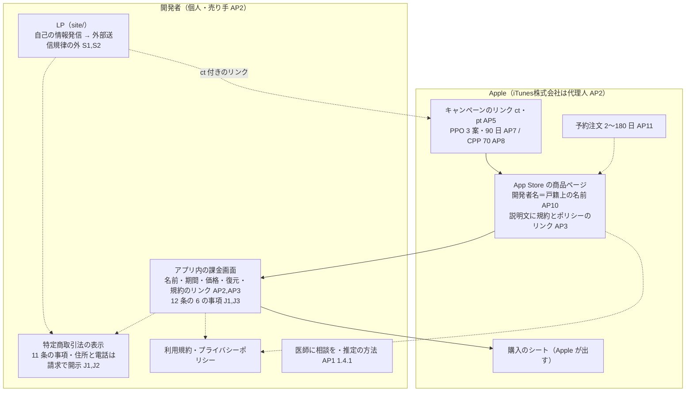

# 一般公開に要る法と App Store の要件（個人での提出、健康の表示、サブスクの表示、特定商取引法、キャンペーンのリンク、外部送信規律、予約注文）

調査日: 2026-10-17
対象: Issue #598「一般公開に要る法と App Store の要件を確かめる」（「一般公開の準備の範囲と方針を決める」のセッションで調べた結果を、出典つきで残す）。nu-tori は日本の個人開発者が日本の App Store だけに出す iPhone アプリで、支払いの登録なしの30日の無料体験をサーバーが数え、そのあとは月額か年額のサブスク（自動更新）を App Store のアプリ内課金で売る（ADR-0024）。公開の前に、紹介のページ（LP。`site/` に置く）と App Store の商品ページで人を集める。

> **確認の方法と限界**
> - Apple の App Review Guidelines（Last Updated: October 16, 2026）、Apple Developer Program License Agreement（以下 DPLA。本体と Schedule 1 は October 13, 2026、Schedule 2・3 は October 13, 2026、その Exhibit は August 27, 2026 の版）、developer.apple.com の App Store のページ（subscriptions、product-page-optimization、custom-product-pages）、App Store Connect ヘルプと App Store Connect Analytics ヘルプの各ページは、HTML を取得して**本文を直接読んだ**。
> - 法令は e-Gov 法令 API（v2）で、調査日に施行されている版を取得した（特定商取引に関する法律は 2026-08-12 施行の版、電気通信事業法施行規則は 2026-08-10 施行の版）。消費者庁の「通信販売広告Q＆A」は HTML を、「通信販売の申込み段階における表示についてのガイドライン」（ファイル名 `20230421la02_09.pdf`）は PDF を `pdftotext` で文字にして読んだ。総務省の外部送信規律のページと FAQ は HTML を、「電気通信事業参入マニュアル［追補版］」（令和5年1月30日改定）は PDF を文字にして読んだ。
> - Cloudflare Web Analytics は developers.cloudflare.com の `index.md` と www.cloudflare.com/web-analytics/ の HTML を読んだ。
> - 本文で確かめた主張は「本文で確認」と書き、短い原文を添える。本文から推し量ったもの（nu-tori への当てはめのほとんど）は「本文からの読み取り」と書き、何から読み取ったかを添える。探しても記述が無かったものは「本文を探したが記述なし」と書き、探したページを添える。
> - 英語の本文は原文のまま引用し、訳はこの文書で付けた。**この文書は法律の専門家の見解ではなく、法律相談の代わりにならない。** 特定商取引法と電気通信事業法の当てはめ（App Store の課金画面が「特定申込み」の画面か、アプリが電気通信事業か）は、どの文書も App Store や nu-tori の形を名指ししておらず、最後は事業者の判断になる。迷うところは消費者庁・総務省の窓口か専門家に確かめる。
> - App Store Connect の**実アカウントの画面は見ていない**。審査で実際にどう判断されるかは確かめようがないので、書かれた基準だけを書いた。
> - 既存の調査と重なるところは、その文書を指して深くは繰り返さない。特定商取引法の表示事項・省略の条件・最終確認画面の詳しい表と、課金画面の表示、標準 EULA、サーバーが数える無料体験の出し方は `docs/research/app-store-subscription.md`（同じ調査日）の問い1・問い2にある。この文書では、その要の文言を一次情報で取り直して確かめ、一般公開の観点で並べ直した。
> - 二次情報（解説ブログ、まとめ記事、コミュニティ投稿、Wikipedia）は使っていない。検索エンジンは一次情報の URL を探すためだけに使った。

## 結論の要約

- **5.1.1(ix)**: 医療（healthcare）などの規制の強い分野のサービスや、機微な情報（sensitive user information）を要するアプリは「should be submitted by a legal entity that provides the services, and not by an individual developer」【本文で確認 AP1】。食事・体重の記録が「healthcare」や「sensitive user information」に当たるかは書かれていない【本文を探したが記述なし AP1】。5.1.3 は健康・フィットネスのデータを「especially sensitive」と呼ぶ【本文で確認 AP1】ので、審査が (ix) を持ち出す余地はある【本文からの読み取り】。個人で出すなら、医療・診断の言い回しを避け、ウェルネスの記録と助言のアプリとして説明をそろえるのが筋【本文からの読み取り】。
- **1.4.1**: 「health measurements」の精度をうたうなら、データと方法を開示し、確かめられなければ却下。医師に相談するよう促すことを求める【本文で確認 AP1】。カロリーや消費量の推定の精度を宣伝しないこと、方法の説明と「医師に相談を」の一文をアプリと LP に置くことが要る【本文からの読み取り】。
- **規制医療機器の申告**（App Store Connect）は EU/EEA・英国・米国で配布するアプリだけが対象で、日本だけの配布なら求められない【本文で確認 AP9】。
- **個人で登録すると、App Store に出る開発者名は戸籍上の名前（legal name）で、変えられない**【本文で確認 AP10】。
- **サブスクの表示**: 名前・期間・価格、請求額を最も目立たせる、購入の復元、**アプリ内と App Store のメタデータに利用規約（Terms of Use）とプライバシーポリシーへのリンク**【本文で確認 AP2,AP3】。独自の EULA を出さなければ Apple の標準 EULA が適用される【本文で確認 AP2,AP4】。
- **特定商取引法**: 日本の App Store では iTunes株式会社は**民法 643 条の代理人**で、売り手は開発者【本文で確認 AP2】。通信販売の広告に 11 条の事項を表示する義務がある【本文で確認 J1】。**住所・電話番号は「請求があれば遅滞なく開示する」と表示し、実際に遅滞なく出せる措置があれば省ける**【本文で確認 J2】。課金の最後の画面には 12 条の 6 の事項を表示する【本文で確認 J1】。ガイドラインは、無償期間から自動で有償に移るサブスクに移行時期と金額の表示を、無期限のサブスクに1年単位の支払額の目安を求める【本文で確認 J3】。nu-tori の無料体験は自動で有償に移らないので前者には当たらず、サブスク自体（自動更新）の表示が要る【本文からの読み取り】。
- **キャンペーンのリンク**: `ct=`（キャンペーン）と `pt=`（開発者のアカウント）を付けたリンクで、表示・ページの閲覧・ダウンロード・売上・サブスクをキャンペーンごとに見られる。**数字は 5 以上で表示**、出るのは**24 時間後から**、**アプリにデータが入るまでリンクを作れない**、**最後に押したリンクに帰属**（ダウンロードは押してから 24 時間以内の初回）【本文で確認 AP5】。
- **プロダクトページの最適化（PPO）**: 最大 3 つの案を、1 度に 1 つのテストで最長 90 日。アプリが Ready for Distribution であることが要る【本文で確認 AP6,AP7】。**カスタムプロダクトページ（CPP）**: 1 アプリに最大 70、審査が要る、指標は初回ダウンロード 5 件から【本文で確認 AP6,AP8】。
- **外部送信規律**: 自分の情報だけを発信するホームページは「自己の需要」で、電気通信事業に当たらず、外部送信規律もかからない【本文で確認 S1,S2】。アプリの紹介と申込みへの誘導だけの LP はこれに当たると読める【本文からの読み取り】。Cloudflare Web Analytics は Cookie も localStorage も使わず、指紋を取らないとする【本文で確認 CF1,CF2】。
- **予約注文**: 初めての公開なら、発売日を 2〜180 日先に置ける。審査を通ってから予約を公開する。アプリ内課金は予約できない。2.3.11 は、予約中に広告したものと大きく違うものを出さないよう求める【本文で確認 AP1,AP11】。

### 一般公開までに、誰が何を表示するか（本文からの読み取り）

出典の記号は末尾の「出典一覧」を指す。点線は nu-tori の設計で決めること。

## 問い1: 審査ガイドライン（5.1.1(ix)、1.4.1、5.1.3）と、個人で出すこと

| 問い | 答え | 確かさ | 出典 |
|---|---|---|---|
| 5.1.1(ix) の本文 | 「Apps that provide services in highly regulated fields (such as banking and financial services, healthcare, gambling, legal cannabis use, air travel and crypto exchanges) or that require sensitive user information should be submitted by a legal entity that provides the services, and not by an individual developer.」 | 本文で確認 | AP1 |
| 食事・体重の記録や、カロリーの推定は「healthcare」「sensitive user information」に当たるか | 定義や例は書かれていない | 本文を探したが記述なし（5.1.1、5.1.3、1.4.1） | AP1 |
| 5.1.3 の位置づけ | 「Health, fitness, and medical data are especially sensitive and apps in this space have some additional rules」。(i) HealthKit などのデータを広告・マーケティングに使わない、集める健康データを開示する。(ii) HealthKit に誤ったデータを書かない、「may not store personal health information in iCloud」 | 本文で確認 | AP1 |
| 1.4.1 の本文 | 「Medical apps that could provide inaccurate data or information, or that could be used for diagnosing or treating patients may be reviewed with greater scrutiny.」「Apps must clearly disclose data and methodology to support accuracy claims relating to health measurements, and if the level of accuracy or methodology cannot be validated, we will reject your app.」「Apps should remind users to check with a doctor in addition to using the app and before making medical decisions.」 | 本文で確認 | AP1 |
| 規制医療機器の申告 | 「apps that are available in the European Union (EU)/European Economic Area (EEA), United Kingdom (UK), or United States (US)」で、カテゴリが Health & Fitness か Medical のもの（または年齢区分の Medical or Treatment Information が「frequent」のもの）が申告する | 本文で確認 | AP9 |
| 個人で登録したときの開発者名 | 「If you're enrolled as an individual, this option isn't available to you and the developer name is the same as your legal name.」「You can't edit or update this name later」。承認後に「your developer name appears under your app name on App Store product pages」 | 本文で確認 | AP10 |

**nu-tori への当てはめ（本文からの読み取り）**:

- (ix) は「should」で、どの健康アプリを含むかの線を書いていない。5.1.3 が健康・フィットネスのデータを「especially sensitive」と呼ぶので、審査が (ix) を持ち出す余地はある。個人で出すなら、商品ページ・LP・アプリの文言を、診断・治療・病気の管理ではなく、食事と体重の記録と、その上での助言に寄せてそろえる。`docs/research/ai-disclosure.md` の読み（ウェルネスの助言の側）と同じ向き。却下されたときに法人で出し直す道は (ix) の文言から読めるが、実際の審査の運用は確かめていない。
- 1.4.1 の前半（精度の開示）は「health measurements」の「accuracy claims」をする場合の決まり。nu-tori の写真からのカロリー推定や消費量の推定は「測定」とまでは言わないが、精度をうたう宣伝（「正確に」「〇%の精度」）をすると方法とデータの開示を求められうる。精度をうたわず、推定であることと推定の方法の要旨をアプリと LP に書く。後半の「医師に相談を」は Medical apps への一文だが、減量の目標や助言を出すアプリとして、アプリ内（目標の設定や助言の近く）と LP に置くのが安全。
- 規制医療機器の申告は日本だけの配布なら対象外。日本の薬機法（プログラム医療機器）への当てはまりは今回確かめていない（「確かめられなかったこと」）。
- 開発者名は戸籍上の氏名が商品ページに出る。特定商取引法の表示でも氏名は戸籍上の氏名で、屋号だけは不可（`docs/research/app-store-subscription.md` 問い1）。一般公開で開発者の氏名は公になる前提で考える。

## 問い2: サブスクの表示と、利用規約・標準 EULA

詳しい表は `docs/research/app-store-subscription.md` の問い2。ここでは要の文言を取り直した。

| 問い | 答え | 確かさ | 出典 |
|---|---|---|---|
| 3.1.2(c) | 「Before asking a customer to subscribe, you should clearly describe what the user will get for the price. … Ensure you clearly communicate the requirements described in Schedule 2 of the Apple Developer Program License Agreement.」 | 本文で確認 | AP1 |
| DPLA Schedule 2 3.8(b) | 「Title of auto-renewing subscription … / Length of subscription / Price of subscription, and price per unit if appropriate / Links to Your Privacy Policy and Terms of Use must be accessible within Your Licensed Application.」 | 本文で確認 | AP2 |
| subscriptions ページの sign-up screen | 「Subscription name and duration, and the content or services provided during the subscription period」「Full renewal price, shown clearly and prominently, and localized in available currencies」「A way for current subscribers to sign in or restore purchases」「Please note that your app and App Store metadata must include links to your Terms of Use and Privacy Policy.」 | 本文で確認 | AP3 |
| 請求額の目立たせ方 | 「the amount that will be billed must be the most prominent pricing element in the layout」。年額の月割りや割引率は「subordinate position and size」 | 本文で確認 | AP3 |
| 独自の EULA を出さないとき | DPLA Schedule 2 4.2: 「each End-User's use of that Licensed Application shall be subject to Apple's standard EULA」。App Store Connect ヘルプ: 「If you don't provide a custom EULA, the standard EULA is applied to your app and the license agreement link isn't shown on your App Store product page.」 | 本文で確認 | AP2,AP4 |
| 独自の EULA を出すとき | Exhibit D の最低限の条件を含み、配布する地域の法に従う（Schedule 2 4.2） | 本文で確認 | AP2 |

**nu-tori への当てはめ（本文からの読み取り）**: 標準 EULA が適用されても、課金画面と説明文に「Terms of Use」へのリンクが要る。標準 EULA へのリンクでこの要件を満たすと書いた Apple の文書は無い（`app-store-subscription.md` で「本文を探したが記述なし」）。アカウント、LLM の推定、無料体験とサブスク切れといった標準 EULA に無い条件を持つので、自前の利用規約を `site/` に置き、アプリ内（課金画面と設定）と App Store の説明文からリンクする。

## 問い3: 特定商取引法（売り手、表示の義務、省略の条件、最終確認画面）

詳しい表は `docs/research/app-store-subscription.md` の問い1。ここでは要の文言を取り直した。

| 問い | 答え | 確かさ | 出典 |
|---|---|---|---|
| 日本の App Store での Apple の立場 | DPLA Schedule 2 Exhibit A, 1. Apple as Agent: 「You appoint iTunes KK as Your agent pursuant to Article 643 of the Japanese Civil Code for the marketing and End-User download of the Licensed and Custom Applications by End-Users located in the following region: Japan」 | 本文で確認 | AP2 |
| Section 2（Apple Distribution International が commissionaire）の Japan | `***` の注が「Solely applicable to non-resident Developers.」。日本に住む開発者には Section 1 が当たる | 本文で確認（注の文言）／本文からの読み取り（日本に住む開発者への当てはめ） | AP2 |
| 11 条（通信販売の広告） | 「販売業者又は役務提供事業者は、通信販売をする場合の…役務の提供条件について広告をするときは、…次の事項を表示しなければならない」。1 号 対価、2 号 支払の時期と方法、3 号 提供時期、4 号 申込みの期間の定め、5 号 申込みの撤回又は解除に関する事項、6 号 主務省令で定める事項 | 本文で確認 | J1 |
| 11 条ただし書 | 「当該広告に、請求により、これらの事項を記載した書面を遅滞なく交付し、又はこれらの事項を記録した電磁的記録を遅滞なく提供する旨の表示をする場合には、…これらの事項の一部を表示しないことができる」 | 本文で確認 | J1 |
| 住所と電話番号の省略 | 「消費者からの請求によって、広告表示事項を記載した書面又は電子メール等を『遅滞なく』提供することを広告に表示し、かつ、実際に請求があった場合に『遅滞なく』提供できるような措置を講じている場合には、事業者の住所及び電話番号の表示を省略することも可能です」。「遅滞なく」は「申込みの意思決定に先立って十分な時間的余裕をもって提供されること」 | 本文で確認 | J2 A17 |
| 個人でも氏名は要るか | 「法人であれ個人であれ氏名又は名称を表示することが必要です」 | 本文で確認 | J2 A15 |
| 12 条の 6（特定申込みを受ける際の表示） | 事業者「若しくはそれらの委託を受けた者」が定める手続で画面に表示して行う申込み（特定申込み）では、その画面に「分量」と「第十一条第一号から第五号までに掲げる事項」を表示する。申込みになることや表示事項を「誤認させるような表示」をしてはならない | 本文で確認 | J1 |
| 無償期間から有償へ自動で移るとき | 「サブスクリプションにおいて見受けられるような、無償又は割引価格で利用できる期間を経て当該期間経過後に有償又は通常価格の契約内容に自動的に移行するような場合には、有償契約又は通常価格への移行時期及びその支払うこととなる金額が明確に把握できるようにあらかじめ表示する必要がある」 | 本文で確認 | J3 |
| 無期限・自動更新のサブスク | 価格は「１年単位の支払額など、一定期間を区切った支払総額を目安として明示する」。分量は「無期限のサブスクリプションの場合には、その旨を明確に表示する必要があり」「自動更新のある契約である場合には、その旨も加えて表示する必要がある」 | 本文で確認 | J3 |
| App Store のアプリ内課金に限った適用除外、App Store を名指しした記述 | 見つからなかった | 本文を探したが記述なし（J1 の 11 条・12 条の 6、J2、J3） | J1,J2,J3 |

**nu-tori への当てはめ（本文からの読み取り）**:

- 売り手は開発者（個人）で、Apple は代理人。有料のサブスクは役務の有償提供の通信販売に当たり、11 条の表示が要る。表示は LP（`site/`）の「特定商取引法に基づく表記」のページに置き、アプリの課金画面と設定、App Store の説明文からリンクする。
- 住所と電話番号は「請求があれば遅滞なく電子メールで開示する」と書き、請求の窓口（問い合わせのメールアドレス）を表示し、すぐ返せる運用にすれば省ける。氏名は戸籍上の氏名を表示する（問い1の開発者名と同じく公になる）。
- 無料体験は支払いの登録が無く、自動で有償に移らないので、ガイドラインの「移行時期と金額」の表示にはそのまま当たらない。サブスク自体は自動更新で期限が無いので、課金画面（購入ボタンの直前の画面）に、自動更新であること、更新の時期と金額、年額の支払額の目安（月額なら 12 か月分）、解約の方法を表示する。Apple の購入シートの中身は開発者が決められないので、アプリ内の課金画面に 12 条の 6 の事項をそろえておくのが安全（`app-store-subscription.md` と同じ読み）。

## 問い4: キャンペーンのリンク、プロダクトページの最適化、カスタムプロダクトページ

| 問い | 答え | 確かさ | 出典 |
|---|---|---|---|
| キャンペーンのリンクで何が見えるか | 「Analytics captures the impressions, product page views, downloads, usage, sales, and subscriptions tied to each campaign token.」。地域・端末・ページの種類で分けられる | 本文で確認 | AP5 |
| リンクの形 | 例: `https://apps.apple.com/app/apple-store/id123456789?pt=123456&ct=test1234&mt=8`。`ct=` はキャンペーンごと（英数字と空白など 30 文字まで）、`pt=` は「identifies your developer account」で全キャンペーンで同じ | 本文で確認 | AP5 |
| 数字が出る条件 | 「Each metric for your campaign will appear in the dashboard if the metric meets a minimum threshold of 5 in the date range selected.」「Campaigns appear in Analytics only after a minimum of 24 hours since their launch.」 | 本文で確認 | AP5 |
| 公開前に作れるか | 「No. The Campaigns tab and add button appear only after your app has generated analytics data.」。「Continue checking after your app has been live and generating downloads for at least 24 hours.」 | 本文で確認 | AP5 |
| 帰属 | 「When a user downloads your app for the first time within 24 hours of using your campaign link or campaign token, they're counted as a First-Time Download. If a user clicks more than one campaign link within a given timeframe, only the most recent link receives credit for subsequent sales.」 | 本文で確認 | AP5 |
| Web から | Smart App Banner に campaign token と provider token を入れられる。provider token は「You must generate a campaign link in App Store Connect first」 | 本文で確認 | AP5 |
| 地域 | リンクに `/us/` があっても、押した人の地域の App Store に移る | 本文で確認 | AP5 |
| PPO | 「testing up to three different app icons, screenshots, and previews」「You can create one test at a time which will run for up to 90 days」。「Your app must be in the Ready for Distribution state to test its product page.」。CPP では使えない。新しいメタデータは審査を通す。結果は初回ダウンロード 5 件から | 本文で確認 | AP6,AP7 |
| CPP | 「Create up to 70 custom product pages per app」。スクリーンショット・プレビュー・プロモーションテキスト・キーワードを変えられ、固有の URL で共有できる。「must be approved before they are visible to users」。指標は「at least five first-time downloads」から。iOS 18 以上ではディープリンクを付けられる | 本文で確認 | AP6,AP8 |

**nu-tori への当てはめ（本文からの読み取り）**: キャンペーンのリンクは公開してデータが入るまで作れないので、公開の日の LP のリンクには `ct=` を付けられない。公開の翌日以降に作って LP と告知に差し替える。数字は 5 未満だと出ないので、小さな規模のうちは経路ごとの細かい比較はできない。ここで得る数は Apple の集計で、nu-tori から記録の中身を送るものではない（ルートの `AGENTS.md` の観測の決めごととぶつからない）。PPO は公開後（Ready for Distribution）でないと使えない。CPP は経路ごとの訴求（例: 写真で記録、体重の推移）を分けたいときに使える。

## 問い5: 電気通信事業法の外部送信規律は LP に当たるか

| 問い | 答え | 確かさ | 出典 |
|---|---|---|---|
| 外部送信規律がかかる者 | 「外部送信規律は、電気通信事業法に基づき、『電気通信事業』を営む者に適用される規律です。…該当しない場合は、外部送信規律は適用されません」 | 本文で確認 | S1 |
| 自分の情報発信のホームページ | 「電気通信役務を『自己の需要』のために提供している場合は該当しない。【自己の需要のために提供している例】＊個人や企業等の専ら自己の情報発信のためのホームページの開設」。事例の表は「個人や企業等が、…Webサイトを開設し、インターネット経由で自らの情報のみを発信し、専ら自らの情報の提供を目的とするもの」を「非電気通信事業（事業法規律対象外）」とする | 本文で確認 | S2 |
| 本来業務の手段としての Web | 「電気通信役務の提供を前提としない本来業務の遂行手段として活用している場合は、電気通信役務を『自己の需要』のために提供するもの」。例に「自社商品やサービスのオンライン販売」。ただし「オンラインニュースや映像配信など、自社の商品やサービス自体がインターネットで提供される場合は、…電気通信事業に該当する」 | 本文で確認 | S2 |
| FAQ 問1-13 | 実店舗を持たず「専ら自社ウェブサイト上で商品販売を行っています」の問いに、「本来業務である小売業の遂行の手段として電気通信を用いているに過ぎないことには変わりはないため、Q1-12のケースと同様、外部送信規律は適用されません」 | 本文で確認 | S3 |
| FAQ 問2-12 | 同じサイトでも「会社案内のページについては、自己の情報発信のために運営していると考えられ、『電気通信事業』には該当しないため、…外部送信規律に対応いただく必要はありません」 | 本文で確認 | S3 |
| 規律の対象の役務（規則 22 条の 2 の 27） | ブラウザやアプリで提供される、1 号 他人の通信の媒介、2 号 SNS・掲示板など不特定の利用者に送る記録、3 号 検索、4 号「不特定の利用者による情報の閲覧に供することを目的とするもの」 | 本文で確認 | J4 |
| Cloudflare Web Analytics | 「Cloudflare Web Analytics does not use any client-side state, such as cookies or localStorage, to collect usage metrics. We also don't "fingerprint" individuals via their IP address, User Agent string, or any other data for the purpose of displaying analytics.」。「Cloudflare Web Analytics does not collect or use your visitors' personal data.」 | 本文で確認 | CF1,CF2 |

**nu-tori への当てはめ（本文からの読み取り）**:

- アプリの紹介、特定商取引法の表記、利用規約、プライバシーポリシーだけを載せる LP は「専ら自己の情報発信のためのホームページ」に当たり、電気通信事業でないので外部送信規律はかからない。Cloudflare Web Analytics のビーコンを入れても、規律の対象外のままと読める。それでも、プライバシーポリシーに LP の解析（Cloudflare Web Analytics を使うこと、Cookie を使わないこと）を書いておくのは、個人情報保護法の公表や利用者への説明として害が無い（`docs/agents/privacy.md` に従って `site/` を直す）。
- LP にブログ・ニュースのような読み物を足していくと、問2-12 の「ニュース配信」のページのように 4 号の「各種情報のオンライン提供」に寄る余地がある。紹介の範囲にとどめるうちは当たらない。
- **アプリ本体は別の問い**。参入マニュアルは、クラウドのソフトウェアを利用させる SaaS を「登録及び届出が不要な電気通信事業（第３号事業）」としている【本文で確認 S2】。nu-tori のアプリとサーバーがこれに当たると読める余地がある。ただし外部送信規律の対象は規則 22 条の 2 の 27 の 1〜4 号の役務で、nu-tori のアプリは利用者同士の媒介も、不特定の利用者に向けた情報の閲覧もしない（自分の記録と、自分への推定・助言だけ）ので、どの号にも当たらないと読める。この当てはめは総務省の文書に nu-tori の形の事例が無く、確かめきれていない（「確かめられなかったこと」）。

## 問い6: 予約注文

| 問い | 答え | 確かさ | 出典 |
|---|---|---|---|
| 発売日 | 初めて公開するとき「Set your app's release date to fall between two and 180 days in the future」。すでにどこかで公開済みのアプリを新しい地域に出すときは 2〜365 日 | 本文で確認 | AP11 |
| 審査 | 予約を設定し、「Submit the app for review」、承認後に「Release This Version」で予約が公開される（全員に見えるまで最大 24 時間） | 本文で確認 | AP11 |
| アプリ内課金 | 「In-App Purchases aren't eligible for pre-order, but you can set up your In-App Purchases … before and during the pre-order period」 | 本文で確認 | AP11 |
| 予約の請求 | 有料アプリの予約は発売日まで請求されない。発売日にアプリが自動でダウンロードされる | 本文で確認 | AP11 |
| 2.1(a) | 「Submissions to App Review, including apps you make available for pre-order, should be final versions with all necessary metadata and fully functional URLs included」 | 本文で確認 | AP1 |
| 2.3.11 | 「Apps you submit for pre-order on the App Store must be complete and deliverable as submitted. Ensure that the app you ultimately release is not materially different from what you advertise while the app is in a pre-order state. If you make material changes to the app (such as changing business models), you should restart your pre-order sales.」 | 本文で確認 | AP1 |
| 予約の分析 | 予約の純数（予約 − 取り消し）、予約の転換率、予約からのダウンロード。「Pre-order metrics appear once your app has received pre-orders from at least five individual users.」 | 本文で確認 | AP12 |
| PPO と予約のページ | App Store のページは「your App Store product page (or pre-order page)」を試せると書く。App Store Connect ヘルプは「Ready for Distribution」を条件にする | 本文で確認（両方の文言）／予約中に使えるかは本文からは決めきれない | AP6,AP7 |

**nu-tori への当てはめ（本文からの読み取り）**: 予約に出すには、審査に出せる完成版（すべての URL が動く。利用規約・プライバシーポリシー・特定商取引法の表記のページを含む）が先に要る。サブスクは予約できないが、アプリ自体は無料なので予約の対象にでき、発売日にダウンロードされたあとで無料体験が始まる。予約中に料金の形（無料体験の日数、サブスクの価格の形）を大きく変えると 2.3.11 の「changing business models」に当たりうるので、予約を始める前に決めきる。

## 関連して見つけたこと

- **5.1.3(ii)「may not store personal health information in iCloud」**: 体重などをアプリが iCloud に置く設計を取らないこと（今の設計はサーバーに置く）【本文で確認 AP1】。
- **App Store Connect の Analytics の数（キャンペーン、CPP、PPO、予約）は、どれも 5 件を下回ると出ない**【本文で確認 AP5,AP6,AP8,AP12】。公開直後の小さな数の比較には使えない。

## 確かめられなかったこと

- 審査が、食事・体重の記録とカロリーの推定のアプリを 5.1.1(ix) の「healthcare」「sensitive user information」として個人の提出を断るか（運用の記述が無い）。
- 日本の薬機法で、nu-tori の推定や助言がプログラム医療機器に当たらないことの確認（今回は調べていない。厚生労働省の「プログラムの医療機器該当性に関するガイドライン」が一次情報になる）。
- アプリ本体とサーバーが電気通信事業（第３号事業）に当たるか、当たるなら外部送信規律の 1〜4 号のどれにも当たらないと言い切れるか（参入マニュアルと FAQ に同じ形の事例が無い）。
- 特定商取引法 26 条などの適用除外の書きぶり（`app-store-subscription.md` と同じく確かめていない）。
- 予約中に PPO を使えるか（App Store のページとヘルプの書きぶりが違う）。

## 出典一覧

### 日本
- J1: 特定商取引に関する法律（昭和51年法律第57号。2026-08-12 施行の版。11 条、12 条の 6） — https://laws.e-gov.go.jp/law/351AC0000000057 （本文は e-Gov 法令 API v2 `https://laws.e-gov.go.jp/api/2/law_data/351AC0000000057`）
- J2: 消費者庁 特定商取引法ガイド「通信販売広告Q＆A」（A15、A17） — https://www.no-trouble.caa.go.jp/qa/advertising.html
- J3: 消費者庁「通信販売の申込み段階における表示についてのガイドライン」 — https://www.no-trouble.caa.go.jp/pdf/20230421la02_09.pdf
- J4: 電気通信事業法施行規則（昭和60年郵政省令第25号。2026-08-10 施行の版。22 条の 2 の 27） — https://laws.e-gov.go.jp/law/360M50001000025 （本文は e-Gov 法令 API v2）
- S1: 総務省「外部送信規律」（6 参考情報） — https://www.soumu.go.jp/main_sosiki/joho_tsusin/d_syohi/gaibusoushin_kiritsu.html
- S2: 総務省「電気通信事業参入マニュアル［追補版］」（令和5年1月30日改定。フローチャート(2)Ⅰ、「個人や企業によるWebサイトの開設」「ソフトウェアのオンライン提供（SaaS、ASP）」「各種情報のオンライン提供」の事例） — https://www.soumu.go.jp/main_content/000477428.pdf
- S3: 総務省「外部送信規律FAQ」（問1-12、問1-13、問2-12） — https://www.soumu.go.jp/main_sosiki/joho_tsusin/d_syohi/gaibusoushin_kiritsu_00002.html

### Apple
- AP1: App Review Guidelines（Last Updated: October 16, 2026。1.4.1、2.1(a)、2.3.11、3.1.2(c)、5.1.1(ix)、5.1.3） — https://developer.apple.com/app-store/review/guidelines/
- AP2: Apple Developer Program License Agreement（Schedule 2 は October 13, 2026、Exhibit は August 27, 2026 の版。Schedule 2 の 3.8(b)、4.2、Exhibit A の 1 と 2） — https://developer.apple.com/support/terms/apple-developer-program-license-agreement/
- AP3: Auto-renewable subscriptions — https://developer.apple.com/app-store/subscriptions/
- AP4: App Store Connect ヘルプ「Provide a custom license agreement」 — https://developer.apple.com/help/app-store-connect/manage-app-information/provide-a-custom-license-agreement
- AP5: App Store Connect Analytics ヘルプ「Campaign links」 — https://developer.apple.com/help/app-store-connect-analytics/acquisition/campaign-links
- AP6: App Store Connect Analytics ヘルプ「Product Page Optimization」と「Custom Product Pages」 — https://developer.apple.com/help/app-store-connect-analytics/acquisition/product-page-optimization 、https://developer.apple.com/help/app-store-connect-analytics/acquisition/custom-product-pages
- AP7: Product page optimization（App Store）と App Store Connect ヘルプ「Overview of product page optimization」 — https://developer.apple.com/app-store/product-page-optimization/ 、https://developer.apple.com/help/app-store-connect/create-product-page-optimization-tests/overview-of-product-page-optimization
- AP8: Custom product pages（App Store）と App Store Connect ヘルプ「Configure multiple product page versions」 — https://developer.apple.com/app-store/custom-product-pages/ 、https://developer.apple.com/help/app-store-connect/create-custom-product-pages/configure-multiple-product-page-versions
- AP9: App Store Connect ヘルプ「Declare Regulated Medical Device Status」 — https://developer.apple.com/help/app-store-connect/manage-app-information/declare-regulated-medical-device-status
- AP10: App Store Connect ヘルプ「Set your developer name」 — https://developer.apple.com/help/app-store-connect/create-an-app-record/set-your-developer-name
- AP11: App Store Connect ヘルプ「Publish for pre-order」 — https://developer.apple.com/help/app-store-connect/manage-your-apps-availability/publish-for-pre-order
- AP12: App Store Connect Analytics ヘルプ「Pre-orders」 — https://developer.apple.com/help/app-store-connect-analytics/acquisition/pre-orders

### Cloudflare
- CF1: Cloudflare Web Analytics「About」（Last updated Apr 17, 2026） — https://developers.cloudflare.com/web-analytics/about/
- CF2: Cloudflare Web Analytics（製品ページ） — https://www.cloudflare.com/web-analytics/
