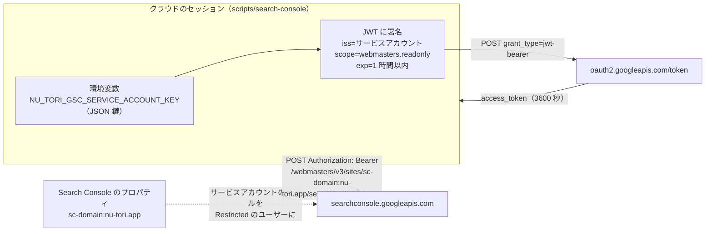
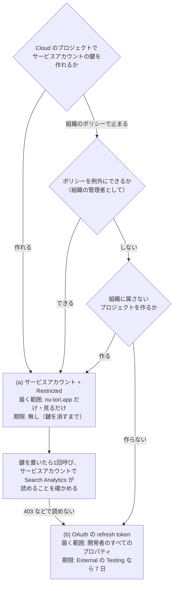

# エージェントが Search Console の検索の数を、クラウドのセッションから読む

調査日: 2026-11-06
対象: Google Search Console の Search Analytics（検索での表示回数・クリック・掲載順位を、検索語・ページ・国・端末・日で分けたもの）を、Claude Code on the web のセッションから読む方法（#910「流入の数字を、クラウドのエージェントが読めるようにする」の調べの1つ）。確かめたのは、①`nu-tori.app` の持ち主の確認の形、②API の認証（サービスアカウントか OAuth か）、③クラウドの環境での鍵の置き方、④どちらを勧めるか、⑤Search Analytics で取れる次元・遅れ・保持期間、⑥このセッションから Google の API に届くか。ほかの道具の読み方（`docs/research/app-store-connect-agent-access.md`、`posthog-agent-access.md` など）と同じ形で、読む側だけを書く

> **確認の方法と限界**
> - Google の文書は developers.google.com（Search Console API の `webmaster-tools/`、OAuth の `identity/protocols/oauth2/`、Search Central のブログ）、support.google.com（Search Console のヘルプ `webmasters/`、Google Cloud のヘルプ `cloud/`）、docs.cloud.google.com（IAM、組織のポリシー）を読んだ（2026-11-06）。
> - Search Console API の discovery 文書（`https://searchconsole.googleapis.com/$discovery/rest?version=v1`、`revision` 20261104）をこのセッションから取り、次元・`dataState`・スコープの値を確かめた。
> - Claude Code on the web の環境変数と network secrets は code.claude.com/docs の `cloud-environments` と、このセッションの道具（`read_documentation` の `environment.secrets`・`environment.network`、`get_environment`）で確かめた。
> - 本文で確かめた主張は「本文で確認」と書き、短い英語の原文を添える。discovery 文書や実際の応答で確かめたものは「実行で確認」と書く。推し量ったものは「本文からの読み取り」、探しても記述が無かったものは「本文を探したが記述なし」と書く。
> - **Google のアカウントでは何も動かしていない**（プロパティを足していない、Cloud のプロジェクト・サービスアカウント・OAuth のクライアントを作っていない、鍵が無いので Search Analytics を呼んでいない）。二次情報（ブログ記事、SNS）は使っていない。Google 自身の Search Central のブログは一次資料として使った。

## 結論の要約

- **勧める形: Google Cloud に nu-tori 用のプロジェクトを1つ作って Google Search Console API を有効にし、サービスアカウントを1つ作って、その JSON 鍵を環境変数 `NU_TORI_GSC_SERVICE_ACCOUNT_KEY`（JSON を base64 の1行にしたもの）に置く。サービスアカウントのメールを、Search Console の `nu-tori.app` のプロパティに `Restricted` のユーザーとして足す。呼ぶのは起動スクリプト（例 `scripts/search-console`）1本で、JWT を作ってアクセストークンに換え、`searchanalytics.query` を POST する。** 理由:
  - 届く範囲を `nu-tori.app` のプロパティの「見るだけ」に絞れる。OAuth の refresh token は、同意した開発者のアカウントが見られるすべてのプロパティに届く（本文からの読み取り。スコープは Search Console 全体の読み取りで、プロパティを選ぶ引数が無い）
  - 期限で切れない。OAuth の同意の画面が External で公開の状態が「Testing」なら、refresh token は 7 日で切れる（本文で確認）。サービスアカウントの鍵は既定で期限が無い（本文で確認）
  - 形が `scripts/app-store-connect` と同じ（鍵を環境変数に置き、スクリプトの中で短い JWT に署名する）で、Node の `node:crypto` だけで書ける（本文からの読み取り）
- **ただし2つ、前に確かめること**:
  1. **Search Console API の文書は、サービスアカウントを認証の手段として名指していない**。文書は「authenticated user」の OAuth 2.0 と書くだけ（本文で確認）。サービスアカウントのメールを Search Console のユーザーにする手順を公式に書くのは Indexing API の文書だけ（本文で確認）。サービスアカウントで Search Analytics が読めることは、鍵を作ったあとに1回呼んで確かめる
  2. **組織のポリシーで鍵の作成が止められていることがある**。2024-05-03 以降に作られた組織では `iam.disableServiceAccountKeyCreation` が既定で効く（本文で確認）。`nu-tori.app` のメールは Google Workspace にある（`docs/agents/tooling.md`）ので、Workspace の組織の下にプロジェクトを作ると、鍵が作れないことがある。そのときは、組織の下で例外にする（組織の管理者として）か、組織に属さないプロジェクトで作るか、OAuth に回る
- **OAuth（次の推し）**: 開発者が自分の Google アカウントで同意し、refresh token を環境変数に置く。スクリプトが refresh token をアクセストークン（1 時間）に換えて呼ぶ。届く範囲が広いこと、External の Testing なら 7 日で切れること、6 か月使わないと切れること（本文で確認）が弱み。同意の画面を Internal（Workspace の組織の利用者だけ）にできるなら 7 日の制限は当たらない（本文からの読み取り。7 日は「external user type」で「Testing」の条件）
- **持ち主の確認: Domain プロパティ `nu-tori.app`（API では `sc-domain:nu-tori.app`）にする**。`https`・`http`・`www` などの別名とサブドメインをまとめて数え、確かめ方は DNS の TXT だけ（本文で確認）。DNS は Cloudflare にあり手で置いている（`docs/agents/tooling.md`）ので、TXT を1つ足す
- **鍵はプロキシの network secrets に置けない**。network secrets はホストごとに決まった値をヘッダーに付ける形で、保存したら値を見られず、変えるには消して足し直す（本文で確認）。Google のアクセストークンは 1 時間で切れる（本文で確認）ので、固定の値では続かない。環境変数に置く（`NU_TORI_ASC_PRIVATE_KEY` と同じ扱い）
- **このセッションから届く**: `searchconsole.googleapis.com` と `www.googleapis.com` の `webmasters/v3/sites` は認証なしで `401`（`Login Required.`）、`oauth2.googleapis.com/token` は空の POST に `400`（`unsupported_grant_type`）を返し、プロキシには止められなかった（実行で確認、2026-11-06）。今の環境 `nu-tori` のネットは Unrestricted（実行で確認、`get_environment`）
- **取れるもの**: 次元は `date`・`query`・`page`・`country`・`device`・`searchAppearance`・`hour`。指標はクリック・表示回数・CTR・平均の掲載順位。1 回 25,000 行まで。データは普通 2〜3 日遅れ、`dataState: "all"` でまだ固まっていない新しい日も取れる。保持は 16 か月（Google の 2018 年のブログ。今のヘルプには書かれていない）
- **公開の Issue・PR に貼るもの**: 検索語（`query`）は利用者が打った文字で、少ない件数の語は人を指しうる。Google 自身が珍しい語と個人の情報を含む語を落としている（本文で確認）が、貼るのは件数の多い語と集計（表示回数・クリック・CTR・順位、ページ・国・端末・週ごと）までにするのがよい（本文からの読み取り）。決まりは道具を置くときに `docs/agents/tooling.md` に書く



## 問い1: 持ち主の確認（Domain か URL prefix か）

| 問い | 答え | 確かさ | 出典 |
|---|---|---|---|
| Domain プロパティ | 「Includes all subdomains (m, www, and so on) and multiple protocols (http, https, ftp)」。確かめ方は「DNS record verification only」。入れるのはルートのドメインで、プロトコル・パス・`www` を付けない | 本文で確認 | https://support.google.com/webmasters/answer/34592 |
| URL-prefix プロパティ | 「Includes only URLs with the specified prefix, including the protocol (http/https)」。確かめ方は「Many possible methods」（HTML のファイル、HTML のタグ、Google Analytics など） | 本文で確認 | 同上 |
| API での書き方 | URL-prefix は `http://www.example.com/`、Domain は `sc-domain:example.com` | 本文で確認 | https://developers.google.com/webmaster-tools/v1/searchanalytics/query |
| 足し方の画面 | プロパティの選び口のドロップダウンの「+ Add property」→「Domain property (example.com)」か「URL-prefix property」 | 本文で確認 | https://support.google.com/webmasters/answer/34592 |
| データはいつから | プロパティを足した時から集め始め、確かめる前でも集める。新しいサイトはデータが出るまで1週間ほどかかりうる | 本文で確認 | https://support.google.com/webmasters/answer/34592 、https://support.google.com/webmasters/answer/9008080 |

**Domain を勧める。** `nu-tori.app` は `site/` の1つの公開のページで、サブドメインを分けて見る理由が無い。Domain なら `http` から `https` への転送や `www` の有無で数が割れない（本文からの読み取り）。DNS を触れるのは開発者なので、TXT を1つ足す手間は小さい。

### Cloudflare の DNS に TXT を足す手順

Search Console 側（ヘルプの「Domain name provider」の節。本文で確認、https://support.google.com/webmasters/answer/9008080 ）:

1. Search Console で「+ Add property」→「Domain property (example.com)」に `nu-tori.app` を入れて「Continue」
2. 確かめ方の画面で、DNS の提供元の一覧から「Any DNS provider」を選ぶ（一覧に提供元があれば「Start verification」でその提供元にログインして自動で置く道もあるが、ヘルプは Cloudflare を名指していない。本文を探したが記述なし）。「Select record type」は `TXT`。表示される `google-site-verification=...` の値を写す
3. Cloudflare のダッシュボードで `nu-tori.app` の zone を開き、DNS の Records に、Type `TXT`、Name `@`（ヘルプは「For the Host/Name property, either leave this blank, or set as '@'」）、Content に写した値を足す
4. Search Console に戻って「Verify」。手で置いたレコードは、提供元が配り始めるまで「up to two or three days」かかりうる。確かめは Google Admin Toolbox の dig（`https://toolbox.googleapps.com/apps/dig/`）でできる
5. **確かめたあともレコードを消さない**（「To stay verified, don't remove the DNS record from your provider, even after verification succeeds.」）

`nu-tori.app` には SPF の TXT（`v=spf1 ...`）がすでにあるが、`google-site-verification=` は別の TXT として足す。SPF のレコードは1つだけにする決まり（`docs/agents/tooling.md` の「`nu-tori.app` からメールを送る」）は `v=spf1` で始まるものだけの話で、ほかの TXT と並べてよい（本文からの読み取り）。Google Workspace を始めたときに同じ `google-site-verification=` の TXT をすでに置いているなら、Search Console が同じアカウントで見つけて確かめが済むことがある（本文を探したが記述なし。画面で確かめる）。

## 問い2: API の認証

### 共通: Google Cloud のプロジェクトで要るもの

| 問い | 答え | 確かさ | 出典 |
|---|---|---|---|
| 有効にする API | 「Activate the Google Search Console API in the Google API Console.」（discovery の `title` も「Google Search Console API」） | 本文で確認、実行で確認 | https://developers.google.com/webmaster-tools/v1/how-tos/authorizing |
| 認証の形 | 「Your application must use OAuth 2.0 to authorize requests. No other authorization protocols are supported.」API キーは Testing Tools の API だけ | 本文で確認 | 同上 |
| スコープ | `https://www.googleapis.com/auth/webmasters.readonly`（「View Search Console data for your verified sites」）と、読み書きの `.../webmasters`。`searchanalytics.query` と `sites.list` はどちらでも通る | 本文で確認、実行で確認（discovery の `auth.oauth2.scopes`） | 同上、https://developers.google.com/identity/protocols/oauth2/scopes |
| 呼ぶ人の権限 | 「Your account must have the appropriate Search Console permission on a given property」。`searchanalytics.query` はそのプロパティの読む権限が要る | 本文で確認 | https://developers.google.com/webmaster-tools/v1/prereqs |
| `webmasters.readonly` は sensitive か | スコープの一覧の表は区分を載せない。区分は Cloud Console の同意の画面の設定で自動で示される | 本文を探したが記述なし（区分は Console で確かめる） | https://developers.google.com/identity/protocols/oauth2/scopes 、https://support.google.com/cloud/answer/13463073 |

### (a) サービスアカウントを `Restricted` のユーザーにする

手順（Cloud 側の画面は英語のまま）:

1. Google Cloud Console でプロジェクトを作り（例 `nu-tori-search-console`）、「APIs & Services」→「Library」で「Google Search Console API」を有効にする
2. 「IAM & Admin」→「Service accounts」→「Create service account」。プロジェクトの IAM の役割は付けない（Search Console の権限は Search Console 側で付けるため。本文からの読み取り。鍵の文書は「Each service determines its own authorization rules.」と書く）
3. サービスアカウントの「Keys」タブ→「Add key」→「Create new key」→ JSON。落とした JSON は二度と落とせない（「you cannot download it again」）。鍵は既定で期限が無く、1つのサービスアカウントに 10 本まで（本文で確認、https://docs.cloud.google.com/iam/docs/keys-create-delete ）
4. Search Console の `nu-tori.app` で「Settings」→「Users and permissions」→「Add user」。メールにサービスアカウントのメール（`<名前>@<プロジェクト>.iam.gserviceaccount.com`）を入れ、Permission を「Restricted」にする（本文で確認、https://support.google.com/webmasters/answer/7687615 。足せるのは Owner だけ）

| 問い | 答え | 確かさ | 出典 |
|---|---|---|---|
| `Restricted` で何が見えるか | 「Has simple view rights on most data.」Performance の報告は Owner・Full・Restricted のどれでも見られる。ユーザーを足す・サイトマップを出す・リンクの否認はできない | 本文で確認 | https://support.google.com/webmasters/answer/7687615 |
| サービスアカウントを Search Console のユーザーにできるか | Search Console API の文書は名指さない。ヘルプは「Users must have a valid Google Account」「An email group cannot be added as a user」とだけ書く。Indexing API の文書は「Add your service account as a site owner」と書き、サービスアカウントのメールを Search Console に足す手順を公式に示す | 本文を探したが記述なし（Search Console API）、本文で確認（Indexing API） | https://developers.google.com/webmaster-tools/v1/how-tos/authorizing 、https://developers.google.com/search/apis/indexing-api/v3/prereqs |
| JWT の中身 | ヘッダー `{"alg":"RS256","typ":"JWT"}`、`iss` はサービスアカウントのメール、`scope` はスペース区切り、`aud` は「always `https://oauth2.googleapis.com/token`」、`exp` は「a maximum of 1 hour after the issued time」 | 本文で確認 | https://developers.google.com/identity/protocols/oauth2/service-account |
| 換え方 | `POST https://oauth2.googleapis.com/token`、`grant_type=urn:ietf:params:oauth:grant-type:jwt-bearer`、`assertion=<署名した JWT>`。応答の `expires_in` は 3600 | 本文で確認 | 同上 |
| アクセストークンの寿命 | 「By default, the maximum lifetime of an access token is 1 hour (3,600 seconds).」12 時間まで延ばす組織のポリシーもある | 本文で確認 | https://docs.cloud.google.com/resource-manager/docs/organization-policy/restricting-service-accounts |
| トークンに換えずに JWT を直に Bearer にする道 | 一部の API は自分で署名した JWT（`aud` が API の URL）をそのまま Bearer で受ける。どの API が受けるかの一覧は無い | 本文で確認、Search Console API が受けるかは本文を探したが記述なし | https://developers.google.com/identity/protocols/oauth2/service-account （Addendum） |

**鍵を作れない組織がある。** 「If your organization was created on or after May 3, 2024, this constraint is enforced by default.」（`iam.disableServiceAccountKeyCreation`。本文で確認、https://docs.cloud.google.com/iam/docs/keys-create-delete ）。効いていると、鍵を作るときに `FAILED_PRECONDITION: Key creation is not allowed on this service account.` で止まる（本文で確認、restricting-service-accounts）。外すには、プロジェクトにタグ `disableServiceAccountKeyCreation` を `not_enforced` で付けてポリシーの規則で例外にする（本文で確認、keys-create-delete）。組織のポリシーを触るには組織の管理の役割が要る（本文からの読み取り）。Google 自身は鍵を避けるよう勧める（「The best way to mitigate these threats is to avoid user-managed service account keys」、本文で確認、https://docs.cloud.google.com/iam/docs/best-practices-for-managing-service-account-keys ）が、勧める代わり（Cloud の中で付けるサービスアカウント、Workload Identity Federation）は、Google Cloud の外で動き、身元を示す外部の ID の提供元を持たないクラウドのセッションには当たらない（本文からの読み取り）。

### (b) OAuth（開発者のアカウントで同意し refresh token を持つ）

手順:

1. 同じくプロジェクトを作り「Google Search Console API」を有効にする
2. 「APIs & Services」→「OAuth consent screen」（Google Auth Platform）で同意の画面を作る。User type は、Workspace の組織の下なら「Internal」、そうでなければ「External」
3. 「Credentials」→「Create credentials」→「OAuth client ID」→ Application type「Desktop app」。Desktop app は `http://127.0.0.1:<port>` に戻すループバックを使う。手で写す OOB の形は「no longer supported」（本文で確認、https://developers.google.com/identity/protocols/oauth2/native-app ）。PKCE を使う
4. 開発者が Mac で一度だけ同意し（`scope=https://www.googleapis.com/auth/webmasters.readonly`、`access_type=offline`）、受け取った refresh token を、クライアント ID・クライアントの秘密と一緒に環境変数に置く。同意を回す道具はこのとき作る（`/wizard` か小さなスクリプト）
5. スクリプトは `POST https://oauth2.googleapis.com/token`（`grant_type=refresh_token`）でアクセストークンに換えて呼ぶ

| 問い | 答え | 確かさ | 出典 |
|---|---|---|---|
| refresh token が切れるとき | 6 か月使わない、利用者が取り消す、1つのクライアントにつき 100 本を超える（古いものから黙って切れる）、など | 本文で確認 | https://developers.google.com/identity/protocols/oauth2 |
| Testing の 7 日 | 「A Google Cloud Platform project with an OAuth consent screen configured for an external user type and a publishing status of "Testing" is issued a refresh token expiring in 7 days」 | 本文で確認 | 同上 |
| 公開（In production）にするなら | sensitive・restricted のスコープを使うなら Google の審査が要る。sensitive でなければ審査は要らない。審査していない app は新しい利用者 100 人まで | 本文で確認 | https://support.google.com/cloud/answer/13463073 、https://support.google.com/cloud/answer/7454865 |
| 届く範囲 | 同意したアカウントが Search Console で権限を持つ、すべてのプロパティ（スコープにプロパティを選ぶ値が無い） | 本文からの読み取り（discovery のスコープは2つだけ） | 実行で確認（discovery） |

## 問い3: クラウドのセッションに置く形

| 問い | 答え | 確かさ | 出典 |
|---|---|---|---|
| network secrets の形 | 「Anthropic's agent proxy adds the key to requests for the hosts you list, after each request leaves the session's VM, so the key itself stays outside the VM.」ヘッダーの名前（既定 `Authorization`）と前置き（既定 `Bearer`）を選ぶ。値は保存したら見られず、変えるには消して足し直す | 本文で確認 | https://code.claude.com/docs/en/cloud-environments |
| Google に合うか | 合わない。Google の API が受けるのは 1 時間で切れるアクセストークン（上の問い2）で、network secrets は固定の値を付けるだけ。値を時間で換える仕組みは書かれていない | 本文からの読み取り（換える仕組みは本文を探したが記述なし） | 同上 |
| 環境変数 | 「A session reads the environment's values into ordinary environment variables that any command Claude runs can read」「Anyone who uses the environment can read the values.」値はセッションを作るときと VM を戻すときに読み直す | 本文で確認 | 同上 |
| 今の nu-tori の環境 | 個人の環境 `nu-tori`、ネットは Unrestricted。App Store Connect の秘密鍵も `NU_TORI_ASC_PRIVATE_KEY`（`.p8` を base64 の1行に）として環境変数に置いている | 実行で確認（`get_environment`） | — |

当てはめ:

- **サービスアカウント**: JSON 鍵を `base64 -w0`（Mac は `base64 -i <file>`）で1行にして `NU_TORI_GSC_SERVICE_ACCOUNT_KEY` に置く。JSON には改行を含む `private_key` があるので、そのまま `.env` に書くより base64 のほうが壊れにくい（本文からの読み取り。`.env` は改行を含む値を引用符で囲む形で、`NU_TORI_ASC_PRIVATE_KEY` と同じにそろえる）。スクリプトは毎回 JWT を作って換える（1 回の呼び出しに 1 往復足すだけで、トークンをファイルに残さない）
- **OAuth**: `NU_TORI_GSC_OAUTH_CLIENT_ID`・`NU_TORI_GSC_OAUTH_CLIENT_SECRET`・`NU_TORI_GSC_OAUTH_REFRESH_TOKEN` の3つを環境変数に置く。Desktop app のクライアントの秘密は公開の値として扱われ（本文で確認、native-app）、守るべきは refresh token
- どちらも、`scripts/search-console` が `Not authenticated` で止まる形と、読んだ中身の扱いを `docs/agents/tooling.md` に足す（ほかの道具と同じ）
- `gcloud` がこのセッションに入っている（`gcloud auth activate-service-account --key-file=...` と `gcloud auth print-access-token` でトークンを作れる）が、ファイルに鍵を書き出す必要があり、Mac でも同じ形にするには `gcloud` が要る。`scripts/app-store-connect` と同じく Node だけで署名するほうが、置き場ごとの違いが少ない（本文からの読み取り）

## 問い4: どちらを勧めるか



推しは (a)。理由は「結論の要約」のとおり（届く範囲を絞れる、期限で切れない、`scripts/app-store-connect` と同じ形）。

決めるのは開発者。材料:

- **(a) の弱み**: 鍵は期限が無いので、漏れたら消すまで使える（その代わり届くのは `nu-tori.app` の Search Console の見るだけ）。Google は鍵を勧めない。組織のポリシーで作れないことがある。Search Console API の文書がサービスアカウントを名指していない（Indexing API の文書が手順を示すので、同じ仕組みで通ると読めるが、確かめていない）
- **(b) の弱み**: 届く範囲がアカウント全体の Search Console（ほかに持つプロパティも読める）。External の Testing だと 7 日ごとに同意し直す。In production にするなら、`webmasters.readonly` の区分しだいで審査が要る。6 か月使わないと切れる
- どちらでも、Search Console の外（Gmail、Drive など）には届かない（スコープが Search Console だけ。本文からの読み取り）

## 問い5: Search Analytics で取れるもの

| 問い | 答え | 確かさ | 出典 |
|---|---|---|---|
| 受け口 | `POST https://www.googleapis.com/webmasters/v3/sites/<siteUrl>/searchAnalytics/query`（文書）。discovery の `rootUrl` は `https://searchconsole.googleapis.com/` で、同じパスで呼べる。`siteUrl` は URL エンコードする（`sc-domain%3Anu-tori.app`） | 本文で確認、実行で確認（discovery、両方のホストで 401） | https://developers.google.com/webmaster-tools/v1/searchanalytics/query |
| 次元 | `country`（ISO 3166-1 alpha-3）、`device`（`DESKTOP`・`MOBILE`・`TABLET`）、`page`、`query`、`searchAppearance`、`date`、`hour`。並べた順に分け、同じものを2度書けない。無しなら全体の1行 | 本文で確認、実行で確認（discovery の enum） | 同上 |
| 指標 | 行ごとに `keys`（次元の値）、`clicks`、`impressions`、`ctr`（0〜1）、`position`（平均） | 本文で確認 | 同上 |
| 期間 | `startDate`・`endDate`（`YYYY-MM-DD`、太平洋時間、両端を含む） | 本文で確認 | 同上 |
| 絞り込み | `dimensionFilterGroups`（`and` だけ）。演算は `equals`・`contains`・`notContains`・`notEquals`・`includingRegex`・`excludingRegex`（RE2） | 本文で確認 | 同上 |
| 種類 | `type`: `web`（既定）・`image`・`video`・`news`・`discover`・`googleNews` | 本文で確認 | 同上 |
| 行の数 | `rowLimit` は 1〜25,000（既定 1,000）、`startRow` で次のページ。返るのは上位で、全部の行は保証しない。1日・1種類あたり最大 5 万行まで | 本文で確認 | 同上、https://developers.google.com/webmaster-tools/v1/how-tos/all-your-data |
| 落ちる行 | 「When querying for page and/or query string, some data may be dropped.」ヘルプは、ごく少ない回数の語と、個人の情報や機微な情報を含む語を数えないことがあると書く（「we might not track some queries that are made a very small number of times or those that contain personal or sensitive information」）。そのため、語で分けた行の合計は全体より小さくなる | 本文で確認 | all-your-data、https://support.google.com/webmasters/answer/96568 |
| 遅れ | 「Normally, however, collected data should be available in 2-3 days.」API の文書も「typically available after 2-3 days」 | 本文で確認 | https://support.google.com/webmasters/answer/96568 、all-your-data |
| 新しいデータ | `dataState`: `final`（既定。固まったものだけ）、`all`（「data will include fresh data」）、`hourly_all`（`hour` と組む。最大 10 日を時間ごとに）。`all` で日ごとに分けると、応答の `metadata.first_incomplete_date` から先はまだ変わりうる | 本文で確認、実行で確認（discovery の enum） | searchanalytics/query、https://developers.google.com/search/blog/2025/04/san-hourly-data |
| 保持期間 | 16 か月（「you'll have 16 months of data」、2018-01-08 の Search Central のブログ）。今のヘルプと API の文書には書かれていない | 本文で確認（ブログ）、今の文書は本文を探したが記述なし | https://developers.google.com/search/blog/2018/01/introducing-new-search-console |
| 上限 | Search Analytics は、サイトごと 1,200 QPM、利用者ごと 1,200 QPM、プロジェクトごと 40,000 QPM・3,000 万 QPD。ほかに負荷の上限（10 分と 1 日）があり、`page` と `query` の両方で分けるのが一番重い | 本文で確認 | https://developers.google.com/webmaster-tools/limits |
| 料金 | 文書に料金の記述は無い | 本文を探したが記述なし | 同上 |

例（鍵を置いたあとに、過去 28 日の検索語ごとの数を取る。`$TOKEN` はスクリプトが換えたアクセストークン）:

```bash
curl -fsS -X POST -H "Authorization: Bearer $TOKEN" -H 'Content-Type: application/json' \
  'https://searchconsole.googleapis.com/webmasters/v3/sites/sc-domain%3Anu-tori.app/searchAnalytics/query' \
  -d '{"startDate":"2026-10-06","endDate":"2026-11-02","dimensions":["query"],"rowLimit":100}'
```

## 問い6: このセッションから届くか（2026-11-06）

| 呼んだもの | 応答 | 読み取り |
|---|---|---|
| `GET https://searchconsole.googleapis.com/webmasters/v3/sites` | `401`、`"Request is missing required authentication credential. Expected OAuth 2 access token..."`、`"Login Required."` | Google まで届き、認証が無いので断られた |
| `GET https://www.googleapis.com/webmasters/v3/sites` | 同じく `401` | 同上 |
| `POST https://oauth2.googleapis.com/token`（本文なし） | `400`、`{"error":"unsupported_grant_type"}` | トークンの受け口まで届いた |
| `GET https://searchconsole.googleapis.com/$discovery/rest?version=v1` | `200`（discovery 文書） | — |

プロジェクトの環境 `nu-tori` のネットは Unrestricted なので、ホストを足す必要は無い。ネットを Limited に絞るなら、`oauth2.googleapis.com` と `searchconsole.googleapis.com`（文書のとおり `www.googleapis.com` で呼ぶならそれも）を足す。

## 人がやること、エージェントが読むまでに残ること

人（開発者）:

1. Search Console に Domain プロパティ `nu-tori.app` を足し、Cloudflare の DNS に `google-site-verification=` の TXT を置いて「Verify」（問い1）
2. Google Cloud にプロジェクトを作って「Google Search Console API」を有効にし、サービスアカウントと JSON 鍵を作る（問い2 (a)）。鍵の作成が止められたら、問い4の図のどれにするか決める
3. Search Console の「Settings」→「Users and permissions」→「Add user」で、サービスアカウントのメールを「Restricted」で足す
4. 鍵の JSON を base64 の1行にして、クラウドの環境 `nu-tori` の環境変数 `NU_TORI_GSC_SERVICE_ACCOUNT_KEY` に置く（Mac ではシェルの設定に）。落とした JSON は置いたら消す

エージェント:

1. `scripts/search-console`（JWT の署名、トークンへの交換、`searchAnalytics.query` の POST。POST するのは読む口だけに絞る）を書き、`docs/agents/tooling.md` に「Search Console を読む」を足す（読む決まり、貼ってよいもの、鍵の置き場、`Not authenticated`）
2. 鍵が置かれたら1回呼び、サービスアカウントで `sc-domain:nu-tori.app` の Search Analytics が読めることを確かめ、この文書に追記する。読めなければ OAuth に回る
3. プロパティを足したばかりは数が少ない（データが出るまで1週間ほどかかりうる）ので、確かめの呼び出しは 0 行でも `200` なら通ったとみなす

## 確かめていないこと

- サービスアカウントを Search Console のユーザー（`Restricted`）にして、Search Analytics API が読めるか（公式の文書に記述が無い。Indexing API の文書は Owner として足す手順を書く）
- `webmasters.readonly` が sensitive の区分か（Cloud Console の同意の画面で示される）
- Search Console API が、トークンに換えない自己署名の JWT を受けるか
- Cloudflare が Search Console の「Domain name provider」の一覧にあり、自動で TXT を置けるか
- `nu-tori.app` の Google Workspace に Cloud の組織があるか、あれば `iam.disableServiceAccountKeyCreation` が効いているか
