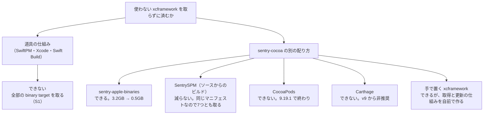
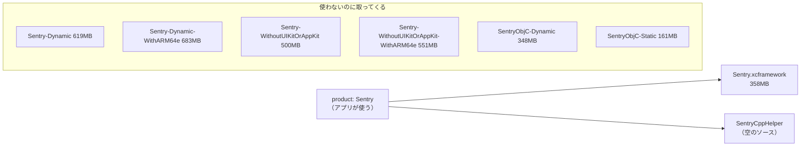
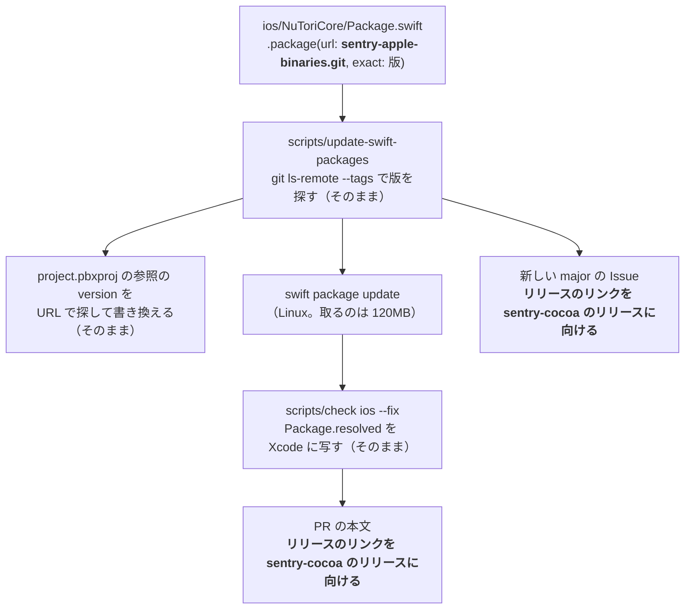
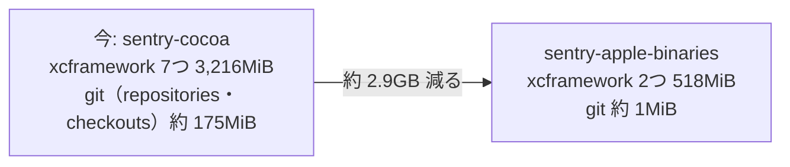

# アプリで、使わない sentry-cocoa の xcframework を取らずに済むか

調査日: 2026-10-20
対象: Issue #635「アプリで、使わない sentry-cocoa の xcframework を取らずに済む方法を調べる」（#606 の一部）。前の調査は `docs/research/ios-build-sharing.md`（S4・R2・M1）

> **確認の方法と限界**
> - 道具の振る舞いは、ソースを読んで確かめた。SwiftPM は swiftlang/swift-package-manager の main（7137197）、Swift Evolution は swiftlang/swift-evolution の main（239be1d）、sentry-cocoa はこのリポジトリが固定している 9.30.2（4bb2282）、sentry-apple-binaries は 9.30.2 のタグ（442e323）を読んだ
> - Linux（Swift 6.4）で、小さなパッケージを作って `swift package resolve` を回し、取ってきて展開したものの大きさを測った（L1〜L3）。SwiftPM は Linux でも xcframework を取って展開する。Mac の Xcode では測っていない。Mac の大きさは前の調査の M1（sentry-cocoa 9.30.1）を使う
> - 配布物の zip の大きさは、9.30.2 のリリースの zip の `Content-Length` で見た（Z1）

## 結論の要約

- **SwiftPM と Xcode には、使う product に関わる binary target だけを取る仕組みは無い**。SwiftPM は、依存グラフに入った全部のマニフェストの全部の binary target を取る（S1）。Xcode も同じく7つを取ってくる（前の調査の M1）。予定されている変更にも、これを変えるものは見つからなかった（E1〜E4）
- **sentry-cocoa の別の配り方のうち、使えるのは sentry-apple-binaries だけ**。Sentry が sentry-cocoa のリリースのたびに出す、binary target を2つだけ持つパッケージ（R3・R4・R6）。中の `Sentry.xcframework.zip` は、今使っている `Sentry` と同じファイル（チェックサムが同じ）。product の名前は `Sentry-Static` になるが、`import Sentry` はそのまま。dSYM を上げる `ci_post_xcodebuild.sh` も変わらない
- **減る量は、置き場1つあたり約 2.7GB（xcframework の展開分の約 84%）と、git の約 0.17GB**。3.2GB が 0.5GB になる（L1・L2）。Mac で1つの共有のキャッシュ（`~/Library/Caches/org.swift.swiftpm`）の zip も、1つの版あたり 842MB が 120MB になる（Z1）
- **週1回の更新の仕組みは、ほぼそのまま動く**。`scripts/update-swift-packages` は URL とタグで動くので、URL を差し替えるだけで今の流れに乗る。直すのは、PR の本文の「リリース」のリンク（sentry-apple-binaries には GitHub のリリースが無い）と、文書と一覧に書いた名前（`sentry-cocoa` → `sentry-apple-binaries`）
- ソースからのビルド（`SentrySPM`）、CocoaPods、Carthage、手で置く xcframework は、減らないか、もう配られていないか、更新の仕組みを作り直すことになる

## 今の形

- アプリは sentry-cocoa の `Sentry` の product だけを使う（`ios/NuTori.xcodeproj/project.pbxproj` の `productName = Sentry`）。版の正本は `ios/NuToriCore/Package.swift` の `exact: "9.30.2"`（`docs/agents/dependencies.md`）
- sentry-cocoa 9.30.2 のマニフェストは、7つの xcframework を binary target に持つ（R1 `Package@swift-6.2.swift` 77〜111 行）。`Sentry` の product が使うのは `Sentry`（binary）と `SentryCppHelper`（中身の無いソース）の2つだけ（R1 57 行）

（大きさは L2 で測った展開後の MiB）

## 1. Xcode（Swift Build）と SwiftPM に、使う product の binary target だけを取る仕組みはあるか

**答え: できない。予定されている変更も見つからなかった。**

- SwiftPM が取ってくる binary target は、ルートと依存の全部のマニフェストの、`type == .binary` の全部のターゲット（ソースで確認、S1 `Workspace+BinaryArtifacts.swift` 76〜155 行の `parseArtifacts`）。どの product が使われるかは見ない。解決（resolve）のたびに、この一覧と置き場を突き合わせて足りないものを取る（同 883〜960 行の `_updateBinaryArtifacts`）
- Xcode の中のビルドシステム（Swift Build）は取ってこない。SwiftPM が取って展開したあとの置き場のパス（`artifactPath`）を受け取るだけ（ソースで確認、S2 `PackagePIFProjectBuilder+Products.swift` 742〜749 行）。なので Swift Build の側に設定は無い。Xcode が7つとも取ってくることは、前の調査で DerivedData の `SourcePackages/artifacts` に7つあったことで確かめている（`ios-build-sharing.md` の M1）
- 試したが使えないもの
  - **traits**（SE-0450、Swift 6.1）: traits で外せるのは依存のパッケージで、ターゲットは外せない。sentry-cocoa 自身も「Traits cannot remove targets」と書いている（R1 388 行）。SE-0450 は、traits を解決の前に効かせることを「今後の方向」に挙げているが、これも依存のパッケージを取らずに済ませる話（E3）
  - **`--experimental-prune-unused-dependencies`**（隠しフラグ）: どのターゲットも使わない依存のパッケージを、丸ごと解決から外す（S3）。sentry-cocoa を使うアプリでは外れないので、この問いには効かない。試すと、どのターゲットも使わないパッケージ（今の NuToriCore と同じ形）では、sentry-cocoa を取らず、`Package.resolved` にも載らなかった（L3）。版の正本を NuToriCore の `Package.resolved` に置く今の決まりとは合わない（#606 の問い1 にかかる）。Xcode に同じ設定があるかは見つからなかった
  - **ミラー**（`swift package config set-mirror`、SE-0535 で全体の設定にも広がる）: binary target の URL もミラーで差し替えられる（S4 126〜128 行、E4）。しかしマニフェストのチェックサムと合わないと失敗する（S1 303〜310 行）ので、中身の小さいファイルに差し替えることはできない
  - **artifact bundle index**（SE-0305）: 1つの binary target の中で、要る版だけを取る仕組み。`.artifactbundle` のためのもので、xcframework には使えず、使わないターゲットを飛ばすものでもない（E2）
- SE-0272（binary target の元の提案）の「今後の方向」は、artifact の条件（どの条件でどの artifact を使うか）を挙げるだけで、使わないものを取らない仕組みは書いていない（E1 238〜250 行）
- sentry-cocoa の開発者も、「SwiftPM は解決のときに宣言された全部の remote の binary target を取る」ことを前提に決めている（R5 の 37 番、847〜863 行）。サードパーティの連携を別のリポジトリに映すのも、同じ理由（R5 の 31 番、559 行〜）

## 2. sentry-cocoa はほかの配り方を出しているか。今の使い方を続けられるか

### sentry-apple-binaries（使える）

- sentry-cocoa の README は「Pre-built XCFrameworks」として、SwiftPM で静的な配布物を使うなら sentry-apple-binaries を使え、と書く（R2 57〜62 行）
- sentry-cocoa のリリースのとき、Craft が `distribution/apple-binaries/` を版とチェックサムを埋めて sentry-apple-binaries の main にコミットし、同じ版のタグを打つ（R3 `MIRRORING.md`、R4 `scripts/create-apple-binaries-archive.sh`）。タグは 9.24.0 から 9.30.2 まで、sentry-cocoa の正式な版と1つずつ対応していた（G1）
- 9.30.2 のマニフェスト（R6）は binary target を2つだけ持つ
  - `Sentry-Static`: URL は sentry-cocoa のリリースの `Sentry.xcframework.zip`、チェックサムは `593897db…`。sentry-cocoa の `Sentry` と同じ（R1 79〜80 行）。落として確かめた（Z2）
  - `SentryObjC-Static`: 使わないが、これは取ってくる（161MB）
  - `SentryCppHelper`: sentry-cocoa と同じ中身の無いソース（中身を比べて同じ）
  - 依存のパッケージは無い（`dependencies: []`）
- 今の使い方が続けられるか
  - **import**: xcframework の中身は `Sentry.framework` なので、モジュールの名前は `Sentry` のまま。アプリの `import Sentry` は変わらない（L1 で展開したものの中を確認）
  - **product**: 名前が `Sentry` から `Sentry-Static` に変わる。中身（`Sentry.xcframework` と `SentryCppHelper`）は同じ
  - **dSYM**: 同じ zip なので変わらない。静的な `Sentry.xcframework` はもともとデバッグ情報を持たない（R5 の 37 番、863 行。Z2 で zip に dSYM が無いことを確認）。`ios/ci_scripts/ci_post_xcodebuild.sh` はアーカイブの dSYM（アプリのもの）を上げるだけなので、何も変えなくてよい
  - Linux でも解決できる（L1）。週1回の更新は Linux で回るので、そのまま動く
- 気をつけること
  - README の例は `sentry-cocoa-binaries.git` の URL を書いている（R6 の README）。`git ls-remote` では同じタグと SHA を返した（G1）が、改名前の名前と見られる。使うなら `sentry-apple-binaries` の URL にする
  - sentry-apple-binaries には GitHub のリリースが無い（タグだけ。G2）。変更履歴は sentry-cocoa のリリースか、リポジトリの `CHANGELOG.md` で読む
  - タグは sentry-cocoa のリリースのあとに Craft が打つ。遅れたら、週1回の更新が次の週に拾う

### SentrySPM（ソースからのビルド。減らない）

- sentry-cocoa の同じマニフェストにある product で、SDK をソースからビルドする（R1 132〜137 行、R2 34〜55 行、D1）
- 同じマニフェストなので、7つの binary target はそのまま宣言されていて、SwiftPM は全部取ってくる（S1）。マニフェストから binary target を外すのは環境変数 `SDK_V10=1` のときだけ（R1 54・74 行）だが、これは開発中の V10 の API に切り替わる開発用のスイッチ（R5 769 行）なので使えない
- 加えて、SDK を毎回ビルドすることになる（測っていない）

### CocoaPods（使えない）

- 対応を終えた。最後の版は 9.19.1（R2 66 行）

### Carthage（使えない）

- v9 から公式の対応をやめた。Carthage が GitHub のリリースから複数の xcframework を落とせないため（R5 の 30 番、547 行〜）

### 手で置く xcframework（できるが、勧めない）

- リリースの `Sentry.xcframework.zip` を落として、プロジェクトに直接置く方法が文書にある（R2 59 行、D1 の Manual Install）
- 置き場は 358MB で済む。ただし SwiftPM の外になるので、次を自前で作ることになる
  - zip をリポジトリに入れない（79MB）なら、Xcode Cloud の `ci_post_clone.sh` と手元の `scripts/check` で、版とチェックサムを見て落とす仕組み
  - `scripts/update-swift-packages` の外で、版とチェックサムを上げる仕組み（sentry-cli の手での上げ方に近い）
- sentry-apple-binaries との差は `SentryObjC-Static` の 161MB だけで、それにしては作るものが多い

## 3. それぞれの方法で、週1回の更新と版の正本の決まりがどう変わるか

sentry-apple-binaries に替えたときの流れ（変わるところを太字にした）:

- `scripts/update-swift-packages` は、マニフェストの `.package(url:, exact:)` を読み、その URL の `git ls-remote --tags` から版を選び、`project.pbxproj` の同じ URL の参照の版を書き換える。sentry-cocoa の名前は持っていないので、URL を替えるだけでそのまま動く
  - 直すところ: PR の本文と major の Issue のリンク（`release_url` が `<URL>/releases/tag/<タグ>` を作る）。sentry-apple-binaries にはリリースが無いので、このリンクは開けない（G2）。sentry-cocoa のリリースへ向ける例外を足すか、タグのページ（`/tree/<タグ>`）にする
  - 変わる名前: 「上げない版」の一覧（`.github/swift-package-ignore`）と Issue の題の名前は、URL の最後から作るので `sentry-apple-binaries` になる。一覧の例の行も直す
- `.github/workflows/update-swift-packages.yml`: 変えなくてよい。`swift package update` が取る zip が 842MB から 120MB に減る（Z1）
- 版の正本の決まり（`docs/agents/dependencies.md`）: 置き場（NuToriCore）と書き方（`exact:`、Xcode の参照の `version` をそろえる）は変わらない。文書の `sentry-cocoa` を `sentry-apple-binaries` に直す（「Why」の段落と major の手順）。`dependency-pr.yml` の先頭のコメントも同じ
- 変えるときに一度だけ要ること: `project.pbxproj` の参照の URL と product の名前（`Sentry-Static`）、両方の `Package.resolved`（identity が `sentry-apple-binaries` になる）
- ほかの方法
  - SentrySPM: 変わらない（product の名前だけ）。ただし減らない
  - 手で置く xcframework: Swift Package の更新の外に出るので、`update-swift-packages` の対象から外れ、手で上げ続けるもの（`docs/agents/dependencies.md` の「手で上げ続けるもの」）に足すか、別の仕組みを作る

## 4. 減る量

置き場1つ（`ios/NuToriCore/.build`、Xcode の DerivedData、MobileBuildMCP の DerivedData のそれぞれ）あたり:

- xcframework の展開分: 9.30.2 を Linux で測ると 3,216MiB が 518MiB で、2,698MiB（84%）減る（L1・L2）。Mac で測った 9.30.1 の大きさ（M1）で数えても、3,147MiB が 514MiB（`Sentry` 355MiB と `SentryObjC-Static` 159MiB）で、2,633MiB 減る
- git: sentry-cocoa の `repositories` 130MiB と `checkouts` 45MiB が、どちらも 1MiB 未満になる（L1・L2）
- Mac で1つの共有のキャッシュ: zip は1つの版あたり 842MB が 120MB になる（Z1）
- worktree 1つには、置き場が2〜3か所ある（`ios-build-sharing.md`）ので、worktree 1つあたり約 5.8〜8.7GB 減る
- `SentryObjC-Static`（161MiB）は使わないが、sentry-apple-binaries のマニフェストにあるので残る

## 分からなかったこと

- Mac の Xcode で、sentry-apple-binaries に替えてビルドが通るか、DerivedData の `SourcePackages` が実際にどれだけ減るか（Linux の SwiftPM で取って展開しただけ）
- product の名前を変えたとき、Xcode のプロジェクトの参照（`XCSwiftPackageProductDependency`）を書き換えるだけで済むか。Xcode の画面で付け直す必要があるか
- Xcode に、`--experimental-prune-unused-dependencies` にあたる設定があるか
- sentry-apple-binaries のタグが、sentry-cocoa のリリースからどれだけ遅れて打たれるか（タグの日時は見ていない）
- SwiftPM の Issue と Swift Forums で、使わない binary target を取らない変更が議論されているか。GitHub の検索の API がこのセッションから使えず、Web の検索でも、メンテナーの書いた予定は見つからなかった

## 測ったこと

- L1: Linux（Swift 6.4）で、sentry-apple-binaries 9.30.2 の `Sentry-Static` を使うだけのパッケージを `swift package resolve`。取ったのは `Sentry.xcframework.zip` と `SentryObjC-Static.xcframework.zip` の2つ（119.8MB）。`.build/artifacts` は 518MiB（`Sentry-Static` 358MiB、`SentryObjC-Static` 161MiB）、`checkouts` と `repositories` はどちらも 1MiB 未満。`Sentry-Static` の中は `Sentry.xcframework/<各プラットフォーム>/Sentry.framework`
- L2: 同じく sentry-cocoa 9.30.2 の `Sentry` を使うだけのパッケージ。7つを取り、`.build/artifacts` は 3,216MiB（`Sentry-Dynamic-WithARM64e` 683、`Sentry-Dynamic` 619、`Sentry-WithoutUIKitOrAppKit-WithARM64e` 551、`Sentry-WithoutUIKitOrAppKit` 500、`Sentry` 358、`SentryObjC-Dynamic` 348、`SentryObjC-Static` 161）、`repositories` 130MiB、`checkouts` 45MiB。KSCrash は取らなかった（V10 の trait の中）
- L3: sentry-cocoa 9.30.2 を依存に持ち、どのターゲットも使わないパッケージを `--experimental-prune-unused-dependencies` で `resolve`。`artifacts` は空、`checkouts` に sentry-cocoa は無く、`Package.resolved` もできなかった
- Z1: 9.30.2 のリリースの zip の大きさ（`Content-Length`）。`Sentry` 79,124,560、`Sentry-Dynamic` 164,409,174、`Sentry-Dynamic-WithARM64e` 181,763,673、`Sentry-WithoutUIKitOrAppKit` 126,548,230、`Sentry-WithoutUIKitOrAppKit-WithARM64e` 140,005,054、`SentryObjC-Dynamic` 109,600,389、`SentryObjC-Static` 40,717,100 バイト。合計 842,168,180、sentry-apple-binaries の2つで 119,841,660
- Z2: `Sentry.xcframework.zip` と `SentryObjC-Static.xcframework.zip` を落として SHA-256 を見ると、マニフェストのチェックサム（`593897db…`、`01c43031…`）と同じ。展開前の合計は 372,183,595 バイトと 165,324,107 バイトで、どちらにも dSYM は無い
- G1: `git ls-remote --tags`（2026-10-20）。sentry-apple-binaries のタグは 9.23.1-alpha.0、9.24.0〜9.30.2 で、sentry-cocoa の 9.24.0 以降の正式な版と同じ並び。9.30.2 は 442e323。`sentry-cocoa-binaries.git` も同じタグと SHA を返した
- G2: https://github.com/getsentry/sentry-apple-binaries/releases は「There aren't any releases here.」（2026-10-20）

## 出典

- S1: SwiftPM `Sources/Workspace/Workspace+BinaryArtifacts.swift`（`parseArtifacts` 76〜155 行、チェックサムの確かめ 303〜310 行、`_updateBinaryArtifacts` 883 行〜）— https://github.com/swiftlang/swift-package-manager/blob/7137197d30da49413553f3dd5e03988b967be36a/Sources/Workspace/Workspace+BinaryArtifacts.swift
- S2: SwiftPM `Sources/SwiftBuildSupport/PackagePIFProjectBuilder+Products.swift`（742〜749 行）— https://github.com/swiftlang/swift-package-manager/blob/7137197d30da49413553f3dd5e03988b967be36a/Sources/SwiftBuildSupport/PackagePIFProjectBuilder%2BProducts.swift
- S3: SwiftPM `Sources/CoreCommands/Options.swift`（410〜420 行）・`Sources/Workspace/Workspace+Manifests.swift`（250〜280 行）・`Sources/PackageModel/Manifest/Manifest+Traits.swift`（407〜420 行）— https://github.com/swiftlang/swift-package-manager/tree/7137197d30da49413553f3dd5e03988b967be36a/Sources
- S4: SwiftPM `Sources/Workspace/Workspace+BinaryArtifacts.swift`（ミラーを URL に当てる 126〜128 行。S1 と同じファイル）
- E1: SE-0272 Package Manager Binary Dependencies（Future directions）— https://github.com/swiftlang/swift-evolution/blob/239be1db9902be50984e4a133a1fd769d55e2a64/proposals/0272-swiftpm-binary-dependencies.md
- E2: SE-0305 Package Manager Binary Target Improvements（artifact bundle index）— https://github.com/swiftlang/swift-evolution/blob/239be1db9902be50984e4a133a1fd769d55e2a64/proposals/0305-swiftpm-binary-target-improvements.md
- E3: SE-0450 Package traits（Future directions の「Consider traits during dependency resolution」）— https://github.com/swiftlang/swift-evolution/blob/239be1db9902be50984e4a133a1fd769d55e2a64/proposals/0450-swiftpm-package-traits.md
- E4: SE-0535 Add CLI for editing global mirrors configuration（binary target のミラーへの言及）— https://github.com/swiftlang/swift-evolution/blob/239be1db9902be50984e4a133a1fd769d55e2a64/proposals/0535-global-mirrors-configuration-cli.md
- R1: sentry-cocoa 9.30.2（4bb2282）`Package@swift-6.2.swift` — https://github.com/getsentry/sentry-cocoa/blob/4bb2282661ee6ca2212aa01d19a1214394cd3c45/Package%40swift-6.2.swift
- R2: sentry-cocoa 9.30.2 `README.md`（34〜66 行）— https://github.com/getsentry/sentry-cocoa/blob/4bb2282661ee6ca2212aa01d19a1214394cd3c45/README.md
- R3: sentry-cocoa 9.30.2 `develop-docs/MIRRORING.md`・`.craft.yml` — https://github.com/getsentry/sentry-cocoa/blob/4bb2282661ee6ca2212aa01d19a1214394cd3c45/develop-docs/MIRRORING.md
- R4: sentry-cocoa 9.30.2 `distribution/apple-binaries/Package.swift`・`scripts/create-apple-binaries-archive.sh` — https://github.com/getsentry/sentry-cocoa/tree/4bb2282661ee6ca2212aa01d19a1214394cd3c45/distribution/apple-binaries
- R5: sentry-cocoa 9.30.2 `develop-docs/DECISIONS.md`（30 番 Deprecate Carthage Support、31 番 3rd Party Library Integrations、37 番 Strip DWARF from prebuilt SentryObjC static binaries、769 行の `SDK_V10`）— https://github.com/getsentry/sentry-cocoa/blob/4bb2282661ee6ca2212aa01d19a1214394cd3c45/develop-docs/DECISIONS.md
- R6: sentry-apple-binaries 9.30.2（442e323）`Package.swift`・`README.md`・`Sources/SentryCppHelper/SentryCppHelper.swift` — https://github.com/getsentry/sentry-apple-binaries/tree/442e32302e1752e982ffeecc15d0bc412a6e2eb1
- D1: Sentry の文書 Install（https://docs.sentry.io/platforms/apple/install/ ）と Swift Package Manager（https://docs.sentry.io/platforms/apple/install/swift-package-manager/ 。`Sentry`・`Sentry-Dynamic`・`SentrySPM`・`SentryObjC-*` の説明。sentry-apple-binaries には触れていない）。2026-10-20 に読んだ
- このリポジトリ: `ios/NuToriCore/Package.swift`、`ios/NuTori.xcodeproj/project.pbxproj`、`scripts/update-swift-packages`（`exact_dependencies`・`replace_xcode_project_version`・`release_url`）、`.github/workflows/update-swift-packages.yml`、`.github/swift-package-ignore`、`ios/ci_scripts/ci_post_xcodebuild.sh`、`docs/agents/dependencies.md`
