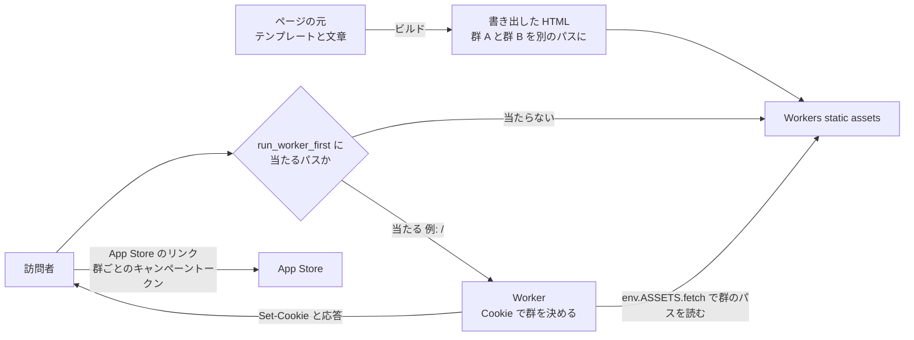
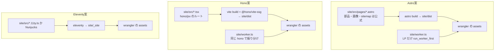

# 公開のページ（`site/`）を作る静的サイトジェネレーターの比較（Astro、Eleventy、Hugo、Next.js、Hono、SvelteKit、VitePress ほか）

調査日: 2026-10-17
対象: nu-tori.app に置く公開のページ（LP、プライバシーポリシー、利用規約、特定商取引法に基づく表記、サポートと FAQ。日本語だけ、5〜10 枚、ほぼ静的で JavaScript なしが既定）を、今の手書きの HTML（`site/public/`、Cloudflare Workers の static assets で配る）から、静的サイトジェネレーター（以下 SSG。ビルドのときにページを HTML に書き出す道具）で作る形に移すかを決めるために、候補ごとの今の状態を集める。求めるのは SEO、AIO（AI の検索・回答に引用されること。構造化データ、`llms.txt`、意味の通る HTML）、A/B テスト（Worker が一次の Cookie で群を決め、別々の静的 HTML を返す。成果は App Store のキャンペーントークンで測る。第三者のトラッカーは使わない）。

> **確認の方法と限界**
> - npm レジストリ（`registry.npmjs.org` の JSON）から、各パッケージの最新版・公開日時・直接の依存・メンテナー・リポジトリの URL を**直接取得して読んだ**。依存の総数は、作業用のディレクトリで `npm install --package-lock-only --ignore-scripts`（npm 10.9.4、Node 22）を回し、`package-lock.json` に載ったパッケージを数えた。**OS ごとの任意の依存（`optional`）も数に入っている**ので、実際にディスクに入る数はこれより少ない。pnpm での数は数えていない。
> - Cloudflare（developers.cloudflare.com の各ページの `index.md`）、Astro（astro.build のブログ、docs.astro.build）、Cloudflare のブログ、Eleventy（11ty.dev のブログと文書）、Hugo（gohugo.io の文書、GitHub のリリースのページ）、Next.js（nextjs.org の文書）、Hono（hono.dev の文書、`honojs/vite-plugins` の README）、SvelteKit（svelte.dev の文書とブログ）、VitePress（vitepress.dev の文書）、VoidZero（voidzero.dev のブログ）、Google 検索セントラル（developers.google.com）、llmstxt.org の**本文を取得して読んだ**。本文で確かめた主張は「本文で確認」と書く。一部のページは、取得した本文を要約する道具を通して読んだ。引用はその道具が本文から抜き出したもので、ページを人が目で見直してはいない。
> - 本文の記述から推し量ったものは「本文からの読み取り」と書き、何から読み取ったかを添える。nu-tori に当てはめた部分は、ほとんどがこれに当たる。
> - 本文や関連ページを探しても記述が無かったものは「本文を探したが記述なし」と書き、探したページを添える。
> - **GitHub の API はこのセッションから使えなかった**（リポジトリのアクセスが許されていない）。リリースの日付は npm の公開日時で代え、Hugo だけ GitHub のリリースのページ（HTML）を読んだ。スター数やコミットの頻度は見ていない。
> - **どの道具も、実際にプロジェクトを作ってビルドしてはいない。** ビルドの速さ、出る HTML の綺麗さ、`scripts/check` との相性は試していない。
> - 英語の本文は原文のまま引用した。訳は要点だけを地の文に書いた。
> - 二次情報（解説ブログ、まとめ記事、コミュニティ投稿、Wikipedia）は使っていない。検索の結果に出た二次情報（Eleventy の改名の中止を伝える個人ブログなど）は、一次の本文と食い違うものがあったが、根拠にしていない。

## 結論の要約

- **Astro の開発元（The Astro Technology Company）は 2026-01-16 に Cloudflare に加わった。** 常勤の全員が Cloudflare の社員になり、Astro は MIT のまま、特定の配信先に縛らない（platform-agnostic）方針を続けると両社が書いている【本文で確認 AS1,CF9】。さらに **2026-06-04 には Vite・Rolldown・Oxc（oxlint・oxfmt）の VoidZero も Cloudflare に加わった**【本文で確認 VZ1】。nu-tori がすでに使う oxlint・oxfmt と、Astro・SvelteKit・Hono の Vite 系の道具の多くが、今は Cloudflare の社員の手で保守されている。
- **最新版（npm の latest、2026-10-17 時点）**: Astro 7.4.0（10-15。7.0 は 06-22）、`@astrojs/cloudflare` 14.4.0、Eleventy 3.1.7（10-15。v4 は 07-01 の alpha.10 から止まっている）、Hugo v0.168.0（10-13）、Next.js 16.4.2（10-15）、Hono 4.13.13（10-04）と `@hono/vite-ssg` 0.3.3（2026-01-15）、SvelteKit 3.1.0（3.0 は 10-01）と `adapter-static` 4.0.0、VitePress 1.6.4（**2025-08-05 から latest が出ていない**。2.0 は alpha.20 が 09-04）【本文で確認 NPM1,NPM3〜NPM9,HU1】。
- **Eleventy は Font Awesome の下で「Build Awesome」に改名すると 2026-03-03 に発表した。** 「Eleventy v4 will be Build Awesome v4」。有料の「Build Awesome Pro」は使うのに要らない、とする【本文で確認 EL1】。npm のリポジトリの URL は `11ty/buildawesome` に変わっているが、パッケージ名は `@11ty/eleventy` のまま【本文で確認 NPM3】。v4 の公開日と v4 のパッケージ名は【本文を探したが記述なし EL1】。
- **A/B の土台は Cloudflare 側にある。** `assets.run_worker_first` に道のパターン（`*` と、`!` の否定）の配列を書くと、そのパスだけ Worker が先に動き、`env.ASSETS.fetch()` で群ごとの静的 HTML を返せる。Cloudflare は使いみちに「A/B testing」を挙げている【本文で確認 CF1】。**静的 assets への要求は無料・無制限だが、Worker が先に動く要求は Worker の呼び出しとして数える**【本文で確認 CF2】。**`_headers` のヘッダーは Worker が作った応答には付かない**ので、A/B を通すパスでは Worker でヘッダーを付ける【本文で確認 CF3】。
- **どの SSG でも「群ごとに別の HTML を書き出す」ことはできる。** 差は、群を別のパス（例: `/lp/a/`、`/lp/b/`）として作る手間と、JavaScript を出さないかどうか。**JavaScript を出さないのが既定なのは Astro、Eleventy、Hugo、Hono（SSG）**。SvelteKit は `csr = false` で出さなくできる。Next.js の静的書き出しはクライアントでの遷移の JavaScript を出す。VitePress は実験的な `mpa` を使わない限り出す【本文で確認 AS6,SV2,NX1,VP1、Hugo・Eleventy・Hono は本文からの読み取り】。
- **sitemap を標準で出すのは Hugo（既定で出す）と VitePress（設定項目）、公式の追加で出すのが Astro（`@astrojs/sitemap`）**。Eleventy・Hono・SvelteKit・Next.js の静的書き出しは自分で書く【本文で確認 HU3,AS4,HO1、ほかは本文からの読み取り】。**`llms.txt` を標準で出す SSG は見つからなかった**。Astro の静的エンドポイント（`src/pages/llms.txt.ts`）、Hono のルート、Next.js の Route Handler（`force-static`）なら、ビルドのときにテキストのファイルとして書き出せる【本文で確認 AS5,HO1,NX1】。**Google は「AI 機能に出るのに、新しい機械可読ファイルや AI 用のテキストファイルは要らない」と書いている**【本文で確認 GO1】。
- **依存の数（任意の依存を含む、lock に載る数）**: Hono のみ 1、Hono + Vite + `@hono/vite-ssg` 42、Next.js + React 54、SvelteKit + adapter-static + Vite 72、Eleventy 114、Hugo（npm の `hugo-bin` 経由）118、VitePress 173、Astro 260、Astro + Cloudflare アダプター + sitemap 328【本文で確認 NPM10】。
- **TypeScript 7 との相性に注意がある。** リポジトリは TypeScript 7.0.2 を使うが、Astro の型検査（`@astrojs/check` 0.9.10）と `svelte-check` 4.7.7 は peer の TypeScript を `^5.0.0 || ^6.0.0` としている【本文で確認 NPM11】。

## 前提: 今の `site/` と、やりたいこと

今の `site/wrangler.jsonc` は `assets.directory` が `public` で、`main`（Worker のコード）を持たない。中身は `site/public/privacy.html` の1枚。

SSG の選び方が効くのは図の左（ページの元から HTML を作る部分）で、右（群を振り分ける部分）は SSG によらず Worker のコードで書く。

## 問い1: Cloudflare Workers の static assets で A/B を組めるか

| 問い | 答え | 確かさ | 出典 |
|---|---|---|---|
| Worker を先に動かす | `run_worker_first = false`（既定）は当たる asset をそのまま返す。`true` は「unconditionally invoke your Worker script」 | 本文で確認 | CF1 |
| 一部のパスだけ Worker を先に | 配列で道のパターンを書く。「The array supports glob patterns with `*` for deep matching and negative patterns with `!` prefix.」否定が優先し、順番は効かない。最大 100 項目 | 本文で確認 | CF1 |
| A/B に使えると書いてあるか | 「Common uses for `run_worker_first` include authentication checks, A/B testing, and injecting bootstrap data into your SPA shell」 | 本文で確認 | CF1 |
| Worker から asset を返す | `assets.binding` に名前（例 `ASSETS`）を付け、`env.ASSETS.fetch(request)` で読む。「or you could pass in a custom Request object here」なので、URL を群のパスに書き換えた要求を渡せる | 本文で確認 | CF4 |
| 料金 | 「Requests to static assets are free and unlimited.」`run_worker_first` に当たる要求は「will always invoke your Worker script」で、無料プランでは上限を超えると asset に戻らず 429 を返す | 本文で確認 | CF2 |
| `_headers` との関係 | 「Custom headers defined in the `_headers` file are not applied to responses generated by your Worker code」。`run_worker_first` を使うときは Worker でヘッダーを付ける | 本文で確認 | CF3 |
| 既定のキャッシュのヘッダー | `Cache-Control: public, max-age=0, must-revalidate` と、ファイルのハッシュの `ETag` | 本文で確認 | CF3 |
| 末尾のスラッシュ | 既定の `html_handling = "auto-trailing-slash"` は、`file.html` を `/file` で、`folder/index.html` を `/folder/` で返し、ほかの形は 307 で寄せる | 本文で確認 | CF5 |
| ファイルの数と大きさ | 有料で 1 版あたり 100,000 ファイル、1 ファイル 25 MiB。`_headers` は 100 規則、`_redirects` の静的なものは 2,000 | 本文で確認 | CF6 |
| Cloudflare の A/B の見本 | Cookie（`myExampleWorkersABTest=control` / `test`）を見て、無ければ `Math.random() < 0.5` で決め、パスの前に `/control` か `/test` を付けて取りに行き、`Set-Cookie` を足して返す | 本文で確認 | CF7 |

- **本文からの読み取り（CF1〜CF7 から）**: SSG は群 A・群 B のページを別のパス（例 `dist/_variants/a/index.html` と `dist/_variants/b/index.html`）に書き出せば足り、振り分けは `run_worker_first: ["/"]` のように LP のパスだけに当てた小さな Worker で書ける。プライバシーポリシーなどほかのページは asset のまま無料で返り、`_headers` も効く。Worker を通すパスでは、`_headers` に書いたセキュリティのヘッダーを Worker でも付け直す必要がある。群のパスそのものを検索に載せないよう、Worker で `X-Robots-Tag: noindex` を付けるか、群のパスへの直のアクセスを本来の URL に寄せる（Cloudflare の見本は直のアクセスを素通しにしている）。
- **本文からの読み取り**: 見本の `Set-Cookie` には `Secure`、`HttpOnly`、`SameSite`、`Max-Age` が無い（CF7）。そのまま写さず、属性を足す。

## 問い2: 候補ごとの今の状態

### Astro

| 問い | 答え | 確かさ | 出典 |
|---|---|---|---|
| 最新版 | `astro` 7.4.0（2026-10-15）。メジャーは 6.0.0（2026-03-10）、7.0.0（2026-06-22）。Node は `>=22.22.0` | 本文で確認 | NPM1 |
| Cloudflare との関係 | 2026-01-16、「All full-time employees of The Astro Technology Company are now employees of Cloudflare」。Cloudflare 側は「Astro will remain open source, MIT-licensed, and open to contributions, with a public roadmap and open governance」「You can deploy Astro to any platform or cloud」 | 本文で確認 | AS1、CF9 |
| 7.0 の中身 | Vite 8（Rolldown）、Rust で書き直した `.astro` のコンパイラー（閉じていないタグをエラーにする）、`astro dev --background`（AI のエージェントを検知すると自動で使う）、`src/fetch.ts` で要求の流れを握る Advanced Routing（Hono のミドルウェアと組める）、Cloudflare など CDN のキャッシュの実験的な提供 | 本文で確認 | AS2 |
| 静的な出力 | 「If you're using Astro as a static site builder, you don't need an adapter.」Cloudflare への静的な配信は `assets.directory: "./dist"` の wrangler の設定だけで、アダプターは不要 | 本文で確認 | AS3、AS7 |
| JavaScript | 「By default, Astro will automatically render every UI component to just HTML & CSS」 | 本文で確認 | AS6 |
| Cloudflare アダプター | `@astrojs/cloudflare` 14.4.0（2026-10-15）。オンデマンドの描画をするときだけ要る。v13 で Cloudflare Pages の対応を外し、開発サーバーを `workerd` に。画像の既定は `cloudflare-binding`（Cloudflare Images の binding） | 本文で確認 | AS3、NPM1 |
| 画像 | 既定の画像サービスは Sharp。静的なページでは「images will be processed at build time」。`<Picture />` で AVIF・WebP を作り、寸法を入れて CLS を防ぎ、`layout` で `srcset` と `sizes` を作る。pnpm では Sharp を手で入れる必要があることがある | 本文で確認 | AS8 |
| sitemap | `@astrojs/sitemap` 3.7.4。ビルドで `sitemap-index.xml` と `sitemap-0.xml` を出す。`site` の設定が要る。`filter` で外すページを決める。`lastmod` はサイト全体で1つ（ページごとは `serialize()`） | 本文で確認 | AS4、NPM1 |
| `llms.txt` などのファイル | 「In statically-generated sites, your custom endpoints are called at build time to produce static files.」`src/pages/data.json.ts` が `/data.json` になる | 本文で確認（`llms.txt` に使えるのは読み取り） | AS5 |
| `llms.txt` の標準の機能 | 7.0 の告知に記述なし | 本文を探したが記述なし | AS2 |
| 型検査 | `@astrojs/check` 0.9.10 の peer は `typescript: ^5.0.0 \|\| ^6.0.0` | 本文で確認 | NPM11 |
| 依存 | 直接 52（任意で `sharp`）。lock に 260、アダプターと sitemap を足すと 328。直接の依存に `@astrojs/telemetry` を含む | 本文で確認 | NPM1、NPM10 |
| テレメトリー | CLI に `astro telemetry` があり、「Telemetry is anonymous data that provides the Astro team insights into which Astro features are most often used.」 | 本文で確認 | AS9 |

- **本文からの読み取り（AS1、AS2、VZ1 から）**: Astro は Cloudflare が抱える道具になり、Cloudflare の文書（CF8）も Astro を最初に挙げる。nu-tori の配信先が Cloudflare である限り、配信の相性で困る見込みは低い。逆に、方針が Cloudflare の事業に引っぱられる懸念は、両社が「platform-agnostic」「open governance」を書いた範囲でしか打ち消せない。
- **本文からの読み取り（AS2、AS6、AS3 から）**: 群ごとのページは `src/pages/_variants/a/index.astro` のように別のページとして作れ、共通の部品をコンポーネントに切り出せる。Advanced Routing（`src/fetch.ts`）はオンデマンドの描画の仕組みで、静的な出力だけなら使わず、振り分けは別の Worker に書く。

### Eleventy（Build Awesome）

| 問い | 答え | 確かさ | 出典 |
|---|---|---|---|
| 最新版 | `@11ty/eleventy` 3.1.7（2026-10-15）。3.0.0 は 2024-10-01。`canary` の 4.0.0-alpha.10 は 2026-07-01 | 本文で確認 | NPM3 |
| 持ち主と名前 | 2024-09 に Font Awesome に加わった（11ty.dev のブログの一覧）。2026-03-03 の「Eleventy is now Build Awesome」で「Eleventy v4 will be Build Awesome v4」「this is a continuation of the open source project under the larger Awesome banner」。有料の Pro は「will not be required to use Build Awesome (Eleventy)」 | 本文で確認 | EL1、EL2 |
| その後 | 2026-04 に Pro の Kickstarter、2026-05 に支援の段階の追加の記事 | 本文で確認 | EL2 |
| ライセンス | npm の `license` は MIT。リポジトリは `github.com/11ty/buildawesome` | 本文で確認 | NPM3 |
| v4 のパッケージ名と公開日 | 記述なし | 本文を探したが記述なし | EL1、EL2 |
| JavaScript | テンプレートから HTML を作るだけで、クライアントの実行時を足さない | 本文からの読み取り（EL3 の画像の HTML Transform が出力の HTML を後から書き換える作りから） | EL3 |
| 画像 | `@11ty/eleventy-img` 7.0.0（2026-07-29）。Sharp を使う。既定の形式は `["webp", "jpeg"]`。HTML Transform で既存の `` を書き換え、`width`・`height` を付ける | 本文で確認 | EL3、NPM3 |
| TypeScript | v3.0.0 から、`*.11ty.ts` を Node の型の除去（Node 22.6 以上）で読む。設定ファイルも `eleventy.config.ts` にできる | 本文で確認 | EL4 |
| sitemap・JSON-LD | 標準の機能は無く、テンプレートで書く | 本文からの読み取り（文書の一覧に sitemap の機能が無い） | — |
| 依存 | 直接 33、lock に 114 | 本文で確認 | NPM3、NPM10 |

- **本文からの読み取り（EL1、EL2、NPM3 から）**: 3.x は保守の版が出続けているが、v4（＝ Build Awesome v4）の alpha は 3 か月以上止まり、名前・パッケージ名がこれから変わる途中にある。

### Hugo

| 問い | 答え | 確かさ | 出典 |
|---|---|---|---|
| 最新版 | v0.168.0（2026-10-13）、その前 v0.167.0（09-28）、v0.166.0（09-09）。v1 の告知は無い | 本文で確認（v1 は本文を探したが記述なし） | HU1 |
| 作り | Go の単一のバイナリ。npm からは `hugo-bin`（0.166.0。中の `hugoVersion` は 0.168.0。fenneclab の保守）で入れられる | 本文で確認 | NPM9 |
| sitemap | 「Hugo generates a sitemap.xml file in the root of the `public` directory」（単一言語のとき） | 本文で確認 | HU3 |
| 構造化データ | 組み込みの Schema のテンプレートは「microdata」を出す。JSON-LD は自分で書く | 本文で確認 | HU4 |
| 画像 | ビルドのときに Resize・Fit・Fill・Crop・Filter。WebP に書き出せる。AVIF に書けるかは記述なし | 本文で確認（AVIF の出力は記述なし） | HU2 |
| TypeScript | テンプレートは Go のテンプレートで、TypeScript で書けない | 本文からの読み取り（HU4 などのテンプレートが Go のテンプレートであることから） | HU4 |
| 依存 | `hugo-bin` は直接 5、lock に 118（バイナリを落とすための依存） | 本文で確認 | NPM9、NPM10 |

### Next.js（静的書き出し）

| 問い | 答え | 確かさ | 出典 |
|---|---|---|---|
| 最新版 | 16.4.2（2026-10-15）。16.0.0 は 2025-10-22。Vercel が保守 | 本文で確認 | NPM4 |
| 出力 | `output: 'export'` で `out/` に「an HTML file per route」 | 本文で確認 | NX1 |
| JavaScript | Server Components は「rendered into static HTML for the initial page load and a static payload for client navigation between routes」。遷移はクライアントで行う | 本文で確認 | NX1 |
| 使えないもの | Cookies、Rewrites、Redirects、Headers、Proxy、ISR、既定の loader での画像の最適化、Server Actions など | 本文で確認 | NX1 |
| 画像 | `next/image` は custom loader（外の画像サービス）を書けば使える | 本文で確認 | NX1 |
| `llms.txt` などのファイル | Route Handler に `export const dynamic = 'force-static'` を付けると、ビルドで静的なファイルになる | 本文で確認 | NX1 |
| 依存 | `next` の直接は 6、`react`・`react-dom` を足して lock に 54（多くは OS ごとの SWC のバイナリ） | 本文で確認 | NPM4、NPM10 |

### Hono（`hono/ssg` と `@hono/vite-ssg`）

| 問い | 答え | 確かさ | 出典 |
|---|---|---|---|
| 最新版 | `hono` 4.13.13（2026-10-04。server と同じ版）。`@hono/vite-ssg` 0.3.3（2026-01-15。peer は `hono >=4.8.0`） | 本文で確認 | NPM5 |
| 出力 | 「`toSSG` is the main function for generating static sites」。`/path/` は `./static/path/index.html`。拡張子は応答の `Content-Type` で決まり、`extensionMap` で変えられる | 本文で確認 | HO1 |
| 除外と専用 | `disableSSG` で書き出しから外し、`onlySSG` で書き出し後は 404 にする。`ssgParams` で動的なルートの値を並べる | 本文で確認 | HO1 |
| 既定のプラグイン | `defaultPlugin` は 200 以外を飛ばす。`redirectPlugin` は転送の HTML を作る | 本文で確認 | HO1 |
| sitemap | 標準では無い。文書の「Advanced Plugin Example」が書き出したファイルの一覧から `sitemap.xml` を作るプラグインを示す | 本文で確認 | HO1 |
| JSX | `tsconfig.json` に `"jsx": "react-jsx"` と `"jsxImportSource": "hono/jsx"` | 本文で確認 | HO2 |
| Vite で使う | `vite.config.ts` に `ssg()` を足し、`vite build`。README の配信の例は `wrangler pages deploy ./dist`（Pages） | 本文で確認 | HO3 |
| 画像 | 標準の機能は無い | 本文を探したが記述なし | HO1、HO2 |
| 依存 | `hono` だけなら 1。Vite と `@hono/vite-ssg` を足して lock に 42 | 本文で確認 | NPM10 |

- **本文からの読み取り（HO1、HO2 から）**: server と同じ `hono` と同じ書き方（ルート、JSX、`c.html()`）でページを作れ、`llms.txt` や `sitemap.xml` も `Content-Type` を変えたルートとして書ける。SSG と振り分けの Worker を同じ道具で書ける。代わりに、画像の変換、sitemap、`<head>` の部品は自分で作る。

### SvelteKit（`adapter-static`）

| 問い | 答え | 確かさ | 出典 |
|---|---|---|---|
| 最新版 | `@sveltejs/kit` 3.1.0（2026-10-14）。3.0 は 2026-10-01 に「SvelteKit 3 is here」。Svelte 5 と Vite 8 が要る。`adapter-static` 4.0.0（2026-10-01） | 本文で確認 | NPM6、SV3 |
| 出力 | ルートのレイアウトに `prerender = true`。`pages` の既定は `build`。ホストが `/a` に `/a.html` を返さないなら `trailingSlash: 'always'` | 本文で確認 | SV1 |
| JavaScript | 「Disabling CSR does not ship any JavaScript to the client.」 | 本文で確認 | SV2 |
| Cloudflare | adapter-static のページに記述なし | 本文を探したが記述なし | SV1 |
| 型検査 | `svelte-check` 4.7.7 の peer は `typescript: ^5.0.0 \|\| ^6.0.0` | 本文で確認 | NPM11 |
| 依存 | Kit・adapter-static・svelte・vite で lock に 72 | 本文で確認 | NPM10 |

### VitePress

| 問い | 答え | 確かさ | 出典 |
|---|---|---|---|
| 最新版 | latest は 1.6.4（2025-08-05）。`next` は 2.0.0-alpha.20（2026-09-04） | 本文で確認 | NPM7 |
| JavaScript | 既定は Vue のクライアント。「MPA mode ships 0kb JavaScript by default, at the cost of disabling client-side navigation」（実験的） | 本文で確認 | VP1 |
| `<head>` | `head`、`transformHead`（「a build hook to add extra tags to the `<head>` of each page」）、`transformPageData` | 本文で確認 | VP1 |
| 依存 | 直接 18、lock に 173 | 本文で確認 | NPM7、NPM10 |

- **本文からの読み取り（VP1、NPM7 から）**: 文書のサイトのための道具で、安定版が 1 年以上出ておらず、LP を作る用途と JavaScript を出さない既定の両方に合わない。

### 新しく出てきたもの

| 名前 | 中身 | 確かさ | 出典 |
|---|---|---|---|
| Void（`void` 1.1.11、2026-10-15） | VoidZero の「Build and deploy full-stack apps with Vite, running on Cloudflare Workers」。直接の依存に D1 以外の DB の接続、`better-auth`、`drizzle-orm`、`miniflare` などを持つ。Node 24.21.0 以上 | 本文で確認 | NPM8 |
| vinext（1.2.1、2026-10-15） | `cloudflare/vinext`。「Run Next.js apps on Vite. Drop-in replacement for the next CLI.」 | 本文で確認 | NPM8 |

- **本文からの読み取り（NPM8 から）**: どちらも全部入りのアプリの枠組みか、Next.js の置き換えで、5〜10 枚の静的なページのための SSG ではない。今回の候補からは外す。

## 問い3: SEO と AIO のために SSG に求めるもの

| 問い | 答え | 確かさ | 出典 |
|---|---|---|---|
| Google の AI 機能に出るのに特別なものは要るか | 「There are no additional requirements to appear in AI Overviews or AI Mode, nor other special optimizations necessary.」「You don't need to create new machine readable files, AI text files, or markup to appear in these features.」「There's also no special schema.org structured data that you need to add.」（2025-12-10 更新） | 本文で確認 | GO1 |
| 構造化データ | 「Making sure your structured data matches the visible text on the page」。形式は「in most cases, that's JSON-LD」 | 本文で確認 | GO1、GO2 |
| `llms.txt` とは | Jeremy Howard が 2024-09-03 に出した提案。必須は H1 だけで、要約の blockquote と、リンクの並びの節を持つ。各ページの Markdown 版を「at the same URL as the original page」に `.md` を付けて置くことも提案している | 本文で確認 | LT1 |
| Google が `llms.txt` を読むか | GO1 に記述なし | 本文を探したが記述なし | GO1 |

- **本文からの読み取り（GO1、GO2、LT1 から）**: AIO のために SSG に求めるのは、意味の通る HTML と、見えている文章と一致する JSON-LD を、ページごとに間違えずに出せること。`llms.txt` は Google の条件ではないが、作る費用は小さく、テキストのファイルをビルドで書き出せればどの SSG でも置ける（`site/public/llms.txt` に手で置くこともできる）。

## 関連して見つけたこと

- **VoidZero が Cloudflare に加わった（2026-06-04）。** 「Vite, Vitest, Rolldown, Oxc, and Vite+ will remain open-source and MIT-licensed」「Evan and the rest of the VoidZero team will continue to lead these projects」【本文で確認 VZ1】。nu-tori が使う oxlint・oxfmt の保守元も Cloudflare の中にある。
- **Cloudflare の文書は Astro を「Deploy an existing Astro project」で `wrangler deploy` の自動の設定の対象に挙げている。** 自動で作る設定は `main: dist/_worker.js/index.js`、`assets.binding: ASSETS`、`nodejs_compat` で、これはオンデマンドの描画のときの形【本文で確認 CF8】。静的なだけなら Astro の文書の形（`assets.directory: "./dist"` だけ）でよい【本文で確認 AS7】。

## nu-tori に当てはめると（読み取り）

ここは全体が「本文からの読み取り」。決定はしない。

- **Astro**: 欲しいもの（JavaScript なしが既定、ビルドのときの画像の変換、公式の sitemap、`llms.txt` を静的エンドポイントで書き出す、アダプター不要の静的配信）がそろう。配信先の Cloudflare が開発元を抱え、Cloudflare の文書でも先頭に出る。弱いところは、依存が最も多いこと（lock に 260〜328。依存の更新で壊れる面が広い）、`@astrojs/check` が TypeScript 7 を peer に含まないこと（`scripts/check` の型検査を `tsc` 7 で通すか、Astro 側の型検査を別に回すかを決める必要がある）、匿名のテレメトリーを既定で集めること（`astro telemetry disable` で止める）、pnpm で Sharp を手で入れる必要があること。
- **Hono（`hono/ssg` + `@hono/vite-ssg`）**: server と同じ `hono` 4.13.13 と同じ書き方で、依存は最も少ない（lock に 42）。振り分けの Worker も同じ道具で書け、エージェントが server の書き方をそのまま使える。弱いところは、画像の変換・sitemap・`<head>` の部品を自分で作ること（ページが 5〜10 枚で画像が少なければ小さい）、`@hono/vite-ssg` が 0.x で最後の版が 2026-01-15 であること、README の配信の例が Pages であること。
- **Eleventy**: 依存は中くらい（114）で、JavaScript を出さず、TypeScript の設定ファイルも書ける。ただ、Build Awesome への改名と v4 の途中で、パッケージ名がこれから変わる見込みがあり、今入れると移行が控えている。
- **外してよさそうなもの**: Next.js の静的書き出し（遷移の JavaScript を出し、Cookies・Headers・Proxy が使えない）、VitePress（安定版が 1 年以上止まり、文書のサイト向け）、Hugo（TypeScript で書けず、構造化データの組み込みが microdata で、pnpm のモノレポの道具の外にある Go のバイナリ）、SvelteKit（`csr = false` で静的にできるが、Svelte という別の書き方を足す割に得が無い。`svelte-check` も TypeScript 7 を peer に含まない）、Void・vinext（全部入りの枠組み）。
- **A/B はどの案でも同じ形**: 群のページを別のパスに書き出し、`run_worker_first` を LP のパスだけに当てた Worker で振り分ける（CF1、CF2、CF4）。Worker を通るパスは Worker の呼び出しとして数え（無料プランでは上限を超えると 429）、`_headers` が効かない（CF2、CF3）。

## 出典一覧

### Cloudflare
- CF1: Static Assets の Configuration and Bindings（`run_worker_first`） — https://developers.cloudflare.com/workers/static-assets/binding/index.md
- CF2: Billing and limitations — https://developers.cloudflare.com/workers/static-assets/billing-and-limitations/index.md
- CF3: Headers（Last updated Sep 22, 2026） — https://developers.cloudflare.com/workers/static-assets/headers/index.md
- CF4: Worker script（Run your Worker script first） — https://developers.cloudflare.com/workers/static-assets/routing/worker-script/index.md
- CF5: HTML handling（Last updated Apr 23, 2026） — https://developers.cloudflare.com/workers/static-assets/routing/advanced/html-handling/index.md
- CF6: Limits（Static Assets） — https://developers.cloudflare.com/workers/platform/limits/index.md
- CF7: A/B testing with same-URL direct access（Last updated Apr 23, 2026） — https://developers.cloudflare.com/workers/examples/ab-testing/index.md
- CF8: Framework guides の Astro（Last updated Oct 12, 2026） — https://developers.cloudflare.com/workers/framework-guides/web-apps/astro/index.md
- CF9: Astro is joining Cloudflare（2026-01-16） — https://blog.cloudflare.com/astro-joins-cloudflare/

### Astro
- AS1: The Astro Technology Company joins Cloudflare（2026-01-16） — https://astro.build/blog/joining-cloudflare/
- AS2: Astro 7.0（2026-06-22） — https://astro.build/blog/astro-7/
- AS3: @astrojs/cloudflare — https://docs.astro.build/en/guides/integrations-guide/cloudflare/
- AS4: @astrojs/sitemap — https://docs.astro.build/en/guides/integrations-guide/sitemap/
- AS5: Endpoints — https://docs.astro.build/en/guides/endpoints/
- AS6: Islands architecture — https://docs.astro.build/en/concepts/islands/
- AS7: Deploy your Astro Site to Cloudflare — https://docs.astro.build/en/guides/deploy/cloudflare/
- AS8: Images — https://docs.astro.build/en/guides/images/
- AS9: CLI Commands（`astro telemetry`） — https://docs.astro.build/en/reference/cli-reference/

### Eleventy
- EL1: Eleventy is now Build Awesome（2026-03-03） — https://www.11ty.dev/blog/build-awesome/
- EL2: Blog の一覧 — https://www.11ty.dev/blog/
- EL3: Image — https://www.11ty.dev/docs/plugins/image/
- EL4: TypeScript — https://www.11ty.dev/docs/languages/typescript/

### Hugo
- HU1: Releases — https://github.com/gohugoio/hugo/releases
- HU2: Image processing — https://gohugo.io/content-management/image-processing/
- HU3: Sitemap templates — https://gohugo.io/templates/sitemap/
- HU4: Embedded partial templates — https://gohugo.io/templates/embedded/

### Next.js
- NX1: How to create a static export of your Next.js application（lastUpdated 2026-08-09） — https://nextjs.org/docs/app/guides/static-exports

### Hono
- HO1: SSG Helper — https://hono.dev/docs/helpers/ssg
- HO2: JSX — https://hono.dev/docs/guides/jsx
- HO3: `@hono/vite-ssg` の README — https://github.com/honojs/vite-plugins/blob/main/packages/ssg/README.md

### SvelteKit
- SV1: Static site generation（adapter-static） — https://svelte.dev/docs/kit/adapter-static
- SV2: Page options（`csr`） — https://svelte.dev/docs/kit/page-options
- SV3: SvelteKit 3 is here（2026-10-01） — https://svelte.dev/blog/sveltekit-3-is-here

### VitePress
- VP1: Site Config（`mpa`、`head`、`transformHead`） — https://vitepress.dev/reference/site-config

### VoidZero
- VZ1: VoidZero is Joining Cloudflare（2026-06-04） — https://voidzero.dev/posts/voidzero-cloudflare

### Google と llms.txt
- GO1: AI features and your website（Last updated 2025-12-10） — https://developers.google.com/search/docs/appearance/ai-features
- GO2: Introduction to structured data markup in Google Search — https://developers.google.com/search/docs/appearance/structured-data/intro-structured-data
- LT1: The /llms.txt file — https://llmstxt.org/

### npm レジストリ（2026-10-17 取得）
- NPM1: `astro`、`@astrojs/cloudflare`、`@astrojs/sitemap` — https://registry.npmjs.org/astro 、https://registry.npmjs.org/@astrojs/cloudflare 、https://registry.npmjs.org/@astrojs/sitemap
- NPM3: `@11ty/eleventy`、`@11ty/eleventy-img` — https://registry.npmjs.org/@11ty/eleventy 、https://registry.npmjs.org/@11ty/eleventy-img
- NPM4: `next` — https://registry.npmjs.org/next
- NPM5: `hono`、`@hono/vite-ssg` — https://registry.npmjs.org/hono 、https://registry.npmjs.org/@hono/vite-ssg
- NPM6: `@sveltejs/kit`、`@sveltejs/adapter-static` — https://registry.npmjs.org/@sveltejs/kit 、https://registry.npmjs.org/@sveltejs/adapter-static
- NPM7: `vitepress` — https://registry.npmjs.org/vitepress
- NPM8: `void`、`vinext` — https://registry.npmjs.org/void 、https://registry.npmjs.org/vinext
- NPM9: `hugo-bin` — https://registry.npmjs.org/hugo-bin
- NPM10: 依存の総数。空の `package.json` に `npm install --package-lock-only --ignore-scripts` で次を入れ、`package-lock.json` の `packages` を数えた（任意の依存を含む）: `astro`（260、任意 84）、`astro @astrojs/cloudflare @astrojs/sitemap`（328、任意 112）、`@11ty/eleventy`（114）、`next react react-dom`（54、任意 39）、`hono`（1）、`hono vite @hono/vite-ssg`（42、任意 27）、`@sveltejs/kit @sveltejs/adapter-static svelte vite`（72、任意 27）、`vitepress`（173、任意 50）、`hugo-bin`（118）
- NPM11: `@astrojs/check` 0.9.10、`svelte-check` 4.7.7 の `peerDependencies`、`typescript` の dist-tags（latest 7.0.2） — https://registry.npmjs.org/@astrojs/check/latest 、https://registry.npmjs.org/svelte-check/latest 、https://registry.npmjs.org/typescript
