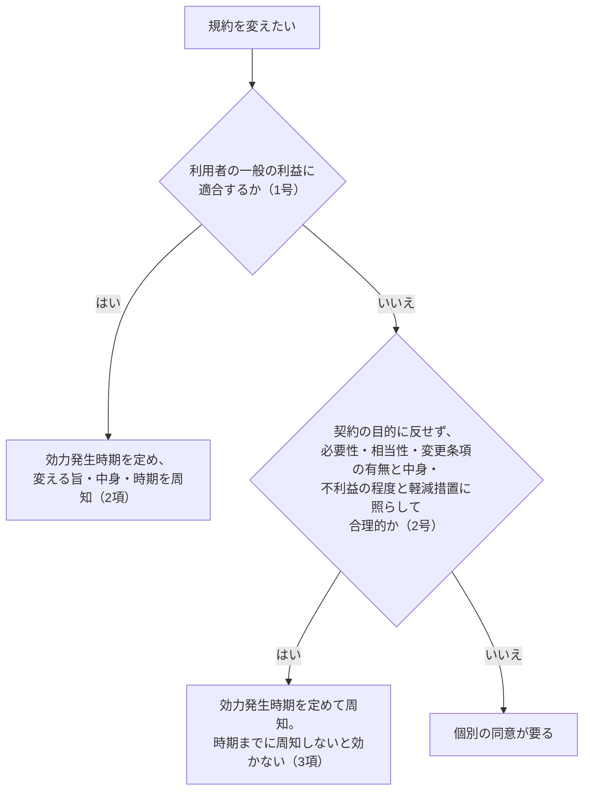
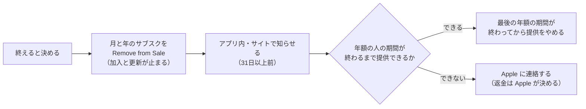

# 自前の利用規約に書く条項の効き目（責任の制限、定型約款の同意と変更、未成年、管轄、サービスの終わり方、健康の但し書き）

調査日: 2026-10-19
対象: 「利用規約と特商法の表記の中身を決める」（#593）のための下調べ。nu-tori は日本の個人開発者が日本の App Store だけに出す iPhone アプリで、月980円・年8,800円の自動更新サブスクを App Store のアプリ内課金だけで売る。支払いの登録なしの30日の無料体験をサーバーが数え、自動で有料には移らない。利用規約は `nu-tori.app` に置く。

> **確認の方法と限界**
> - 法令は e-Gov 法令 API（v2）で、調査日に施行されている版を取得した（消費者契約法・民事訴訟法・法の適用に関する通則法は 2026-06-24 施行の版、民法は 2026-06-24 施行の版、裁判所法・景品表示法・医師法・医薬品医療機器等法は 2026-05-21 施行の版）。まだ施行されていない改正も API の改正履歴で見た。
> - 消費者庁の「消費者契約法 逐条解説」（令和5年9月。第2章は令和5年12月差し替え）の第3条・第8条・第9条・第10条の PDF、消費者庁の「打消し表示に関する表示方法及び表示内容に関する留意点」（平成30年6月）、法務省の民法（債権関係）改正の説明資料「重要な実質改正事項」、厚生労働省の「プログラムの医療機器該当性に関するガイドライン」（令和5年3月31日一部改正）と「オンライン診療の適切な実施に関する指針」（令和4年1月一部改訂の版。令和8年4月に改訂があったことは概要資料で見たが、本体の新版は読んでいない）を読んだ。
> - 判例は裁判所の裁判例検索の詳細ページ（判示事項と裁判要旨）を読んだ。全文は読んでいない。
> - Apple は、Apple Developer Program License Agreement（以下 DPLA。調査日に developer.apple.com で配られていた版）、App Store Connect ヘルプ、StoreKit のドキュメント（JSON）、Apple Media Services 利用規約の日本版（最終更新日 2026年9月14日）、Apple サポートの日本語ページを読んだ。
> - 本文で確かめた主張は「本文で確認」、本文から推し量ったもの（nu-tori への当てはめのほとんど）は「本文からの読み取り」、探しても書かれていなかったものは「記述なし」と書く。英語の本文は原文のまま引き、訳はこの文書で付けた。
> - **この文書は法律の専門家の見解ではなく、法律相談の代わりにならない。** 条項が裁判でどう判断されるかは、個別の事情による。規約を確定する前に専門家に見てもらうかは開発者が決める。
> - 二次情報（解説記事、法律事務所のブログ、Wikibooks、開発者フォーラム）は根拠にしていない。検索エンジンは一次資料の URL を探すためだけに使った。
> - 既存の調査と重ねない。特定商取引法の表示と課金画面・標準 EULA・Apple が代理人であることは `docs/research/app-store-subscription.md`、個人での提出・健康の表示（App Review 1.4.1）・Terms of Use へのリンクの要件はブランチ `research/release-legal` の `docs/research/release-legal.md` にある。

## 結論の要約

- **問い1（責任の制限）**: 「一切責任を負わない」は全部免除で無効（8条1項1号・3号）。上限を決める一部免除は、**「当方に故意又は重大な過失がある場合を除き」か「軽過失に限り」を条項の中に書けば**、8条1項2号・4号にも8条3項にも当たらない（逐条解説の事例8-7と8条3項の注）。「法律上許される限り」は8条3項で無効（事例8-19）。逐条解説には「実際に支払いがあった額を超えない」という上限の例がそのまま載っている【本文で確認 L1, C2】。ただし、**無料体験の人は払った額が0円なので、上限が「払った額」だけだと実質は全部免除になる**【本文からの読み取り】。生命・身体の損害の制限と、90％を免除するような制限は10条で無効になりうる【本文で確認 C4, C2】。1か月か12か月かを決める基準は記述なし。
- **問い2（定型約款）**: 「定型約款を契約の内容とする旨」に合意するか、あらかじめ表示していれば、読んでいなくても個々の条項に合意したとみなされる（548条の2第1項）。不当な条項は合意しなかったとみなされる（同2項）【本文で確認 L2】。利用者の同意なしの変更は、利用者の一般の利益に合うとき、または契約の目的に反せず合理的なときにでき、どちらでも**効力発生時期を定めて、変える旨・変えたあとの中身・効力発生時期をインターネットなどで周知**する。後者は**効力発生時期までに周知しないと効かない**（548条の4）。変更の条項の有無と中身は、合理性を判断する事情の一つにすぎない【本文で確認 L2, M1】。
- **問い3（未成年）**: 18歳未満が法定代理人の同意なしに結んだ契約は取り消せる（民法4条・5条）。規約に「18歳未満は保護者の同意を得ること」と書いても取消権は消えない。取消しができなくなるのは、未成年が成年と信じさせる**詐術**を使ったときだけで、黙っていただけでは詐術に当たらない（最判昭和44年2月13日）【本文で確認 L2, K1】。Apple の「承認と購入のリクエスト」は13歳未満で既定で有効、18歳未満まで使え、保護者が承認しないと App 内課金は行われない【本文で確認 A4, A5】。これが民法上の法定代理人の同意に当たるかを Apple は書いていない【記述なし】。
- **問い4（準拠法と管轄）**: 国内の訴えは、第一審に限り、書面（電磁的記録を含む）で専属的な管轄を合意できる（民事訴訟法11条）。ただし合意した専属管轄でも、著しい遅滞や当事者間の衡平のために他の裁判所に移すことができる（17条・20条）【本文で確認 L3】。外国の利用者との管轄の合意は、契約時の消費者の住所の国の裁判所を指すときなどに限って効く（3条の7第5項）【本文で確認 L3】。準拠法を日本法にするのは妨げられない（通則法7条・11条）【本文で確認 L4】。管轄の条項が消費者契約法10条で無効になるかを書いた消費者庁の記述は見つからなかった【記述なし】。
- **問い5（サービスの終わり方）**: **開発者は返金できない**（DPLA の Attachment 2 の 3.4「You will not issue any refunds to end users」）。返金は Apple が決める【本文で確認 A1】。サブスクを終えるときは App Store Connect で **Remove from Sale** にすると、新しい加入と**更新**が止まる。止めてから提供をやめるまで最低31日、期間の長さと同じだけ置くのを勧め、1か月より長いサブスク（年8,800円）で期間の終わりまで提供できないなら Apple に連絡する【本文で確認 A2】。アプリを販売停止にしたときにサブスクの更新がどうなるかは、アプリの販売停止のページには書かれていない【記述なし A3】。
- **問い6（健康の但し書き）**: 「医療機器ではない」「診断に使わない」と**書くこと自体は、医療機器に当たらない根拠にならない**（厚生労働省のガイドラインの脚注12）。一般的な食事・運動・体重管理のアドバイスは非該当の例【本文で確認 H1】。景品表示法の判断は表示全体で決まり、強調した表示を規約の但し書きで打ち消すことはできないと読める【本文からの読み取り C5】。医師法は「医業」を医師に限るだけで、アプリへの当てはめの基準は条文にない。オンライン診療指針の「一般的な医学的な情報の提供」と「個別の状態を踏まえた診断」の線引きが参考になる【本文からの読み取り L7, H2】。

## 問い1: 責任の制限はどう書くと無効になり、どう書けば有効と読めるか

### 条文（消費者契約法、2026-06-24 施行の版）【L1】

| 条 | 中身 | 確かさ |
|---|---|---|
| 2条2項 | 「事業者」には「事業として又は事業のために契約の当事者となる場合における個人」を含む。個人開発者が売るサブスクも消費者契約 | 本文で確認 |
| 8条1項1号・3号 | 債務不履行・不法行為の責任の**全部を免除**する条項、または**責任の有無を事業者が決める**条項は無効 | 本文で確認 |
| 8条1項2号・4号 | **故意・重大な過失**による責任の一部を免除する条項、または責任の限度を事業者が決める条項は無効 | 本文で確認 |
| 8条2項 | 有償契約で、引き渡したものの不適合について、追完や代金の減額の責任を負うと定めていれば、1項1号・2号は適用しない | 本文で確認 |
| 8条3項 | 軽過失による責任の一部を免除する条項で、「重大な過失を除く過失による行為にのみ適用されることを明らかにしていないもの」は無効（2023年6月1日施行の改正で足された） | 本文で確認 |
| 8条の2 | 事業者の債務不履行で生じた消費者の解除権を放棄させる、または解除権の有無を事業者が決める条項は無効 | 本文で確認 |
| 8条の3 | 後見開始・保佐開始・補助開始の審判を受けたことだけを理由に事業者が解除できる条項は無効。**2028-12-23 施行の改正で「補助開始の審判又は特定補助人を付する処分の審判」に変わる**（令和8年法律第46号、未施行） | 本文で確認 |
| 9条1項1号 | 解除に伴う損害賠償の予定・違約金は、平均的な損害の額を超える部分が無効 | 本文で確認 |
| 10条 | 任意規定より消費者の権利を制限し義務を重くする条項で、信義則に反して消費者の利益を一方的に害するものは無効。例として「消費者の不作為をもって…申込み又はその承諾の意思表示をしたものとみなす条項」を挙げる | 本文で確認 |
| 3条1項1号 | 条項は、解釈に疑義が生じない明確なもので、消費者にとって平易なものになるよう配慮する（努力義務） | 本文で確認 |
| 3条1項3号 | 定型約款を使う契約の勧誘では、定型約款を容易に知り得る状態に置いていないときは、表示請求（民法548条の3）に要る情報を提供する（努力義務、2023年改正で追加） | 本文で確認 |
| 3条1項4号 | 消費者の求めに応じて、契約で定めた解除権の行使に要る情報を提供する（努力義務、2023年改正で追加） | 本文で確認 |

### 消費者庁の逐条解説の事例【C2】

| 事例 | 条項 | 消費者庁の考え方 | 確かさ |
|---|---|---|---|
| 8-1〜8-3 | 「いかなる理由があっても一切損害賠償責任を負わない」など | 全部免除で無効。無効になると特約が無かったことになり、民法の原則どおり責任を負う | 本文で確認 |
| 8-4 | 「天災等事業者の責に帰すべき事由によらない損害については賠償責任を負わない」 | もともと負わない責任を確かめただけなので無効にならない | 本文で確認 |
| 8-5 | 「いかなる理由があっても事業者の損害賠償責任は○○円を限度とする」 | 故意・重過失でも限度をかけるので1項2号・4号で無効 | 本文で確認 |
| 8-6 | 通常損害は負うが特別損害は負わない | 同じく一部免除で無効 | 本文で確認 |
| 8-7 | 「事業者に故意又は重大な過失がある場合を除き、損害賠償責任は○○円を限度とする」 | 1項2号・4号に当たらず、8条3項にも当たらず、無効とはならない | 本文で確認 |
| 8-9 | 人的損害は負うが物的損害は一切負わない | 物的損害だけが生じたときは全部免除になるので無効 | 本文で確認 |
| 8-11 | 一切負わないが、会社の調査で過失を認めたら補償する | 責任の有無を事業者が決める条項で無効 | 本文で確認 |
| 8-12 | 上限10万円。ただし故意・重過失があると**当社が認めたとき**は全額 | 責任の限度を事業者が決める条項で無効 | 本文で確認 |
| 8-18 | ソフトウェアの不適合は交換・修補・代金返還で対応する | 有償のソフトウェアで不適合の損害賠償を全部免除するのは無効になりうるが、交換・修補などで対応すると定めていれば8条2項1号で無効にならない | 本文で確認 |
| 8-19 | 「法律上許される限り、賠償限度額を〇万円とする」 | 一般的・平均的な消費者に軽過失の場合に限ると明らかでなく、8条3項で無効。「関連法令により許される限り」も同じ | 本文で確認 |
| （8-5の考え方） | 損害賠償責任の90％を免除する条項 | 全部免除ではないので8条1項1号・3号には当たらないが、10条で無効となりうる | 本文で確認 |

8条3項の解説は、有効な書き方の例として次の2つを挙げる【本文で確認 C2】。

> 「弊社に軽過失がある場合に限り、弊社がユーザーに負う責任は、ユーザーから実際に支払いがあった検定受験料の額を超えるものではないとします。」
> 「弊社に故意又は重大な過失がある場合を除き、弊社がユーザーに負う責任は、ユーザーから実際に支払いがあった検定受験料の額を超えるものではないとします。」

判断の基準は「免責条項がいわゆる軽過失の場合のみ適用されることが一般的・平均的な消費者にとって明らかになっているか否か」で、重過失か軽過失かは「最終的には個別具体の事情を踏まえた裁判所での判断に委ねられる」【本文で確認 C2】。分離可能性条項（一部が無効でも残りは有効とする条項）は8条3項の対象ではない【本文で確認 C2】。

10条の解説は、生命・身体の侵害による損害賠償責任を免除する条項は、軽過失の一部免除でも10条で無効となりうるとし、故意・重過失以外は治療費等の直接損害に限るとした条項を無効の疑いありとした札幌高判平成28年5月20日を挙げる（事例10-6）【本文で確認 C4】。証明責任を消費者に重くする条項（事例10-3）、解除の方法を限る条項（事例10-5）、送った情報の権利を放棄したとみなす条項（事例10-7）も10条で無効となりうる例に挙がっている【本文で確認 C4】。

3条1項1号について、逐条解説は、事業者を救うために条項に文言を補って限定して解釈することは「極力控えるのが相当」とした東京高判令和2年11月5日と、適格消費者団体の差止めで条項の限定解釈を否定した最一判令和4年12月12日（民集76巻7号1696頁）を挙げる【本文で確認 C1, K2】。

### 9条（解約と返金）【C3】

9条1項1号は、解除に伴う損害賠償の予定・違約金のうち「平均的な損害の額」を超える部分を無効にする。逐条解説は、大学の入学時納付金の不返還特約をこの号で判断した最高裁判決を挙げる【本文で確認 C3】。nu-tori は解約の違約金を取らず、返金は Apple が決める（問い5）ので、9条が問題になる場面は少ないと読める【本文からの読み取り】。

### nu-tori への当てはめ（本文からの読み取り）

- 上限を書くなら、事例8-7と8条3項の注の形にそろえる。「当方に故意又は重大な過失がある場合を除き」を、上限の文と同じ条項の中に書く。「法令で許される範囲で」は使わない。
- **無料体験の人**: 30日の無料体験の間は払った額が0円。「直近に払った額を上限とする」だけだと上限が0円になり、実質は全部免除（8条1項1号・3号）と読まれるおそれがある。無料の契約でも消費者契約である（2条3項は有償を要件にしていない）。8条2項の例外は有償契約に限られる。上限を書くなら「直近12か月に払った額、または○円のいずれか高いほう」のように、0円にならない下限を付けるのが安全側。下限の額を決める基準は消費者庁の資料に無い。
- **1か月か12か月か**: どちらがよいかを書いた一次資料は無い【記述なし】。年8,800円の人は12か月分で年額、月980円の人は1か月分で980円になる。上限が低いほど10条の「一方的に害する」に近づくと読めるが、額の目安は書かれていない。
- **生命・身体**: 食事と体重の目安を出すアプリなので、上限の条項から「生命又は身体の損害」を外すほうが10条の事例10-6に沿う。
- **事業者が責任の有無を決める書き方**（「当方が過失を認めた場合に限り」）は避ける（事例8-11・8-12）。
- **解除の方法**: 解約は Apple のサブスクリプションの管理で行う。規約で解約の方法を他に限らない（事例10-5）。3条1項4号のため、規約か FAQ に解約の手順を書いておく。
- **変更への同意を「使い続けたら同意したとみなす」とする書き方**は、10条の例示（不作為で承諾したとみなす条項）に近い。変更は民法548条の4に沿って行う（問い2）。

## 問い2: 定型約款として合意したとみなされる条件と、同意なしに変えられる条件

### 条文（民法、2026-06-24 施行の版）【L2】

| 条 | 中身 | 確かさ |
|---|---|---|
| 548条の2第1項 | 定型取引を行う合意をした者は、(1) 定型約款を契約の内容とする旨の合意をしたとき、(2) 定型約款準備者が**あらかじめ**その定型約款を契約の内容とする旨を相手方に**表示していた**ときは、個別の条項にも合意したものとみなす | 本文で確認 |
| 548条の2第2項 | 相手方の権利を制限し義務を重くする条項で、定型取引の態様・実情・取引上の社会通念に照らして信義則に反して相手方の利益を一方的に害すると認められるものは、合意しなかったものとみなす | 本文で確認 |
| 548条の3第1項 | 定型取引合意の前、または後の相当の期間内に請求があれば、遅滞なく相当な方法で中身を示す。書面か電磁的記録をすでに渡していれば要らない | 本文で確認 |
| 548条の3第2項 | 合意の前の請求を拒んだら548条の2は適用しない（一時的な通信障害など正当な事由があるときは別） | 本文で確認 |
| 548条の4第1項 | (1) 相手方の一般の利益に適合するとき、または (2) 契約の目的に反せず、変更の必要性、変更後の内容の相当性、**変更をすることがある旨の定めの有無及びその内容**その他の事情に照らして合理的なときは、個別の合意なしに変えられる | 本文で確認 |
| 548条の4第2項 | 変えるときは、効力発生時期を定め、変える旨、変更後の内容、効力発生時期を「インターネットの利用その他の適切な方法により周知しなければならない」 | 本文で確認 |
| 548条の4第3項 | 1項2号による変更は、効力発生時期が来るまでに周知しなければ効力を生じない | 本文で確認 |
| 548条の4第4項 | 548条の2第2項（不当条項の除外）は変更には適用しない | 本文で確認 |

2029-06-23 施行分までの未施行の民法改正で、4条・5条・21条・548条の2〜548条の4の文言は変わらない（API の未施行版と比べた）【本文で確認】。

### 法務省の説明資料【M1】

- 定型約款に当たる例として「インターネットサイトの利用規約」を挙げる【本文で確認】。
- 548条の2第1項2号の「表示」について「（取引に際して）定型約款を契約の内容とする旨をあらかじめ相手方に『表示』していた場合」と書く【本文で確認】。
- 不当条項の例として「想定外の別の商品の購入を義務付ける不当な（不意打ち的）抱合せ販売条項など」を挙げる【本文で確認】。
- 変更の合理性の「その他の変更に係る事情」として「相手方に与える不利益の内容・程度、不利益の軽減措置の内容など」を挙げる【本文で確認】。
- 改正前は「この約款は当社の都合で変更することがあります。」との条項の有効性は「見解が分かれている」と書く【本文で確認】。

### 消費者庁の逐条解説（3条1項3号）【C1】

「容易に知り得る状態に置く措置」の例として「オンライン取引であれば、契約締結画面までの間に画面上で認識可能な形で定型約款のリンクを表示し、そのリンクをクリックすると定型約款の内容が表示されるようにすること」を挙げる【本文で確認】。

### 変更の流れ

### nu-tori への当てはめ（本文からの読み取り）

- **同意の画面**: 支払いは Apple の購入のシートで行うので、nu-tori の画面で規約に触れられるのは、最初の起動（アカウントの作成）と課金画面。548条の2第1項1号の合意にするなら、アカウントを作る画面に「利用規約に同意して始める」のように「規約を契約の内容とすること」に同意させるボタンを置き、規約へのリンクをその画面の中に出す。課金画面にも規約へのリンクがあれば（Apple がもともと求める）、2号の「表示」も重ねて満たすと読める。
- **「表示していた」の条件**: 法務省の資料は「取引に際して」「あらかじめ」と書く。サイトの片隅に置いただけで、取引の画面に何も出していない場合は「表示」と言いにくい。
- **表示請求**: 規約を `nu-tori.app` に常に載せ、画面からリンクしていれば、548条の3の請求にも3条1項3号にもこたえられる。
- **変更の条項**: 548条の4は変更の条項が無くても変更を認めるが、その有無と中身は合理性の判断に入る。規約に「548条の4に基づき変更することがある」「変更するときは効力発生日と変更後の中身を、効力発生日の○日前までにアプリ内と `nu-tori.app` で知らせる」と書いておくと、2号の判断で有利な事情になる。何日前かの基準は法令にも法務省の資料にも無い【記述なし】。
- **価格の変更**: 価格は Apple の仕組みの中で変わり、Apple の利用規約は「サブスクリプションの価格が上がった場合はお客様に通知され、必要な場合には、継続に際してお客様の同意が必要となります」と書く【本文で確認 A4】。規約の変更で値上げを同意なしに通す形にはしないほうが、Apple の扱いとそろう。

## 問い3: 未成年と、アプリ内課金

### 条文と判例

| 出典 | 中身 | 確かさ |
|---|---|---|
| 民法4条 | 「年齢十八歳をもって、成年とする。」 | 本文で確認 L2 |
| 民法5条1項・2項 | 未成年者の法律行為は法定代理人の同意が要り、反すると取り消せる。ただし「単に権利を得、又は義務を免れる法律行為」は別 | 本文で確認 L2 |
| 民法5条3項 | 法定代理人が目的を定めて処分を許した財産は、その目的の範囲で自由に処分できる。目的を定めないで許した財産も同じ | 本文で確認 L2 |
| 民法21条 | 行為能力者であると信じさせるため詐術を用いたときは取り消せない | 本文で確認 L2 |
| 最一判昭和44年2月13日（民集23巻2号291頁） | 「無能力者であることを黙秘することは、無能力者の他の言動などと相まつて、相手方を誤信させ、または誤信を強めたものと認められるときには、民法二〇条にいう『詐術』にあたるが、黙秘することのみでは右詐術にあたらない。」（当時の20条は今の21条） | 本文で確認 K1 |

### Apple の文書

| 項目 | 中身 | 確かさ |
|---|---|---|
| Apple Account の年齢 | 「13歳以上…である必要があります。最低年齢に達していないユーザーのApple Accountは、親権者または法定後見人が『ファミリー共有』を使用して作成する」 | 本文で確認 A4 |
| ファミリー共有の支払い | 管理者の支払い方法を使うとき「ファミリーメンバーが管理者の代理人として行っているものとします」。管理者は「家族が行った取引は承認されたものであること」に同意する | 本文で確認 A4 |
| 承認と購入のリクエスト | 「18歳…未満のファミリーメンバーが行った取引を管理者が承認するための機能」。13歳未満は既定で有効。管理者は親権者か法定後見人 | 本文で確認 A4 |
| しくみ | App 内課金をしようとすると保護者に通知が届き、「リクエストを却下すると、購入もダウンロードも行われません」。「アプリの対象年齢とは関係なく」承認を求める。地域によっては18歳未満で既定で有効になり無効にできない | 本文で確認 A5 |
| スクリーンタイム | 「承認と購入のリクエスト」で、お子様が購入できるものを承認制にできる | 本文で確認 A6 |
| 年齢区分 | App Store Connect の年齢区分は「parental controls」のための項目で、中身（content descriptors）と機能から Apple が決める | 本文で確認 A8 |
| Declared Age Range | 年齢の範囲を本人か保護者から共有してもらう API。「You are solely responsible for ensuring compliance with associated laws or regulations」 | 本文で確認 A7 |
| 承認が民法上の法定代理人の同意に当たるか | 書かれていない | 記述なし |

### nu-tori への当てはめ（本文からの読み取り）

- 規約に「18歳未満の方は保護者の同意を得て使う」と書くことは、**取消しを防ぐ効果を持たない**。意味があるのは、(1) 同意を得るよう促すこと、(2) 未成年が「同意を得ている」と積極的に偽ったときに、詐術（21条）の事情の一つになりうること、の2つ。チェックを付けさせただけで詐術になるかを判断した最高裁判決は見つからなかった【記述なし】。黙っていただけでは詐術でない（K1）ので、規約の一文だけに頼れない。
- 「承認と購入のリクエスト」で保護者が承認した課金は、保護者が自分の Apple Account で認証して承認する（A5）ので、法定代理人の同意があったと読みやすい。管理者の支払い方法で払うときは、ファミリーメンバーは管理者の代理人として行うと Apple の規約は書く（A4）。ただし nu-tori の側からは、承認があったかどうかは見えない。
- 980円の月額が、親から渡された小遣い（5条3項）の範囲の処分と言えるかは事情による。
- 30日の無料体験は支払いの義務を負わないので、「単に権利を得」る行為に近いと読めるが、規約全体（責任の制限など）を受け入れる契約でもあるので、言い切れない。
- 取り消されたときに返すお金は、返金の仕組み（問い5）で Apple を通る。

## 問い4: 準拠法と裁判の管轄

### 条文

| 条 | 中身 | 確かさ |
|---|---|---|
| 民事訴訟法4条1項・2項 | 訴えは被告の普通裁判籍（人は住所）の裁判所に属する | 本文で確認 L3 |
| 民事訴訟法5条1号 | 財産権上の訴えは義務履行地にも出せる | 本文で確認 L3 |
| 民事訴訟法11条 | 「第一審に限り、合意により管轄裁判所を定めることができる」。一定の法律関係に基づく訴えに関し書面でする。電磁的記録でしたものは書面とみなす | 本文で確認 L3 |
| 民事訴訟法17条 | 管轄があっても、当事者・証人の住所その他の事情から、著しい遅滞を避け、または当事者間の衡平を図るため必要なら、他の管轄裁判所に移送できる | 本文で確認 L3 |
| 民事訴訟法20条1項 | 専属管轄なら17条などの移送をしないが、「当事者が第十一条の規定により合意で定めたものを除く」 | 本文で確認 L3 |
| 民事訴訟法3条の4第1項 | 消費者から事業者への訴えは、提起の時か契約の時の消費者の住所が日本にあれば日本の裁判所に出せる | 本文で確認 L3 |
| 民事訴訟法3条の7第5項 | 将来の消費者契約の紛争についての国際的な管轄の合意は、(1) 契約の時に消費者が住所を有していた国の裁判所を指す合意（専属としても、他の国にも出せる合意とみなす）、(2) 消費者がその合意に基づいて訴えたか、合意を援用したとき、に限り効く | 本文で確認 L3 |
| 裁判所法33条1項1号 | 140万円以下の請求は簡易裁判所が第一審 | 本文で確認 L5 |
| 民事訴訟法368条 | 60万円以下の金銭の請求は簡易裁判所で少額訴訟を求められる | 本文で確認 L3 |
| 法の適用に関する通則法7条・11条 | 当事者が選んだ地の法による。消費者の常居所地法以外を選んでも、消費者が常居所地法の強行規定を適用すべき旨を示せば、その強行規定も適用する | 本文で確認 L4 |
| 管轄の合意と消費者契約法10条 | 消費者庁の逐条解説（3条・8条・9条・10条）に管轄の記述は無い | 記述なし C1〜C4 |

### nu-tori への当てはめ（本文からの読み取り）

- 準拠法を日本法とする条項は、日本の App Store だけで売る nu-tori では、書いても書かなくても結果はほぼ同じ。
- 「開発者の住所地を管轄する裁判所を第一審の専属的合意管轄裁判所とする」は11条で書ける。ただし、遠方の利用者に不公平なら17条で移送されうる（20条が合意の専属管轄を移送の制限から外している）ので、裁判所を一つに固定できるとは限らない。
- 「地方裁判所」とだけ書くと、140万円以下の請求で簡易裁判所（少額訴訟を含む）を使う道をふさぐ書き方になる。nu-tori の取引額なら、争いはほぼ全部が簡易裁判所の額になる。「簡易裁判所又は地方裁判所」と書くのが自然。
- 利用者が外国に住んでいる場合、日本の裁判所を指す合意は、契約時にその人が日本に住んでいたときに限り効く（3条の7第5項1号）。日本の App Store のアカウントなので多くは日本に住んでいると見込めるが、確かめる手段は無い。
- 管轄の条項が10条で無効になった判例は、今回は探していない。

## 問い5: サービスを終える・サブスクの販売をやめるとき

### Apple の文書

| 項目 | 中身 | 確かさ |
|---|---|---|
| 開発者の返金 | DPLA の Attachment 2（Additional Terms for Use of the In-App Purchase API）の 3.4「You will not issue any refunds to end users of Your Application, and You agree that Apple may issue refunds to end users in accordance with the terms of Schedule 2.」（あなたはアプリの利用者に返金しない。Apple が Schedule 2 に沿って返金できることに同意する） | 本文で確認 A1 |
| Apple の返金 | Schedule 2 の 6.3。利用者が90日以内（または自動更新の期間が90日より短ければその期間の終わりまで）に取消しを求めたとき、またはアプリが仕様・保証・法令の要件に合わないとき、「Apple may refund to the End-User the full amount of the price paid」。返金した額は開発者が払い戻す | 本文で確認 A1 |
| 提供しきれないとき | Schedule 2 の 3.8(c)「You must fulfill the offer during the entire subscription period, as marketed」。破ると Apple が全額か一部を Apple の判断で返金するよう指示したことになる | 本文で確認 A1 |
| 返金の窓口 | 利用者は Apple のサポート、`reportaproblem.apple.com`、支払い手段の発行者に返金を求める | 本文で確認 A9 |
| サブスクを終える前 | 「Before discontinuing an auto-renewable subscription, remove it from sale, within App Store Connect, to stop additional sign-ups and renewals.」（新しい加入と更新を止めるため、先に販売をやめる） | 本文で確認 A2 |
| 置く期間 | 「We recommend timing the removal of your subscription to be equivalent to its duration. A minimum of 31 days is required from the date subscription is removed from sale and service is stopped」（期間の長さと同じだけ置くのを勧める。販売をやめてから提供をやめるまで最低31日） | 本文で確認 A2 |
| 1か月より長いサブスク | 「if you're unable to provide the full amount of content to eligible subscribers through the subscription duration before removing the subscription, contact us.」 | 本文で確認 A2 |
| 知らせ | メール、サイト、アプリ内で前もって知らせる。「at least 31 days before」を勧める。宣伝はやめる | 本文で確認 A2 |
| 地域を外す | 地域を外すのはアカウント保有者だけ。「this will impact existing subscribers」 | 本文で確認 A2 |
| アプリの販売停止 | 24時間以内にすべての地域の App Store から消える。ダウンロード済みの人はアップデートを受け取り続け、購入履歴から再ダウンロードできる | 本文で確認 A3 |
| アプリの販売停止とサブスクの更新 | アプリの販売停止のページには、サブスクの更新がどうなるか書かれていない。アプリを消す（Remove App）前には、App 内課金を販売停止にするよう書かれている | 記述なし（更新について） A3 |
| 日割りの返金 | 開発者が日割りで返金する仕組みは無い（3.4）。Apple の利用規約の、継続を求めるサブスクの返金は「支払い済みであるがまだ提供されていないアクセス期間のみを対象」と書くが、これは12か月の継続を約束する月払いの話 | 本文で確認 A1, A4 |

### nu-tori への当てはめ（本文からの読み取り）

- 規約に「サービスを終えるときは、残りの期間の日割りで返金する」とは書けない。開発者は返金しないと Apple と約束している。書くなら「返金は Apple の定めに従い、Apple が判断する」。
- 年8,800円の人がいるかぎり、提供をやめる前に最長で1年近く Remove from Sale の期間を置くか、Apple に連絡する必要がある。規約には「終えるときは○日前までに知らせる」と書き、その日数は Apple の勧める31日以上にする。
- 「どんな理由でも返金しない」と規約に書くと、事業者の都合で提供をやめたときの債務不履行の解除（8条の2）や10条と合わない。提供を期間の途中でやめることは、Schedule 2 の 3.8(c) にも反する。
- アプリだけ販売停止にしてもサブスクの更新が止まると書いた文書は無いので、終えるときはサブスク自体を Remove from Sale にする。

## 問い6: 「医療の助言ではない」「推定値は目安」と書く意味

| 出典 | 中身 | 確かさ |
|---|---|---|
| 医薬品医療機器等法2条4項 | 「医療機器」は、疾病の診断・治療・予防に使うこと、または身体の構造・機能に影響を及ぼすことが目的とされている機械器具等（プログラムを含む）で政令で定めるもの | 本文で確認 L8 |
| 同68条 | 承認前の医療機器の名称・効能・効果・性能の広告の禁止 | 本文で確認 L8 |
| プログラムの医療機器該当性ガイドライン 脚注12 | 「『当該プログラムは、疾病の診断、治療又は予防に使用されることを目的としていない』又は『当該プログラムは医療機器ではない』旨の記載、表示があることをもって、当該プログラムが医療機器ではないことの根拠とはならない。そのような記載があっても、疾病の疑いを判断できるなどと医療機器との認識を与える広告・標ぼうをする製品は医療機器に該当する。」 | 本文で確認 H1 |
| 同 フローチャート③C | 医療機器でない例として「健康な人の健康維持・増進のために、一般的な食事、運動、体重管理等の生活習慣に関するアドバイスを行うもの（情報提供にあたって、アドバイスの根拠が利用者に検証可能な形で示されることが望ましい）」 | 本文で確認 H1 |
| 同 フローチャート③A | 体重などの計測値の記録・閲覧のための表示・保管・転送だけのものは非該当 | 本文で確認 H1 |
| 医師法17条 | 「医師でなければ、医業をなしてはならない。」 | 本文で確認 L7 |
| オンライン診療指針（令和4年1月版） | 遠隔健康医療相談（医師以外）は「一般的な医学的な情報の提供や、一般的な受診勧奨に留まり、相談者の個別的な状態を踏まえた疾患のり患可能性の提示・診断等の医学的判断を伴わない行為」 | 本文で確認 H2 |
| 景品表示法5条1号・7条2項 | 実際より著しく優良と示す表示の禁止。消費者庁は合理的な根拠の資料を求められ、出さないと不当表示とみなされる | 本文で確認 L6 |
| 打消し表示の留意点 | 打消し表示は「強調表示だけでは一般消費者が認識できない例外条件、制約条件等がある場合に例外的に使用されるべきもの」で、強調表示と矛盾する場合や、小さい・離れていて気付けない場合は景品表示法上問題となるおそれ | 本文で確認 C5 |

**nu-tori への当てはめ（本文からの読み取り）**

- 規約の「医療の助言ではない」「推定値は目安」は、法的な位置づけを決めるものではなく、利用者への説明と、責任の範囲を分かりやすくするもの。医療機器に当たるかは、アプリと広告が何をうたうかで決まる（脚注12）。体重の傾向から1日の目安を出すのは「一般的な食事、運動、体重管理等の生活習慣に関するアドバイス」に近く、病気の疑いや診断をうたわなければ非該当の例に沿う。
- 医師法は、個別の状態から病気の可能性を示したり診断したりしなければ問題になりにくい、とオンライン診療指針の線引きから読める。指針は遠隔健康医療相談についての文書で、アプリそのものの基準ではない。
- 景品表示法は、App Store の説明文や LP で精度を強調し、規約の奥に「目安です」と書く形を問題にしうる。目安であることは、強調する表示のすぐ近くに書く。
- App Review の 1.4.1（精度の開示、医師に相談するよう促す）は `docs/research/release-legal.md` にある。

## 確かめられなかったこと

- 上限を「直近1か月」と「直近12か月」のどちらにするか、下限の額をいくらにするかの基準（消費者庁の資料に記述なし）。
- 規約の変更を何日前に周知すれば足りるかの基準（法令と法務省の資料に記述なし）。
- 「18歳以上か、保護者の同意を得ている」にチェックさせることが詐術になるかの最高裁判決。
- 「承認と購入のリクエスト」の承認が民法5条の同意に当たるかの公的な見解。
- 消費者相手の専属的合意管轄の条項を10条で無効とした判例（今回は探していない）。
- アプリだけを販売停止にしたときに、サブスクの自動更新が続くか止まるか（Apple の文書に記述なし）。
- 最一判令和4年12月12日と札幌高判平成28年5月20日の全文（逐条解説と判示事項だけを読んだ）。
- オンライン診療指針の令和8年4月の改訂版の本文。

## 出典

- L1: 消費者契約法（平成12年法律第61号。2026-06-24 施行の版と、2028-12-23 施行の未施行の版） — https://laws.e-gov.go.jp/law/412AC0000000061
- L2: 民法（明治29年法律第89号。2026-06-24 施行の版。2029-06-23 施行の未施行の版と比べた） — https://laws.e-gov.go.jp/law/129AC0000000089
- L3: 民事訴訟法（平成8年法律第109号。2026-06-24 施行の版） — https://laws.e-gov.go.jp/law/408AC0000000109
- L4: 法の適用に関する通則法（平成18年法律第78号。2026-06-24 施行の版） — https://laws.e-gov.go.jp/law/418AC0000000078
- L5: 裁判所法（昭和22年法律第59号） — https://laws.e-gov.go.jp/law/322AC0000000059
- L6: 不当景品類及び不当表示防止法（昭和37年法律第134号） — https://laws.e-gov.go.jp/law/337AC0000000134
- L7: 医師法（昭和23年法律第201号） — https://laws.e-gov.go.jp/law/323AC0000000201
- L8: 医薬品、医療機器等の品質、有効性及び安全性の確保等に関する法律（昭和35年法律第145号） — https://laws.e-gov.go.jp/law/335AC0000000145
- C1: 消費者庁「消費者契約法 逐条解説」第3条（令和5年9月） — https://www.caa.go.jp/policies/policy/consumer_system/consumer_contract_act/annotations/assets/consumer_system_cms203_230915_05.pdf
- C2: 同 第8条（本書134〜146頁） — https://www.caa.go.jp/policies/policy/consumer_system/consumer_contract_act/annotations/assets/consumer_system_cms203_230915_13.pdf
- C3: 同 第9条 — https://www.caa.go.jp/policies/policy/consumer_system/consumer_contract_act/annotations/assets/consumer_system_cms203_230915_16.pdf
- C4: 同 第10条 — https://www.caa.go.jp/policies/policy/consumer_system/consumer_contract_act/annotations/assets/consumer_system_cms203_230915_17.pdf
- （逐条解説の目次） — https://www.caa.go.jp/policies/policy/consumer_system/consumer_contract_act/annotations/
- C5: 消費者庁「打消し表示に関する表示方法及び表示内容に関する留意点（実態調査報告書のまとめ）」（平成30年6月） — https://www.caa.go.jp/policies/policy/representation/fair_labeling/pdf/fair_labeling_180607_0004.pdf
- M1: 法務省「民法（債権関係）改正 重要な実質改正事項」の「約款（定型約款）に関する規定の新設」 — https://www.moj.go.jp/content/001259610.pdf （掲載ページ: https://www.moj.go.jp/MINJI/minji06_001070000.html ）
- K1: 最一判昭和44年2月13日 民集23巻2号291頁（昭和42(オ)607） — https://www.courts.go.jp/hanrei/55084/detail2/index.html
- K2: 最一判令和4年12月12日 民集76巻7号1696頁（令和3(受)987） — https://www.courts.go.jp/hanrei/91599/detail2/index.html
- H1: 厚生労働省「プログラムの医療機器該当性に関するガイドラインの一部改正について」（令和5年3月31日 薬生機審発0331第1号・薬生監麻発0331第4号） — https://www.mhlw.go.jp/content/11120000/001082227.pdf （掲載ページ: https://www.mhlw.go.jp/stf/seisakunitsuite/bunya/0000179749_00004.html ）
- H2: 厚生労働省「オンライン診療の適切な実施に関する指針」（令和4年1月一部改訂の版） — https://www.mhlw.go.jp/content/12601000/000901835.pdf
- A1: Apple Developer Program License Agreement（Attachment 2 の 3.4、Schedule 2 の 3.8(c) と 6.3） — https://developer.apple.com/support/terms/apple-developer-program-license-agreement/
- A2: App Store Connect ヘルプ「Set availability for an auto-renewable subscription」 — https://developer.apple.com/help/app-store-connect/manage-subscriptions/set-availability-for-an-auto-renewable-subscription/
- A3: App Store Connect ヘルプ「Manage availability for your app on the App Store」「Remove an app」 — https://developer.apple.com/help/app-store-connect/manage-your-apps-availability/manage-availability-for-your-app-on-the-app-store/ 、 https://developer.apple.com/help/app-store-connect/create-an-app-record/remove-an-app/
- A4: Apple Media Services 利用規約（日本、最終更新日 2026年9月14日） — https://www.apple.com/jp/legal/internet-services/itunes/jp/terms.html
- A5: Apple サポート「『承認と購入のリクエスト』でお子様の購入やダウンロードを承認する」 — https://support.apple.com/ja-jp/105055
- A6: Apple サポート「ペアレンタルコントロールを設定してお子様のiPhoneやiPadを管理する」 — https://support.apple.com/ja-jp/105121
- A7: Apple Developer Documentation「Declared Age Range」 — https://developer.apple.com/documentation/declaredagerange
- A8: App Store Connect ヘルプ「Age ratings values and definitions」 — https://developer.apple.com/help/app-store-connect/reference/app-information/age-ratings-values-and-definitions/
- A9: Apple Developer Documentation「Handling refund notifications」 — https://developer.apple.com/documentation/storekit/handling-refund-notifications
